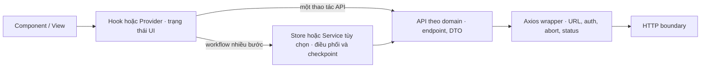

# Audit vòng đời Request/Response của Frontend

Phạm vi là working tree của `src/frontend` tại HEAD `f017663`, gồm các thay đổi có sẵn tại thời điểm đọc. Audit truy vết sâu hai luồng Management, rà các điểm gọi HTTP theo nhóm chức năng và chạy các test hiện có. Các mô tả dưới đây dựa trên source và test, còn phản hồi của server đang chạy, lưu lượng thật và thời gian tải chưa được đo. Mọi đường dẫn trong báo cáo tính từ `src/frontend`.

## 1. Hiện trạng kiến trúc

| Vị trí | Trách nhiệm và phụ thuộc đã thấy |
|---|---|
| `src/app/router/workbench-routes.tsx:47–54`, `src/views/application/application-frame.tsx:15–30` | React Router chọn màn hình. Frame ghép route với provider có phạm vi dữ liệu phù hợp và `PreviewSessionProvider`. |
| `src/components`, `src/views`, `src/hooks/preview` | UI nhận thao tác. `usePreviewSession` đọc snapshot và điều phối phản hồi cho người dùng. `usePreviewStore` nối React với external store bằng `useSyncExternalStore`. |
| `src/services/management/management.store.ts` | Store vừa giữ snapshot và checkpoint, vừa khai báo endpoint, đọc phân trang, ánh xạ DTO và điều phối ghi nhiều bước. |
| `src/services/{auth,health,users,management,processing}` | Nhóm hàm gọi API tập trung vào endpoint hoặc ánh xạ dữ liệu. Một số module mang tên Service nhưng thực hiện vai trò API Layer. |
| `src/lib/axios-client.ts`, `src/lib/api-error.ts`, `src/configs/api.config.ts` | Axios thực hiện HTTP. Wrapper quản lý URL, timeout, auth, abort, định dạng phản hồi và lỗi. `src/types/api/api.types.ts` định nghĩa giao diện transport. |
| `src/lib/openapi.json`, `src/types/services-type` | Snapshot contract và các kiểu sinh từ schema. TypeScript kiểm tra lúc biên dịch. Guard hoặc mapper kiểm tra dữ liệu khi ứng dụng chạy. |
| `src/lib/query-client.ts`, `src/app/provider/app-providers.tsx` | Có TanStack Query ở bootstrap. Hai trace bên dưới cập nhật bằng store và React subscription. |

**Danh mục đường gọi.** Rà các điểm gọi `ApiClient.request`, khởi tạo Axios và dấu hiệu transport trực tiếp trong `src`. Các nhóm tìm được gồm auth/account (login, refresh, logout, đăng ký và mật khẩu), health, users, Management store (workspace, project, membership, thông báo, issue, profile, session), admin, dataset/records, recent projects, analysis/report/feedback. `app-runtime.ts:23–34`, `management-data-provider.tsx:50–58` và `account.service.ts:6–10` khởi tạo wrapper với các phạm vi token khác nhau. Google sign-in chuyển trang bằng `window.location.assign` ở `google-sign-in.ts:9`. Shopping demo dùng adapter/fixture riêng. Trong điểm gọi đã rà, Axios được tạo trong wrapper và hai trace dùng cùng cơ chế. Rà imports trực tiếp tại các module được truy vết chưa thấy vòng phụ thuộc runtime. Cạnh `analysis.service.ts:2` sang kiểu Management là type-only. Kết quả này chưa chứng minh toàn bộ đồ thị import phi chu trình.

## 2. Truy vết Request/Response

### GET · Mở danh sách project của Management

| Bước | Bằng chứng và dữ liệu |
|---|---|
| Vào route | `ApplicationFrame` ghép `ManagementDataProvider` với màn hình. `SessionDataProvider` kiểm tra trạng thái authenticated, tạo client đọc token từ phiên cùng account, rồi gọi `data.load()` trong effect. Đổi scope/phiên khiến cleanup abort và dispose store. (`application-frame.tsx:15–30`, `management-data-provider.tsx:39–81`) |
| Store → endpoint | `createManagementStore` xuất `load`, gọi `loadWorkspaces` qua `load()`. `pages` gửi GET `/workspaces?page=1&limit=100`, rồi GET `/projects?limit=100`. Các trang tiếp theo dùng cursor hoặc số trang theo response. GET có params, signal và không có body. Index project trả 404 thì thử danh sách project theo workspace. Sau đó lấy members/dataset theo từng project. (`management.store.ts:186–256,264–279,626–630`) |
| HTTP | `request` đặt `auth: 'session'`, ghép tín hiệu hủy request và lifecycle. `createAxiosClient.request` chọn GET mặc định, resolve path dưới base đã cấu hình, thêm Authorization Bearer, chuyển params và signal sang Axios. Snapshot khai báo đường workspace/project dưới `/api/v1`. (`management.store.ts:95–109`, `axios-client.ts:82–127`, `openapi.json:708,1335`) |
| Phản hồi | Axios xử lý HTTP status theo cấu hình instance. Wrapper mở envelope thành công thành `data`. `pages` kiểm tra danh sách và tiến trình phân trang. `loadWorkspaces` kiểm tra revision, ánh xạ DTO, cập nhật version và publish snapshot. Lần tải đầu của provider còn chờ `loadPersonal`, gồm profile, notification, issue và unread count. Provider nắm lỗi và hiển thị trạng thái retry. (`axios-client.ts:129–134`, `management.store.ts:186–208,279–313,354–372,628–630`, `management-data-provider.tsx:69–75,96–103`) |
| Render | Context cấp store cho `usePreviewStore`. React subscribe vào `store.subscribe/getState`. `usePreviewSession` đưa snapshot vào session model. `ProjectsPreviewView` nhận projects, lọc theo workspace, sắp xếp và cắt trang để render. (`use-preview-store.ts:11–15`, `use-preview-session.ts:40–51`, `projects.view.tsx:95–114,155`) |

Điểm khác sơ đồ mục tiêu là GET tự động khi vào trang do provider khởi tạo bằng effect. Hook ở phía đọc state giúp render lại. Hai trách nhiệm này có thể giữ nguyên nếu tách cách tải tài nguyên theo scope.

### POST · Tạo project qua wizard

| Bước | Bằng chứng và dữ liệu |
|---|---|
| UI → Hook | Nút Tạo project gọi `openProjectWizard`, session provider gắn wizard. `ProjectWizard.submit` chặn khi pending hoặc thiếu workspace/file, gửi tên, mô tả, member và file vào `session.createProject`. Hook gọi store trong `applyMutation`; thành công hiện toast và trả `true`, lỗi hiện toast danger và trả `false`. (`projects.view.tsx:124–129`, `preview-session.tsx:59–60`, `project-wizard.tsx:129–150`, `use-preview-session.ts:128–148,291–306`) |
| Store → POST | Store kiểm tra CSV và member. Gửi POST `/workspaces/{workspaceId}/projects` với JSON `{ name, description }`; không có query params. Sau khi có `data.project`, gửi POST `/projects/{id}/datasets/upload` với multipart field `file`, timeout 120 giây. Với mỗi member chưa hoàn tất, POST `/projects/{id}/members` với `{ email, role }`. Các request dùng Bearer từ cùng wrapper. (`management.store.ts:544–559`, `axios-client.ts:103–131`, `openapi.json:1197`) |
| Thành công → state → UI | Sau các POST, store gọi `load()`, publish dữ liệu mới rồi trả kết quả persisted. Wizard tắt pending và sang màn hoàn tất khi hook trả `true`. Danh sách đọc snapshot mới qua cùng cơ chế subscription với GET. (`management.store.ts:309–313,544–562`, `use-preview-session.ts:144–147`, `project-wizard.tsx:147–150`) |
| Lỗi từng phần | Khi có phản hồi tạo project, store giữ draft gồm project ID, trạng thái upload và member hoàn tất. Các lần gọi đang chạy cùng khóa workspace/tên dùng chung Promise. Nếu bước sau thất bại, store thử tải lại, giữ draft và ném lỗi để hook hiển thị. Draft chỉ sống trong instance store. Mất phản hồi POST đầu tiên là tình huống khác vì client chưa có project ID để ghi checkpoint. (`management.store.ts:88–90,548–562,618–624`) |

`Processing` cũng render `ProjectWizard` tại `processing.view.tsx:35`. Chi tiết trạng thái sau khi chuyển route được đề xuất kiểm tra trong regression vì provider có nhiều scope.

## 3. Đối chiếu với kiến trúc mục tiêu

| Tầng | Mục tiêu | Hiện trạng | Đánh giá | Bằng chứng hoặc vấn đề |
|---|---|---|---|---|
| Component | Nhận tương tác, trình bày | Danh sách render snapshot, wizard quản lý form/pending | PASS | `projects.view.tsx:95–129`, `project-wizard.tsx:129–150` |
| Hook/provider | Điều phối status và kết nối state | GET do provider chạy, mutation qua hook. Ngoại lệ personal có thể chặn cả vùng dữ liệu | PARTIAL | `management-data-provider.tsx:69–103`, `management.store.ts:626–630` |
| Service GET | Điều phối khi nghiệp vụ cần | Store có ghép nhiều nguồn, fallback theo contract và giới hạn concurrency | PASS | `management.store.ts:229–279` |
| Service POST | Điều phối các bước nghiệp vụ | Store giữ checkpoint và thứ tự bước, thông báo gộp nhiều loại lỗi | PARTIAL | `management.store.ts:544–562,618–624` |
| API Layer | Định nghĩa endpoint và contract | Có module theo domain. Endpoint Management còn đặt trong store, mức kiểm tra response khác nhau | PARTIAL | `recent-projects.service.ts:24–39`, `management.store.ts:186–208,551–558` |
| HTTP Client | Gửi request, xử lý transport | Dùng Axios tập trung, có Bearer, timeout, abort, 204, Blob và envelope | PASS | `axios-client.ts:70–134` |
| Response/type | Truyền đúng kiểu và giữ ngữ nghĩa phản hồi | `204` ép kiểu về `T`; report dùng MIME để suy ra trạng thái | PARTIAL | `axios-client.ts:129–131`, `analysis.service.ts:50–61` |
| State → render | Đưa dữ liệu vào UI | Store publish và React subscribe trên cả hai trace | PASS | `management.store.ts:107,312`, `use-preview-store.ts:11–15` |

Trong tám tiêu chí áp dụng đã đối chiếu có **4 PASS và 4 PARTIAL**. Đây là số đếm của bảng và hai luồng mẫu, không phải tỷ lệ tuân thủ của tất cả endpoint. Sử dụng Axios, dùng provider cho initial load và dùng external store là các khác biệt triển khai hợp lý. Chưa có căn cứ thêm Service riêng cho thao tác chỉ đọc hoặc ghi một endpoint.

## 4. Findings

| Mã | Ưu tiên | Bằng chứng và tác động |
|---|---|---|
| F1 | Medium | `management.store.ts:312,354–372,628–630` publish workspace/project rồi vẫn chờ personal. Nếu một trong các request personal reject, `management-data-provider.tsx:69–75,96–103` ghi lỗi thay cho store đã tải. Màn hình có thể rơi vào lỗi chung dù tài nguyên chính đã sẵn sàng. Cần xác minh profile nào thật sự bắt buộc để hiển thị và giữ kiểm tra phiên. |
| F2 | Medium | `management.store.ts:555–562` đặt upload, thêm member và reload vào cùng catch. Nếu chỉ reload lỗi sau khi đã ghi đủ, wizard vẫn nhận thông báo CSV hoặc member chưa hoàn tất. Draft và chống trùng dựa trên bộ nhớ; không đảm bảo an toàn của lần gửi lại sau khi route dispose hoặc khi server đã ghi nhưng client mất phản hồi. Chưa xác nhận hành vi ở server. |
| F3 | Medium | `axios-client.ts:129–131` trả `undefined as T` cho mọi 204. Điều này phù hợp với DELETE mà caller bỏ qua payload, nhưng caller kỳ vọng DTO có thể chỉ phát hiện lỗi khi dùng dữ liệu. Ví dụ tạo project destructure kết quả tại `management.store.ts:551`. Chưa có bằng chứng endpoint tạo project trả 204. |
| F4 | Low | `management.store.ts:98–109,186–208,251–256,544–562` trộn mô tả request, parsing, điều phối và lifecycle. `recent-projects.service.ts:24–39` cũng gọi `/projects` với parser và query riêng. Khác biệt query/list là hợp lý theo mục đích, nhưng contract chung có thể lệch khi sửa hai nơi. Các lỗi parse giống loại hiện có cả `ApiError` và `Error`. |
| F5 | Low | `openapi.json:2698–2725` mô tả report file 200 và pending 202. `analysis.service.ts:50–61` chỉ dựa vào MIME của Blob vì wrapper trả body. Nếu server hoặc proxy trả MIME khác kỳ vọng, file/pending có thể bị phân loại sai. Đây là rủi ro theo contract snapshot, chưa có tái hiện live. |

Trong lần rà từ khóa `any` ở `services/hooks/lib/types` ngoài OpenAPI sinh sẵn, không thấy kết quả cần nêu. Điểm cần ưu tiên là generic và ép kiểu không kiểm tra runtime. Transport đã chuẩn hóa lỗi HTTP/mạng/timeout/cancel tại `api-error.ts:56–111`. Lỗi nghiệp vụ và thông báo UI vẫn cần ngữ cảnh ở store/hook. Refresh thấy tại session coordinator (`session-coordinator.ts:217–239`), wrapper hai trace không có cơ chế tự replay mutation sau 401.

## 5. Proposal để duyệt

| Mã | File ứng viên và ranh giới sau thay đổi | Lợi ích và rủi ro |
|---|---|---|
| F1 | Sửa `management.store.ts` và `management-data-provider.tsx`. Tách kết quả tải nguồn chính và personal tùy theo dữ liệu màn hình thực sự cần. Store trả trạng thái từng nguồn, provider công bố store và lỗi theo phạm vi. | Tránh chặn dự án khi một nguồn phụ lỗi. Cần kiểm tra trạng thái từng vùng, retry, đổi tài khoản và abort để tránh hiển thị dữ liệu cũ. |
| F2 | Sửa `management.store.ts` trước. Chia lỗi theo bước ghi và bước refresh. Chỉ sửa `management.types.ts`, `use-preview-session.ts` hoặc `project-wizard.tsx` nếu UI cần hành động riêng cho trạng thái đã ghi. | Người dùng biết bước nào đã hoàn tất và có thể tải lại dữ liệu. Giữ checkpoint, thứ tự, chống gửi trùng và xác thực. Trường hợp mất phản hồi POST cần xác minh contract trước khi thiết kế retry qua phiên. |
| F3, F4 | Sửa `api.types.ts` và `axios-client.ts` nếu xác định được nhóm caller cần khai báo phản hồi rỗng hoặc DTO bắt buộc. Cân nhắc module API Management cạnh store để gom endpoint workspace/project đã truy vết. Tái dùng parser chung khi hai caller có cùng shape. | Ràng buộc output rõ hơn và giảm việc store phụ thuộc shape HTTP. Phải kiểm tra tương thích với DELETE, blob, health, mock adapter và phân trang cũ. |
| F5 | Sửa `analysis.service.ts` cùng các file transport nếu contract được xác nhận. Cân nhắc lựa chọn giữ status ở riêng endpoint cần nó. | Nhận biết pending qua 202 với chi phí thay đổi thấp hơn mở rộng response cho mọi caller. Xác minh 200/202, MIME và hành vi khi metadata không parse được. |

Chưa đề xuất xóa file. Module API Management mới là tùy chọn của F4, tên và tập hàm sẽ chốt khi duyệt scope. Service điều phối có giá trị ở tạo project nhiều bước và load Management đa tài nguyên. Giữ phần đó trong store cũng phù hợp nếu việc tách chưa giúp trách nhiệm rõ hơn.

## 6. Sơ đồ đề xuất

Response và lỗi đi ngược theo chuỗi gọi. Store publish snapshot qua subscription khi cần chia sẻ state. API và transport có thể kiểm thử mà không dựng UI.

## 7. Lộ trình và xác minh

1. **Chốt contract và baseline.** Rà endpoint liên quan qua OpenAPI đã lưu và test, giữ health root, auth mode và response rỗng/Blob. Chốt scope F1/F2 trước vì hai finding này đã có chuỗi thực thi rõ.
2. **Tách trạng thái lỗi theo phạm vi.** Kiểm chứng workspace và project vẫn xuất hiện khi notification hoặc issue lỗi theo hành vi được duyệt. Kiểm tra cả trường hợp profile bắt buộc lỗi, chuyển route và đổi phiên.
3. **Làm rõ workflow ghi.** Kiểm chứng lỗi POST đầu, upload lỗi, thêm member lỗi, reload lỗi và hai lần submit đồng thời. Xác nhận khi nào có thể tiếp tục draft và khi nào chỉ cần làm mới dữ liệu.
4. **Chuẩn hóa API/kiểu theo finding được duyệt.** Rà lại GET phân trang và fallback 404, body bắt buộc, 204, multipart, file/pending và lỗi transport. Thay đổi tùy chọn có thể hoãn nếu test và contract cho thấy lợi ích thấp.
5. **Regression và review.** Chạy lại nhóm test nền, TypeScript và test UI liên quan trong phạm vi duyệt. Kiểm tra FE–BE trên dữ liệu kiểm thử khi có môi trường phù hợp. Mở diff trong Codex và giải thích code trọng tâm, cách gọi và các nhánh lỗi.

**Kiểm chứng đã chạy** · `./node_modules/.bin/vitest run src/__tests__/foundation/api.test.ts src/__tests__/management src/__tests__/auth/session-coordinator.test.ts src/__tests__/auth/session-services.test.ts` → **11 file, 227 test pass**. Các test sẵn có xác nhận nhánh 204 DELETE và các trường hợp tạo project/upload lỗi bằng mock. Kết quả chưa xác nhận mọi finding bằng test riêng hoặc qua Backend đang chạy.

**Điểm duyệt hiện tại** · Chọn findings và phạm vi file cho implementation. Lượt này chỉ tạo báo cáo audit, chưa sửa source.
