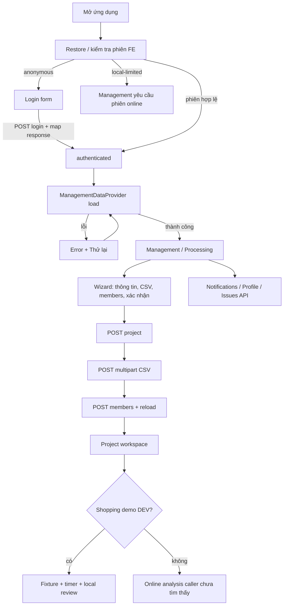

# Chương III. User Flow và User Journey

## Cập nhật hiện hành — 19/11/2026

HEAD `f017663` + working tree, ghép TaiFE@48d1ba6. Google: redirect qua BE → callback fragment được xóa → coordinator kiểm tra token/profile trước commit. Delete account cần nhập email xác nhận và cleanup sau ACK. Dataset: schema/detail, GET records thường; POST query khi lọc/sắp xếp; PII là metadata, không đổi/reset tên cột. Project processing có complete qua PUT snapshot expectedVersion. Issue needs-info/version mở form bổ sung, PATCH rồi reload detail. Profile gửi phone/bio cùng họ tên. Admin ở Management members, tách quản lý workspace/project. SOURCE/mock tests không thay nghiệm thu live mới.

Nguồn hiện hành: [revalidation](audit/frontend-api-revalidation.md), [API inventory](audit/api-inventory.md), [testing](06-software-testing.md). **Các mục snapshot 17/11 dưới đây được giữ làm lịch sử; khi có khác biệt, mục cập nhật này và revalidation thay thế nhận định cũ.**

User flow là đường đi giữa thao tác, màn hình và trạng thái. Journey dưới đây phản ánh caller FE có thật, không dựng hành trình RAG/chat nếu không tìm thấy.

## 1. Entry, auth và điều hướng

| Bước | Hành động/màn hình | File dưới `src/frontend/src/` | State/request/kết quả |
|---|---|---|---|
| 1 | Mở app | `app/main.tsx` | Skeleton → lazy bootstrap; có thông báo nếu import thất bại |
| 2 | Restore phiên | `app/context/auth-provider.tsx` → `services/auth/session-coordinator.ts` | Đọc sessionStorage; có token còn hạn thì GET users/me; có nhánh local-limited khi outage |
| 3 | Anonymous vào private URL | `app/guards/protected-route.tsx` | Navigate login, giữ returnTo khi phù hợp |
| 4 | Submit login | `views/auth/login/login.view.tsx` → `hooks/auth/use-login.ts` | email/password, pending, POST auth/login |
| 5 | Nhận login response | `services/auth/auth.service.ts` → coordinator | Kiểm tra DTO/token identity/expiry; persist rồi publish authenticated |
| 6 | Mở vùng ứng dụng | `app/router/return-target.ts`, `app/router/workbench-routes.tsx` | Đích hợp lệ hoặc đường mặc định `/processing` |
| 7 | Load data | `views/application/management-data-provider.tsx` | Loading → store context hoặc error/retry; không fallback mock vì API lỗi |

Không dùng checkbox “Ghi nhớ đăng nhập” như bằng chứng persistence dài hạn: session hiện lưu sessionStorage. Khi token hết hạn, coordinator kiểm tra health → awaiting-consent → refresh chỉ sau lựa chọn chấp nhận → GET users/me → commit phiên. Từ chối hoặc lỗi dẫn tới cleanup/anonymous. Logout dọn local state trước, sau đó báo kết quả revoke request; không suy ra từ việc local logout rằng server đã revoke thành công.

## 2. Route inventory

Nguồn: `src/frontend/src/app/router/workbench-routes.tsx`, `app/constants/routes.ts` và `services/navigation/application-route.ts`.

| URL pattern | Chức năng UI | Admission |
|---|---|---|
| `/auth/login` | Login/public-only | PublicOnlyRoute |
| `/management` | Home quản lý | ProtectedRoute + ApplicationFrame |
| `/management/workspaces`, `/management/workspaces/:workspaceId` | Danh sách/chi tiết workspace | Cùng guard/provider |
| `/management/projects` | Danh sách project, có scope từ URL | Cùng guard/provider |
| `/management/notifications`, `/management/notifications/:notificationId` | Thông báo | Cùng guard/provider |
| `/management/settings`, `/management/settings/:settingsSection` | Cài đặt | Cùng guard/provider |
| `/processing`, `/processing/new` | Processing landing | Cùng guard/provider |
| `/processing/projects/:projectId` | Project workspace/scene | Kiểm tra project tồn tại trong store sau provider |
| `/processing/projects/:projectId/records` | Shopping records view | Có route; không khẳng định generic online data grid |
| Các suffix upload/analysis/review/results của project | Redirect về management project context | Không phải các page nghiệp vụ độc lập |
| `/preview/*` | Legacy redirect hoặc not found | Theo nhánh router thực tế |
| `/preview/workspaces-3d` trong DEV | Entry preview riêng từ main | Tách khỏi app bootstrap |
| Không khớp | 404 | Shared fallback |

ProtectedRoute cho cả authenticated và local-limited qua, nhưng ManagementDataProvider chỉ load management online khi authenticated. Hai tầng kiểm soát khác nhau; không mô tả local-limited như offline CRUD management.

## 3. Workspace và project

Workspace create dialog tại `src/frontend/src/views/management/workspaces/sections/workspace-create-dialog.tsx` gửi input qua preview session model. Hook lấy store từ context, gọi createWorkspace rồi hiển thị toast/lỗi. API store POST workspace, lần lượt POST members và reload. Nếu tạo workspace thành công nhưng thêm member/reload lỗi, message báo đã tạo và hướng người dùng kiểm tra, không giả lập rollback.

Project wizard tại `src/frontend/src/components/project/create/project-wizard.tsx` có bốn bước: thông tin → CSV → thành viên → xác nhận. CSV được đọc từ File bằng UTF-8, parse bởi `src/frontend/src/services/management/csv-preview.ts` qua hook parser; wizard giữ File gốc cùng metadata.

Khi submit, pending chặn submit trùng. Hook trả success flag; store online thực hiện create project → upload File multipart → members → load. Chỉ hoàn tất UI sau Promise phản hồi. Nếu lỗi từng phần, file/form có thể được giữ để thử lại; Maps trong store chỉ giúp tiếp tục trong cùng instance, không tồn tại qua reload. Journey này đã có test mock, chưa live verified.

Đổi tên/xóa/chuyển owner cũng qua store được inject. Hộp thoại xác nhận chỉ kiểm soát ý định người dùng; không chứng minh server chấp nhận thao tác. API store không có undo server: kết quả persisted khác undo fixture trong tab.

## 4. Upload trong project và kết quả phân tích

`src/frontend/src/views/processing/project/sections/project-data-actions.tsx` hiện lấy store bằng `useManagementStore()`. Upload dialog nhận prop onClose; đọc projectId từ `session.state.selection.projectId` và File từ input, không nhận projectId qua prop. Nó gọi optional uploadDataset, hiển thị busy/error và đóng sau ACK phù hợp. Đây là trạng thái mới so với lượt khảo sát cũ khi nút chưa nối.

Không đồng nhất upload metadata thành công với analysis hoàn thành. Project workspace có callback result/review/download, nhưng chưa tìm thấy service online FE gọi analysis/job endpoints từ flow đang khảo sát. Với project shopping ở DEV, `use-shopping-detection.ts` chạy timer, đổi idle/running/complete/reviewed và lưu review bằng sessionStorage. Đó là mô phỏng UI, không phải polling AI thật.

## 5. Thông báo, hồ sơ và báo cáo sự cố

- Notifications: loadPersonal GET danh sách cursor → map unread từ readAt → UI center/list; đánh dấu đọc gửi PATCH từng ID rồi reload personal data.
- Preferences: các control notification trong UI map về một boolean notificationsEnabled; không có bằng chứng bốn kênh độc lập được persist riêng.
- Profile: store ghép/tách full name, PATCH first_name/last_name và load lại; phone/bio/organization hiển thị không đồng nghĩa mọi field đã được PATCH.
- Issues: tạo report bằng POST `/issues`; nếu có attachment, POST multipart sau khi có issue ID. Có nhớ trạng thái upload trong Map để retry trong cùng store; lỗi attachment không nói report chưa từng được tạo.
- Download attachment: GET với responseType Blob → caller UI xử lý file; không unwrap JSON envelope cho Blob.

Nguồn chính: `src/frontend/src/services/management/management.store.ts`, `src/frontend/src/components/notification/center/notification-center.tsx`, `src/frontend/src/components/report/center/report-center.tsx`, `src/frontend/src/views/management/settings/settings.view.tsx`.

## 6. User flow diagram

Nguồn standalone: [user-flow.mmd](diagrams/user-flow.mmd). Nhánh error ở create/upload/members được giải thích trong chương V; không có transaction rollback được suy diễn vào sơ đồ.
