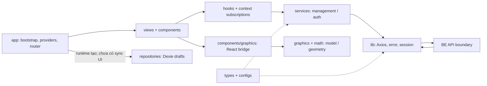
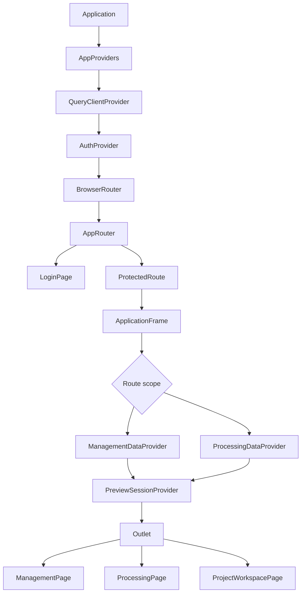

# Chương IV. Kiến trúc và cấu trúc Frontend

## Cập nhật hiện hành — 19/11/2026

HEAD `f017663` + working tree, ghép TaiFE@48d1ba6. ApplicationFrame chọn ManagementDataProvider cho Management, ProcessingDataProvider cho landing/detail. Processing landing dùng recent theo cursor và workspace lookup dùng lại; detail theo projectId. Store có lifecycle signal, disposed/revision guards, loadMembers cursor và concurrency workspace 3. TanStack Query chỉ là hạ tầng trong flow này; không gán query invalidation cho external store. Auth coordinator thêm Google và delete account nhưng giữ generation để late completion không ghi đè phiên mới.

Nguồn hiện hành: [revalidation](audit/frontend-api-revalidation.md), [API inventory](audit/api-inventory.md), [testing](06-software-testing.md). **Các mục snapshot 17/11 dưới đây được giữ làm lịch sử; khi có khác biệt, mục cập nhật này và revalidation thay thế nhận định cũ.**


## 1. Kiến trúc thực tế

FE là SPA (Single Page Application, ứng dụng một trang) React/Vite. Các layer source tách UI composition, feature views/components, hooks, services/stores, repositories, transport và graphics/math. Đây là mô tả ranh giới quan sát được; không gọi toàn bộ FE là Clean Architecture chỉ vì có tên folder tương ứng.



API box chỉ là bên gửi/nhận HTTP, không mô tả nội bộ BE. Sơ đồ: [system-architecture.mmd](diagrams/system-architecture.mmd).

## 2. Folder tree chọn lọc từ repository

```text
src/frontend/
├── package.json, yarn.lock, package-lock.json
├── vite.config.ts, vite.e2e.config.ts
├── tsconfig.json, tsconfig.app.json, tsconfig.node.json
├── vitest.config.ts, playwright.config.ts, eslint.config.js
├── scripts/generate-swagger-types.mjs
├── tests/e2e/
└── src/
    ├── app/                 bootstrap, runtime, router, guards, route pages
    ├── views/               application, auth, management, processing, preview, 3D
    ├── components/          UI primitives, domain widgets, graphics bridge
    ├── hooks/               auth, preview, project, UI surfaces, processing
    ├── services/            auth, users, health, management, preview, navigation
    ├── repositories/       datasets/upload drafts
    ├── lib/                Axios, error, query client, session, OpenAPI artifacts
    ├── types/              domain/UI contracts và services-type generated aliases
    ├── configs/            API và upload draft limits
    ├── styles/             tokens.css, global.css
    ├── graphics/           model/material/scene helpers không sở hữu React UI
    ├── math/               geometry, layout, local data helpers
    ├── mocks/              shopping-trends demo data/adapter
    ├── sync/               placeholder, chưa có coordinator runtime
    ├── utils/              helpers và token reading
    ├── assets/             font, image, artwork
    └── __tests__/          Vitest test groups
```

Đây là cây chọn lọc, không liệt kê mọi file. Repo không có module `features/`, `stores/` hay `contexts/` ở cùng cấp chỉ vì cách phân loại phổ biến thường dùng các tên đó: store hiện nằm trong services; auth context/provider nằm ở app/hooks.

## 3. Composition và vòng đời

| Thành phần | Sở hữu gì | Caller → callee |
|---|---|---|
| `src/frontend/src/app/main.tsx` | React root, initial skeleton, entry selection | index.html → lazy Application hoặc DEV preview |
| `src/frontend/src/app/application-bootstrap.tsx` | QueryClient + runtime, config error | Application → AppProviders + BrowserRouter |
| `src/frontend/src/app/app-runtime.ts` | Session coordinator + draft repository/database | Bootstrap → auth/users/health clients và local repository |
| `src/frontend/src/app/context/auth-provider.tsx` | Subscription/retain/restore, focus/expiry checks | AppProviders → coordinator; cung cấp AuthContext |
| `src/frontend/src/views/application/application-frame.tsx` | Shared shell/session composition | Router → ManagementDataProvider + PreviewSessionProvider + Outlet |
| `src/frontend/src/views/application/management-data-provider.tsx` | API store instance theo auth snapshot | Frame → Axios + createManagementStore; cleanup dispose |
| `src/frontend/src/services/management/management.store.ts` | External state, versions, in-flight/draft Maps | Provider/hook → ApiClient; publish cho subscribers |

AppRuntime retain/release xử lý StrictMode cleanup/setup bằng microtask để không đóng instance còn dùng. Management store có dispose/revision guard cho load/publish; chưa có abort request management xuyên suốt cleanup. Việc component unmount không đồng nghĩa request đã bị server hủy.

## 4. State và persistence

| Loại dữ liệu | Chủ sở hữu | Persistence/giới hạn |
|---|---|---|
| Input/step/pending/error | Component/hook React | Trong instance UI |
| Auth snapshot/generation | SessionCoordinator | Snapshot external store; credentials qua sessionStorage |
| Online management records | API management store | Cache/map trong tab; nguồn chính là request server |
| Mock management | previewMockStore | Fixture state, shopping demo có cơ chế lưu riêng |
| Theme preference | usePreviewColorScheme | localStorage; lỗi storage fallback state phiên |
| Upload drafts | UploadDraftDatabase/repository | IndexedDB, theo account/generation |
| Server query cache infrastructure | QueryClient | Provider/policy có dùng; không thấy management load dùng useQuery thay cho store |
| Project retry progress | Maps trong API store | Không bền qua dispose/reload; không phải server idempotency |

Draft repository lưu metadata tách Blob, kiểm tra quyền truy cập theo account/generation và quota. `confirmUploaded` nhận confirmation từ caller rồi đánh dấu/dọn draft; không tự thực hiện HTTP upload. Runtime có repository không có nghĩa UI online create-project đã dùng draft queue: flow wizard hiện gửi File trực tiếp qua management store. `sync/README.md` xác nhận chưa có tự đồng bộ.

## 5. Naming, dependency và tính tái sử dụng

ESLint tại `src/frontend/eslint.config.js` có rule layer: `.tsx` giới hạn ở app/views/components/tests; graphics không import React/R3F; services/repositories không import UI layers. Có rule Design System migration riêng. Đây là enforcement source rule, không khẳng định mọi file toàn repo đã pass lint ở snapshot này.

Các file trong `views/preview/` có re-export tới view domain; `use-preview-session.ts` nhận store context nhưng biến cục bộ còn tên previewMockStore. Khi đọc code, phải theo import/context thay vì suy từ tên biến. `ManagementStore` lại được suy ra từ kiểu preview store cộng các optional API capability; thuận lợi tái sử dụng UI nhưng coupling kiểu mock/online còn tồn tại.

Generated aliases dưới `types/services-type/` đi theo `lib/openapi.ts`; chưa có static consumer nghiệp vụ. Không vẽ chúng như tầng validation runtime đang hoạt động trong mọi request.

## 6. Component hierarchy



Sơ đồ gộp các wrapper Route/Routes/Suspense để làm rõ ownership, không liệt kê mọi DOM element. Xem [component-hierarchy.mmd](diagrams/component-hierarchy.mmd) và [folder-analysis.md](audit/folder-analysis.md).
