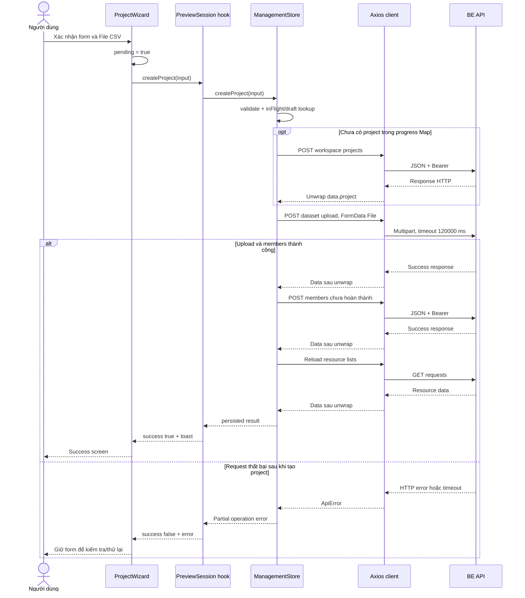
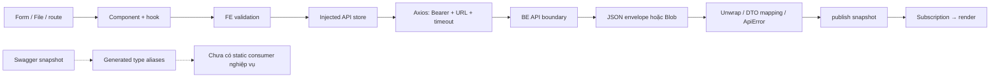

# Chương V. Request–Response Lifecycle của Frontend

## Cập nhật hiện hành — 19/11/2026

HEAD `f017663` + working tree, ghép TaiFE@48d1ba6. Health root đã xử lý ở axios-client, không còn finding prefix. Generated request aliases có consumer/satisfies ở services; snapshot 66 paths/86 operations vẫn thiếu 2xx content. Dataset dùng GET /records thường, POST /records/query khi có search/filter/sort; PII PATCH columns/pii; DELETE rồi refreshProject. Project snapshot có expectedVersion. Issue PATCH chỉ khi cần bổ sung; mutation failure không tự retry. Read/run analysis có caller; async polling/PDF pipeline chưa được chứng minh. Xem API inventory cập nhật, không sử dụng bảng snapshot cũ bên dưới làm inventory hiện hành.

Nguồn hiện hành: [revalidation](audit/frontend-api-revalidation.md), [API inventory](audit/api-inventory.md), [testing](06-software-testing.md). **Các mục snapshot 17/11 dưới đây được giữ làm lịch sử; khi có khác biệt, mục cập nhật này và revalidation thay thế nhận định cũ.**

Lifecycle là toàn bộ vòng từ thao tác tới request và kết quả render. Chương này dừng ở HTTP boundary; không truy vào implementation BE. Các endpoint được đối chiếu với **Swagger snapshot trong FE**, không khẳng định đó là contract mới nhất của server đang chạy.

## 1. API client và contract chung

| Mối quan tâm | Implementation FE | Bằng chứng |
|---|---|---|
| Base URL | Origin + prefix; không dùng URL Swagger UI làm API base | `src/frontend/src/configs/api.config.ts` |
| Path safety | Chặn absolute URL, origin escape, backslash, hash và traversal ra ngoài base | `src/frontend/src/lib/axios-client.ts` |
| Auth | Request phải chỉ rõ public/session; session cần bearer từ token reader | Cùng file và `src/frontend/src/types/api/api.types.ts` |
| JSON / no-content | Gửi data qua Axios; HTTP 204 trả undefined trước; JSON khác unwrap success/data đúng một lần | `src/frontend/src/lib/axios-client.ts` |
| Multipart | Caller tạo FormData; không tự hard-code multipart boundary | `src/frontend/src/services/management/management.store.ts` |
| Blob | responseType blob đi qua riêng, không unwrap JSON | `src/frontend/src/lib/axios-client.ts` |
| Timeout | 30000 ms mặc định; health 5000 ms; CSV upload 120000 ms | Config, health service, management store |
| Cancellation | ApiRequestOptions có signal; auth truyền AbortSignal | Client + session coordinator |
| Retry | Không có retry transport tự động ở client; QueryClient policy retry:false | Client + `src/frontend/src/lib/query-client.ts` |
| Error | Normalize network/timeout/cancelled/http/config/invalid-response | `src/frontend/src/lib/api-error.ts` |

JSON thành công không phải 204 mà client mong đợi có `success:true` và `data`; service nhận **data bên trong**, không envelope ngoài. HTTP 204 trả undefined, Blob mode trả response.data. Generic `request<T>()` không tự kiểm tra DTO T. Auth/users services kiểm tra các trường cụ thể; management DTO phần lớn được tin theo kiểu viết tay.

Client không dựa trên response interceptor Axios riêng để unwrap: logic nằm ngay trong hàm request sau `instance.request()`. Nếu server trả body sai dạng, client tạo invalid-response; nếu HTTP lỗi, normalize giữ status/code 4xx phù hợp và che message nội bộ 5xx. Field errors hiện đọc từ mảng `error.message`; format khác như `error.details.fields` chưa được mapper này đọc.

### Xử lý HTTP 204 đã có trong source

`DELETE /api/v1/workspaces/{id}` và `/api/v1/projects/{id}` được snapshot khai báo 204. `src/frontend/src/lib/axios-client.ts:125` trả undefined ngay khi response.status bằng 204, trước Blob/JSON unwrap. `src/frontend/src/__tests__/foundation/api.test.ts:177` có test xóa trả 204 với body rỗng; test được chạy lại ở Phase 5 và pass trong bộ 55 test API. Nhận định Phase 4 rằng 204 bị unwrap từ chối là đọc thiếu nhánh source và đã được bác bỏ, không phải bug hiện tại. Live DELETE vẫn UNVERIFIED; generic T không tự xác nhận semantics của body.

## 2. Auth: form tới session và màn hình

| Thứ tự | File thực tế | Input → xử lý → output |
|---|---|---|
| 1 | `src/frontend/src/views/auth/login/login.view.tsx` | Form email/password; onSubmit → form.submit; pending/disabled/error |
| 2 | `src/frontend/src/hooks/auth/use-login.ts` | Local input → AuthContext.signIn; bắt lỗi thành message |
| 3 | `src/frontend/src/services/auth/session-coordinator.ts` | Chỉ signIn khi anonymous/cleanup hợp lệ; begin generation, abort flow cũ, publish signing-in |
| 4 | `src/frontend/src/services/auth/auth.service.ts` | Whitelist email/password và device_name nếu được caller cung cấp → POST `/auth/login` public |
| 5 | `src/frontend/src/lib/axios-client.ts` | URL + data + timeout → HTTP → unwrap envelope hoặc ApiError |
| 6 | `src/frontend/src/services/auth/auth.service.ts` | Kiểm tra token/refresh_token/expires_in/user; đọc account/expiry từ token; đối chiếu user.id |
| 7 | `src/frontend/src/services/auth/session-coordinator.ts` | Kiểm tra generation/current expiry; ghi credential; publish authenticated snapshot |
| 8 | `src/frontend/src/lib/session-storage.ts` | Whitelist schemaVersion/accessToken/refreshToken/accountId; lưu sessionStorage |
| 9 | `src/frontend/src/app/context/auth-provider.tsx` | useSyncExternalStore nhận snapshot; context cập nhật |
| 10 | `src/frontend/src/app/guards/public-only-route.tsx`, `app/router/return-target.ts` | Điều hướng authenticated user về đích hợp lệ; router mở frame |

FE đọc JWT payload để điều phối expiry/account, **không xác minh chữ ký JWT thay server**. Session generation ngăn kết quả cũ ghi đè phiên mới. Restore token còn hạn gọi GET `/users/me` để xác nhận profile; outage có thể dẫn tới local-limited nhưng management online vẫn yêu cầu authenticated.

Gia hạn: expiry → GET health → awaiting-consent → người dùng đồng ý → POST refresh → xác nhận account/expiry → GET users/me bằng candidate token → persist/commit. Refresh response không được ghi ngay khi chưa qua các bước xác nhận. Từ chối hoặc lỗi kết thúc phiên. Logout capture token phiên cũ, cleanup local trước, gọi POST logout và trả serverRevoked/revokeError riêng.

Health snapshot có path `/health` ngoài prefix, trong khi service sử dụng API client đã ghép prefix. Đây là finding cần xử lý ở FE/API boundary; không cần phân tích internals BE để ghi nhận lệch đường dẫn.

## 3. Load management: API data tới card/table

| Thứ tự | File | Trách nhiệm, input/output |
|---|---|---|
| 1 | `src/frontend/src/views/application/application-frame.tsx` | Route context → ManagementDataProvider + PreviewSessionProvider |
| 2 | `src/frontend/src/views/application/management-data-provider.tsx` | Auth snapshot → sessionStorage.read; account phải khớp và token còn hạn |
| 3 | Cùng provider → `src/frontend/src/lib/axios-client.ts` | Tạo client với reader đọc token hiện tại cho đúng account; token không được đưa vào UI state |
| 4 | `src/frontend/src/services/management/management.store.ts` | createManagementStore(api, account) → state source:'api', arrays rỗng |
| 5 | `management.store.ts`: `load()` / `pages()` | GET workspaces; mỗi workspace lấy members/projects; mỗi project lấy members và dataset khi hasDataset |
| 6 | `management.store.ts`: mapping | DTO IDs/name/roles/dates/bytes → Workspace/Project/DatasetSummary; versions Map cho update |
| 7 | `management.store.ts`: `loadPersonal()` | GET users/me, notifications và issues song song; map profile/unread/report |
| 8 | Provider | Chỉ expose context sau load thành công; lỗi hiển thị role=alert + Thử lại |
| 9 | `src/frontend/src/hooks/preview/use-preview-store.ts` | Context → useSyncExternalStore subscribe/getState |
| 10 | `src/frontend/src/views/management/workspaces/workspaces.view.tsx`, `src/frontend/src/views/management/projects/projects.view.tsx` | State + route/filter → UI cards/table; selection theo ID |

Resource list hỗ trợ cả page-total và cursor-meta. Trang đầu hiện gửi page/limit, trong khi Swagger list hiện mô tả cursor/limit; test mock bao phủ hai dạng nhưng không chứng minh live API chấp nhận mọi query thêm. Members load dùng memberRows đọc `members` hoặc `items`, chưa lặp cursor để lấy toàn bộ roster.

`revision` và `disposed` tránh publish resource load cũ; provider có active flag ngăn expose instance khi effect đã cleanup. Requests management chưa được abort bằng signal xuyên suốt. Disposal không phải rollback request server.

## 4. Tạo project và upload CSV: đường đi trọng tâm

### 4.1. Input và validation

`src/frontend/src/components/project/create/project-wizard.tsx` giữ step, workspaceId, name, description, selected members, picked CSV và pending/error. File được đọc qua arrayBuffer → TextDecoder UTF-8 fatal → parser từ `src/frontend/src/hooks/project/use-project-csv-parser.ts` → `src/frontend/src/services/management/csv-preview.ts`.

Parser xử lý delimiter từ header ngoài quotes, escaped quotes, newline và số field khớp header; trả delimiter/headers/rows. Wizard tính rows/columns/size từ File thật và giữ File gốc để upload. Đây là đọc cục bộ trước HTTP, không phải upload đã thành công. Parse toàn bộ text có thể dùng nhiều RAM cho file lớn; chưa đo memory.

Store gọi `validateCsvFile`: đuôi .csv, không rỗng, tối đa 50 × 1024² bytes. Member write cần email có thật; project role chỉ member/viewer. FE validation là UX, không là kiểm tra tin cậy cuối cùng trên server.

### 4.2. Chuỗi request và response

1. Wizard submit đặt pending và đợi `session.createProject(input)`.
2. `src/frontend/src/hooks/preview/use-preview-session.ts` lấy API store qua context, gọi createProject và applyMutation để chuyển Promise thành success/error UI.
3. `src/frontend/src/services/management/management.store.ts` dùng khóa workspaceId + tên đã trim/lowercase; inFlight Map gom submit cùng khóa trong cùng instance.
4. Nếu chưa có draft progress, POST `/workspaces/:workspaceId/projects` với name/description. Store mong data `{project: ProjectDto}` sau unwrap.
5. Lưu ID project trong drafts Map; tạo FormData field file chứa original File.
6. POST `/projects/:projectId/datasets/upload`, timeout 120000 ms. Resolve mới đánh dấu uploaded=true.
7. Với từng member chưa đánh dấu, POST `/projects/:projectId/members` với email/role.
8. Load lại resource list. Thành công mới xóa progress Map và trả `{persisted:true, message, undo}`; undo ở API mode báo không thể hoàn tác server.
9. Hook hiển thị toast, trả boolean thành công. Wizard hoàn tất bước success khi nhận true; lỗi giữ input để người dùng xử lý.

### 4.3. Failure và retry

| Điểm lỗi | Trạng thái có thể đã tồn tại | Hành vi FE / giới hạn |
|---|---|---|
| Preflight File/member | Chưa gửi create | Throw trước HTTP |
| POST create reject | Chưa có project ID trong Map | Không báo success; không suy ra server không ghi nếu là timeout |
| Upload reject sau create | Project có thể đã tạo | Message partial success; retry dùng project ID trong cùng store |
| Add member lỗi | Project/upload hoặc vài member đã xong | Theo dõi email đã hoàn thành trong Map; không rollback tự động |
| Reload lỗi sau write | Server có thể đã lưu | Message yêu cầu tải lại/kiểm tra, tránh gửi lại thao tác |
| Reload trang/dispose provider | Progress Maps mất | Không có bảo đảm tiếp tục/idempotency bền vững |

Khóa theo tên không chứa hash File hoặc toàn bộ member payload. Nếu thay input cùng khóa, không thể khẳng định đúng ngữ nghĩa tiếp tục. Đây là giới hạn thiết kế quan sát được, chưa sửa trong audit.

Diagram mô tả logic online, không phải network trace đã capture. Xuất riêng: [request-response.mmd](diagrams/request-response.mmd).

## 5. Issues, notifications và Blob

Store `loadPersonal()` gom profile/notifications/issues; một request reject làm Promise.all reject, có thể ngăn provider expose toàn bộ UI dù workspace đã tải. Đây là coupling giữa dữ liệu lõi và phụ, không phải bằng chứng mọi endpoint đã lỗi.

Issue creation POST body type/title/description; sau khi có ID mới upload attachment. issueDrafts Map tránh tạo/upload lại trong cùng instance khi refresh sau save lỗi. Attachment cho phép PNG/JPEG/PDF, tối đa 10 × 1024² bytes ở FE. DownloadAttachment dùng encodeURIComponent ID và Blob mode; API trả file thành công không cần JSON envelope. Kiểm tra Content-Type/filename thực trả về chưa được xác minh live.

Thông báo đọc PATCH từng ID rồi loadPersonal. Mark-all dựa trên các notification đã load; không thấy SSE/WebSocket subscription trong management store/provider này. Không mô tả notification hiện tại như realtime đã tích hợp. Nếu mark một phần thành công rồi request sau lỗi, không suy ra cả batch rollback.

## 6. Swagger generation và type consumption

Nguồn cụ thể:

| File | Vai trò |
|---|---|
| `src/frontend/scripts/generate-swagger-types.mjs` | Tải đặc tả từ config, sanitize, normalize operation IDs, gọi openapi-typescript, chia aliases |
| `src/frontend/src/lib/openapi.json` | Snapshot local, có 65 path/86 operation tại lúc audit |
| `src/frontend/src/lib/openapi.ts` | Generated paths/operations; có @ts-nocheck |
| `src/frontend/src/types/services-type/index.ts` | Export nhóm generated aliases |
| `src/frontend/src/types/services-type/auth.ts`, `workspaces.ts`, `projects.ts`, `datasets.ts` | Type request/params/status response theo operation |
| `src/frontend/src/services/management/management.store.ts` | Consumer runtime hiện dùng DTO viết tay, chưa import generated aliases |

86 operation trong snapshot không có content trực tiếp ở response 2xx. Ví dụ `postAuthLoginResponse200` mô tả response object nhưng không có JSON Content type; đây không phải `LoginResult` mà service cần. 16 file generated kể cả index; chưa thấy static import/export tới chúng ở consumer ngoài generated files, kể cả root types barrel tại lúc audit.

Generator tự thêm @ts-nocheck, thay một số `$ref` dạng #/$defs/ bằng object mở và xóa .ts output trước khi sinh. Do đó chạy gen không chỉ “thêm type”; có thể thay đổi contract biểu diễn và overwrite output. Không chạy lại generator trong audit; chỉ đọc source/snapshot. TypeScript pass không chứng minh Swagger đầy đủ hoặc mapping response chính xác runtime.

## 7. API inventory và data flow

[API inventory](audit/api-inventory.md) liệt kê caller, request, response FE mong đợi và status từ Swagger. [File traceability](audit/file-traceability.md) cho phép mở từng file để đối chiếu caller/callee. Các API có generated type nhưng không thấy caller online được đánh dấu riêng.

Xuất riêng: [data-flow.mmd](diagrams/data-flow.mmd). Online analysis async jobs, polling, WebSocket và SSE caller trong flow này: **NOT FOUND**; timer shopping demo không được thay thế vào vị trí đó.
