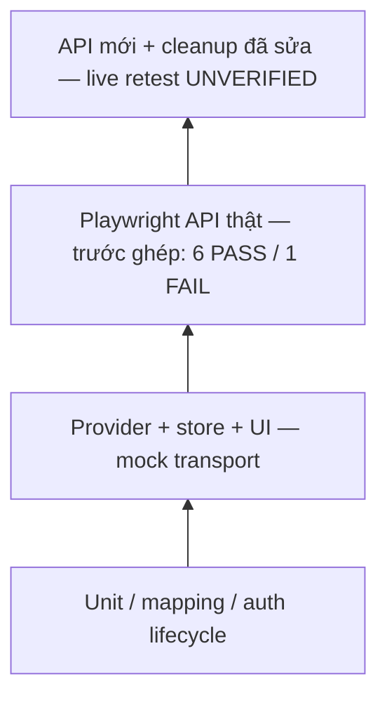

# Chương VI. Kiểm thử Frontend

Cập nhật 19/11/2026, HEAD `f017663` + working tree. Kết quả dưới đây từ các lượt thực thi trong phiên tích hợp, không phải chạy mới khi viết tài liệu.

## 1. Ranh giới kiểm thử

Vitest/jsdom + Testing Library: unit/component/store/provider; Axios adapter, ApiClient hoặc auth ports giả. fake-indexeddb kiểm tra draft cục bộ. Các test này không chứng minh WebGL hay server thật. E2E Playwright dùng login và API thật; không chuyển các test lỗi/race cấp unit thành request live.

## 2. Kết quả sau ghép API

| Lệnh từ src/frontend | Kết quả | Giới hạn |
|---|---|---|
| yarn build | PASS | tsc -b + Vite build; warning chunk >500 kB |
| yarn test src/__tests__/auth src/__tests__/management src/__tests__/foundation | 402 PASS / 26 file | 45,75 s; mock boundary, không coverage |
| yarn test src/__tests__/management/connected-api.test.ts | 13 PASS / 1 file | 2,34 s; chạy sau bổ sung hai ca issue; không cộng với 402 |
| ESLint phạm vi mới loại provider test, --quiet | 0 error | Vẫn có warning; không phải full lint |
| ESLint gồm management-data-provider.test.tsx | 6 require-await errors | Chưa sửa trong đợt ghép API |
| git diff --check -- src/frontend | PASS | Whitespace |

Lượt đầu phát hiện hai test còn giả định mọi records đều POST query. Fixtures/assertions đã cập nhật theo contract GET records thường, giữ POST cho filtering; sau đó scope 402 đạt. Build từng phát hiện lỗi cú pháp khi ghép type PII; đã sửa và build lại PASS, không che failure.

## 3. Hành vi được test

- Google callback: attempt còn hạn, xóa fragment, chỉ consume một lần, từ chối unsolicited/expired callback; coordinator xác nhận profile đúng account trước lưu session.
- Delete account: thành công cleanup; 403 giữ phiên; kết quả xóa A trả muộn không xóa phiên B.
- Dataset: GET/cursor, POST điều kiện lọc, malformed PII/schema/detail, failure không retry mutation.
- Project: PUT snapshot expectedVersion và state completed sau reload.
- Issues: PATCH supplement + đọc lại detail, conflict không retry.
- Regression auth/provider/members/204 và partial upload vẫn có trong scope tests.

## 4. E2E API thật — bằng chứng trước đợt ghép mới

Cấu hình: Chromium, một worker, retries 0, viewport 960×900, locale vi-VN, test timeout 120 s, expect 20 s; trace off để không lưu credentials/tokens. FE E2E ở loopback HTTP; chỉ bridge hai cấu hình API công khai vào Vite, credentials E2E ở runner.

| Spec dưới tests/e2e | Full run trước ghép |
|---|---|
| api/reachability.spec.ts | PASS: health/CORS/unauthenticated profile |
| auth/anonymous-guard.spec.ts | PASS |
| auth/login-restore.spec.ts | PASS |
| auth/logout.spec.ts | PASS: logout + is_revoked |
| admin/read-admin.spec.ts | PASS: read users/issues |
| appearance/theme-preferences.spec.ts | PASS với login thật |
| management/workspace-project-lifecycle.spec.ts | FAIL |

Full run **6 PASS / 1 FAIL**. Lặp lifecycle riêng 3 lần: **3 FAIL**, chưa xác định chắc nguyên nhân; không gọi đây là flake pass/fail. Đã chuyển cleanup sang fixture teardown 30 s, chưa runtime retest. Recovery cleanup bị từ chối; tài nguyên thử còn lại chưa được xác nhận dọn xong. Không chạy thêm mutation trong đợt tài liệu.

Ba spec demo seed/rejected-demo-login/support demo đã bị thay; Shopping Demo sản phẩm/Vitest vẫn là phần riêng. Chưa E2E API mới từ TaiFE; chưa analyst/permission matrix; không thử refresh-token reuse.

## 5. Coverage và lịch sử

Coverage statements/branches/functions/lines mới: **UNVERIFIED**. 315 test/20 file và 55 API test thuộc audit 17/11, scope trùng nhau. 864 test (863 pass/1 timeout), rerun 25/25 và 70,83% lines thuộc snapshot cũ hơn; không dùng làm baseline hiện tại.

## 6. Tầng bằng chứng

Xuất riêng: [testing-pyramid.mmd](diagrams/testing-pyramid.mmd). Không thể hiện tỷ lệ chất lượng hay cộng các lượt có overlap.

## 7. Tiếp theo

Được phép cleanup dữ liệu thử → rerun lifecycle với teardown mới → kiểm chứng API mới trên dữ liệu/tài khoản thử. Đối chiếu quyền analyst/member/viewer, numeric filter sau BE fix và đo coverage riêng. Không xóa tài khoản thật hoặc chạy token reuse nếu chưa được duyệt.
