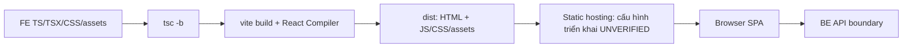
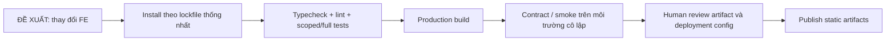

# Chương VII. Build, Packaging và Deployment Frontend

## Cập nhật hiện hành — 19/11/2026

HEAD `f017663` + working tree, ghép TaiFE@48d1ba6. yarn build sau ghép API đã PASS (tsc -b + Vite), có warning chunk >500 kB. Đây là static artifact build, không xác nhận hosting production, headers, deep-link routing hay hiệu năng thực. E2E riêng dùng HTTP loopback/960×900 và API thật; normal local HTTPS vẫn là cấu hình phát triển.

Nguồn hiện hành: [revalidation](audit/frontend-api-revalidation.md), [API inventory](audit/api-inventory.md), [testing](06-software-testing.md). **Các mục snapshot 17/11 dưới đây được giữ làm lịch sử; khi có khác biệt, mục cập nhật này và revalidation thay thế nhận định cũ.**

## 1. Build process từ cấu hình

`src/frontend/package.json` định nghĩa `build: tsc -b && vite build`. TypeScript project references ở `src/frontend/tsconfig.json` trỏ app/node configs; app có strict/noUncheckedIndexedAccess/exactOptionalPropertyTypes/noUnused và noEmit. Vite nhận React plugin và Babel React Compiler tại `src/frontend/vite.config.ts`.

Đây là pipeline từ script/cấu hình; build snapshot hiện tại chưa chạy lại. `vite.e2e.config.ts` dùng cấu hình app + envDir:false cho DEV demo tests, không là production build configuration riêng.

## 2. Artifact và runtime

FE build tạo static HTML/JS/CSS/assets; mã React chạy trong trình duyệt. Vite dev/preview là process hỗ trợ phát triển/xem build. Không cần suy diễn FE static build được chạy bằng PM2 hay chứa backend runtime.

| Hạng mục triển khai FE | Bằng chứng hiện có | Trạng thái |
|---|---|---|
| Static build script | package.json + vite.config.ts | SOURCE |
| Lazy route chunks | workbench-routes.tsx dùng lazy/Suspense | SOURCE |
| Assets/font bundling | Import từ src/assets; font-face local | SOURCE |
| FE Dockerfile/image | Không tìm thấy trong inventory đã khảo sát | NOT FOUND |
| Nginx/reverse proxy FE config | Không tìm thấy trong inventory đã khảo sát | NOT FOUND |
| PM2 config FE | Không tìm thấy | NOT FOUND |
| FE CI/CD workflow | Không tìm thấy workflow trong inventory repository đã khảo sát | NOT FOUND |
| TLS/certificate/cache/CDN thực | Không quan sát hosting live | UNVERIFIED |
| Production deployment FE | Chưa thực hiện | UNVERIFIED |

Các file Compose của BE không phải bằng chứng FE đã containerize/deploy; không đưa internals của chúng vào chương này.

## 3. Environment boundary và routing

FE đọc `VITE_API_BASE_URL` và `VITE_API_PREFIX` khi tạo client. Giá trị `import.meta.env` cho ứng dụng build là cấu hình client; không có bằng chứng runtime configuration endpoint để đổi API origin sau deploy mà không rebuild. Không đặt secret vào biến client hoặc generated artifacts.

BrowserRouter dùng URL dạng path. Hosting production cần trả HTML entry khi người dùng mở trực tiếp path SPA hợp lệ; đây là **yêu cầu triển khai đề xuất**, chưa tìm thấy rewrite config đã áp dụng. Request API phải được định tuyến đúng server; không rewrite nhầm response API thành index.html vì client sẽ báo invalid-response.

DEV shopping demo được bảo vệ bằng import.meta.env.DEV; production build không bật demo qua query theo nhánh source. Không suy ra từ đó rằng mọi fixture string/asset đều bị loại khỏi bundle: shared preview presentation còn được import bởi production application frame.

## 4. Build/performance history

Lượt validation cũ có production-mode Vite build với envDir:false và output đổi sang `.agents/system-audit/validation/frontend-build/`, sau typecheck noEmit riêng. Lượt đó không phải nguyên lệnh yarn build và không đại diện cấu hình production thật. Có cảnh báo chunk lớn; snapshot hiện tại có API/type thay đổi nên build cần đo lại trước khi công bố kích thước hiện tại.

Không ghi duration build cũ như tốc độ build chuẩn; phụ thuộc máy/plugin/cache. Không triển khai hay publish gì trong audit.

## 5. CI/CD hiện trạng và đề xuất

CI/CD là tự động hóa kiểm tra/đưa artifact lên môi trường. Không tìm thấy pipeline FE đã được nối trong repository đã khảo sát, nên sơ đồ dưới đây là **đề xuất**, không phải pipeline đang chạy:

Trade-off: gate bảo vệ contract giúp phát hiện lệch path/shape sớm nhưng cần fixture/contract đủ chính xác; empty 204 đã có nhánh và regression test, cần giữ gate đó. Không đặt threshold coverage giả trước baseline mới. Sơ đồ riêng: [cicd-pipeline.mmd](diagrams/cicd-pipeline.mmd), [deployment-architecture.mmd](diagrams/deployment-architecture.mmd).
