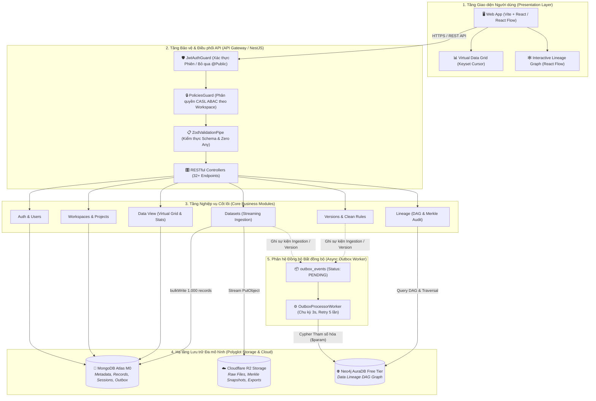

# NỀN TẢNG FULL-STACK QUẢN LÝ & GIÁM SÁT CHẤT LƯỢNG DỮ LIỆU CÓ AI HỖ TRỢ
### (AI Systems Support Detecting and Handling Data Quality Issues)

[](https://www.typescriptlang.org/)
[](https://nestjs.com/)
[](#4-công-nghệ--hạ-tầng-đám-mây-tech-stack)
[](#5-ràng-buộc-chất-lượng--tiêu-chuẩn-bất-biến-quality--safety-invariants)
[](#)

---

## 1. Định vị & Tuyên ngôn Giá trị của Hệ thống (Problem & Vision)

Trong kỷ nguyên Trí tuệ Nhân tạo và Ra quyết định dựa trên Dữ liệu (Data-Driven Decision Making), vấn đề **"Dữ liệu rác vào $\rightarrow$ Kết quả rác ra" (Garbage In, Garbage Out)** là rào cản lớn nhất của các kỹ sư và chuyên viên phân tích dữ liệu. Các vấn đề chất lượng dữ liệu phổ biến bao gồm:
- Dữ liệu bị khuyết thiếu (Missing values), dị biệt ngoài ngưỡng (Outliers), định dạng không đồng nhất.
- Thiếu công cụ truy vết nguồn gốc (Data Lineage), không biết dữ liệu lỗi bắt nguồn từ đâu và ảnh hưởng đến những hệ thống nào.
- Việc sửa đổi dữ liệu thủ công tiềm ẩn rủi ro phá hủy dữ liệu gốc, không có cơ chế khôi phục phiên bản (Data Versioning & Rollback) và không thể đối soát tính toàn vẹn (Integrity Verification).

**Hệ thống AI Hỗ trợ Phát hiện & Xử lý Vấn đề Chất lượng Dữ liệu** được xây dựng như một nền tảng tập trung (Enterprise Full-Stack Data Quality Platform) giải quyết toàn diện các thách thức trên:
1. **Tiếp nhận Dữ liệu Đa nhánh Song song:** Streaming Ingestion CSV/Excel dung lượng lớn với mức tiêu thụ RAM $\le 20\text{ MB}$.
2. **Khám phá & Thống kê Tốc độ cao:** Lưới dữ liệu ảo (Virtual Grid) phân trang con trỏ Keyset $\le 50\text{ ms}$ cho hàng triệu dòng dữ liệu.
3. **Đồ thị Phả hệ Nguồn gốc (Data Lineage DAG):** Trực quan hóa toàn bộ chuỗi biến đổi trên Neo4j AuraDB và kiểm toán tính toàn vẹn chuỗi băm mật mã học Merkle chống giả mạo.
4. **Động cơ Làm sạch Xác định & Quản lý Phiên bản:** Bộ quy tắc chuẩn hóa nhiều tầng kết hợp cơ chế lưu trữ snapshot bất biến trên Cloudflare R2 và khôi phục tại chỗ (In-place Rollback).
5. **Trợ lý AI Hỗ trợ Phân tích (Giai đoạn 2):** Ứng dụng mô hình ngôn ngữ lớn (Google Gemini API) và học máy để tự động phát hiện dị biệt ngữ cảnh và kê đơn xử lý thông minh.

---

## 2. Bức tranh Tổng quan Kiến trúc Toàn diện (System Architecture)

Hệ thống được thiết kế theo mô hình **Modular Monolith** phân tầng rõ ràng, kết hợp cơ chế lưu trữ đa đám mây (Polyglot Persistence) và phân tách giao dịch bất đồng bộ qua **Transactional Outbox Pattern**:



---

## 3. Bản đồ Tính năng & Phân hệ Nghiệp vụ (Feature Modules)

Hệ thống backend được phân rã thành các phân hệ nghiệp vụ độc lập, mỗi module chịu trách nhiệm duy nhất (Single Responsibility) và có tài liệu chi tiết riêng:

| Module | Vị trí Thư mục | Trách nhiệm Nghiệp vụ Cốt lõi | Tài liệu Module |
| :--- | :--- | :--- | :---: |
| **Auth** | `src/backend/src/modules/auth/` | Đăng ký, đăng nhập, cấp phát Access Token (JWT 15m) & Refresh Token (7d), băm một chiều SHA-256 cho phiên làm việc `user_sessions`, thu hồi phiên từ xa. | [Chi tiết](file:///home/hoa/Documents/UTH/L%E1%BA%ADp%20tr%C3%ACnh%20JS%20&%20TS/AI%20systems%20support%20detecting%20and%20handling%20data%20quality%20issues%20/src/backend/src/modules/auth/README.md) |
| **Users** | `src/backend/src/modules/users/` | Quản lý hồ sơ người dùng, phân tách vai trò hệ thống, chuẩn hóa xóa mềm `deleted_at: Date`, chỉ mục một phần cho phép tái sử dụng email. | [Chi tiết](file:///home/hoa/Documents/UTH/L%E1%BA%ADp%20tr%C3%ACnh%20JS%20&%20TS/AI%20systems%20support%20detecting%20and%20handling%20data%20quality%20issues%20/src/backend/src/modules/users/README.md) |
| **Workspaces** | `src/backend/src/modules/workspaces/` | Ranh giới cô lập dữ liệu cấp cao nhất (Multi-tenancy Boundary), quản lý nhóm thành viên và phân quyền theo mô hình CASL: `Owner`, `Editor`, `Viewer`. | [Chi tiết](file:///home/hoa/Documents/UTH/L%E1%BA%ADp%20tr%C3%ACnh%20JS%20&%20TS/AI%20systems%20support%20detecting%20and%20handling%20data%20quality%20issues%20/src/backend/src/modules/workspaces/README.md) |
| **Projects** | `src/backend/src/modules/projects/` | Quản lý dự án trực thuộc Workspace, thực thi ràng buộc Single Dataset (`has_dataset`) nhằm đơn giản hóa cây phả hệ dữ liệu. | [Chi tiết](file:///home/hoa/Documents/UTH/L%E1%BA%ADp%20tr%C3%ACnh%20JS%20&%20TS/AI%20systems%20support%20detecting%20and%20handling%20data%20quality%20issues%20/src/backend/src/modules/projects/README.md) |
| **Datasets** | `src/backend/src/modules/datasets/` | Cổng Ingestion Gateway đa luồng song song: tính SHA-256 on-the-fly, stream upload Cloudflare R2, suy luận schema 100 dòng đầu, nạp MongoDB theo mẻ 1.000 dòng. | [Chi tiết](file:///home/hoa/Documents/UTH/L%E1%BA%ADp%20tr%C3%ACnh%20JS%20&%20TS/AI%20systems%20support%20detecting%20and%20handling%20data%20quality%20issues%20/src/backend/src/modules/datasets/README.md) |
| **Data View** | `src/backend/src/modules/data-view/` | Động cơ phân trang Keyset Cursor $O(1)$ $\le 50\text{ ms}$, sửa ô trực tiếp (In-place Cell Edit) và tính toán biểu đồ Histogram 10 khoảng qua MongoDB Aggregation `$bucket`. | [Chi tiết](file:///home/hoa/Documents/UTH/L%E1%BA%ADp%20tr%C3%ACnh%20JS%20&%20TS/AI%20systems%20support%20detecting%20and%20handling%20data%20quality%20issues%20/src/backend/src/modules/data-view/README.md) |
| **Lineage** | `src/backend/src/modules/lineage/` | Quản lý Đồ thị Phả hệ DAG trên Neo4j AuraDB, truy vết nguồn gốc (Upstream Root Cause), tác động lan truyền (Downstream Impact) và đối soát chuỗi băm Merkle chống giả mạo. | [Chi tiết](file:///home/hoa/Documents/UTH/L%E1%BA%ADp%20tr%C3%ACnh%20JS%20&%20TS/AI%20systems%20support%20detecting%20and%20handling%20data%20quality%20issues%20/src/backend/src/modules/lineage/README.md) |
| **Shared** | `src/backend/src/shared/` | Khung hạ tầng dùng chung: CASL ABAC Factory, Ambient Mongo Transaction (`AsyncLocalStorage`), S3 Quota Guard, PII Data Masking, Zod OpenAPI Bridge, BaseMongoRepository. | [Chi tiết](file:///home/hoa/Documents/UTH/L%E1%BA%ADp%20tr%C3%ACnh%20JS%20&%20TS/AI%20systems%20support%20detecting%20and%20handling%20data%20quality%20issues%20/src/backend/src/shared/README.md) |

---

## 4. Công nghệ & Hạ tầng Đám mây (Tech Stack)

### Backend & Công nghệ Lập trình
- **Ngôn ngữ:** TypeScript 5.6+ (`^5.6.3` trong `package.json`, chế độ `strict: true`, kích hoạt bắt buộc **Zero Any Policy**).
- **Khung ứng dụng (Framework):** NestJS 11 (`^11.1.21`, Kiến trúc Modular Monolith, Dependency Injection, Pipes, Interceptors, Guards).
- **Kiểm thực Dữ liệu (Validation):** Zod 3 + `zod-to-json-schema` (Tự động sinh đặc tả Swagger OpenAPI 3.0).
- **Bảo mật & Phân quyền:** Passport JWT, `@casl/ability` (Attribute-based Access Control), Bcrypt (Salt 12).
- **Mật mã học & Xử lý Luồng:** Node.js Native Crypto (AES-256-GCM, PBKDF2 100.000 vòng, SHA-256), `busboy`, `fast-csv`.

### Hệ thống Lưu trữ Đa tầng (Multi-Database Infrastructure)
- **MongoDB Atlas (Database `test-ai-system-jsts-db`):** Lưu trữ tài liệu phi cấu trúc, metadata, bản ghi dữ liệu bảng thô (`dataset_records`), phiên làm việc và bảng hàng đợi Outbox.
- **Neo4j AuraDB Free Tier:** Cơ sở dữ liệu đồ thị lưu trữ các Nút (`Dataset`, `Version`, `Transformation`) và Cạnh (`DERIVED_FROM`, `APPLIED_TO`) phục vụ truy vết phả hệ dữ liệu.
- **Cloudflare R2 (Tương thích Amazon S3 API):** Lưu trữ tệp dữ liệu thô nguyên bản, tệp snapshot phục vụ khôi phục (Rollback) và tệp xuất dữ liệu mã hóa.
- **Hệ thống Cảnh báo SRE:** `https://ntfy.sh/AI-SYSTEM-DATA-QUALITY` (Thông báo đẩy sự cố khẩn cấp P0 tới thiết bị di động).

---

## 5. Ràng buộc Chất lượng & Tiêu chuẩn Bất biến (Quality & Safety Invariants)

Hệ thống được phát triển tuân thủ nghiêm ngặt các nguyên tắc kỹ thuật trong tài liệu nội bộ:

1. **Nguyên tắc Zero Any (Mục 13 WORKING RULE):**
   - Cấm tuyệt đối kiểu dữ liệu `any` trong toàn bộ mã nguồn ứng dụng, scripts và test suites (`: any`, `as any`, `<any>`, `Record<string, any>`).
   - Mọi dữ liệu không chắc chắn phải được bọc trong `unknown`, kiểm tra bằng Type Guards (`instanceof`, `typeof`) hoặc kiểm thực an toàn qua Zod (`schema.safeParse()`).
   - Tệp kiểm thử tự động [`test/zero-any.spec.ts`](file:///home/hoa/Documents/UTH/L%E1%BA%ADp%20tr%C3%ACnh%20JS%20&%20TS/AI%20systems%20support%20detecting%20and%20handling%20data%20quality%20issues%20/src/backend/test/zero-any.spec.ts) quét toàn bộ cây thư mục mã nguồn để đảm bảo không một vi phạm nào bị lọt.

2. **An toàn Truy vấn CSDL & Chống Injection (Mục 6 WORKING RULE):**
   - **MongoDB:** Bắt buộc dùng Parameterized Query / Mongoose Query Builder, tuyệt đối không nối chuỗi dữ liệu đầu vào từ người dùng.
   - **Neo4j Cypher:** 100% câu truy vấn Cypher sử dụng tham số hóa (`$param`), nghiêm cấm nối chuỗi để ngăn chặn Cypher Injection.

3. **Bảo mật Dữ liệu Nhạy cảm (PII Masking):**
   - Tiện ích `mask-pii.ts` tự động che giấu Email (`us***@gmail.com`), Số điện thoại (`090*****67`) và Căn cước công dân trong toàn bộ log hệ thống.
   - Mật khẩu người dùng (`password_hash`) được bảo vệ bằng `select: false` ở cấp độ Schema Mongoose.

4. **Chuỗi Băm Toàn vẹn Merkle (Cryptographic Merkle Invariant):**
   - Mỗi phiên bản dữ liệu lưu trữ bắt buộc thỏa mãn công thức:
     $$\text{version\_hash} = \text{SHA256}(\text{data\_checksum} + \text{parent\_hash} + \text{rules\_hash})$$
   - Mọi hành vi can thiệp dữ liệu trực tiếp trong database đều làm đứt gãy chuỗi băm và bị phát hiện ngay khi kiểm toán.

5. **Chuẩn hóa Xóa mềm (Soft Delete Invariant):**
   - Bắt buộc sử dụng `deleted_at: Date | null`. Nghiêm cấm dùng cờ boolean `is_deleted`.
   - Sử dụng MongoDB Partial Unique Index `{ partialFilterExpression: { deleted_at: null } }` để hỗ trợ tái đăng ký hoặc tái sử dụng tên tài nguyên khi bản ghi cũ đã bị xóa mềm.

---

## 6. Cấu trúc Thư mục Dự án (Project Directory Structure)

```
.
├── .agent/                      # Quy tắc và hướng dẫn cấu hình AI Agent
├── docs/                        # Tài liệu đặc tả kỹ thuật, kế hoạch Sprint và phân tích kiến trúc
│   ├── build_env.md             # Hướng dẫn thiết lập môi trường CSDL & biến .env
│   ├── feature_spec_v4.md       # Đặc tả chi tiết 9 nhóm tính năng
│   ├── report_overview_v5.md    # Báo cáo tổng quan dự án
│   └── sprint_b1..b3_plan.md    # Kế hoạch chi tiết các Sprint Backend
├── remember/                    # Quy chuẩn bắt buộc nội bộ (Module Documentation Rule, Zero Any)
│   └── module_documentation_rule.md # Quy định cấu trúc 6 phần cho README module
├── src/
│   ├── frontend/                # Thư mục mã nguồn Giao diện Người dùng (React / Vite)
│   └── backend/                 # Khung ứng dụng NestJS Backend
│       ├── package.json         # Danh mục dependencies, build scripts và test commands
│       ├── tsconfig.json        # Cấu hình TypeScript Strict Mode
│       ├── src/
│       │   ├── app.module.ts    # Root Module liên kết các phân hệ
│       │   ├── main.ts          # Điểm khởi chạy ứng dụng, cấu hình Swagger và Global Pipes
│       │   ├── modules/         # Các Module Nghiệp vụ (Auth, Users, Workspaces, Datasets, Lineage...)
│       │   │   ├── auth/        # Xác thực JWT, Refresh Token & Quản lý Session
│       │   │   ├── data-view/   # Keyset Pagination, Cell Edit & Histogram Aggregation
│       │   │   ├── datasets/    # Streaming Upload, Ingestion Pipeline & Checksum
│       │   │   ├── lineage/     # Đồ thị Neo4j AuraDB, Cypher Queries & Merkle Audit
│       │   │   ├── projects/    # Quản lý Dự án & Ràng buộc has_dataset
│       │   │   ├── users/       # Hồ sơ Người dùng & Vòng đời tài khoản
│       │   │   └── workspaces/  # Multi-tenancy Workspace & Phân quyền CASL
│       │   └── shared/          # Khung hạ tầng dùng chung (Crypto, Storage, CASL, Swagger, DB)
│       ├── scripts/             # Scripts hỗ trợ vận hành (Bootstrap DB, Reset CSDL, Seed Data)
│       └── test/                # Bộ kiểm thử Unit Test & End-to-End Test (Jest)
└── README.md                    # Tài liệu tổng quan toàn bộ dự án (Tệp hiện tại)
```

---

## 7. Hướng dẫn Cài đặt & Vận hành (Getting Started & Operations)

### 7.1. Yêu cầu Tiên quyết (Prerequisites)
- **Node.js:** Phiên bản $\ge 20.10.0$ LTS
- **Trình quản lý gói:** `pnpm` phiên bản $\ge 9.0.0$ (Khuyến nghị sử dụng `pnpm` để tối ưu hóa bộ nhớ)
- **Tài khoản Đám mây (Đã cấu hình sẵn sàng):**
  - Cụm MongoDB Atlas (Database `test-ai-system-jsts-db`)
  - Cụm Neo4j AuraDB Free Tier
  - Cloudflare R2 Bucket (`test-ai-system-storage`)

### 7.2. Thiết lập Biến Môi trường (.env)
Sao chép tệp cấu hình mẫu và cập nhật các thông tin kết nối thực tế:
```bash
cd src/backend
cp .env.example .env
```
*(Chi tiết cấu hình từng biến môi trường được trình bày đầy đủ tại [`docs/build_env.md`](file:///home/hoa/Documents/UTH/L%E1%BA%ADp%20tr%C3%ACnh%20JS%20&%20TS/AI%20systems%20support%20detecting%20and%20handling%20data%20quality%20issues%20/docs/build_env.md)).*

### 7.3. Cài đặt Phụ thuộc & Khởi tạo CSDL
```bash
# 1. Cài đặt các gói thư viện
pnpm install

# 2. Khởi tạo Schema, Indexes và nạp dữ liệu mẫu ban đầu
pnpm run db:bootstrap

# 3. (Tùy chọn) Reset từng dịch vụ CSDL độc lập khi cần làm sạch môi trường:
# Reset chỉ MongoDB:
CONFIRM_RESET=DROP_ALL_DATA pnpm run db:reset:mongo
# Reset chỉ Neo4j AuraDB:
CONFIRM_RESET=DROP_ALL_DATA pnpm run db:reset:neo4j
# Reset chỉ Cloudflare R2:
CONFIRM_RESET=DROP_ALL_DATA pnpm run db:reset:storage
```

### 7.4. Khởi chạy Ứng dụng
```bash
# Chạy ứng dụng ở chế độ Phát triển (Watch Mode):
pnpm run start:dev

# Kiểm tra an toàn kiểu dữ liệu TypeScript (Zero Any Check):
pnpm run type-check

# Chạy toàn bộ bộ kiểm thử tự động (Unit Tests & Guard Coverage):
pnpm test
```

Sau khi khởi chạy thành công, truy cập tài liệu API trực quan tại:
- **Swagger OpenAPI 3.0 UI:** `http://localhost:3000/api/v1/docs`

---

## 8. Lộ trình Phát triển & Trạng thái Dự án (Project Roadmap)

Dự án được phân kỳ thành 2 giai đoạn lớn với các Sprint phát triển rõ ràng:

### Giai đoạn 1: Nền tảng Cốt lõi Full-Stack (Core Platform MVP)
- [x] **Sprint B1 (Hạ tầng Nền tảng & Định danh):**
  - Mật mã học AES-256-GCM / SHA-256, Cloudflare R2 S3 Client với Quota Guard.
  - Phân quyền CASL ABAC đa tầng, Ambient Transaction qua `AsyncLocalStorage`.
  - Module `auth` (JWT, Refresh Token, Session Hash) và Module `users` (Soft delete, Partial Index).
- [x] **Sprint B2 (Tổ chức Không gian & Tiếp nhận Dữ liệu Thô):**
  - Module `workspaces` (Owner/Editor/Viewer) & Module `projects` (Ràng buộc Single Dataset).
  - Module `datasets`: Streaming Ingestion đa nhánh song song, Schema Inference 100 dòng đầu.
  - Module `data-view`: Keyset Cursor Pagination $\le 50\text{ ms}$, In-place Cell Edit, Histogram Aggregation.
- [ ] **Sprint B3 (Toàn vẹn Phả hệ, Quản lý Phiên bản & Làm sạch) - *Đang thực hiện*:**
  - [x] Module `lineage`: Đồ thị DAG Neo4j AuraDB, Outbox Processor Worker, Thuật toán Merkle Audit.
  - [ ] Module `versions`: Lưu snapshot Cloudflare R2, Quản lý băm Merkle, In-place Rollback & Diff.
  - [ ] Module `clean-rules`: Động cơ làm sạch 4 nhóm quy tắc, Dry-run preview 100 dòng in-memory, bulkWrite ghi đè.
  - [ ] Module `exports`: Xuất dữ liệu streaming CSV và mã hóa tệp AES-256-GCM.
- [ ] **Sprint F1 - F4 (Giao diện Web Frontend):**
  - Phát triển giao diện React + Tailwind CSS, Virtual Data Grid, Trực quan hóa đồ thị React Flow và Dashboard phân tích chất lượng.

### Giai đoạn 2: Tích hợp Động cơ AI Trợ lý Thông minh (AI Copilot Integration)
- [ ] **Tier 2 Anomaly Detection:** Tích hợp học máy không giám sát phát hiện ngoại lai phân phối.
- [ ] **Tier 3 Prescriptive AI Assistant:** Tích hợp Cloud LLM (Google Gemini API) suy luận ngữ cảnh, giải thích nguyên nhân lỗi và sinh quy tắc làm sạch tự động có sự phê duyệt của con người (Human-in-the-loop).

---

## 9. Đội ngũ Phát triển & Giảng viên Hướng dẫn

- **Đơn vị Đào tạo:** Trường Đại học Giao thông Vận tải TP.HCM (UTH) - Khoa Công nghệ Thông tin.
- **Học phần:** Lập trình JavaScript & TypeScript Nâng cao.
- **Đề tài:** Hệ thống AI Hỗ trợ Phát hiện và Xử lý Vấn đề về Chất lượng Dữ liệu.
- **Nhóm Sinh viên Thực hiện:** Tienes Hoa & Đội ngũ Phát triển.
