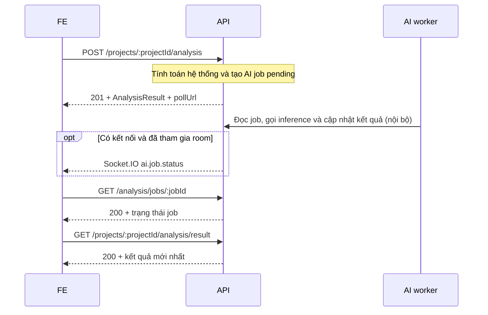

# API Design & Specification — Data Quality Platform (As-Is)

Ngày đối chiếu source: **18/11/2026**. Phạm vi: `src/backend/src`. Tài liệu mô tả contract hiện có; trạng thái chạy thực tế: **Chưa xác minh**.

## Mục lục

- [Phần 1 — API Overview](#overview)
- [Phần 2 — API Inventory](#inventory)
- [Phần 3 — API Specification theo module](#specification)
  - [Health](#spec-health) · [Auth](#spec-auth) · [Users](#spec-users)
  - [Workspaces](#spec-workspaces) · [Projects](#spec-projects) · [Datasets](#spec-datasets)
  - [Data View](#spec-data-view) · [Analysis / Summary / Report](#spec-analysis)
  - [Feedback](#spec-feedback) · [Issues](#spec-issues) · [Notifications](#spec-notifications)
- [Phần 4 — API Conventions & Error Handling](#conventions)
- [Phần 5 — Asynchronous API & Realtime](#async-realtime)
- [Phần 6 — Tổng kết & phạm vi xác minh](#verification)

## Phần 1 — API Overview

| Hạng mục | Contract hiện tại |
| --- | --- |
| Mục đích | Quản lý tài khoản, workspace/project, nhập CSV, truy vấn dữ liệu, phân tích chất lượng dữ liệu và AI, tổng kết/PDF, feedback, sự cố và thông báo. |
| Backend | NestJS 11, TypeScript, Express, Mongoose/MongoDB, Zod, Socket.IO. |
| Giao tiếp | HTTP REST JSON, multipart upload, stream tải file; Socket.IO với websocket/polling. Không tìm thấy SSE route. |
| Base URL | Mặc định `http://localhost:3000/api/v1`; origin/port thực tế phụ thuộc triển khai. HTTPS có cấu hình SSL_PORT mặc định 443, fallback 8443 khi thiếu quyền cổng 443. |
| Prefix / version | API_PREFIX mặc định `api/v1`; không thấy enableVersioning. `/health` và `/health/ready` nằm ngoài prefix. Các URL REST bên dưới dùng prefix mặc định. |
| URL trả trong payload | pollUrl/downloadUrl trong source dùng cứng `/api/v1`; Socket.IO path cũng dùng cứng `/api/v1/realtime`. |
| Authentication | JWT Bearer trong Authorization cho Protected HTTP endpoint; refresh token gửi trong JSON body; không có cookie auth ở các controller đã kiểm tra. |
| Request / response | JSON trừ upload/download; giữ nguyên tên field của mỗi contract. Response thông thường là `{success: true, data: ...}`; xem [Phần 4](#conventions). |
| Quy mô | **82 HTTP endpoint**, **14 controller**, **19 module tự định nghĩa** = 12 module nghiệp vụ + 6 module dùng chung + AppModule; không tính module thư viện. |
| Phân loại | **9 Public**, **73 Protected**. **3 endpoint khởi tạo/khởi động lại công việc bất đồng bộ** (gồm một endpoint hỗn hợp sync + async); 79 endpoint còn lại synchronous. |
| Swagger | UI ở `/api/v1/docs` theo prefix cấu hình; route hạ tầng Swagger không tính vào 82 route controller. |

Các module `realtime`, `audit` không có HTTP controller riêng; realtime được đặc tả ở Phần 5. Health thuộc AppModule. Danh mục tính cả hai route Google hiện trả 501, không tính transport handshake Socket.IO, CORS preflight hay route Swagger.

## Phần 2 — API Inventory

`Asynchronous` là route tạo/đặt lại job và trả response trước khi công việc nền hoàn tất. Các API polling vẫn là `Synchronous`. Với chạy phân tích, nhãn Asynchronous phản ánh nhánh AI; tính toán hệ thống diễn ra đồng bộ.

### Health / AppModule

| Method | Endpoint | Chức năng | Auth | Xử lý |
| --- | --- | --- | --- | --- |
| GET | `/health` | Kiểm tra liveness | Public | Synchronous |
| GET | `/health/ready` | Kiểm tra readiness | Public | Synchronous |

### Auth

| Method | Endpoint | Chức năng | Auth | Xử lý |
| --- | --- | --- | --- | --- |
| POST | `/api/v1/auth/register` | Đăng ký tài khoản | Public | Synchronous |
| POST | `/api/v1/auth/login` | Đăng nhập | Public | Synchronous |
| POST | `/api/v1/auth/refresh` | Gia hạn token | Public | Synchronous |
| POST | `/api/v1/auth/forgot-password` | Yêu cầu OTP đặt lại mật khẩu | Public | Synchronous |
| POST | `/api/v1/auth/reset-password` | Đặt lại mật khẩu bằng OTP | Public | Synchronous |
| POST | `/api/v1/auth/change-password` | Đổi mật khẩu | Protected | Synchronous |
| GET | `/api/v1/auth/google` | Điểm vào đăng nhập Google | Public | Synchronous |
| GET | `/api/v1/auth/google/callback` | Callback Google | Public | Synchronous |
| POST | `/api/v1/auth/logout` | Đăng xuất | Protected | Synchronous |
| GET | `/api/v1/auth/sessions` | Liệt kê phiên đang hoạt động | Protected | Synchronous |
| DELETE | `/api/v1/auth/sessions/:id` | Thu hồi phiên đăng nhập | Protected | Synchronous |

### Users & Admin Users

| Method | Endpoint | Chức năng | Auth | Xử lý |
| --- | --- | --- | --- | --- |
| GET | `/api/v1/users/me` | Xem hồ sơ cá nhân | Protected | Synchronous |
| PATCH | `/api/v1/users/me` | Cập nhật hồ sơ cá nhân | Protected | Synchronous |
| DELETE | `/api/v1/users/me` | Xóa mềm tài khoản | Protected | Synchronous |
| GET | `/api/v1/admin/users` | Tra cứu danh sách người dùng | Protected | Synchronous |
| GET | `/api/v1/admin/users/:id` | Xem hồ sơ người dùng | Protected | Synchronous |

### Workspaces

| Method | Endpoint | Chức năng | Auth | Xử lý |
| --- | --- | --- | --- | --- |
| POST | `/api/v1/workspaces` | Tạo workspace | Protected | Synchronous |
| GET | `/api/v1/workspaces` | Liệt kê workspace | Protected | Synchronous |
| GET | `/api/v1/workspaces/:id` | Xem workspace | Protected | Synchronous |
| PATCH | `/api/v1/workspaces/:id` | Cập nhật workspace | Protected | Synchronous |
| DELETE | `/api/v1/workspaces/:id` | Xóa mềm workspace | Protected | Synchronous |
| GET | `/api/v1/workspaces/:id/members` | Liệt kê thành viên workspace | Protected | Synchronous |
| POST | `/api/v1/workspaces/:id/members` | Thêm thành viên workspace | Protected | Synchronous |
| DELETE | `/api/v1/workspaces/:id/members/:userId` | Xóa thành viên workspace | Protected | Synchronous |
| POST | `/api/v1/workspaces/:id/transfer-owner` | Nhượng quyền workspace owner | Protected | Synchronous |
| POST | `/api/v1/workspaces/:id/leave` | Rời workspace | Protected | Synchronous |

### Projects

| Method | Endpoint | Chức năng | Auth | Xử lý |
| --- | --- | --- | --- | --- |
| POST | `/api/v1/workspaces/:workspaceId/projects` | Tạo project | Protected | Synchronous |
| GET | `/api/v1/workspaces/:workspaceId/projects` | Liệt kê project của workspace | Protected | Synchronous |
| GET | `/api/v1/projects/:id` | Xem project | Protected | Synchronous |
| PATCH | `/api/v1/projects/:id` | Cập nhật project | Protected | Synchronous |
| DELETE | `/api/v1/projects/:id` | Xóa mềm project | Protected | Synchronous |
| PUT | `/api/v1/projects/:id/snapshot` | Lưu project hoàn tất | Protected | Synchronous |
| GET | `/api/v1/projects/:id/members` | Liệt kê thành viên project | Protected | Synchronous |
| POST | `/api/v1/projects/:id/members` | Thêm thành viên project | Protected | Synchronous |
| PATCH | `/api/v1/projects/:id/members/:userId` | Đổi vai trò thành viên project | Protected | Synchronous |
| DELETE | `/api/v1/projects/:id/members/:userId` | Xóa thành viên project | Protected | Synchronous |
| POST | `/api/v1/projects/:id/transfer-owner` | Nhượng quyền project owner | Protected | Synchronous |

### Datasets

| Method | Endpoint | Chức năng | Auth | Xử lý |
| --- | --- | --- | --- | --- |
| POST | `/api/v1/projects/:projectId/datasets/upload` | Upload và nhập dữ liệu CSV | Protected | Synchronous |
| GET | `/api/v1/projects/:projectId/datasets` | Xem dataset của project | Protected | Synchronous |
| GET | `/api/v1/datasets/:id` | Xem dataset | Protected | Synchronous |
| PATCH | `/api/v1/datasets/:id` | Đổi tên dataset | Protected | Synchronous |
| PATCH | `/api/v1/datasets/:id/columns` | Đổi tên hiển thị cột | Protected | Synchronous |
| POST | `/api/v1/datasets/:id/columns/reset` | Khôi phục tên cột gốc | Protected | Synchronous |
| DELETE | `/api/v1/datasets/:id` | Xóa mềm dataset | Protected | Synchronous |
| GET | `/api/v1/datasets/:id/file` | Tải file CSV gốc | Protected | Synchronous |
| GET | `/api/v1/datasets/:id/schema` | Xem schema cột | Protected | Synchronous |

### Data View

| Method | Endpoint | Chức năng | Auth | Xử lý |
| --- | --- | --- | --- | --- |
| GET | `/api/v1/datasets/:datasetId/records` | Đọc bản ghi theo cursor | Protected | Synchronous |
| POST | `/api/v1/datasets/:datasetId/records/query` | Lọc, tìm kiếm và sắp xếp bản ghi | Protected | Synchronous |
| GET | `/api/v1/datasets/:datasetId/columns/:columnKey/stats` | Thống kê cột | Protected | Synchronous |

### Analysis, Summary & Report

| Method | Endpoint | Chức năng | Auth | Xử lý |
| --- | --- | --- | --- | --- |
| POST | `/api/v1/projects/:projectId/analysis/config` | Lưu cấu hình phân tích | Protected | Synchronous |
| GET | `/api/v1/projects/:projectId/analysis/config` | Xem cấu hình phân tích | Protected | Synchronous |
| POST | `/api/v1/projects/:projectId/analysis` | Chạy phân tích và tạo AI job | Protected | Asynchronous |
| GET | `/api/v1/projects/:projectId/analysis/result` | Xem kết quả phân tích mới nhất | Protected | Synchronous |
| GET | `/api/v1/analysis/jobs/:jobId` | Xem trạng thái AI job | Protected | Synchronous |
| POST | `/api/v1/analysis/jobs/:jobId/retry` | Yêu cầu chạy lại AI job | Protected | Asynchronous |
| POST | `/api/v1/analysis/jobs/:jobId/result` | Gắn kết quả AI vào lần phân tích | Protected | Synchronous |
| POST | `/api/v1/projects/:projectId/summary` | Tạo tổng kết | Protected | Synchronous |
| GET | `/api/v1/projects/:projectId/summary` | Xem tổng kết mới nhất | Protected | Synchronous |
| POST | `/api/v1/projects/:projectId/report` | Yêu cầu tạo báo cáo PDF | Protected | Asynchronous |
| GET | `/api/v1/projects/:projectId/report/:reportId/file` | Theo dõi hoặc tải báo cáo PDF | Protected | Synchronous |

### Feedback

| Method | Endpoint | Chức năng | Auth | Xử lý |
| --- | --- | --- | --- | --- |
| POST | `/api/v1/analyses/:analysisId/findings/:findingId/feedback` | Nhận xét một phát hiện | Protected | Synchronous |
| POST | `/api/v1/analyses/:analysisId/feedback` | Nhận xét cả lần phân tích | Protected | Synchronous |
| GET | `/api/v1/analyses/:analysisId/findings/:findingId/feedback` | Xem nhận xét của phát hiện | Protected | Synchronous |
| GET | `/api/v1/analyses/:analysisId/feedback` | Xem nhận xét của lần phân tích | Protected | Synchronous |
| PATCH | `/api/v1/feedback/:id` | Sửa nhận xét của mình | Protected | Synchronous |
| DELETE | `/api/v1/feedback/:id` | Xóa nhận xét | Protected | Synchronous |
| GET | `/api/v1/projects/:projectId/ai-quality-metrics` | Thống kê chất lượng AI | Protected | Synchronous |

### Issues

| Method | Endpoint | Chức năng | Auth | Xử lý |
| --- | --- | --- | --- | --- |
| POST | `/api/v1/issues` | Tạo báo cáo sự cố | Protected | Synchronous |
| GET | `/api/v1/issues` | Liệt kê báo cáo sự cố của mình | Protected | Synchronous |
| POST | `/api/v1/issues/:id/attachments` | Upload tệp đính kèm sự cố | Protected | Synchronous |
| GET | `/api/v1/issues/:id/attachments/:attachmentId` | Tải tệp đính kèm sự cố | Protected | Synchronous |
| GET | `/api/v1/issues/:id` | Xem báo cáo sự cố của mình | Protected | Synchronous |
| GET | `/api/v1/admin/issues` | Tra cứu toàn bộ báo cáo sự cố | Protected | Synchronous |
| GET | `/api/v1/admin/issues/:id` | Xem báo cáo sự cố với quyền quản trị | Protected | Synchronous |
| PATCH | `/api/v1/admin/issues/:id/status` | Đổi trạng thái báo cáo sự cố | Protected | Synchronous |

### Notifications

| Method | Endpoint | Chức năng | Auth | Xử lý |
| --- | --- | --- | --- | --- |
| GET | `/api/v1/notifications` | Liệt kê thông báo cá nhân | Protected | Synchronous |
| GET | `/api/v1/notifications/unread-count` | Đếm thông báo chưa đọc | Protected | Synchronous |
| GET | `/api/v1/notifications/:id` | Xem và đánh dấu đã đọc thông báo | Protected | Synchronous |
| PATCH | `/api/v1/notifications/:id/read` | Đánh dấu thông báo đã đọc | Protected | Synchronous |
| PATCH | `/api/v1/users/me/notification-preferences` | Đổi tùy chọn nhận thông báo | Protected | Synchronous |

## Phần 3 — API Specification theo module

**Cách đọc:** Success mô tả giá trị **data bên trong envelope** ở Phần 4, trừ khi ghi stream, JSON trực tiếp hoặc 204. `ID` = chuỗi định danh MongoDB 24 hex; `DateTime` = chuỗi ISO 8601. R = Required, O = Optional. Dấu `?` trong mô tả shape là field Optional; “hoặc null” là Nullable. Các tên schema là shape của JSON, không phải source TypeScript.

Mọi route chịu lỗi chung ở [Phần 4](#errors). Protected gửi `Authorization: Bearer <access_token>` và có thể nhận 401; route có policy/role có thể nhận 403. Lỗi riêng bên dưới được cộng với lỗi chung. Query không khai báo thì không có contract query bổ sung; request không có body ghi rõ “Không có”. Các ID path là Required/string; **không có validation ObjectId thống nhất cho mọi route**, vì vậy lỗi ID sai tùy endpoint, không mặc định luôn là 400. Các shape response được định nghĩa một lần tại [schema dùng chung](#response-schemas). Required của field con áp dụng khi object cha được gửi.

### Health / AppModule

Nguồn route: [app.controller.ts](../../src/backend/src/app.controller.ts).

#### GET /health — Kiểm tra liveness

| Thuộc tính | Nội dung |
| --- | --- |
| Mục đích | Kiểm tra liveness.  |
| Authentication | Public |
| Authorization | Không có role/policy bổ sung tại route. |
| Processing | Sync |
| Request | Body: **Không có**. Query: Không có. |
| Success | 200 · `Health` |
| Errors | — Lỗi chung: [Phần 4.3](#errors). |

#### GET /health/ready — Kiểm tra readiness

| Thuộc tính | Nội dung |
| --- | --- |
| Mục đích | Kiểm tra readiness.  |
| Authentication | Public |
| Authorization | Không có role/policy bổ sung tại route. |
| Processing | Sync |
| Request | Body: **Không có**. Query: Không có. |
| Success | 200 · `Readiness` |
| Errors | 503 `HTTP_503`: MongoDB chưa sẵn sàng; envelope lỗi chung, không trả nguyên `checks` của readiness. Lỗi chung: [Phần 4.3](#errors). |

### Auth

Nguồn route: [auth.controller.ts](../../src/backend/src/modules/auth/infrastructure/http/auth.controller.ts).

Schema response: `Role` = admin/analyst. `Session` xem [schema dùng chung](#response-schemas).

#### Request schema: RegisterSchema

| Field | Kiểu | Bắt buộc | Constraint / default |
| --- | --- | --- | --- |
| `email` | `string` | Required | format email |
| `password` | `string` | Required | dài ≥8; dài ≤100 |
| `first_name` | `string` | Required | dài ≥1; dài ≤50 |
| `last_name` | `string` | Required | dài ≥1; dài ≤50 |
| `role` | `admin/analyst` | Optional | mặc định "analyst" |

Email hợp lệ, chuyển lowercase/trim; password 8..100 ký tự. first_name/last_name kiểm tra 1..50 trước trim.

#### Request schema: LoginSchema

| Field | Kiểu | Bắt buộc | Constraint / default |
| --- | --- | --- | --- |
| `email` | `string` | Required | format email |
| `password` | `string` | Required | dài ≥1 |

Email hợp lệ, lowercase/trim; password chỉ yêu cầu không rỗng.

#### Request schema: RefreshTokenSchema

| Field | Kiểu | Bắt buộc | Constraint / default |
| --- | --- | --- | --- |
| `refresh_token` | `string` | Required | dài ≥1 |

#### Request schema: ForgotPasswordSchema

| Field | Kiểu | Bắt buộc | Constraint / default |
| --- | --- | --- | --- |
| `email` | `string` | Required | format email |

#### Request schema: ResetPasswordSchema

| Field | Kiểu | Bắt buộc | Constraint / default |
| --- | --- | --- | --- |
| `email` | `string` | Required | format email |
| `otp` | `string` | Required | pattern ^\d{6}$ |
| `new_password` | `string` | Required | dài ≥8; dài ≤100 |

#### Request schema: ChangePasswordSchema

| Field | Kiểu | Bắt buộc | Constraint / default |
| --- | --- | --- | --- |
| `current_password` | `string` | Required | dài ≥1 |
| `new_password` | `string` | Required | dài ≥8; dài ≤100 |
| `confirm_password` | `string` | Required | dài ≥1 |

new_password phải bằng confirm_password, khác mật khẩu hiện tại; kiểm tra thêm ở nghiệp vụ.

#### POST /api/v1/auth/register — Đăng ký tài khoản

| Thuộc tính | Nội dung |
| --- | --- |
| Mục đích | Đăng ký tài khoản. `role` được DTO chấp nhận nhưng tài khoản tạo mới luôn là `analyst`. Rate limit 5 request/giờ. |
| Authentication | Public |
| Authorization | Không có role/policy bổ sung tại route. |
| Processing | Sync |
| Request | Body JSON: [RegisterSchema](#request-registerschema). Query: Không có. |
| Success | 201 · `{id: ID, email: string, first_name: string, last_name: string, role: "analyst", created_at: DateTime}` |
| Errors | 409 `Conflict`: email đã tồn tại. Lỗi chung: [Phần 4.3](#errors). |

#### POST /api/v1/auth/login — Đăng nhập

| Thuộc tính | Nội dung |
| --- | --- |
| Mục đích | Đăng nhập. Rate limit 10 request/giờ. `User-Agent` và IP request được dùng cho thông tin phiên. |
| Authentication | Public |
| Authorization | Không có role/policy bổ sung tại route. |
| Processing | Sync |
| Request | Body JSON: [LoginSchema](#request-loginschema). Query: Không có. |
| Success | 200 · `{access_token: string, refresh_token: string, expires_in: 900, device_name: string, user: {id: ID, email: string, role: Role}}` |
| Errors | 401 `Unauthorized`: sai thông tin đăng nhập hoặc tài khoản bị khóa. Lỗi chung: [Phần 4.3](#errors). |

#### POST /api/v1/auth/refresh — Gia hạn token

| Thuộc tính | Nội dung |
| --- | --- |
| Mục đích | Gia hạn token. Body chứa refresh token, không dùng cookie. Rotation trả refresh token mới; phát hiện reuse sẽ thu hồi các phiên của tài khoản. Rate limit 10 request/giờ. |
| Authentication | Public |
| Authorization | Không có role/policy bổ sung tại route. |
| Processing | Sync |
| Request | Body JSON: [RefreshTokenSchema](#request-refreshtokenschema). Query: Không có. |
| Success | 200 · `{access_token: string, refresh_token: string, expires_in: 900}` |
| Errors | 401 `TOKEN_EXPIRED`: refresh token không hợp lệ/hết hạn; `TOKEN_INVALID`: tái sử dụng token đã thu hồi; `Unauthorized`: tài khoản không hoạt động. Lỗi chung: [Phần 4.3](#errors). |

#### POST /api/v1/auth/forgot-password — Yêu cầu OTP đặt lại mật khẩu

| Thuộc tính | Nội dung |
| --- | --- |
| Mục đích | Yêu cầu OTP đặt lại mật khẩu. Response trung lập dù email không tồn tại; OTP có hạn 10 phút và không trả trong response. Source hiện ghi OTP vào log, chưa có adapter gửi email thực. Rate limit 5 request/giờ, thêm giới hạn 5 lần/giờ/email. |
| Authentication | Public |
| Authorization | Không có role/policy bổ sung tại route. |
| Processing | Sync |
| Request | Body JSON: [ForgotPasswordSchema](#request-forgotpasswordschema). Query: Không có. |
| Success | 200 · `{message: string}` |
| Errors | 429 `LIMIT_EXCEEDED`: quá số lần gửi OTP. Lỗi chung: [Phần 4.3](#errors). |

#### POST /api/v1/auth/reset-password — Đặt lại mật khẩu bằng OTP

| Thuộc tính | Nội dung |
| --- | --- |
| Mục đích | Đặt lại mật khẩu bằng OTP. OTP sai tối đa 3 lần; thành công thu hồi toàn bộ refresh session. Rate limit 10 request/giờ. |
| Authentication | Public |
| Authorization | Không có role/policy bổ sung tại route. |
| Processing | Sync |
| Request | Body JSON: [ResetPasswordSchema](#request-resetpasswordschema). Query: Không có. |
| Success | 200 · `{message: string}` |
| Errors | 400 `Bad Request`: OTP sai/hết hạn/đã bị vô hiệu; 401 `Unauthorized`: tài khoản bị khóa. Lỗi chung: [Phần 4.3](#errors). |

#### POST /api/v1/auth/change-password — Đổi mật khẩu

| Thuộc tính | Nội dung |
| --- | --- |
| Mục đích | Đổi mật khẩu. Giữ phiên hiện tại nếu token có sessionId; thu hồi các phiên khác. Rate limit 5 request/giờ. |
| Authentication | JWT Bearer · [quy ước chung](#auth-conventions) |
| Authorization | Không có role/policy bổ sung tại route. |
| Processing | Sync |
| Request | Body JSON: [ChangePasswordSchema](#request-changepasswordschema). Query: Không có. |
| Success | 200 · `{message: string}` |
| Errors | 400 `Bad Request`: mật khẩu hiện tại sai, hai lần nhập mới không khớp hoặc mới trùng cũ. Lỗi chung: [Phần 4.3](#errors). |

#### GET /api/v1/auth/google — Điểm vào đăng nhập Google

| Thuộc tính | Nội dung |
| --- | --- |
| Mục đích | Điểm vào đăng nhập Google.  |
| Authentication | Public |
| Authorization | Không có role/policy bổ sung tại route. |
| Processing | Sync |
| Request | Body: **Không có**. Query: Không có. |
| Success | Không có response thành công; hiện luôn trả 501. |
| Errors | 501 `DEPENDENCY_UNAVAILABLE`: chức năng chưa khả dụng. Lỗi chung: [Phần 4.3](#errors). |

#### GET /api/v1/auth/google/callback — Callback Google

| Thuộc tính | Nội dung |
| --- | --- |
| Mục đích | Callback Google.  |
| Authentication | Public |
| Authorization | Không có role/policy bổ sung tại route. |
| Processing | Sync |
| Request | Body: **Không có**. Query: Không có. |
| Success | Không có response thành công; hiện luôn trả 501. |
| Errors | 501 `DEPENDENCY_UNAVAILABLE`: chức năng chưa khả dụng. Lỗi chung: [Phần 4.3](#errors). |

#### POST /api/v1/auth/logout — Đăng xuất

| Thuộc tính | Nội dung |
| --- | --- |
| Mục đích | Đăng xuất. Thu hồi refresh session gắn với `sessionId` trong access token nếu có. |
| Authentication | JWT Bearer · [quy ước chung](#auth-conventions) |
| Authorization | Không có role/policy bổ sung tại route. |
| Processing | Sync |
| Request | Body: **Không có**. Query: Không có. |
| Success | 200 · `{message: string}` |
| Errors | — Lỗi chung: [Phần 4.3](#errors). |

#### GET /api/v1/auth/sessions — Liệt kê phiên đang hoạt động

| Thuộc tính | Nội dung |
| --- | --- |
| Mục đích | Liệt kê phiên đang hoạt động.  |
| Authentication | JWT Bearer · [quy ước chung](#auth-conventions) |
| Authorization | Không có role/policy bổ sung tại route. |
| Processing | Sync |
| Request | Body: **Không có**. Query: Không có. |
| Success | 200 · `Session[]` |
| Errors | — Lỗi chung: [Phần 4.3](#errors). |

#### DELETE /api/v1/auth/sessions/:id — Thu hồi phiên đăng nhập

| Thuộc tính | Nội dung |
| --- | --- |
| Mục đích | Thu hồi phiên đăng nhập.  |
| Authentication | JWT Bearer · [quy ước chung](#auth-conventions) |
| Authorization | Chỉ phiên thuộc tài khoản hiện tại. |
| Processing | Sync |
| Request | Path `id`: string, Required; ID. Body: **Không có**. Query: Không có. |
| Success | 200 · `{message: string}` |
| Errors | 400 `Bad Request`: không tìm thấy phiên của mình hoặc không thu hồi được. Lỗi chung: [Phần 4.3](#errors). |

### Users & Admin Users

Nguồn route: [users.controller.ts](../../src/backend/src/modules/users/infrastructure/http/users.controller.ts), [admin-users.controller.ts](../../src/backend/src/modules/users/infrastructure/http/admin-users.controller.ts).

Profile trả camelCase; AdminUserProfile và UserProfile khác nhau ở các field được loại bỏ, xem [schema dùng chung](#response-schemas).

#### Request schema: UpdateUserSchema

| Field | Kiểu | Bắt buộc | Constraint / default |
| --- | --- | --- | --- |
| `first_name` | `string` | Optional | dài ≥1; dài ≤50 |
| `last_name` | `string` | Optional | dài ≥1; dài ≤50 |
| `avatar_url` | `string` | Optional | format uri |

#### GET /api/v1/users/me — Xem hồ sơ cá nhân

| Thuộc tính | Nội dung |
| --- | --- |
| Mục đích | Xem hồ sơ cá nhân.  |
| Authentication | JWT Bearer · [quy ước chung](#auth-conventions) |
| Authorization | Tài khoản hiện tại. |
| Processing | Sync |
| Request | Body: **Không có**. Query: Không có. |
| Success | 200 · `UserProfile` |
| Errors | 404 `Not Found`: tài khoản không tồn tại. Lỗi chung: [Phần 4.3](#errors). |

#### PATCH /api/v1/users/me — Cập nhật hồ sơ cá nhân

| Thuộc tính | Nội dung |
| --- | --- |
| Mục đích | Cập nhật hồ sơ cá nhân.  |
| Authentication | JWT Bearer · [quy ước chung](#auth-conventions) |
| Authorization | Tài khoản hiện tại. |
| Processing | Sync |
| Request | Body JSON: [UpdateUserSchema](#request-updateuserschema). Query: Không có. |
| Success | 200 · `UserProfile` |
| Errors | 404 `Not Found`: tài khoản không tồn tại. Lỗi chung: [Phần 4.3](#errors). |

#### DELETE /api/v1/users/me — Xóa mềm tài khoản

| Thuộc tính | Nội dung |
| --- | --- |
| Mục đích | Xóa mềm tài khoản. Đồng thời thu hồi refresh session của tài khoản. |
| Authentication | JWT Bearer · [quy ước chung](#auth-conventions) |
| Authorization | Tài khoản hiện tại. |
| Processing | Sync |
| Request | Body: **Không có**. Query: Không có. |
| Success | 200 · `{message: string}` |
| Errors | 404 `Not Found`: không tìm thấy tài khoản. Lỗi chung: [Phần 4.3](#errors). |

#### GET /api/v1/admin/users — Tra cứu danh sách người dùng

| Thuộc tính | Nội dung |
| --- | --- |
| Mục đích | Tra cứu danh sách người dùng. Query: `search?: string` trim ≤200; `role?: admin/analyst`; `status?: active/blocked`; `page?: integer ≥1 =1`; `limit?: integer 1..100 =15`. Sắp xếp thời điểm tạo giảm dần. |
| Authentication | JWT Bearer · [quy ước chung](#auth-conventions) |
| Authorization | Role hệ thống `admin`. |
| Processing | Sync |
| Request | Query: các field nêu ở mục đích bên dưới (search, role, status, page, limit). Body: **Không có**. |
| Success | 200 · `{items: AdminUserProfile[], total: integer, page: integer, limit: integer}` |
| Errors | — Lỗi chung: [Phần 4.3](#errors). |

#### GET /api/v1/admin/users/:id — Xem hồ sơ người dùng

| Thuộc tính | Nội dung |
| --- | --- |
| Mục đích | Xem hồ sơ người dùng.  |
| Authentication | JWT Bearer · [quy ước chung](#auth-conventions) |
| Authorization | Role hệ thống `admin`. |
| Processing | Sync |
| Request | Path `id`: string, Required; ID. Body: **Không có**. Query: Không có. |
| Success | 200 · `AdminUserProfile` |
| Errors | 404 `Not Found`: không tìm thấy người dùng. Lỗi chung: [Phần 4.3](#errors). |

### Workspaces

Nguồn route: [workspaces.controller.ts](../../src/backend/src/modules/workspaces/infrastructure/http/workspaces.controller.ts).

Policy ghi ở từng API là policy thực tế; hiệu lực role hiện tại được mô tả tại [Authentication & Authorization](#auth-conventions).

#### Request schema: CreateWorkspaceSchema

| Field | Kiểu | Bắt buộc | Constraint / default |
| --- | --- | --- | --- |
| `name` | `string` | Required | dài ≥1; dài ≤100 |
| `description` | `string` | Optional | dài ≤500 |

#### Request schema: ListWorkspacesQuerySchema

| Field | Kiểu | Bắt buộc | Constraint / default |
| --- | --- | --- | --- |
| `search` | `string` | Optional | dài ≤100 |
| `role` | `owner/member` | Optional | — |
| `sort` | `last_accessed/updated/name_asc/name_desc/joined` | Optional | mặc định "last_accessed" |
| `page` | `integer` | Optional | ≥1; mặc định 1 |
| `limit` | `integer` | Optional | ≥1; ≤100; mặc định 15 |

#### Request schema: UpdateWorkspaceSchema

| Field | Kiểu | Bắt buộc | Constraint / default |
| --- | --- | --- | --- |
| `name` | `string` | Optional | dài ≥1; dài ≤100 |
| `description` | `string` | Optional | dài ≤500 |
| `expectedVersion` | `integer` | Optional | ≥1 |

#### Request schema: AddMemberSchema

| Field | Kiểu | Bắt buộc | Constraint / default |
| --- | --- | --- | --- |
| `email` | `string` | Required | format email |
| `role` | `owner/member` | Optional | mặc định "member" |

#### Request schema: TransferOwnerSchema

| Field | Kiểu | Bắt buộc | Constraint / default |
| --- | --- | --- | --- |
| `email` | `string` | Required | format email |
| `expectedVersion` | `integer` | Required | ≥1 |

#### POST /api/v1/workspaces — Tạo workspace

| Thuộc tính | Nội dung |
| --- | --- |
| Mục đích | Tạo workspace.  |
| Authentication | JWT Bearer · [quy ước chung](#auth-conventions) |
| Authorization | CASL `create Workspace`; xem Phần 4.1. |
| Processing | Sync |
| Request | Body JSON: [CreateWorkspaceSchema](#request-createworkspaceschema). Query: Không có. |
| Success | 201 · `{message: string, workspace: Workspace}` |
| Errors | — Lỗi chung: [Phần 4.3](#errors). |

#### GET /api/v1/workspaces — Liệt kê workspace

| Thuộc tính | Nội dung |
| --- | --- |
| Mục đích | Liệt kê workspace. Admin nhận danh sách workspace active; lọc `role` theo quan hệ owner với tài khoản hiện tại. `joined` ở nhánh admin dùng thứ tự last-accessed/updated; ở nhánh theo thành viên dùng ngày tạo workspace. |
| Authentication | JWT Bearer · [quy ước chung](#auth-conventions) |
| Authorization | CASL `read Workspace`; xem Phần 4.1. |
| Processing | Sync |
| Request | Query: [ListWorkspacesQuerySchema](#request-listworkspacesqueryschema). Body: **Không có**. |
| Success | 200 · `{items: Workspace[], total: integer, page: integer, limit: integer}` |
| Errors | — Lỗi chung: [Phần 4.3](#errors). |

#### GET /api/v1/workspaces/:id — Xem workspace

| Thuộc tính | Nội dung |
| --- | --- |
| Mục đích | Xem workspace. Cập nhật thời điểm truy cập gần nhất. |
| Authentication | JWT Bearer · [quy ước chung](#auth-conventions) |
| Authorization | CASL `read Workspace`; xem Phần 4.1. |
| Processing | Sync |
| Request | Path `id`: string, Required; ID. Body: **Không có**. Query: Không có. |
| Success | 200 · `{workspace: Workspace}` |
| Errors | 400 `Bad Request`: ID sai; 404 `Not Found`: workspace không tồn tại. Lỗi chung: [Phần 4.3](#errors). |

#### PATCH /api/v1/workspaces/:id — Cập nhật workspace

| Thuộc tính | Nội dung |
| --- | --- |
| Mục đích | Cập nhật workspace.  |
| Authentication | JWT Bearer · [quy ước chung](#auth-conventions) |
| Authorization | CASL `update Workspace`; xem Phần 4.1. |
| Processing | Sync |
| Request | Path `id`: string, Required; ID. Body JSON: [UpdateWorkspaceSchema](#request-updateworkspaceschema). Query: Không có. |
| Success | 200 · `{message: string, workspace: Workspace}` |
| Errors | 400 `Bad Request`: ID sai; 404 `Not Found`: workspace không tồn tại; 409 `CONFLICT`: expectedVersion không khớp. Lỗi chung: [Phần 4.3](#errors). |

#### DELETE /api/v1/workspaces/:id — Xóa mềm workspace

| Thuộc tính | Nội dung |
| --- | --- |
| Mục đích | Xóa mềm workspace.  |
| Authentication | JWT Bearer · [quy ước chung](#auth-conventions) |
| Authorization | CASL `delete Workspace`; xem Phần 4.1. |
| Processing | Sync |
| Request | Path `id`: string, Required; ID. Body: **Không có**. Query: Không có. |
| Success | 204 · Không có response body. |
| Errors | 400 `Bad Request`: ID sai; 404 `Not Found`: workspace không tồn tại. Lỗi chung: [Phần 4.3](#errors). |

#### GET /api/v1/workspaces/:id/members — Liệt kê thành viên workspace

| Thuộc tính | Nội dung |
| --- | --- |
| Mục đích | Liệt kê thành viên workspace.  |
| Authentication | JWT Bearer · [quy ước chung](#auth-conventions) |
| Authorization | CASL `read Workspace`; xem Phần 4.1. |
| Processing | Sync |
| Request | Path `id`: string, Required; ID. Body: **Không có**. Query: Không có. |
| Success | 200 · `{members: WorkspaceMember[], total: integer}` |
| Errors | 400 `Bad Request`: ID sai; 404 `Not Found`: workspace không tồn tại. Lỗi chung: [Phần 4.3](#errors). |

#### POST /api/v1/workspaces/:id/members — Thêm thành viên workspace

| Thuộc tính | Nội dung |
| --- | --- |
| Mục đích | Thêm thành viên workspace. DTO chấp nhận `role=owner` hoặc `member`; field `ownerId` không tự đổi qua API này. |
| Authentication | JWT Bearer · [quy ước chung](#auth-conventions) |
| Authorization | CASL `update Workspace`; xem Phần 4.1. |
| Processing | Sync |
| Request | Path `id`: string, Required; ID. Body JSON: [AddMemberSchema](#request-addmemberschema). Query: Không có. |
| Success | 201 · `{message: string, workspace: Workspace}` |
| Errors | 400 `Bad Request`: ID sai; 404 `Not Found`: workspace/người dùng không tồn tại; 409 `Conflict`: đã là thành viên. Lỗi chung: [Phần 4.3](#errors). |

#### DELETE /api/v1/workspaces/:id/members/:userId — Xóa thành viên workspace

| Thuộc tính | Nội dung |
| --- | --- |
| Mục đích | Xóa thành viên workspace.  |
| Authentication | JWT Bearer · [quy ước chung](#auth-conventions) |
| Authorization | CASL `update Workspace`; xem Phần 4.1. |
| Processing | Sync |
| Request | Path `id`: string, Required; ID. Path `userId`: string, Required; ID. Body: **Không có**. Query: Không có. |
| Success | 200 · `{message: string, workspace: Workspace}` |
| Errors | 400 `Bad Request`: ID workspace sai hoặc xóa owner chính; 404 `Not Found`: workspace/thành viên không tồn tại. Lỗi chung: [Phần 4.3](#errors). |

#### POST /api/v1/workspaces/:id/transfer-owner — Nhượng quyền workspace owner

| Thuộc tính | Nội dung |
| --- | --- |
| Mục đích | Nhượng quyền workspace owner. Điều kiện nghiệp vụ: actor là owner hiện tại, người nhận khác actor và đã là thành viên. Giá trị lỗi ở đây phản ánh mapping hiện tại. |
| Authentication | JWT Bearer · [quy ước chung](#auth-conventions) |
| Authorization | CASL `update Workspace`; xem Phần 4.1. |
| Processing | Sync |
| Request | Path `id`: string, Required; ID. Body JSON: [TransferOwnerSchema](#request-transferownerschema). Query: Không có. |
| Success | 201 · `{message: string, workspace: Workspace}` |
| Errors | 400 `Bad Request`: ID workspace sai; 404 `Not Found`: workspace/người dùng không tồn tại hoặc nhượng quyền thất bại; 409 `CONFLICT`: version lệch; 500 `INTERNAL_ERROR`: vi phạm điều kiện nhượng quyền. Lỗi chung: [Phần 4.3](#errors). |

#### POST /api/v1/workspaces/:id/leave — Rời workspace

| Thuộc tính | Nội dung |
| --- | --- |
| Mục đích | Rời workspace.  |
| Authentication | JWT Bearer · [quy ước chung](#auth-conventions) |
| Authorization | CASL `read Workspace`; xem Phần 4.1. |
| Processing | Sync |
| Request | Path `id`: string, Required; ID. Body: **Không có**. Query: Không có. |
| Success | 201 · `{message: string, left: true}` |
| Errors | 400 `Bad Request`: ID sai hoặc owner chưa nhượng quyền; 404 `Not Found`: workspace không tồn tại/không phải thành viên. Lỗi chung: [Phần 4.3](#errors). |

### Projects

Nguồn route: [projects.controller.ts](../../src/backend/src/modules/projects/infrastructure/http/projects.controller.ts).

Policy ghi ở từng API là policy thực tế; hiệu lực role hiện tại được mô tả tại [Authentication & Authorization](#auth-conventions).

#### Request schema: CreateProjectSchema

| Field | Kiểu | Bắt buộc | Constraint / default |
| --- | --- | --- | --- |
| `name` | `string` | Required | dài ≥1; dài ≤100 |
| `description` | `string` | Optional | dài ≤500 |

#### Request schema: ListProjectsQuerySchema

| Field | Kiểu | Bắt buộc | Constraint / default |
| --- | --- | --- | --- |
| `search` | `string` | Optional | dài ≤100 |
| `status` | `not_started/in_progress/completed` | Optional | — |
| `sort` | `last_accessed/updated/name_asc/name_desc/joined` | Optional | mặc định "last_accessed" |
| `page` | `integer` | Optional | ≥1; mặc định 1 |
| `limit` | `integer` | Optional | ≥1; ≤100; mặc định 15 |

#### Request schema: UpdateProjectSchema

| Field | Kiểu | Bắt buộc | Constraint / default |
| --- | --- | --- | --- |
| `name` | `string` | Optional | dài ≥1; dài ≤100 |
| `description` | `string` | Optional | dài ≤500 |
| `expectedVersion` | `integer` | Optional | ≥1 |

#### Request schema: MarkCompletedSchema

| Field | Kiểu | Bắt buộc | Constraint / default |
| --- | --- | --- | --- |
| `expectedVersion` | `integer` | Required | ≥1 |

#### Request schema: AddProjectMemberSchema

| Field | Kiểu | Bắt buộc | Constraint / default |
| --- | --- | --- | --- |
| `email` | `string` | Required | format email |
| `role` | `member/viewer` | Optional | mặc định "viewer" |

#### Request schema: UpdateProjectMemberSchema

| Field | Kiểu | Bắt buộc | Constraint / default |
| --- | --- | --- | --- |
| `role` | `member/viewer` | Required | — |
| `expectedVersion` | `integer` | Required | ≥1 |

#### Request schema: TransferProjectOwnerSchema

| Field | Kiểu | Bắt buộc | Constraint / default |
| --- | --- | --- | --- |
| `email` | `string` | Required | format email |
| `expectedVersion` | `integer` | Required | ≥1 |

#### POST /api/v1/workspaces/:workspaceId/projects — Tạo project

| Thuộc tính | Nội dung |
| --- | --- |
| Mục đích | Tạo project.  |
| Authentication | JWT Bearer · [quy ước chung](#auth-conventions) |
| Authorization | CASL `create Project`; xem Phần 4.1. |
| Processing | Sync |
| Request | Path `workspaceId`: string, Required; ID. Body JSON: [CreateProjectSchema](#request-createprojectschema). Query: Không có. |
| Success | 201 · `{message: string, project: Project}` |
| Errors | 404 `Not Found`: workspace không tồn tại; 409 `Conflict`: trùng tên project trong workspace. Lỗi chung: [Phần 4.3](#errors). |

#### GET /api/v1/workspaces/:workspaceId/projects — Liệt kê project của workspace

| Thuộc tính | Nội dung |
| --- | --- |
| Mục đích | Liệt kê project của workspace. Lọc `search` theo tên, `status`; `sort` theo DTO. `joined` dùng ngày tạo project. |
| Authentication | JWT Bearer · [quy ước chung](#auth-conventions) |
| Authorization | CASL `read Project`; xem Phần 4.1. |
| Processing | Sync |
| Request | Path `workspaceId`: string, Required; ID. Query: [ListProjectsQuerySchema](#request-listprojectsqueryschema). Body: **Không có**. |
| Success | 200 · `{items: Project[], total: integer, page: integer, limit: integer}` |
| Errors | 404 `Not Found`: workspace không tồn tại. Lỗi chung: [Phần 4.3](#errors). |

#### GET /api/v1/projects/:id — Xem project

| Thuộc tính | Nội dung |
| --- | --- |
| Mục đích | Xem project. Cập nhật thời điểm truy cập gần nhất. |
| Authentication | JWT Bearer · [quy ước chung](#auth-conventions) |
| Authorization | CASL `read Project`; xem Phần 4.1. |
| Processing | Sync |
| Request | Path `id`: string, Required; ID. Body: **Không có**. Query: Không có. |
| Success | 200 · `{project: Project}` |
| Errors | 400 `Bad Request`: ID sai; 404 `Not Found`: project không tồn tại. Lỗi chung: [Phần 4.3](#errors). |

#### PATCH /api/v1/projects/:id — Cập nhật project

| Thuộc tính | Nội dung |
| --- | --- |
| Mục đích | Cập nhật project.  |
| Authentication | JWT Bearer · [quy ước chung](#auth-conventions) |
| Authorization | CASL `update Project`; xem Phần 4.1. |
| Processing | Sync |
| Request | Path `id`: string, Required; ID. Body JSON: [UpdateProjectSchema](#request-updateprojectschema). Query: Không có. |
| Success | 200 · `{message: string, project: Project}` |
| Errors | 400 `Bad Request`: ID sai; 404 `Not Found`: project không tồn tại; 409 `Conflict`: trùng tên; 409 `CONFLICT`: version lệch. Lỗi chung: [Phần 4.3](#errors). |

#### DELETE /api/v1/projects/:id — Xóa mềm project

| Thuộc tính | Nội dung |
| --- | --- |
| Mục đích | Xóa mềm project.  |
| Authentication | JWT Bearer · [quy ước chung](#auth-conventions) |
| Authorization | CASL `delete Project`; xem Phần 4.1. |
| Processing | Sync |
| Request | Path `id`: string, Required; ID. Body: **Không có**. Query: Không có. |
| Success | 204 · Không có response body. |
| Errors | 400 `Bad Request`: ID sai; 404 `Not Found`: project không tồn tại. Lỗi chung: [Phần 4.3](#errors). |

#### PUT /api/v1/projects/:id/snapshot — Lưu project hoàn tất

| Thuộc tính | Nội dung |
| --- | --- |
| Mục đích | Lưu project hoàn tất. Chuyển trạng thái `in_progress → completed`; request bắt buộc expectedVersion. |
| Authentication | JWT Bearer · [quy ước chung](#auth-conventions) |
| Authorization | CASL `update Project`; xem Phần 4.1. |
| Processing | Sync |
| Request | Path `id`: string, Required; ID. Body JSON: [MarkCompletedSchema](#request-markcompletedschema). Query: Không có. |
| Success | 200 · `{project: Project}` |
| Errors | 400 `Bad Request`: ID sai hoặc project không ở trạng thái in_progress; 409 `CONFLICT`: version lệch; 404 `Not Found`: project không tồn tại. Lỗi chung: [Phần 4.3](#errors). |

#### GET /api/v1/projects/:id/members — Liệt kê thành viên project

| Thuộc tính | Nội dung |
| --- | --- |
| Mục đích | Liệt kê thành viên project.  |
| Authentication | JWT Bearer · [quy ước chung](#auth-conventions) |
| Authorization | CASL `read Project`; xem Phần 4.1. |
| Processing | Sync |
| Request | Path `id`: string, Required; ID. Body: **Không có**. Query: Không có. |
| Success | 200 · `{members: ProjectMember[], total: integer}` |
| Errors | 400 `Bad Request`: ID sai; 404 `Not Found`: project không tồn tại. Lỗi chung: [Phần 4.3](#errors). |

#### POST /api/v1/projects/:id/members — Thêm thành viên project

| Thuộc tính | Nội dung |
| --- | --- |
| Mục đích | Thêm thành viên project.  |
| Authentication | JWT Bearer · [quy ước chung](#auth-conventions) |
| Authorization | CASL `update Project`; xem Phần 4.1. |
| Processing | Sync |
| Request | Path `id`: string, Required; ID. Body JSON: [AddProjectMemberSchema](#request-addprojectmemberschema). Query: Không có. |
| Success | 201 · `{message: string, project: Project}` |
| Errors | 400 `Bad Request`: ID sai; 404 `Not Found`: project/người dùng không tồn tại; 409 `Conflict`: đã là thành viên. Lỗi chung: [Phần 4.3](#errors). |

#### PATCH /api/v1/projects/:id/members/:userId — Đổi vai trò thành viên project

| Thuộc tính | Nội dung |
| --- | --- |
| Mục đích | Đổi vai trò thành viên project.  |
| Authentication | JWT Bearer · [quy ước chung](#auth-conventions) |
| Authorization | CASL `update Project`; xem Phần 4.1. |
| Processing | Sync |
| Request | Path `id`: string, Required; ID. Path `userId`: string, Required; ID. Body JSON: [UpdateProjectMemberSchema](#request-updateprojectmemberschema). Query: Không có. |
| Success | 200 · `{message: string, project: Project}` |
| Errors | 400 `Bad Request`: ID sai hoặc đổi vai trò owner; 404 `Not Found`: project/thành viên không tồn tại; 409 `CONFLICT`: version lệch. Lỗi chung: [Phần 4.3](#errors). |

#### DELETE /api/v1/projects/:id/members/:userId — Xóa thành viên project

| Thuộc tính | Nội dung |
| --- | --- |
| Mục đích | Xóa thành viên project.  |
| Authentication | JWT Bearer · [quy ước chung](#auth-conventions) |
| Authorization | CASL `update Project`; xem Phần 4.1. |
| Processing | Sync |
| Request | Path `id`: string, Required; ID. Path `userId`: string, Required; ID. Body: **Không có**. Query: Không có. |
| Success | 200 · `{message: string, project: Project}` |
| Errors | 400 `Bad Request`: ID sai hoặc xóa owner; 404 `Not Found`: project/thành viên không tồn tại. Lỗi chung: [Phần 4.3](#errors). |

#### POST /api/v1/projects/:id/transfer-owner — Nhượng quyền project owner

| Thuộc tính | Nội dung |
| --- | --- |
| Mục đích | Nhượng quyền project owner.  |
| Authentication | JWT Bearer · [quy ước chung](#auth-conventions) |
| Authorization | CASL `update Project`; xem Phần 4.1. |
| Processing | Sync |
| Request | Path `id`: string, Required; ID. Body JSON: [TransferProjectOwnerSchema](#request-transferprojectownerschema). Query: Không có. |
| Success | 201 · `{message: string, project: Project}` |
| Errors | 400 `Bad Request`: nhượng cho mình/người chưa là thành viên hoặc ID project sai; 403 `Forbidden`: actor không phải Project Owner; 404 `Not Found`: không tồn tại; 409 `CONFLICT`: version lệch. Lỗi chung: [Phần 4.3](#errors). |

### Datasets

Nguồn route: [datasets.controller.ts](../../src/backend/src/modules/datasets/infrastructure/http/datasets.controller.ts).

Policy ghi ở từng API là policy thực tế; hiệu lực role hiện tại được mô tả tại [Authentication & Authorization](#auth-conventions).

#### Request schema: UpdateDatasetSchema

| Field | Kiểu | Bắt buộc | Constraint / default |
| --- | --- | --- | --- |
| `name` | `string` | Optional | dài ≥1; dài ≤100 |

#### Request schema: RenameColumnsSchema

| Field | Kiểu | Bắt buộc | Constraint / default |
| --- | --- | --- | --- |
| `columns` | `array<object>` | Required | số phần tử ≤1000; số phần tử ≥1 |
| `columns[].key` | `string` | Required | pattern ^c\d+$ |
| `columns[].name` | `string` | Required | dài ≥1; dài ≤120 |

#### POST /api/v1/projects/:projectId/datasets/upload — Upload và nhập dữ liệu CSV

| Thuộc tính | Nội dung |
| --- | --- |
| Mục đích | Upload và nhập dữ liệu CSV. `multipart/form-data`; gửi một file CSV ở field `file` (tên theo Swagger; handler không lọc theo tên field). Busboy giới hạn 50×1024² bytes/file; còn kiểm tra Content-Length toàn request và số bytes stream. Tối đa 1.000 cột; CSV có header, phân cách dấu phẩy. MIME Excel, magic bytes Excel và binary NUL bị từ chối. Quota workspace mặc định 500 MiB khi có Content-Length. Request chờ nhập dữ liệu hoàn tất, không trả Job ID. Việc từ chối stream vượt ngưỡng ở runtime: Chưa xác minh. |
| Authentication | JWT Bearer · [quy ước chung](#auth-conventions) |
| Authorization | CASL `create Dataset`; xem Phần 4.1. |
| Processing | Sync |
| Request | Path `projectId`: string, Required; ID. Body multipart: một file; Content-Type và giới hạn ghi tại mục đích. Query: Không có. |
| Success | 201 · `{message: string, dataset: DatasetFull}` |
| Errors | 400 `UNSUPPORTED_FILE_TYPE`/`VALIDATION_ERROR`/`Bad Request`: loại file, header/cột không hợp lệ hoặc không có file; 404 `Not Found`: project không tồn tại; 409 `Conflict`: project đã có dataset active; 413 `FILE_TOO_LARGE`/`Payload Too Large`: vượt giới hạn file/storage; 429 `LIMIT_EXCEEDED`: vượt quota workspace. Lỗi chung: [Phần 4.3](#errors). |

#### GET /api/v1/projects/:projectId/datasets — Xem dataset của project

| Thuộc tính | Nội dung |
| --- | --- |
| Mục đích | Xem dataset của project.  |
| Authentication | JWT Bearer · [quy ước chung](#auth-conventions) |
| Authorization | CASL `read Dataset`; xem Phần 4.1. |
| Processing | Sync |
| Request | Path `projectId`: string, Required; ID. Body: **Không có**. Query: Không có. |
| Success | 200 · `{dataset: DatasetSafe hoặc null}` |
| Errors | 400 `Bad Request`: ID project sai. Lỗi chung: [Phần 4.3](#errors). |

#### GET /api/v1/datasets/:id — Xem dataset

| Thuộc tính | Nội dung |
| --- | --- |
| Mục đích | Xem dataset.  |
| Authentication | JWT Bearer · [quy ước chung](#auth-conventions) |
| Authorization | CASL `read Dataset`; xem Phần 4.1. |
| Processing | Sync |
| Request | Path `id`: string, Required; ID. Body: **Không có**. Query: Không có. |
| Success | 200 · `{dataset: DatasetSafe}` |
| Errors | 400 `Bad Request`: ID sai; 404 `Not Found`: dataset không tồn tại. Lỗi chung: [Phần 4.3](#errors). |

#### PATCH /api/v1/datasets/:id — Đổi tên dataset

| Thuộc tính | Nội dung |
| --- | --- |
| Mục đích | Đổi tên dataset.  |
| Authentication | JWT Bearer · [quy ước chung](#auth-conventions) |
| Authorization | CASL `update Dataset`; xem Phần 4.1. |
| Processing | Sync |
| Request | Path `id`: string, Required; ID. Body JSON: [UpdateDatasetSchema](#request-updatedatasetschema). Query: Không có. |
| Success | 200 · `{message: string, dataset: DatasetFull}` |
| Errors | 400 `Bad Request`: ID sai; 404 `Not Found`: dataset không tồn tại. Lỗi chung: [Phần 4.3](#errors). |

#### PATCH /api/v1/datasets/:id/columns — Đổi tên hiển thị cột

| Thuộc tính | Nội dung |
| --- | --- |
| Mục đích | Đổi tên hiển thị cột. Key `cN` giữ nguyên; phản hồi có `columnIssues` theo tên hiển thị sau đổi. |
| Authentication | JWT Bearer · [quy ước chung](#auth-conventions) |
| Authorization | CASL `update Dataset`; xem Phần 4.1. |
| Processing | Sync |
| Request | Path `id`: string, Required; ID. Body JSON: [RenameColumnsSchema](#request-renamecolumnsschema). Query: Không có. |
| Success | 200 · `{dataset: DatasetFull}` |
| Errors | 400 `VALIDATION_ERROR`: key cột không tồn tại; 404 `Not Found`: dataset không tồn tại. Lỗi chung: [Phần 4.3](#errors). |

#### POST /api/v1/datasets/:id/columns/reset — Khôi phục tên cột gốc

| Thuộc tính | Nội dung |
| --- | --- |
| Mục đích | Khôi phục tên cột gốc. Tên hiển thị trở về originalName; columnIssues trả mảng rỗng. |
| Authentication | JWT Bearer · [quy ước chung](#auth-conventions) |
| Authorization | CASL `update Dataset`; xem Phần 4.1. |
| Processing | Sync |
| Request | Path `id`: string, Required; ID. Body: **Không có**. Query: Không có. |
| Success | 200 · `{dataset: DatasetFull}` |
| Errors | 404 `Not Found`: dataset không tồn tại. Lỗi chung: [Phần 4.3](#errors). |

#### DELETE /api/v1/datasets/:id — Xóa mềm dataset

| Thuộc tính | Nội dung |
| --- | --- |
| Mục đích | Xóa mềm dataset. Đặt lại hasDataset của project và cập nhật dung lượng workspace. |
| Authentication | JWT Bearer · [quy ước chung](#auth-conventions) |
| Authorization | CASL `delete Dataset`; xem Phần 4.1. |
| Processing | Sync |
| Request | Path `id`: string, Required; ID. Body: **Không có**. Query: Không có. |
| Success | 204 · Không có response body. |
| Errors | 404 `Not Found`: dataset không tồn tại. Lỗi chung: [Phần 4.3](#errors). |

#### GET /api/v1/datasets/:id/file — Tải file CSV gốc

| Thuộc tính | Nội dung |
| --- | --- |
| Mục đích | Tải file CSV gốc.  |
| Authentication | JWT Bearer · [quy ước chung](#auth-conventions) |
| Authorization | CASL `read Dataset`; xem Phần 4.1. |
| Processing | Sync |
| Request | Path `id`: string, Required; ID. Body: **Không có**. Query: Không có. |
| Success | 200 · Stream `text/csv; charset=utf-8`; `Content-Disposition: attachment; filename*=UTF-8''<filename>`; Content-Length khi kích thước >0; không bọc envelope. |
| Errors | 400 `Bad Request`: ID sai; 404 `Not Found`: dataset/file gốc không tồn tại. Lỗi chung: [Phần 4.3](#errors). |

#### GET /api/v1/datasets/:id/schema — Xem schema cột

| Thuộc tính | Nội dung |
| --- | --- |
| Mục đích | Xem schema cột.  |
| Authentication | JWT Bearer · [quy ước chung](#auth-conventions) |
| Authorization | CASL `read Dataset`; xem Phần 4.1. |
| Processing | Sync |
| Request | Path `id`: string, Required; ID. Body: **Không có**. Query: Không có. |
| Success | 200 · `{columns: DatasetColumn[]}` |
| Errors | 400 `Bad Request`: ID sai; 404 `Not Found`: dataset không tồn tại. Lỗi chung: [Phần 4.3](#errors). |

### Data View

Nguồn route: [data-view.controller.ts](../../src/backend/src/modules/data-view/infrastructure/http/data-view.controller.ts).

Policy ghi ở từng API là policy thực tế; hiệu lực role hiện tại được mô tả tại [Authentication & Authorization](#auth-conventions).

#### Request schema: QueryRecordsSchema

| Field | Kiểu | Bắt buộc | Constraint / default |
| --- | --- | --- | --- |
| `cursor` | `string` | Optional | — |
| `limit` | `integer` | Optional | ≥1; ≤200; mặc định 50 |
| `sort_field` | `string` | Optional | — |
| `sort_order` | `asc/desc` | Optional | mặc định "asc" |

#### Request schema: QueryRecordsBodySchema

| Field | Kiểu | Bắt buộc | Constraint / default |
| --- | --- | --- | --- |
| `filters` | `array<object>` | Optional | số phần tử ≤30; mặc định [] |
| `filters[].column` | `string` | Required | dài ≥1; dài ≤120 |
| `filters[].operator` | `equals/notEquals/contains/notContains/startsWith/endsWith/greaterThan/greaterThanOrEqual/lessThan/lessThanOrEqual/between/in/isEmpty/isNotEmpty` | Required | — |
| `filters[].value` | `unknown` | Optional | — |
| `sort` | `array<object>` | Optional | số phần tử ≤5; mặc định [] |
| `sort[].column` | `string` | Required | dài ≥1; dài ≤120 |
| `sort[].order` | `asc/desc` | Optional | mặc định "asc" |
| `search` | `object` | Optional | — |
| `search.columns` | `array<string>` | Required | số phần tử ≤20; số phần tử ≥1; mỗi phần tử: dài ≥1; dài ≤120 |
| `search.value` | `string` | Required | dài ≤200 |
| `cursor` | `string` | Optional | — |
| `limit` | `integer` | Optional | ≥1; ≤200; mặc định 50 |

filters/sort mặc định []; operator isEmpty/isNotEmpty không cần value; operator khác cần value khác undefined/null/chuỗi rỗng. between cần mảng đúng 2 phần tử; in cần mảng không rỗng. order trong từng sort mặc định asc. Danh sách operator chính xác ở bảng.

#### GET /api/v1/datasets/:datasetId/records — Đọc bản ghi theo cursor

| Thuộc tính | Nội dung |
| --- | --- |
| Mục đích | Đọc bản ghi theo cursor. `sort_field` và `sort_order` được DTO chấp nhận nhưng kết quả hiện sắp xếp rowIndex tăng dần. Không có total/offset. |
| Authentication | JWT Bearer · [quy ước chung](#auth-conventions) |
| Authorization | CASL `read DataRecord`; xem Phần 4.1. |
| Processing | Sync |
| Request | Path `datasetId`: string, Required; ID. Query: [QueryRecordsSchema](#request-queryrecordsschema). Body: **Không có**. |
| Success | 200 · `RecordPage` |
| Errors | 400 `Bad Request`: ID sai; 400 `VALIDATION_ERROR`: cursor sai; 404 `Not Found`: dataset không tồn tại. Lỗi chung: [Phần 4.3](#errors). |

#### POST /api/v1/datasets/:datasetId/records/query — Lọc, tìm kiếm và sắp xếp bản ghi

| Thuộc tính | Nội dung |
| --- | --- |
| Mục đích | Lọc, tìm kiếm và sắp xếp bản ghi. Cột chấp nhận key cN, tên hiển thị hoặc tên gốc. Bộ lọc cùng cột kết hợp OR, khác cột kết hợp AND; search OR trên các cột, không phân biệt hoa thường. sort theo thứ tự mảng rồi rowIndex tăng dần; cursor dựa row_index (cursor không giải mã được ở API POST được coi là chưa có cursor). |
| Authentication | JWT Bearer · [quy ước chung](#auth-conventions) |
| Authorization | CASL `read DataRecord`; xem Phần 4.1. |
| Processing | Sync |
| Request | Path `datasetId`: string, Required; ID. Body JSON: [QueryRecordsBodySchema](#request-queryrecordsbodyschema). Query: Không có. |
| Success | 200 · `RecordPage` |
| Errors | 400 `Bad Request`: ID dataset sai; 400 `VALIDATION_ERROR`: cột không tồn tại; 404 `Not Found`: dataset không tồn tại. Lỗi chung: [Phần 4.3](#errors). |

#### GET /api/v1/datasets/:datasetId/columns/:columnKey/stats — Thống kê cột

| Thuộc tính | Nội dung |
| --- | --- |
| Mục đích | Thống kê cột. columnKey chấp nhận key cN, tên hiển thị hoặc tên gốc. Cột không phải number không có min/max/average, histogram là []. |
| Authentication | JWT Bearer · [quy ước chung](#auth-conventions) |
| Authorization | CASL `read Dataset`; xem Phần 4.1. |
| Processing | Sync |
| Request | Path `datasetId`: string, Required; ID. Path `columnKey`: string, Required; key cN hoặc tên cột. Body: **Không có**. Query: Không có. |
| Success | 200 · `{stats: ColumnStats}` |
| Errors | 400 `Bad Request`: ID sai; 404 `Not Found`: dataset/cột không tồn tại. Lỗi chung: [Phần 4.3](#errors). |

### Analysis, Summary & Report

Nguồn route: [analysis.controller.ts](../../src/backend/src/modules/analysis/infrastructure/http/analysis.controller.ts), [summary.controller.ts](../../src/backend/src/modules/analysis/infrastructure/http/summary.controller.ts), [report.controller.ts](../../src/backend/src/modules/analysis/infrastructure/http/report.controller.ts).

Policy ghi ở từng API là policy thực tế; hiệu lực role hiện tại được mô tả tại [Authentication & Authorization](#auth-conventions).

#### Request schema: AnalysisConfigSchema

| Field | Kiểu | Bắt buộc | Constraint / default |
| --- | --- | --- | --- |
| `selected_columns` | `array<string> hoặc null` | Optional | số phần tử ≤200; mỗi phần tử: dài ≥1 |
| `label_column` | `string hoặc null` | Optional | dài ≥1; dài ≤120 |
| `time_column` | `string hoặc null` | Optional | dài ≥1; dài ≤120 |
| `time_granularity` | `day/week/month/year` | Optional | mặc định "day" |
| `value_column` | `string hoặc null` | Optional | dài ≥1; dài ≤120 |
| `correlation_method` | `pearson/spearman` | Optional | mặc định "pearson" |
| `outlier_method` | `iqr/modified_zscore/both` | Optional | mặc định "iqr" |
| `top_n` | `integer` | Optional | ≥1; ≤100; mặc định 10 |

selected_columns nullable; label_column/time_column/value_column nullable. Cấu hình lưu theo tên hiển thị cột; xem ghi chú endpoint.

#### Request schema: RunAnalysisSchema

| Field | Kiểu | Bắt buộc | Constraint / default |
| --- | --- | --- | --- |
| `selected_columns` | `array<string>` | Optional | số phần tử ≤200; mỗi phần tử: dài ≥1 |
| `correlation_method` | `pearson/spearman` | Optional | mặc định "pearson" |
| `outlier_method` | `iqr/modified_zscore/both` | Optional | mặc định "iqr" |
| `top_n` | `integer` | Optional | ≥1; ≤100; mặc định 10 |

selected_columns không nhận null; mảng rỗng hoặc bỏ qua sẽ dùng selectedColumns đã lưu, sau đó mặc định các cột hỗ trợ. Các phương pháp/top_n dùng default của request khi bỏ qua.

#### POST /api/v1/projects/:projectId/analysis/config — Lưu cấu hình phân tích

| Thuộc tính | Nội dung |
| --- | --- |
| Mục đích | Lưu cấu hình phân tích. Tên cột trong config đối chiếu với tên hiển thị. Cột không khớp bị loại/đưa về null; selected_columns không rỗng nhưng không khớp cột nào thì lỗi. Kết quả cũ được đánh dấu stale. |
| Authentication | JWT Bearer · [quy ước chung](#auth-conventions) |
| Authorization | CASL `execute Analysis`; xem Phần 4.1. |
| Processing | Sync |
| Request | Path `projectId`: string, Required; ID. Body JSON: [AnalysisConfigSchema](#request-analysisconfigschema). Query: Không có. |
| Success | 200 · `AnalysisConfig` |
| Errors | 400 `Bad Request`: ID/cột không hợp lệ, label_column là number/date, time_column không phải date hoặc value_column không phải number; 404 `Not Found`: project không tồn tại. Lỗi chung: [Phần 4.3](#errors). |

#### GET /api/v1/projects/:projectId/analysis/config — Xem cấu hình phân tích

| Thuộc tính | Nội dung |
| --- | --- |
| Mục đích | Xem cấu hình phân tích. Chưa lưu thì trả cấu hình mặc định (các cột null, day/pearson/iqr/topN=10). |
| Authentication | JWT Bearer · [quy ước chung](#auth-conventions) |
| Authorization | CASL `read Analysis`; xem Phần 4.1. |
| Processing | Sync |
| Request | Path `projectId`: string, Required; ID. Body: **Không có**. Query: Không có. |
| Success | 200 · `AnalysisConfig` |
| Errors | 400 `Bad Request`: ID sai; 404 `Not Found`: project không tồn tại. Lỗi chung: [Phần 4.3](#errors). |

#### POST /api/v1/projects/:projectId/analysis — Chạy phân tích và tạo AI job

| Thuộc tính | Nội dung |
| --- | --- |
| Mục đích | Chạy phân tích và tạo AI job. Hỗn hợp: hệ thống tính toán xong trước response; AI job được tạo pending để chạy tiếp. selected_columns nhận key cN/tên hiển thị/tên gốc; bỏ qua cột không khớp nếu còn cột hợp lệ. Job ID lấy từ pollUrl; response không có field jobId riêng. |
| Authentication | JWT Bearer · [quy ước chung](#auth-conventions) |
| Authorization | CASL `execute Analysis`; xem Phần 4.1. |
| Processing | Async · hệ thống Sync, AI job Async. |
| Request | Path `projectId`: string, Required; ID. Body JSON: [RunAnalysisSchema](#request-runanalysisschema). Query: Không có. |
| Success | 201 · `AnalysisResult` có `pollUrl` và `corrV1PromptPreview` |
| Errors | 400 `Bad Request`: ID sai/không có cột phù hợp; 404 `Not Found`: project hoặc dataset không tồn tại. Lỗi chung: [Phần 4.3](#errors). |

#### GET /api/v1/projects/:projectId/analysis/result — Xem kết quả phân tích mới nhất

| Thuộc tính | Nội dung |
| --- | --- |
| Mục đích | Xem kết quả phân tích mới nhất. GET không trả pollUrl hoặc corrV1PromptPreview. analysisId là ID kết quả; analysisRunId là ID lần chạy. |
| Authentication | JWT Bearer · [quy ước chung](#auth-conventions) |
| Authorization | CASL `read Analysis`; xem Phần 4.1. |
| Processing | Sync |
| Request | Path `projectId`: string, Required; ID. Body: **Không có**. Query: Không có. |
| Success | 200 · `AnalysisResult` |
| Errors | 400 `Bad Request`: ID sai; 404 `Not Found`: project/lần phân tích/kết quả chưa tồn tại. Lỗi chung: [Phần 4.3](#errors). |

#### GET /api/v1/analysis/jobs/:jobId — Xem trạng thái AI job

| Thuộc tính | Nội dung |
| --- | --- |
| Mục đích | Xem trạng thái AI job.  |
| Authentication | JWT Bearer · [quy ước chung](#auth-conventions) |
| Authorization | CASL `read Analysis`; xem Phần 4.1. |
| Processing | Sync |
| Request | Path `jobId`: string, Required; ID. Body: **Không có**. Query: Không có. |
| Success | 200 · `AiJob` |
| Errors | 404 `Not Found`: AI job không tồn tại. Lỗi chung: [Phần 4.3](#errors). |

#### POST /api/v1/analysis/jobs/:jobId/retry — Yêu cầu chạy lại AI job

| Thuộc tính | Nội dung |
| --- | --- |
| Mục đích | Yêu cầu chạy lại AI job. Đặt job về pending; AI_MAX_RETRIES mặc định 2 (cấu hình 0..5). Theo dõi bằng GET /analysis/jobs/:jobId. |
| Authentication | JWT Bearer · [quy ước chung](#auth-conventions) |
| Authorization | CASL `execute Analysis`; xem Phần 4.1. |
| Processing | Async |
| Request | Path `jobId`: string, Required; ID. Body: **Không có**. Query: Không có. |
| Success | 202 · `{jobId: ID, status: string, attempt: integer}` |
| Errors | 400 `Bad Request`: hết số lần retry; 404 `Not Found`: job không tồn tại. Lỗi chung: [Phần 4.3](#errors). |

#### POST /api/v1/analysis/jobs/:jobId/result — Gắn kết quả AI vào lần phân tích

| Thuộc tính | Nội dung |
| --- | --- |
| Mục đích | Gắn kết quả AI vào lần phân tích. Body không qua ZodValidationPipe; `result` thiếu/null dùng {} và modelId chỉ nhận string. Grounding kiểm tra schema nội dung, thất bại vẫn trả 200 với status=failed. Chi tiết AiRaw ở dưới. Đây là route HTTP có JWT và policy execute Analysis dù được đặt tên “AI nội bộ”. |
| Authentication | JWT Bearer · [quy ước chung](#auth-conventions) |
| Authorization | CASL `execute Analysis`; xem Phần 4.1. |
| Processing | Sync |
| Request | Path `jobId`: string, Required; ID. Body JSON: `result?: unknown` (thiếu/null → {}); `modelId?: string` (Optional, chỉ dùng khi là string); không có Zod pipe. Query: Không có. |
| Success | 200 · `{jobId: ID, status: succeeded/failed, assessment: AiAssessment}` |
| Errors | 404 `Not Found`: job/kết quả hệ thống chưa tồn tại. Lỗi chung: [Phần 4.3](#errors). |

#### POST /api/v1/projects/:projectId/summary — Tạo tổng kết

| Thuộc tính | Nội dung |
| --- | --- |
| Mục đích | Tạo tổng kết. Tổng hợp trong request; không tạo job. Có thể tạo khi AI chưa xong; ai_section chỉ có khi AI succeeded. |
| Authentication | JWT Bearer · [quy ước chung](#auth-conventions) |
| Authorization | CASL `execute Analysis`; xem Phần 4.1. |
| Processing | Sync |
| Request | Path `projectId`: string, Required; ID. Body: **Không có**. Query: Không có. |
| Success | 201 · `SummaryResponse` |
| Errors | 400 `Bad Request`: ID sai hoặc lần phân tích mới nhất chưa succeeded; 404 `Not Found`: project/lần chạy/kết quả không tồn tại. Lỗi chung: [Phần 4.3](#errors). |

#### GET /api/v1/projects/:projectId/summary — Xem tổng kết mới nhất

| Thuộc tính | Nội dung |
| --- | --- |
| Mục đích | Xem tổng kết mới nhất.  |
| Authentication | JWT Bearer · [quy ước chung](#auth-conventions) |
| Authorization | CASL `read Analysis`; xem Phần 4.1. |
| Processing | Sync |
| Request | Path `projectId`: string, Required; ID. Body: **Không có**. Query: Không có. |
| Success | 200 · `SummaryResponse` |
| Errors | 400 `Bad Request`: ID sai; 404 `Not Found`: project/tổng kết chưa tồn tại. Lỗi chung: [Phần 4.3](#errors). |

#### POST /api/v1/projects/:projectId/report — Yêu cầu tạo báo cáo PDF

| Thuộc tính | Nội dung |
| --- | --- |
| Mục đích | Yêu cầu tạo báo cáo PDF. Worker tạo PDF sau response; dùng chính pollUrl để kiểm tra và tải file. |
| Authentication | JWT Bearer · [quy ước chung](#auth-conventions) |
| Authorization | CASL `execute Analysis`; xem Phần 4.1. |
| Processing | Async |
| Request | Path `projectId`: string, Required; ID. Body: **Không có**. Query: Không có. |
| Success | 202 · `{reportId: ID, status: "pending", pollUrl: string}` |
| Errors | 400 `Bad Request`: ID sai; 404 `Not Found`: project/tổng kết chưa tồn tại. Lỗi chung: [Phần 4.3](#errors). |

#### GET /api/v1/projects/:projectId/report/:reportId/file — Theo dõi hoặc tải báo cáo PDF

| Thuộc tính | Nội dung |
| --- | --- |
| Mục đích | Theo dõi hoặc tải báo cáo PDF. 202 dùng res.json, không bọc success/data; failed cũng trả 202. Khi tải PDF: Content-Disposition attachment với filename `report-<reportId>.pdf`, Content-Length nếu có. Nếu succeeded nhưng thiếu storageKey, nhánh tải trả 404. Không có endpoint status report riêng. |
| Authentication | JWT Bearer · [quy ước chung](#auth-conventions) |
| Authorization | CASL `read Analysis`; xem Phần 4.1. |
| Processing | Sync |
| Request | Path `projectId`: string, Required; ID. Path `reportId`: string, Required; ID. Body: **Không có**. Query: Không có. |
| Success | 202 · JSON trực tiếp `{reportId: ID, status: pending/running/failed, error: object hoặc null}` khi chưa succeeded; 200 · stream `application/pdf` khi sẵn sàng. |
| Errors | 404 `Not Found`: báo cáo không tồn tại/không thuộc project/không có file khi status=succeeded. Lỗi chung: [Phần 4.3](#errors). |

### Feedback

Nguồn route: [feedback.controller.ts](../../src/backend/src/modules/feedback/infrastructure/http/feedback.controller.ts).

#### Request schema: CreateFeedbackSchema

| Field | Kiểu | Bắt buộc | Constraint / default |
| --- | --- | --- | --- |
| `label` | `correct/partially_correct/false_positive/missed_issue/other` | Required | — |
| `reason` | `string hoặc null` | Optional | dài ≤2000 |
| `suggestedSeverity` | `low/medium/high/critical hoặc null` | Optional | — |

reason bắt buộc có nội dung sau trim khi label là false_positive, missed_issue hoặc other.

#### Request schema: ListFeedbackQuerySchema

| Field | Kiểu | Bắt buộc | Constraint / default |
| --- | --- | --- | --- |
| `limit` | `integer` | Optional | ≥1; ≤100; mặc định 20 |
| `cursor` | `string` | Optional | — |
| `label` | `correct/partially_correct/false_positive/missed_issue/other` | Optional | — |
| `sortOrder` | `asc/desc` | Optional | mặc định "desc" |

#### Request schema: UpdateFeedbackSchema

| Field | Kiểu | Bắt buộc | Constraint / default |
| --- | --- | --- | --- |
| `label` | `correct/partially_correct/false_positive/missed_issue/other` | Optional | — |
| `reason` | `string hoặc null` | Optional | dài ≤2000 |
| `suggestedSeverity` | `low/medium/high/critical hoặc null` | Optional | — |

Ít nhất một field phải được gửi; reason bắt buộc theo label sau khi ghép với nhận xét hiện tại.

#### POST /api/v1/analyses/:analysisId/findings/:findingId/feedback — Nhận xét một phát hiện

| Thuộc tính | Nội dung |
| --- | --- |
| Mục đích | Nhận xét một phát hiện. analysisId là AnalysisRun ID. findingId trim 1..200 ký tự, không phải ObjectId. Không có kiểm tra findingId tồn tại ở route này. |
| Authentication | JWT Bearer · [quy ước chung](#auth-conventions) |
| Authorization | Không phải admin; có vai trò project hoặc quyền kế thừa workspace. |
| Processing | Sync |
| Request | Path `analysisId`: string, Required; AnalysisRun ID. Path `findingId`: string, Required; định danh phát hiện dạng chuỗi, không phải ObjectId. Body JSON: [CreateFeedbackSchema](#request-createfeedbackschema). Query: Không có. |
| Success | 201 · `Feedback` |
| Errors | 400 `Bad Request`: ID lần chạy/findingId/lý do không hợp lệ; 403 `Forbidden`: admin hoặc không có quyền project; 404 `Not Found`: lần chạy/project không tồn tại. Lỗi chung: [Phần 4.3](#errors). |

#### POST /api/v1/analyses/:analysisId/feedback — Nhận xét cả lần phân tích

| Thuộc tính | Nội dung |
| --- | --- |
| Mục đích | Nhận xét cả lần phân tích. analysisId là AnalysisRun ID; findingId trong response là null. |
| Authentication | JWT Bearer · [quy ước chung](#auth-conventions) |
| Authorization | Không phải admin; có quyền truy cập project. |
| Processing | Sync |
| Request | Path `analysisId`: string, Required; AnalysisRun ID. Body JSON: [CreateFeedbackSchema](#request-createfeedbackschema). Query: Không có. |
| Success | 201 · `Feedback` |
| Errors | 400 `Bad Request`: ID/lý do không hợp lệ; 403 `Forbidden`: admin hoặc không có quyền project; 404 `Not Found`: lần chạy/project không tồn tại. Lỗi chung: [Phần 4.3](#errors). |

#### GET /api/v1/analyses/:analysisId/findings/:findingId/feedback — Xem nhận xét của phát hiện

| Thuộc tính | Nội dung |
| --- | --- |
| Mục đích | Xem nhận xét của phát hiện. summary đếm nhãn trong tập tối đa 1.001 nhận xét của scope, không áp dụng label/cursor của trang. |
| Authentication | JWT Bearer · [quy ước chung](#auth-conventions) |
| Authorization | Không phải admin; có quyền truy cập project. |
| Processing | Sync |
| Request | Path `analysisId`: string, Required; AnalysisRun ID. Path `findingId`: string, Required; định danh phát hiện dạng chuỗi, không phải ObjectId. Query: [ListFeedbackQuerySchema](#request-listfeedbackqueryschema). Body: **Không có**. |
| Success | 200 · `{items: Feedback[], meta: CursorMeta, summary: object<label, integer>}` |
| Errors | 400 `Bad Request`: ID/cursor/findingId sai; 403 `Forbidden`: admin hoặc không có quyền project; 404 `Not Found`: lần chạy/project không tồn tại. Lỗi chung: [Phần 4.3](#errors). |

#### GET /api/v1/analyses/:analysisId/feedback — Xem nhận xét của lần phân tích

| Thuộc tính | Nội dung |
| --- | --- |
| Mục đích | Xem nhận xét của lần phân tích. Chỉ nhận xét cấp lần chạy (findingId=null); summary cùng quy ước như API theo finding. |
| Authentication | JWT Bearer · [quy ước chung](#auth-conventions) |
| Authorization | Không phải admin; có quyền truy cập project. |
| Processing | Sync |
| Request | Path `analysisId`: string, Required; AnalysisRun ID. Query: [ListFeedbackQuerySchema](#request-listfeedbackqueryschema). Body: **Không có**. |
| Success | 200 · `{items: Feedback[], meta: CursorMeta, summary: object<label, integer>}` |
| Errors | 400 `Bad Request`: ID/cursor sai; 403 `Forbidden`: admin hoặc không có quyền project; 404 `Not Found`: lần chạy/project không tồn tại. Lỗi chung: [Phần 4.3](#errors). |

#### PATCH /api/v1/feedback/:id — Sửa nhận xét của mình

| Thuộc tính | Nội dung |
| --- | --- |
| Mục đích | Sửa nhận xét của mình.  |
| Authentication | JWT Bearer · [quy ước chung](#auth-conventions) |
| Authorization | Chỉ tác giả; kiểm tra lý do trên trạng thái sau cập nhật. |
| Processing | Sync |
| Request | Path `id`: string, Required; ID. Body JSON: [UpdateFeedbackSchema](#request-updatefeedbackschema). Query: Không có. |
| Success | 200 · `Feedback` |
| Errors | 400 `Bad Request`: nhãn yêu cầu lý do nhưng lý do trống; 403 `Forbidden`: không phải tác giả; 404 `Not Found`: nhận xét không tồn tại. Lỗi chung: [Phần 4.3](#errors). |

#### DELETE /api/v1/feedback/:id — Xóa nhận xét

| Thuộc tính | Nội dung |
| --- | --- |
| Mục đích | Xóa nhận xét.  |
| Authentication | JWT Bearer · [quy ước chung](#auth-conventions) |
| Authorization | Tác giả, admin hoặc Project/Workspace Owner. |
| Processing | Sync |
| Request | Path `id`: string, Required; ID. Body: **Không có**. Query: Không có. |
| Success | 200 · `{deleted: true}` |
| Errors | 403 `Forbidden`: không có quyền xóa; 404 `Not Found`: nhận xét/project không tồn tại. Lỗi chung: [Phần 4.3](#errors). |

#### GET /api/v1/projects/:projectId/ai-quality-metrics — Thống kê chất lượng AI

| Thuộc tính | Nội dung |
| --- | --- |
| Mục đích | Thống kê chất lượng AI. Hai rate là null khi total=0. |
| Authentication | JWT Bearer · [quy ước chung](#auth-conventions) |
| Authorization | Không phải admin; Workspace Owner hoặc Project Owner/Member. |
| Processing | Sync |
| Request | Path `projectId`: string, Required; ID. Body: **Không có**. Query: Không có. |
| Success | 200 · `{projectId: ID, total: integer, distinctRuns: integer, byLabel: object<label, integer>, falsePositiveCount: integer, missedIssueCount: integer, falsePositiveRate: number hoặc null, missedIssueRate: number hoặc null}` |
| Errors | 400 `Bad Request`: ID project sai; 403 `Forbidden`: admin/không đủ quyền; 404 `Not Found`: project không tồn tại. Lỗi chung: [Phần 4.3](#errors). |

### Issues

Nguồn route: [issues.controller.ts](../../src/backend/src/modules/issues/infrastructure/http/issues.controller.ts).

#### Request schema: CreateIssueSchema

| Field | Kiểu | Bắt buộc | Constraint / default |
| --- | --- | --- | --- |
| `issueType` | `function_error/display_error/data_error/feature_feedback/other` | Required | — |
| `title` | `string` | Required | dài ≥1; dài ≤200 |
| `description` | `string` | Required | dài ≥1; dài ≤5000 |
| `workspaceId` | `string` | Optional | dài ≥1; dài ≤100 |
| `apiPath` | `string` | Optional | dài ≤200 |
| `errorMessage` | `string` | Optional | dài ≤1000 |
| `occurredAt` | `string` | Optional | format date-time |

#### Request schema: ListIssuesQuerySchema

| Field | Kiểu | Bắt buộc | Constraint / default |
| --- | --- | --- | --- |
| `cursor` | `string` | Optional | dài ≥1; dài ≤2000 |
| `limit` | `integer` | Optional | ≥1; ≤100; mặc định 10 |
| `sortBy` | `createdAt/updatedAt/status` | Optional | mặc định "createdAt" |
| `sortOrder` | `asc/desc` | Optional | mặc định "desc" |
| `status` | `new/in_progress/resolved/closed` | Optional | — |

#### Request schema: AdminListIssuesQuerySchema

| Field | Kiểu | Bắt buộc | Constraint / default |
| --- | --- | --- | --- |
| `cursor` | `string` | Optional | dài ≥1; dài ≤2000 |
| `limit` | `integer` | Optional | ≥1; ≤100; mặc định 10 |
| `sortBy` | `createdAt/updatedAt/status/severity` | Optional | mặc định "createdAt" |
| `sortOrder` | `asc/desc` | Optional | mặc định "desc" |
| `status` | `new/in_progress/resolved/closed` | Optional | — |

#### Request schema: UpdateIssueStatusSchema

| Field | Kiểu | Bắt buộc | Constraint / default |
| --- | --- | --- | --- |
| `status` | `new/in_progress/resolved/closed` | Required | — |
| `expectedVersion` | `integer` | Required | ≥1 |

#### POST /api/v1/issues — Tạo báo cáo sự cố

| Thuộc tính | Nội dung |
| --- | --- |
| Mục đích | Tạo báo cáo sự cố. Không upload file trong JSON body; dùng route attachments sau khi tạo. |
| Authentication | JWT Bearer · [quy ước chung](#auth-conventions) |
| Authorization | Không có role/policy bổ sung tại route. |
| Processing | Sync |
| Request | Body JSON: [CreateIssueSchema](#request-createissueschema). Query: Không có. |
| Success | 201 · `Issue` |
| Errors | 400 `Bad Request`: workspaceId/occurredAt không hợp lệ. Lỗi chung: [Phần 4.3](#errors). |

#### GET /api/v1/issues — Liệt kê báo cáo sự cố của mình

| Thuộc tính | Nội dung |
| --- | --- |
| Mục đích | Liệt kê báo cáo sự cố của mình.  |
| Authentication | JWT Bearer · [quy ước chung](#auth-conventions) |
| Authorization | Tài khoản hiện tại, chỉ báo cáo do mình tạo. |
| Processing | Sync |
| Request | Query: [ListIssuesQuerySchema](#request-listissuesqueryschema). Body: **Không có**. |
| Success | 200 · `{items: Issue[], meta: CursorMeta}` |
| Errors | 400 `Bad Request`: cursor sai. Lỗi chung: [Phần 4.3](#errors). |

#### POST /api/v1/issues/:id/attachments — Upload tệp đính kèm sự cố

| Thuộc tính | Nội dung |
| --- | --- |
| Mục đích | Upload tệp đính kèm sự cố. Content-Type multipart/form-data; gửi một file, handler chấp nhận mọi tên file field (không khai báo tên bắt buộc). MIME image/png, image/jpeg, application/pdf; Busboy fileSize=10×1024² bytes; tối đa 3 attachment/báo cáo. Từ chối stream vượt ngưỡng ở runtime: Chưa xác minh. |
| Authentication | JWT Bearer · [quy ước chung](#auth-conventions) |
| Authorization | Tác giả báo cáo hoặc admin. |
| Processing | Sync |
| Request | Path `id`: string, Required; ID. Body multipart: một file; Content-Type và giới hạn ghi tại mục đích. Query: Không có. |
| Success | 201 · `Issue` sau khi thêm attachment |
| Errors | 400 `UNSUPPORTED_MEDIA_TYPE`: MIME không hỗ trợ; 400 `ATTACHMENT_TOO_LARGE`: vượt 10 MiB; 400 `Bad Request`: thiếu file/đủ 3 tệp/storage chưa sẵn sàng; 404 `Not Found`: không tồn tại hoặc không được truy cập. Lỗi chung: [Phần 4.3](#errors). |

#### GET /api/v1/issues/:id/attachments/:attachmentId — Tải tệp đính kèm sự cố

| Thuộc tính | Nội dung |
| --- | --- |
| Mục đích | Tải tệp đính kèm sự cố.  |
| Authentication | JWT Bearer · [quy ước chung](#auth-conventions) |
| Authorization | Tác giả báo cáo hoặc admin. |
| Processing | Sync |
| Request | Path `id`: string, Required; ID. Path `attachmentId`: string, Required; ID. Body: **Không có**. Query: Không có. |
| Success | 200 · stream MIME của attachment (`image/png`, `image/jpeg`, `application/pdf`; fallback application/octet-stream); Content-Disposition attachment; Content-Length nếu >0; không bọc envelope. |
| Errors | 404 `Not Found`: báo cáo/tệp không tồn tại hoặc không được truy cập. Lỗi chung: [Phần 4.3](#errors). |

#### GET /api/v1/issues/:id — Xem báo cáo sự cố của mình

| Thuộc tính | Nội dung |
| --- | --- |
| Mục đích | Xem báo cáo sự cố của mình.  |
| Authentication | JWT Bearer · [quy ước chung](#auth-conventions) |
| Authorization | Chỉ tác giả, kể cả khi tài khoản là admin. |
| Processing | Sync |
| Request | Path `id`: string, Required; ID. Body: **Không có**. Query: Không có. |
| Success | 200 · `Issue` |
| Errors | 404 `Not Found`: không tồn tại hoặc không phải báo cáo của mình. Lỗi chung: [Phần 4.3](#errors). |

#### GET /api/v1/admin/issues — Tra cứu toàn bộ báo cáo sự cố

| Thuộc tính | Nội dung |
| --- | --- |
| Mục đích | Tra cứu toàn bộ báo cáo sự cố. Query sortBy=severity được chấp nhận nhưng hiện dùng createdAt. |
| Authentication | JWT Bearer · [quy ước chung](#auth-conventions) |
| Authorization | Role hệ thống `admin`. |
| Processing | Sync |
| Request | Query: [AdminListIssuesQuerySchema](#request-adminlistissuesqueryschema). Body: **Không có**. |
| Success | 200 · `{items: Issue[], meta: CursorMeta}` |
| Errors | 400 `Bad Request`: cursor sai. Lỗi chung: [Phần 4.3](#errors). |

#### GET /api/v1/admin/issues/:id — Xem báo cáo sự cố với quyền quản trị

| Thuộc tính | Nội dung |
| --- | --- |
| Mục đích | Xem báo cáo sự cố với quyền quản trị.  |
| Authentication | JWT Bearer · [quy ước chung](#auth-conventions) |
| Authorization | Role hệ thống `admin`. |
| Processing | Sync |
| Request | Path `id`: string, Required; ID. Body: **Không có**. Query: Không có. |
| Success | 200 · `Issue` |
| Errors | 404 `Not Found`: không tìm thấy báo cáo. Lỗi chung: [Phần 4.3](#errors). |

#### PATCH /api/v1/admin/issues/:id/status — Đổi trạng thái báo cáo sự cố

| Thuộc tính | Nội dung |
| --- | --- |
| Mục đích | Đổi trạng thái báo cáo sự cố. Chuyển trạng thái: new→in_progress; in_progress→resolved hoặc new; resolved→closed; closed không có bước tiếp. version tăng sau cập nhật. |
| Authentication | JWT Bearer · [quy ước chung](#auth-conventions) |
| Authorization | Role hệ thống `admin`. |
| Processing | Sync |
| Request | Path `id`: string, Required; ID. Body JSON: [UpdateIssueStatusSchema](#request-updateissuestatusschema). Query: Không có. |
| Success | 200 · `Issue` |
| Errors | 400 `Bad Request`: chuyển trạng thái không hợp lệ; 404 `Not Found`: báo cáo không tồn tại; 409 `Conflict`: expectedVersion lệch. Lỗi chung: [Phần 4.3](#errors). |

### Notifications

Nguồn route: [notifications.controller.ts](../../src/backend/src/modules/notifications/infrastructure/http/notifications.controller.ts).

#### Request schema: ListNotificationsQuerySchema

| Field | Kiểu | Bắt buộc | Constraint / default |
| --- | --- | --- | --- |
| `cursor` | `string` | Optional | dài ≥1; dài ≤2000 |
| `limit` | `integer` | Optional | ≥1; ≤100; mặc định 10 |
| `sortBy` | `createdAt` | Optional | mặc định "createdAt" |
| `sortOrder` | `asc/desc` | Optional | mặc định "desc" |
| `read` | `true/false/all` | Optional | mặc định "all" |

#### Request schema: UpdateNotificationPreferencesSchema

| Field | Kiểu | Bắt buộc | Constraint / default |
| --- | --- | --- | --- |
| `notificationsEnabled` | `boolean` | Required | — |

#### GET /api/v1/notifications — Liệt kê thông báo cá nhân

| Thuộc tính | Nội dung |
| --- | --- |
| Mục đích | Liệt kê thông báo cá nhân.  |
| Authentication | JWT Bearer · [quy ước chung](#auth-conventions) |
| Authorization | Chỉ thông báo/tùy chọn của tài khoản hiện tại. |
| Processing | Sync |
| Request | Query: [ListNotificationsQuerySchema](#request-listnotificationsqueryschema). Body: **Không có**. |
| Success | 200 · `{items: Notification[], meta: CursorMeta, unreadCount: integer}` |
| Errors | 400 `Bad Request`: cursor sai. Lỗi chung: [Phần 4.3](#errors). |

#### GET /api/v1/notifications/unread-count — Đếm thông báo chưa đọc

| Thuộc tính | Nội dung |
| --- | --- |
| Mục đích | Đếm thông báo chưa đọc.  |
| Authentication | JWT Bearer · [quy ước chung](#auth-conventions) |
| Authorization | Chỉ thông báo/tùy chọn của tài khoản hiện tại. |
| Processing | Sync |
| Request | Body: **Không có**. Query: Không có. |
| Success | 200 · `{unreadCount: integer}` |
| Errors | — Lỗi chung: [Phần 4.3](#errors). |

#### GET /api/v1/notifications/:id — Xem và đánh dấu đã đọc thông báo

| Thuộc tính | Nội dung |
| --- | --- |
| Mục đích | Xem và đánh dấu đã đọc thông báo. GET có tác dụng đánh dấu đã đọc nếu chưa đọc. |
| Authentication | JWT Bearer · [quy ước chung](#auth-conventions) |
| Authorization | Chỉ thông báo/tùy chọn của tài khoản hiện tại. |
| Processing | Sync |
| Request | Path `id`: string, Required; ID. Body: **Không có**. Query: Không có. |
| Success | 200 · `Notification` |
| Errors | 404 `Not Found`: không tồn tại/không thuộc mình. Lỗi chung: [Phần 4.3](#errors). |

#### PATCH /api/v1/notifications/:id/read — Đánh dấu thông báo đã đọc

| Thuộc tính | Nội dung |
| --- | --- |
| Mục đích | Đánh dấu thông báo đã đọc.  |
| Authentication | JWT Bearer · [quy ước chung](#auth-conventions) |
| Authorization | Chỉ thông báo/tùy chọn của tài khoản hiện tại. |
| Processing | Sync |
| Request | Path `id`: string, Required; ID. Body: **Không có**. Query: Không có. |
| Success | 200 · `Notification` |
| Errors | 404 `Not Found`: không tồn tại/không thuộc mình. Lỗi chung: [Phần 4.3](#errors). |

#### PATCH /api/v1/users/me/notification-preferences — Đổi tùy chọn nhận thông báo

| Thuộc tính | Nội dung |
| --- | --- |
| Mục đích | Đổi tùy chọn nhận thông báo. Thông báo mandatory vẫn được gửi khi notificationsEnabled=false. |
| Authentication | JWT Bearer · [quy ước chung](#auth-conventions) |
| Authorization | Chỉ thông báo/tùy chọn của tài khoản hiện tại. |
| Processing | Sync |
| Request | Body JSON: [UpdateNotificationPreferencesSchema](#request-updatenotificationpreferencesschema). Query: Không có. |
| Success | 200 · `{notificationsEnabled: boolean}` |
| Errors | 404 `Not Found`: người dùng không tồn tại. Lỗi chung: [Phần 4.3](#errors). |

## Phần 4 — API Conventions & Error Handling

### 4.1. Authentication & Authorization

| Cơ chế | Quy tắc hiện tại |
| --- | --- |
| HTTP Access Token | Header `Authorization: Bearer <access_token>`; JWT kiểm tra chữ ký, hạn dùng và tài khoản còn tồn tại/active. Mặc định hạn JWT 15 phút, có thể cấu hình JWT_ACCESS_EXPIRATION; expires_in trong response luôn là 900. |
| Refresh | Chuỗi token trong body `refresh_token`; thời hạn phiên 7 ngày; rotation trả token mới. Logout/revoke thu hồi refresh session. JWT HTTP không tra trạng thái session đã revoke ở mỗi request. |
| Cookies | Không có đọc/ghi cookie auth trong các route đã kiểm tra. CORS cho phép credentials không đồng nghĩa dùng cookie để xác thực. |
| Role hệ thống | `admin`, `analyst`; đăng ký public luôn tạo analyst dù DTO nhận role. Admin Users và `/admin/issues*` yêu cầu admin. |
| Policy CASL | Từng route ghi action/subject thực tế. Admin có manage all. Nhóm Workspaces, Projects, Datasets, Data View, Analysis/Summary/Report yêu cầu các policy tương ứng. |
| Hiệu lực policy HTTP | Identity từ JWT hiện chỉ có userId/email/role/sessionId, không có workspaceId/workspaceRole; các controller này không khai báo PolicyResource. Vì vậy analyst hiện không được cấp policy workspace/project/dataset/data-record/analysis và nhận 403 tại các route có policy này. Không suy quyền truy cập HTTP chỉ từ việc là owner/member trong database. |
| Quyền nghiệp vụ bổ sung | Nhượng Project Owner yêu cầu actor là owner hiện tại. Nhượng Workspace Owner có điều kiện owner hiện tại và người nhận là thành viên. Feedback tự kiểm tra quyền project/workspace; tạo/xem nhận xét và AI metrics từ chối admin; sửa chỉ tác giả; xóa nhận admin hoặc owner xử lý vi phạm. |
| Dữ liệu cá nhân | Users chỉ hồ sơ hiện tại; Notifications chỉ của người hiện tại; Issues thường chỉ báo cáo của tác giả; attachment cho tác giả/admin. |
| Throttling | Global 200 request/60 giây; AUTH register/forgot-password/change-password 5 request/giờ; login/refresh/reset-password 10 request/giờ. Theo tracker IP mặc định của guard; không có tracker tùy chỉnh được đăng ký trong source đã kiểm tra. |
| CORS | Allowed headers: Content-Type, Authorization, X-Requested-With, CF-Connecting-IP, CF-Ray. Origin theo cấu hình, cho phép *.trycloudflare.com; development cho phép origin. |

Nguồn: [main.ts](../../src/backend/src/main.ts), [app.module.ts](../../src/backend/src/app.module.ts), [JWT strategy](../../src/backend/src/modules/auth/infrastructure/auth/jwt.strategy.ts), [JWT guard](../../src/backend/src/shared/guards/jwt-auth.guard.ts), [Roles guard](../../src/backend/src/shared/guards/roles.guard.ts), [Policies guard](../../src/backend/src/shared/casl/policies.guard.ts), [CASL ability](../../src/backend/src/shared/casl/casl-ability.factory.ts).

### 4.2. Request & Response

| Quy ước | Nội dung |
| --- | --- |
| Content-Type | Request JSON: application/json; upload: multipart/form-data có boundary; download: MIME theo route. |
| Envelope thành công | `{success: true, data: <giá trị Success tại Phần 3>}`. Không tự chuyển camelCase/snake_case. Payload đã có cả success và data được giữ nguyên. |
| Ngoại lệ envelope | 204 không có body; các download dùng stream; report đang chờ/lỗi dùng JSON trực tiếp tại HTTP 202. |
| ID | MongoDB ID thường chuỗi 24 hex. findingId là chuỗi riêng; columnKey nhận key cN hoặc tên cột. analysisId trong response phân tích là ID kết quả; analysisId trong path `/analyses/*` và joinAnalysis là ID lần chạy (analysisRunId). |
| Date / time | Date trong response serialize thành ISO 8601 UTC; occurredAt của request Issue chấp nhận ISO datetime có offset. Period trong TimeAnalysis là nhãn kỳ theo granularity, không mặc định là timestamp. |
| Pagination page | Admin users, Workspaces, Projects: `{items, total, page, limit}` trong data; page bắt đầu 1; limit mặc định 15, tối đa 100. |
| Pagination cursor | Feedback, Issues, Notifications: `{items, meta: {nextCursor: string hoặc null, hasMore: boolean}, ...}` trong data; cursor opaque. Không có total chung. |
| Grid pagination | RecordPage có cả meta camelCase và alias next_cursor/has_more; không có total hoặc offset. GET cursor sai trả 400 VALIDATION_ERROR; POST query cursor không giải mã được bỏ qua cursor. |
| Optional / Nullable | Optional cho phép bỏ field, không tự cho phép null. Field có undefined thường không xuất hiện trong JSON; null được giữ nguyên. Request schema ghi Nullable khi có; field không khai báo ở Zod object thông thường bị strip, không phải tự động nhận thêm contract. |
| Số JSON | number/integer là số JSON; query có z.coerce.number được ép kiểu trước validation. Non-finite number nếu phát sinh khi serialize JSON trở thành null; không cam kết số hữu hạn cho mọi số liệu thống kê ngoài kiểm tra cụ thể của source. |
| Optimistic locking | expectedVersion nằm trong JSON body theo DTO, không dùng If-Match tại các route hiện có. Patch workspace/project: Optional; nhượng owner, đổi role project, snapshot, đổi status issue: Required. |

#### Schema response dùng chung

Tất cả field trong shape dưới đây được xuất từ đường trả hiện tại, trừ field đánh dấu `?`. Nullable ghi bằng “hoặc null”. `object<k, v>` là object có key động k và value v. `Role` = admin/analyst; `IssueStatus` = new/in_progress/resolved/closed; `FeedbackLabel` = correct/partially_correct/false_positive/missed_issue/other; `Severity` = low/medium/high/critical.

| Schema | Field / shape JSON |
| --- | --- |
| Health | status: "ok"; timestamp: DateTime; services.mongodb_atlas: {status: connected/disconnected, readyState: integer}; services.storage: {mode: cloud_s3_r2/local_fallback, bucket: string}. Liveness trả 200 cả khi MongoDB disconnected. |
| Readiness | status: "ok"; checks.mongodb: {status: "ok", readyState: integer, latencyMs: integer}; checks.storage: {status: "ok", mode: cloud_s3_r2/local_fallback}; uptimeSeconds: integer; version: "1.1.0"; timestamp: DateTime. Quyết định 200/503 hiện dựa MongoDB readyState. |
| UserProfile | id: ID; email: string; passwordHash: string hoặc null; googleId: string hoặc null; firstName: string; lastName: string; avatarUrl: string hoặc null; role: Role; notificationsEnabled: boolean; status: active/blocked; deletedAt: DateTime hoặc null; createdAt, updatedAt: DateTime. GET thường không select password_hash nên passwordHash=null; PATCH trả record từ update và không có bước loại passwordHash/googleId ở controller. |
| AdminUserProfile | UserProfile bỏ passwordHash và googleId (cũng bỏ password_hash/google_id nếu có); các field còn lại giữ nguyên. |
| Session | id, userId: ID; refreshTokenHash?: string; deviceName, ipAddress, userAgent: string hoặc null; isRevoked: boolean; expiresAt, createdAt: DateTime. refresh_token_hash có select=false; ở GET sessions bình thường field refreshTokenHash nhận undefined và bị bỏ khi serialize JSON (không phải null). |
| WorkspaceMember | userId: ID; role: owner/member; joinedAt: DateTime. |
| Workspace | id: ID; name, description: string; ownerId: ID; members: WorkspaceMember[]; storageUsedBytes: number; lastAccessedAt: DateTime hoặc null; version: integer; createdAt, updatedAt: DateTime. |
| ProjectMember | userId: ID; role: owner/member/viewer; joinedAt: DateTime. |
| Project | id, workspaceId: ID; name, description: string; hasDataset: boolean; status: not_started/in_progress/completed; members: ProjectMember[]; lastAccessedAt: DateTime hoặc null; version: integer; createdBy: ID; createdAt, updatedAt: DateTime. |
| DatasetColumn | key: string (cN); index: integer; name: string; dataType: string/number/boolean/date (giá trị enum chuỗi); originalName: string; missingCount: integer; isPii: boolean. |
| DatasetColumnIssue | columnKey: string hoặc null; issue: empty_name/duplicate_name/whitespace_only; message: string. |
| DatasetFull | id, projectId, workspaceId: ID; name, originalFileName: string; fileFormat: "csv"; fileSizeBytes: number; fileChecksum, storageKey: string; rowCount, columnCount: integer; columns: DatasetColumn[]; columnIssues: DatasetColumnIssue[]; hasHeader: boolean; delimiter: chuỗi phân cách; currentVersion: integer; status: INGESTING/READY/FAILED; createdAt, updatedAt: DateTime. Upload dùng dấu phẩy và hasHeader=true. |
| DatasetSafe | DatasetFull bỏ storageKey. Chỉ GET dataset theo ID/project chủ động loại field này; API cập nhật/upload trả DatasetFull. |
| RecordRow | rowIndex: integer; props: `object<cN, giá trị JSON hoặc null>`. Không có id hay datasetId trong mỗi item. |
| CursorMeta | nextCursor: string hoặc null; hasMore: boolean. |
| RecordPage | items: RecordRow[]; meta: CursorMeta; next_cursor: string hoặc null; has_more: boolean. Hai alias bằng giá trị trong meta. |
| ColumnStats | column_key, column_name: string; total_records, null_count: integer; missing_ratio: number; min?, max?, average?: number; histogram: array<{bucket_start: number, bucket_end: number, count: integer}>. Ba field số Optional và histogram=[] khi không phải cột number. |
| AnalysisConfig | projectId: ID; selectedColumns: string[] hoặc null; labelColumn, timeColumn, valueColumn: string hoặc null; timeGranularity: day/week/month/year; correlationMethod: pearson/spearman; outlierMethod: iqr/modified_zscore/both; topN: integer. Request dùng snake_case, response dùng camelCase. |
| AiJob | jobId, analysisRunId: ID; status: pending/running/succeeded/failed/skipped; attempt: integer; modelId, promptVersion: string hoặc null; error: JobError hoặc null; heartbeatAt, leaseExpiresAt: DateTime hoặc null. |
| JobError | code, message: string; retryable?: boolean. Đây là lỗi công việc trong data, không phải HTTP error envelope. |
| Feedback | id, analysisRunId, projectId: ID; findingId: string hoặc null; label: FeedbackLabel; reason: string hoặc null; suggestedSeverity: Severity hoặc null; aiConfidence: number hoặc null; aiRationale, authorRoleAtTime: string hoặc null; createdAt, updatedAt: DateTime; isMine: boolean; authorDisplayName: string hoặc null; authorId?: ID chỉ có khi isMine=true. |
| IssueAttachment | id: ID; filename, storageKey, contentType: string; sizeBytes: number; downloadUrl: string. |
| IssueContext | apiPath, errorMessage: string hoặc null; occurredAt: DateTime hoặc null. |
| Issue | id, userId: ID; workspaceId: ID hoặc null; issueType: function_error/display_error/data_error/feature_feedback/other; title, description: string; status: IssueStatus; attachments: IssueAttachment[]; context: IssueContext hoặc null; version: integer; createdAt, updatedAt: DateTime. |
| Notification | id, userId: ID; type: NotificationType; isMandatory: boolean; title: string; summary: string hoặc null; payload: object hoặc null; sourceEventId: string hoặc null; readAt: DateTime hoặc null; createdAt, updatedAt: DateTime. payload có thể chứa targetType?, targetId?, actionUrl? (string hoặc null); source không áp schema đóng cho object này. |
| NotificationType | project_created, project_deleted, project_member_added, issue_needs_info, issue_resolved, analysis_completed, analysis_failed, ai_analysis_ready, report_ready, security_alert. Đây là enum dữ liệu, không cam kết mọi type đã có luồng phát runtime. |

Nguồn response: mapper/repository của [Users](../../src/backend/src/modules/users/infrastructure/persistence/users.repository.ts), [Workspace](../../src/backend/src/modules/workspaces/infrastructure/persistence/workspace.mapper.ts), [Project](../../src/backend/src/modules/projects/infrastructure/persistence/project.mapper.ts), [Dataset](../../src/backend/src/modules/datasets/infrastructure/persistence/dataset.mapper.ts), [Data View](../../src/backend/src/modules/data-view/application/data-view.service.ts), cùng service [Feedback](../../src/backend/src/modules/feedback/application/feedback.service.ts), [Issues](../../src/backend/src/modules/issues/application/issues.service.ts), [Notifications](../../src/backend/src/modules/notifications/application/notifications.service.ts). Những field nhạy cảm/metadata ở bảng là shape source thực tế, không phải dữ liệu thực của tài khoản.

#### Schema kết quả phân tích và tổng kết

| Schema | Field / shape JSON |
| --- | --- |
| AnalysisResult | analysisId: ID kết quả; analysisRunId: ID lần chạy; inputFingerprint: string; dq05: Dq05 hoặc null; dqSummary: DqSummary hoặc null; descriptive: DescriptiveStat[] hoặc null; imbalance: Imbalance hoặc null; timeAnalysis: TimeAnalysis hoặc null; evidenceSummary: EvidenceSummary hoặc null; correlationMatrix: CorrelationMatrix hoặc null; vif: Vif hoặc null; aiCorrelationAssessment: AiAssessment hoặc null; pollUrl?: string và corrV1PromptPreview?: string (có trên POST chạy phân tích, bỏ trên GET). Không trả isStale/staleReason trong shape này. |
| Dq05 | status: unassessed/assessed; reason: string hoặc null; rules, violations: unknown[]. Đường chạy hiện khởi tạo unassessed, reason=no_rule_confirmed, rules=[], violations=[]. |
| DqSummary | totalScanned: integer; columns: DqColumn[]; duplicateGroups: array<{key: string, rowIndexes: integer[], count: integer, hasPartialMissing: boolean}>; duplicateRowCount, fullyMissingRows, partiallyMissingRows: integer; notes: string[]. |
| DqColumn | column: string; missingCount, invalidCount, outlierCount, checkedRows, excludedRows: integer; missingRate, invalidRate, outlierRate: number hoặc null; method: string; reason: string hoặc null. |
| DescriptiveStat | column, dataType: string; count, missingCount, invalidCount: integer; mean, median, min, max, stdev, q1, q3: number hoặc null; distinctCount: integer hoặc null; topValues: array<{value: string, count: integer}> hoặc null; reason: string hoặc null. |
| Imbalance | status: no_label/not_applicable_continuous/no_valid_labels/single_class/evaluated; labelColumn: string hoặc null; classes: array<{value: string, count: integer, rate: number hoặc null}>; classCount: integer; largest, smallest: string[]; imbalanceRatio: number hoặc null; warning, reason: string hoặc null; validRows, missingLabelRows: integer. |
| TimeAnalysis | status: no_time_column/evaluated/insufficient_data; timeColumn: string hoặc null; granularity: day/week/month/year; buckets: TimeBucket[]; emptyBuckets: string[]; longestEmptyRun: integer; deltas: array<{period: string, absChange: number hoặc null, pctChange: number hoặc null}>; volatilePeriods: string[]; reason: string hoặc null. |
| TimeBucket | period: string; recordCount, validCount, missingCount, invalidCount: integer; median, mean, min, max, sum: number hoặc null. |
| EvidenceSummary | total: integer; byKind, byColumn: `object<string, integer>`; capped: boolean. Không có HTTP route riêng lấy cell evidence trong controller hiện tại. |
| CorrelationMatrix | method: pearson/spearman; columns: string[]; cells: CorrelationCell[]; notes: string[]; excludedColumns: array<{column: string, reason: string}>; totalScanned: integer. |
| CorrelationCell | colA, colB: string; coef: number hoặc null; kind: pearson/spearman/cramers_v/eta_squared; n, totalScanned, missingAOnly, missingBOnly, missingBoth: integer; computable: boolean; reason: string hoặc null. |
| Vif | columns: string[]; rows: VifRow[]; commonN, totalScanned: integer; commonNRate: number hoặc null; lossWarning: string hoặc null; excluded: array<{column: string, reason: string}>. |
| VifRow | column: string; vif: number hoặc null; flag: ok/review/high; computable: boolean; reason: string hoặc null. |
| AiAssessment | status: pending/succeeded/failed; notablePairs: array<{colA: string, colB: string, coef: number, kind: string, n: integer}>; highVif, limits, nextSteps, droppedClaims: string[]; modelId: string hoặc null; promptVersion: "corr-v1"; error: string hoặc null. |
| AiRaw (body.result) | Object strict của grounding: notablePairs?: array<{colA: string ≥1, colB: string ≥1, coef: finite number, kind?: string, n?: integer ≥0}>; highVif?: string[] (mỗi chuỗi ≥1); limits?, nextSteps?: string[]. Bốn mảng mặc định []; key thừa trong object hoặc notablePairs item làm grounding failed. Đây không phải HTTP pipe bắt buộc body.result. |
| SummaryResponse | saveId, projectId: ID; analysisRunId: ID hoặc null; inputFingerprint: string; summary: Summary; isStale: boolean. |
| Summary | overview: string; issues: array<{dq: string, column: string hoặc null, count: integer, rate: number hoặc null}> tối đa 50 nhóm; evidence_refs: integer; recommendations: string[]; ai_section: AiAssessment hoặc null. |

Các khối thống kê được lưu/đọc dưới dạng linh hoạt; bảng mô tả shape do luồng tính toán hiện tại tạo, không khẳng định mọi document lịch sử đã có đúng shape. Nguồn: [Analysis service](../../src/backend/src/modules/analysis/application/analysis.service.ts), [analysis mapper](../../src/backend/src/modules/analysis/infrastructure/persistence/analysis.mapper.ts), [stats](../../src/backend/src/modules/analysis/domain/stats.util.ts), [DQ](../../src/backend/src/modules/analysis/domain/dq.util.ts), [grounding](../../src/backend/src/modules/analysis/domain/ai-grounding.util.ts), [Summary service](../../src/backend/src/modules/analysis/application/summary.service.ts).

### 4.3. Error Handling

HTTP lỗi được chuẩn hóa thành `{success: false, error: {code: string, message: unknown, details?: unknown, timestamp: DateTime, path: string}}`. `details.fields` của validation là mảng `{field: string, message: string, code: string}`. Message không luôn là string: nhánh ZodError trực tiếp có thể trả mảng.

| HTTP Status | Error Code | Ý nghĩa |
| --- | --- | --- |
| 400 | VALIDATION_ERROR | Zod pipe hoặc kiểm tra dữ liệu nghiệp vụ chỉ định code này. |
| 400 | ZOD_VALIDATION_ERROR | ZodError trực tiếp tới filter; message chứa danh sách field/message. |
| 400 | Bad Request | BadRequestException mặc định (ví dụ ID/cursor/OTP/trạng thái không hợp lệ). |
| 400 | UNSUPPORTED_FILE_TYPE | File dataset không phải CSV hoặc binary không được chấp nhận. |
| 400 | UNSUPPORTED_MEDIA_TYPE | MIME attachment ngoài png/jpeg/pdf; hiện là HTTP 400. |
| 400 | ATTACHMENT_TOO_LARGE | Kiểm tra kích thước attachment >10 MiB trong service. |
| 401 | Unauthorized | JWT/tài khoản/thông tin đăng nhập không hợp lệ. |
| 401 | TOKEN_EXPIRED | Refresh token không còn hợp lệ/hết hạn. |
| 401 | TOKEN_INVALID | Phát hiện dùng lại refresh token đã thu hồi. |
| 403 | Forbidden | RolesGuard, PoliciesGuard hoặc điều kiện quyền nghiệp vụ từ chối. |
| 404 | Not Found | Không có tài nguyên hoặc tài nguyên không thuộc phạm vi được xem. |
| 409 | Conflict | Trùng email/tên/thành viên hoặc version issue lệch. |
| 409 | CONFLICT | expectedVersion lệch ở các thao tác workspace/project có chỉ định code. |
| 409 | DUPLICATE_RESOURCE | MongoDB duplicate key code 11000 được filter nhận dạng. |
| 413 | FILE_TOO_LARGE | Dataset vượt ngưỡng 50 MiB ở kiểm tra file. |
| 413 | Payload Too Large | Kiểm tra storage quota của dataset bằng exception mặc định. |
| 429 | LIMIT_EXCEEDED | Quota workspace/giới hạn gửi OTP. OTP có thể kèm details.retryAfterSeconds. |
| 429 | INTERNAL_ERROR | ThrottlerException của thư viện hiện có response string; filter giữ code khởi tạo. Message là ThrottlerException: Too Many Requests. |
| 500 | INTERNAL_ERROR | Exception không phải HttpException/ZodError, lỗi storage hoặc lỗi chưa được mapping riêng. |
| 501 | DEPENDENCY_UNAVAILABLE | Hai route Google hiện chưa khả dụng. |
| 503 | HTTP_503 | Readiness lỗi MongoDB; filter không trả nguyên payload checks. |

Các tên `Bad Request`, `Unauthorized`, `Forbidden`, `Not Found`, `Conflict`, `Payload Too Large` là giá trị `error.code` lấy từ trường error của Nest exception mặc định; không đổi thành application code tự đặt. Filter có fallback `HTTP_<status>` khi object exception không chứa error; exception có response là string giữ code khởi tạo INTERNAL_ERROR. Readiness 503 không có message/error riêng trong payload nên message nhận giá trị mặc định của filter.

Các code `AI_GROUNDING_FAILED`, `AI_RETRY`, `AI_FAILED`, `AI_LEASE_EXPIRED` (xem Phần 5) thuộc job.error trong data; không tự biến thành status HTTP. Thông tin lỗi nghiệp vụ từng endpoint xem Phần 3.

Nguồn: [AllExceptionsFilter](../../src/backend/src/shared/filters/all-exceptions.filter.ts), [TransformInterceptor](../../src/backend/src/shared/interceptors/transform.interceptor.ts), [ZodValidationPipe](../../src/backend/src/shared/pipes/zod-validation.pipe.ts). Không xác nhận middleware X-Request-Id hoạt động: có class/import nhưng chưa thấy đăng ký sử dụng trong bootstrap/module hiện tại.

## Phần 5 — Asynchronous API & Realtime

### 5.1. Asynchronous Processing

| Chức năng | API khởi tạo | Trạng thái | Cách theo dõi | API lấy kết quả |
| --- | --- | --- | --- | --- |
| Import CSV (Sync) | POST /api/v1/projects/:projectId/datasets/upload | Dataset INGESTING/READY/FAILED; không có Job ID | Request chờ nhập xong; không có import job polling API riêng | Response upload; GET /api/v1/datasets/:id; GET /api/v1/projects/:projectId/datasets |
| Phân tích hệ thống + AI (hỗn hợp) | POST /api/v1/projects/:projectId/analysis | Hệ thống hoàn tất trước 201; AI job pending, running, succeeded, failed, skipped | jobId nằm trong pollUrl của response; GET /api/v1/analysis/jobs/:jobId; event ai.job.status (khi có emit) | GET /api/v1/projects/:projectId/analysis/result |
| Chạy lại AI (Async) | POST /api/v1/analysis/jobs/:jobId/retry | 202; pending; tăng attempt của job cũ | Cùng jobId và endpoint polling | GET /api/v1/projects/:projectId/analysis/result |
| Tạo tổng kết (Sync) | POST /api/v1/projects/:projectId/summary | 201, saveId, isStale=false; không có Job ID | Request chờ tạo tổng kết xong | GET /api/v1/projects/:projectId/summary |
| Sinh PDF (Async) | POST /api/v1/projects/:projectId/report | 202; reportId; pending/running/succeeded/failed | GET pollUrl = /api/v1/projects/:projectId/report/:reportId/file; pending/running/failed trả JSON 202 | Cùng URL trả stream PDF 200 khi succeeded có file |

Có **3 endpoint khởi tạo/khởi động lại công việc Async**: chạy analysis (nhánh AI), retry AI, request report. Chỉ **2 endpoint hoàn toàn gửi việc nền** (retry AI và request report). `async/await` không quyết định cách phân loại này.

AI worker chỉ thực thi khi được bật và WORKER_MODE cho phép; có vòng poll, attempt, heartbeat và lease. Job lỗi engine có thể về pending để thử lại rồi failed; lease hết hạn có thể thành skipped. Các code job.error đã xác minh: AI_RETRY, AI_FAILED, AI_GROUNDING_FAILED, AI_LEASE_EXPIRED. Gắn kết quả bằng POST /analysis/jobs/:jobId/result có thể hoàn tất job thủ công; không trả lỗi HTTP chỉ vì grounding cho status=failed. Trạng thái worker, engine và thời gian hoàn thành triển khai thực tế: **Chưa xác minh**.

PDF cần tổng kết đã tồn tại. Controller chỉ tạo job; worker tạo/lưu file sau đó. Việc worker PDF đang được kích hoạt và hoạt động ở môi trường triển khai: **Chưa xác minh**. Không có route retry report hoặc route hủy job trong controller hiện tại.

Các URL trong sơ đồ lược prefix `/api/v1`. Sơ đồ chỉ thể hiện các bước giao tiếp; lời gọi nội bộ của worker không phải endpoint FE bổ sung. Nguồn: [AI worker](../../src/backend/src/modules/analysis/application/services/ai-worker.service.ts), [Report service](../../src/backend/src/modules/analysis/application/report.service.ts), [Report worker](../../src/backend/src/modules/analysis/application/report-worker.service.ts), [Analysis repository](../../src/backend/src/modules/analysis/infrastructure/persistence/analysis.repository.ts).

### 5.2. Realtime Communication

| Thuộc tính | Contract |
| --- | --- |
| Connection | Socket.IO trên cùng origin backend, **path `/api/v1/realtime`**, namespace mặc định `/`; transport websocket hoặc polling. Path không phải REST route/namespace. Không có SSE. |
| Token | `auth.token` ưu tiên; fallback query `token`. JWT được xác minh và kiểm tra tài khoản khi kết nối. Không thấy kiểm tra lại hạn token định kỳ trong gateway hiện tại. |
| Bật/tắt | SOCKET_ENABLED=false: emit error với code SOCKET_DISABLED, rồi disconnect. |
| Thất bại xác thực | Emit event `error` với `{code: 4401, message: string}`, sau đó disconnect. 4401 là giá trị payload, không cam kết HTTP status hoặc WebSocket close code. |
| Kết nối thành công | Tự tham gia room `user:<userId>`; nhận `connected` với `{userId: ID, rooms: string[]}`. |
| Room | `user:<userId>`, `project:<projectId>`, `analysis:<analysisId>`. Project/analysis rooms tham gia qua message dưới đây. |
| Quyền join | Kiểm tra project và vai trò project hoặc quyền kế thừa workspace. Không có bypass admin riêng; joinAnalysis kiểm tra projectId được gửi, chưa có đối chiếu analysisId thuộc project trong handler. |
| Keep-alive | pingInterval=25.000 ms; pingTimeout=60.000 ms. |
| Đồng bộ UI | Event chỉ mang ID/trạng thái; FE gọi REST để lấy nội dung hiện tại. Không có lịch sử/replay event được cung cấp qua gateway. |

**Client → server** (kết quả là Socket.IO acknowledgment, không bọc success/data):

| Event | Payload | Acknowledgment / lỗi |
| --- | --- | --- |
| joinProject | projectId: string Required, ID 24 hex | `{ok: true, room: string}`; hoặc `{ok: false, error: UNAUTHENTICATED/INVALID_PROJECT_ID/FORBIDDEN}`. |
| joinAnalysis | analysisId, projectId: string Required, ID 24 hex; analysisId là AnalysisRun ID | `{ok: true, room: string}`; hoặc `{ok: false, error: UNAUTHENTICATED/INVALID_ANALYSIS_ID/INVALID_PROJECT_ID/FORBIDDEN}`. |
| leaveProject | projectId?: string; ID hợp lệ thì rời room | `{ok: true}`. |
| leaveAnalysis | analysisId?: string; ID hợp lệ thì rời room | `{ok: true}`. |

Payload interface cho phép bỏ ID nhưng join yêu cầu có ID hợp lệ để thành công. Không có Zod pipe cho message; kiểu sai ngoài interface ở runtime: **Chưa xác minh**.

**Server → client:** business event dùng envelope `{event: string, occurredAt: DateTime, ...các field payload}`; connected/error là payload riêng. Các field Optional không có trong lần emit sẽ bị bỏ. `analysisId` trong event lifecycle là AnalysisRun ID.

| Event | Payload chính / room | Mục đích và phạm vi xác minh |
| --- | --- | --- |
| connected | userId: ID; rooms: string[]; socket vừa kết nối | Xác nhận identity và room cá nhân. |
| error | code: 4401 hoặc SOCKET_DISABLED; message: string; socket hiện tại | Báo từ chối xác thực hoặc tắt realtime. |
| analysis.completed | projectId, analysisId: ID; status: succeeded; project + analysis room | Đã có kết quả phân tích hệ thống; AI có thể chưa xong. Đã thấy call site emit. |
| analysis.failed | projectId: ID; analysisId?: ID; status: failed; project + analysis room khi có run | Báo phân tích lỗi. Đã thấy call site emit. |
| ai.job.status | projectId, analysisId, jobId: ID; status: succeeded/failed; attempt: integer; project + analysis room | Được emit khi ingest/grounding cập nhật kết quả; không cam kết push cho mọi chuyển trạng thái pending/running/retry/skipped. |
| feedback.created | project room: projectId, analysisId, feedbackId, label; analysis room: analysisId, projectId, feedbackId, label | Báo có nhận xét mới; không truyền nội dung nhận xét. Đã thấy call site emit. |
| notification.created | notificationId: ID; notificationType: string; user room | Yêu cầu UI cập nhật trung tâm thông báo. Đã thấy call site emit. |
| analysis.progress | Envelope hỗ trợ projectId?, analysisId?, progress?: number, stage?: string, status?: string | Chỉ khai báo trong danh mục/service; chưa tìm thấy call site nghiệp vụ phát event. Việc phát runtime: **Chưa xác minh**. |
| ai.quality.updated | Envelope hỗ trợ projectId?, analysisId?, status? | Chỉ khai báo tên event; chưa tìm thấy call site phát hoặc payload nghiệp vụ cụ thể. **Chưa xác minh**. |

Không đưa event outbox/Kafka vào contract FE. Không thấy call site Socket.IO riêng cho report-ready trong luồng PDF. Nguồn: [Gateway](../../src/backend/src/modules/realtime/infrastructure/websocket/realtime.gateway.ts), [realtime auth](../../src/backend/src/modules/realtime/application/realtime-auth.service.ts), [realtime service](../../src/backend/src/modules/realtime/application/realtime.service.ts), [event envelope](../../src/backend/src/modules/realtime/domain/realtime-events.ts).

## Phần 6 — Tổng kết & phạm vi xác minh

| Hạng mục | Kết quả |
| --- | --- |
| HTTP endpoint | **82**, kiểm kê từ decorator route của toàn bộ 14 controller trong Backend. |
| Authentication | **9 Public / 73 Protected**; đã đối chiếu guard ở class/method, Public và Roles/Policies. |
| Async API | **3** endpoint có gửi việc nền (trong đó 1 hỗn hợp); **79** endpoint Sync còn lại; CSV import và tạo tổng kết là Sync. |
| Giao tiếp | REST JSON, multipart upload, stream download, Socket.IO websocket/polling; không tìm thấy SSE. |
| Coverage đặc tả | Mỗi cặp Method + URL có đúng một dòng Inventory và một đặc tả; đối chiếu DTO/Zod, service/mapper, HTTP status, filter/interceptor và quyền truy cập. |
| Chưa xác minh | Chưa gọi HTTP/Socket.IO runtime; chưa xác nhận MongoDB/index/dữ liệu thực, storage, SMTP, AI engine, worker AI/PDF, TLS/CORS/domain đang triển khai, khả năng từ chối upload quá ngưỡng qua stream và hình ảnh Mermaid sau render. Các event chỉ khai báo được đánh dấu riêng ở Phần 5. |
| Căn cứ | Source Backend As-Is tại thời điểm đọc; không mặc định mọi API đã qua kiểm thử runtime. Không dùng tài liệu thiết kế cũ hoặc database schema để suy ra endpoint. |

Tài liệu chỉ đặc tả API hiện tại; không sửa Backend, cấu hình hoặc database.
