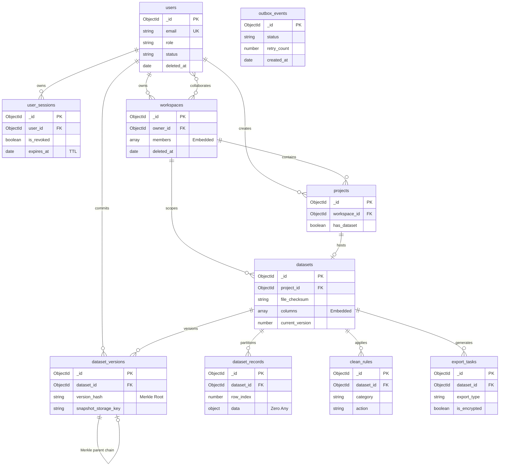
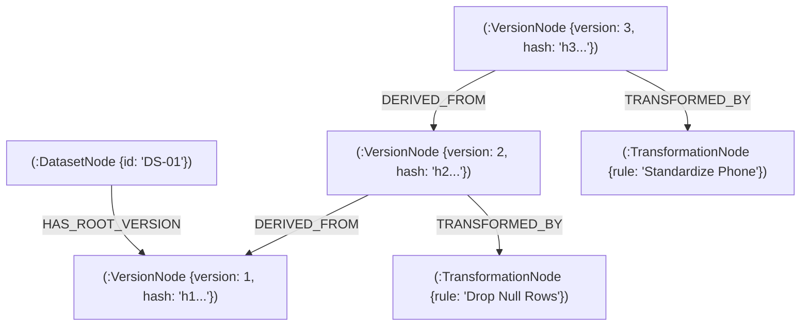

# BÁO CÁO 03: MÔ HÌNH DỮ LIỆU ĐA TẦNG VÀ HẠ TẦNG LƯU TRỮ PHÂN TÁN
## HỆ THỐNG AI HỖ TRỢ PHÁT HIỆN VÀ XỬ LÝ VẤN ĐỀ CHẤT LƯỢNG DỮ LIỆU
### (Full-Stack Data Quality Management Platform with AI Assistance)

---

## 1. TRIẾT LÝ LƯU TRỮ ĐA MÔ HÌNH (POLYGLOT PERSISTENCE ARCHITECTURE)

Trong các hệ thống quản lý chất lượng dữ liệu quy mô doanh nghiệp, không một cơ sở dữ liệu đơn lẻ nào có thể tối ưu hóa cho tất cả các loại truy vấn:
- Dữ liệu dạng bảng (Table rows) và cấu trúc linh hoạt (Dynamic schemas) cần một CSDL Document linh hoạt có khả năng phân trang siêu tốc.
- Dòng chảy biến đổi dữ liệu (Data Lineage) và phân tích phụ thuộc chuỗi đòi hỏi cấu trúc đồ thị (Graph Database) với các thuật toán duyệt đồ thị Directed Acyclic Graph (DAG) phức tạp.
- Các tệp dữ liệu thô (Raw datasets), tệp snapshot phiên bản và tệp xuất mã hóa kích thước lớn cần một kho lưu trữ đối tượng (Object Storage) chi phí thấp và an toàn cao.

Hệ thống ứng dụng kiến trúc **Polyglot Persistence**, kết hợp 3 công nghệ lưu trữ bổ trợ lẫn nhau:

```
┌──────────────────────────────────────────────────────────────────────────────────┐
│                         POLYGLOT STORAGE TOPOLOGY                                │
├──────────────────────────┬──────────────────────────┬────────────────────────────┤
│ 1. MONGODB ATLAS (v8.0+) │ 2. NEO4J AURADB (v5.x)   │ 3. CLOUDFLARE R2           │
│    (Document Database)   │    (Graph Database)      │    (Object Storage S3)     │
├──────────────────────────┼──────────────────────────┼────────────────────────────┤
│ - Quản lý Người dùng     │ - Biểu diễn phả hệ dữ    │ - Lưu trữ tệp dữ liệu thô  │
│   và Phiên (Sessions)    │   liệu đồ thị DAG        │   tải lên ban đầu          │
│ - Metadata Workspace     │ - Truy vết nguồn gốc sâu │ - Lưu trữ các bản snapshot │
│   và Dự án làm sạch      │   (Root Cause Upstream)  │   CSV nén của từng version │
│ - Hàng triệu dòng dữ     │ - Phân tích tác động lan │ - Lưu trữ tệp xuất dữ liệu │
│   liệu (Dataset Records) │   truyền (Downstream)    │   được mã hóa AES-256-GCM  │
│ - Transactional Outbox   │ - Kiểm toán mắt xích băm │ - Không tính phí băng thông│
│   Event Storage          │   Merkle Tree trực quan  │   ra ngoài (Zero Egress)   │
└──────────────────────────┴──────────────────────────┴────────────────────────────┘
```

---

## 2. THIẾT KẾ CƠ SỞ DỮ LIỆU DOCUMENT MONGODB (10 COLLECTIONS)

### 2.1. Triết lý Thiết kế Document Schema
1. **Mô hình Lai (Hybrid Embedding vs Referencing):**
   - *Embedding (Nhúng):* Áp dụng cho quan hệ 1:Few, dữ liệu có kích thước giới hạn và luôn đọc cùng thực thể cha. Ví dụ: Danh sách thành viên `members` trong `workspaces`, định nghĩa cột `columns` trong `datasets`. Giúp kiểm tra quyền hạn CASL ABAC tức thời mà không cần `$lookup`.
   - *Referencing (Tham chiếu qua ObjectId):* Áp dụng cho quan hệ 1:Many lớn để tránh vi phạm giới hạn kích thước tài liệu BSON 16MB. Ví dụ: Hàng triệu dòng dữ liệu được tách thành các tài liệu độc lập trong `dataset_records`.
2. **Cơ chế Khởi tạo Lười (Lazy Collection Creation):**
   - MongoDB Driver chỉ tạo bảng vật lý khi có tài liệu đầu tiên được ghi (`insertOne/insertMany`), giúp tối ưu hóa bộ nhớ đệm WiredTiger Cache.
3. **Tuân thủ Zero Any trên Dynamic Records:**
   - Trường dữ liệu dòng bảng linh hoạt (`data`) được khai báo kiểu TypeScript an toàn: `Record<string, unknown>`.

### 2.2. Chi tiết 10 Collections và Chiến lược Chỉ mục (Indexing)

| Tên Collection | Khóa chính / Khóa ngoại | Trường nghiệp vụ cốt lõi | Chiến lược Chỉ mục (Indexes) & Mục đích |
|---|---|---|---|
| **`users`** | `_id: ObjectId` | `email`, `password_hash`, `role`, `status`, `deleted_at` | - `{ email: 1 }` (Partial Unique: `deleted_at: null`)<br>- `{ created_at: -1, _id: -1 }` (Cursor phân trang) |
| **`user_sessions`**| `_id`, `user_id -> users` | `refresh_token_hash`, `device_name`, `is_revoked`, `expires_at` | - `{ expires_at: 1 }` (**TTL Index 7 ngày tự dọn rác**)<br>- `{ user_id: 1, is_revoked: 1 }` (Kiểm tra phiên hợp lệ) |
| **`workspaces`** | `_id`, `owner_id -> users` | `name`, `members: [{ user_id, role }]`, `deleted_at` | - `{ owner_id: 1, deleted_at: 1 }`<br>- `{ 'members.user_id': 1, deleted_at: 1 }` (Lọc theo quyền) |
| **`projects`** | `_id`, `workspace_id` | `name`, `has_dataset`, `created_by`, `deleted_at` | - `{ workspace_id: 1, deleted_at: 1 }`<br>- `{ workspace_id: 1, name: 1, deleted_at: 1 }` |
| **`datasets`** | `_id`, `project_id`, `workspace_id` | `file_checksum`, `row_count`, `column_count`, `columns: []`, `status` | - `{ project_id: 1, deleted_at: 1 }` (Lấy dữ liệu theo dự án)<br>- `{ file_checksum: 1 }` (Chống nạp trùng tệp) |
| **`dataset_records`**| `_id`, `dataset_id` | `row_index`, `data: Record<string, unknown>`, `version_number` | - `{ dataset_id: 1, row_index: 1, deleted_at: 1 }` (**Keyset Cursor Index $O(\log N)$ cho Virtual Grid**) |
| **`dataset_versions`**| `_id`, `dataset_id`, `parent_version_id` | `version_number`, `parent_hash`, `rules_hash`, `data_checksum`, `version_hash` | - `{ dataset_id: 1, version_number: 1 }` (Partial Unique)<br>- `{ version_hash: 1 }` (Đối soát Merkle nhanh) |
| **`clean_rules`**| `_id`, `dataset_id`, `workspace_id` | `category`, `action`, `target_column`, `parameters`, `is_active` | - `{ dataset_id: 1, deleted_at: 1 }` (Nạp luật làm sạch)<br>- `{ workspace_id: 1, deleted_at: 1 }` |
| **`export_tasks`**| `_id`, `dataset_id`, `workspace_id` | `export_type`, `storage_key`, `checksum_sha256`, `is_encrypted` | - `{ dataset_id: 1, deleted_at: 1 }` (Kiểm toán rò rỉ dữ liệu)<br>- `{ workspace_id: 1, deleted_at: 1 }` |
| **`outbox_events`**| `_id` | `aggregate_type`, `aggregate_id`, `event_type`, `payload`, `status`, `retry_count` | - `{ status: 1, retry_count: 1, created_at: 1 }` (**Polling Index tối ưu cho Outbox Worker**) |

### 2.3. Sơ đồ Thực thể Quan hệ MongoDB (Mermaid ERD)



---

## 3. THIẾT KẾ ĐỒ THỊ PHẢ HỆ DỮ LIỆU NEO4J AURADB (GRAPH DATA MODEL)

### 3.1. Cấu trúc Nút (Nodes) và Cạnh (Relationships)
Trong đồ thị Neo4j AuraDB, toàn bộ lịch sử biến đổi được biểu diễn dưới dạng **Directed Acyclic Graph (DAG)**:
- **Các nhãn Nút (Node Labels):**
  - `:DatasetNode`: Đại diện cho tập dữ liệu gốc ban đầu (`dataset_id`, `name`, `created_at`).
  - `:VersionNode`: Đại diện cho từng cột mốc phiên bản dữ liệu (`version_number`, `version_hash`, `record_count`, `created_by`, `committed_at`).
  - `:TransformationNode`: Đại diện cho hành động làm sạch đã được thực thi (`action_type`, `rule_name`, `target_column`, `execution_time_ms`).
- **Các loại Quan hệ (Relationship Types):**
  - `[:HAS_ROOT_VERSION]`: Từ DatasetNode trỏ đến VersionNode đầu tiên (v1).
  - `[:DERIVED_FROM]`: Từ VersionNode con trỏ ngược về VersionNode cha (hướng mũi tên xác lập nguồn gốc).
  - `[:TRANSFORMED_BY]`: Liên kết VersionNode với TransformationNode tương ứng.
  - `[:ROLLBACK_TO]`: Ghi nhận sự kiện khôi phục dữ liệu quay ngược về một phiên bản lịch sử trong quá khứ.



### 3.2. Mẫu Truy vấn Cypher Nâng cao phục vụ Khai phá Dữ liệu

#### Truy vết Ngược Nguồn gốc (Root Cause Analysis - Upstream Traversal):
```cypher
// Truy vết toàn bộ chuỗi biến đổi từ phiên bản hiện tại về phiên bản gốc
MATCH path = (current:VersionNode {id: $nodeId})<-[:DERIVED_FROM*1..20]-(root:VersionNode)
OPTIONAL MATCH (v:VersionNode)-[:TRANSFORMED_BY]->(t:TransformationNode)
WHERE v IN nodes(path)
RETURN path, t
ORDER BY length(path) ASC;
```

#### Phân tích Tác động Lan truyền (Impact Analysis - Downstream Traversal):
```cypher
// Xác định toàn bộ các phiên bản và tài nguyên hạ nguồn chịu ảnh hưởng nếu phiên bản này thay đổi
MATCH path = (source:VersionNode {id: $nodeId})-[:DERIVED_FROM*1..20]->(descendant:VersionNode)
RETURN descendant.id AS affected_version_id, descendant.version_number AS version, length(path) AS depth;
```

---

## 4. HẠ TẦNG LƯU TRỮ ĐỐI TƯỢNG CLOUDFLARE R2 (OBJECT STORAGE)

### 4.1. Quy ước Đặt Khóa Lưu trữ (Storage Key Convention)
Để tránh xung đột tệp và hỗ trợ phân vùng dữ liệu theo multi-tenant, đường dẫn tệp trên Cloudflare R2 tuân thủ cấu trúc phân cấp:
- **Tệp dữ liệu thô nạp vào:** `datasets/{workspace_id}/{project_id}/{dataset_id}/raw/{file_name}`
- **Tệp Snapshot phiên bản nén:** `snapshots/{dataset_id}/v{version_number}.csv.gz`
- **Tệp xuất dữ liệu mã hóa:** `exports/{dataset_id}/{export_task_id}.enc`

### 4.2. Ưu thế Kỹ thuật của Cloudflare R2
- **Tương thích chuẩn AWS S3 API:** Tận dụng trực tiếp `@aws-sdk/client-s3` của Node.js mà không cần cài thêm driver độc quyền.
- **Chính sách Zero Egress Fee:** Miễn phí 100% cước phí băng thông truyền dữ liệu ra Internet (tiết kiệm chi phí đáng kể so với AWS S3 khi người dùng tải các tệp dữ liệu lớn hàng chục GB).
- **Khả năng sinh Presigned URL:** Cho phép máy khách tải tệp trực tiếp từ Cloudflare Edge thông qua chữ ký xác thực tạm thời (hết hạn sau 15 phút) mà không làm nghẽn băng thông của máy chủ backend.
