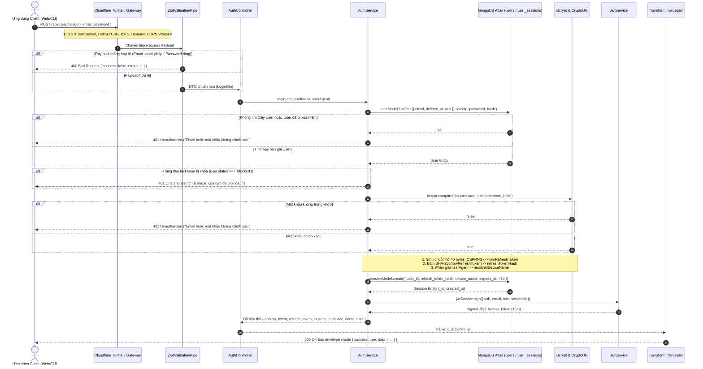

# BÁO CÁO KỸ THUẬT CHUYÊN SÂU: LUỒNG HOẠT ĐỘNG TOÀN TRÌNH CỦA API ĐĂNG NHẬP (`POST /api/v1/auth/login`)

> **Dự án:** Nền tảng Quản lý & Giám sát Chất lượng Dữ liệu có Hỗ trợ của Trí tuệ Nhân tạo  
> **Đơn vị:** Trường Đại học Giao thông Vận tải TP.HCM (UTH) — Học phần: Lập trình JS & TS Nâng Cao  
> **Tài liệu:** Báo cáo Phân tích Kỹ thuật Luồng Thực thi API Xác thực  
> **Đặc tả mã nguồn:** TypeScript Strict (Zero Any Policy) | NestJS 11 | MongoDB Atlas | Dual-Token Model (Stateless JWT + Stateful Session) | Bcrypt 12 Rounds  

---

## MỤC LỤC BÁO CÁO

1. [Tổng quan Nghiệp vụ & Thông số Đặc tả Endpoint](#1-tổng-quan-nghiệp-vụ--thông-số-đặc-tả-endpoint)
2. [Sơ đồ Tuần tự Trực quan Toàn trình (End-to-End Sequence Diagram)](#2-sơ-đồ-tuần-tự-trực-quan-toàn-trình-end-to-end-sequence-diagram)
3. [Bóc tách Chi tiết Luồng Thực thi qua 5 Tầng Kiến trúc](#3-bóc-tách-chi-tiết-luồng-thực-thi-qua-5-tầng-kiến-trúc)
   - 3.1. [Tầng 1 — Bảo mật Mạng & Gateway (Network & Gateway Tier)](#31-tầng-1--bảo-mật-mạng--gateway-network--gateway-tier)
   - 3.2. [Tầng 2 — Kiểm chuẩn Dữ liệu Đầu vào (Strict Schema Validation Tier)](#32-tầng-2--kiểm-chuẩn-dữ-liệu-đầu-vào-strict-schema-validation-tier)
   - 3.3. [Tầng 3 — Nghiệp vụ Xác thực & Mật mã học (Service & Cryptography Tier)](#33-tầng-3--nghiệp-vụ-xác-thực--mật-mã-học-service--cryptography-tier)
   - 3.4. [Tầng 4 — Khởi tạo Phiên & Cấp phát Cặp Token (Session & Dual-Token Tier)](#34-tầng-4--khởi-tạo-phiên--cấp-phát-cặp-token-session--dual-token-tier)
   - 3.5. [Tầng 5 — Chuẩn hóa Đầu ra & Xử lý Ngoại lệ (Transform & Exception Tier)](#35-tầng-5--chuẩn-hóa-đầu-ra--xử-lý-ngoại-lệ-transform--exception-tier)
4. [Cơ chế An ninh Mật mã học & Quy tắc Bất biến (Security Invariants)](#4-cơ-chế-an-ninh-mật-mã-học--quy-tắc-bất-biến-security-invariants)
5. [Ma trận Ngoại lệ & Kịch bản Kiểm thử Thực tế (Exception Matrix & Test Cases)](#5-ma-trận-ngoại-lệ--kịch-bản-kiểm-thử-thực-tế-exception-matrix--test-cases)
6. [Đánh đổi Kỹ thuật, Điểm yếu Hiện tại & Kiến nghị Cải tiến (Trade-offs & Limitations)](#6-đánh-đổi-kỹ-thuật-điểm-yếu-hiện-tại--kiến-nghị-cải-tiến-trade-offs--limitations)

---

## 1. TỔNG QUAN NGHIỆP VỤ & THÔNG SỐ ĐẶC TẢ ENDPOINT

### 1.1. Sứ mệnh của API Login trong Kiến trúc Tổng thể
Trong hệ thống Quản lý Chất lượng Dữ liệu, endpoint `POST /api/v1/auth/login` (Mã tính năng: **F1.2**) đóng vai trò là **Cổng định danh trung tâm (Identity Provider & Security Perimeter)**. Toàn bộ các tài nguyên nhạy cảm như dữ liệu thô, luật làm sạch sandbox, đồ thị phả hệ Neo4j DAG và xuất khẩu file mã hóa AES-256-GCM đều yêu cầu định danh người dùng chính xác trước khi đưa vào bộ máy phân quyền hạt mịn **CASL ABAC (Attribute-Based Access Control)**.

API Login chịu trách nhiệm:
1. Xác thực tính hợp lệ của cặp thông tin danh tính (`email`, `password`).
2. Kiểm tra điều kiện tiên quyết của tài khoản (tài khoản không bị xóa mềm, không bị admin khóa).
3. Tự động nhận diện thiết bị người dùng từ tiêu đề HTTP `User-Agent`.
4. Sinh cặp mã xác thực kép (**Dual-Token Model**): Access Token ngắn hạn và Refresh Token dài hạn.
5. Thiết lập phiên làm việc có khả năng kiểm soát từ xa (Remote Session Management) trên cơ sở dữ liệu MongoDB Atlas.

### 1.2. Bảng Đặc tả Giao thức Kỹ thuật (Contract Specification)

| Thuộc tính | Giá trị cấu hình | Ghi chú kỹ thuật |
| :--- | :--- | :--- |
| **HTTP Method** | `POST` | Thao tác gửi dữ liệu nhạy cảm qua Request Body |
| **Routing Path** | `/api/v1/auth/login` | Định tuyến qua tiền tố toàn cục `API_PREFIX=api/v1` |
| **Quyền truy cập** | Công khai (`@Public()`) | Bỏ qua bộ lọc `JwtAuthGuard` |
| **Kiểm chuẩn DTO** | `ZodValidationPipe(LoginSchema)` | Phân tích cú pháp nghiêm ngặt, từ chối kiểu `any` |
| **Mã HTTP Thành công** | `200 OK` (Explicit HttpCode) | Khác với mặc định `201 Created` của phương thức POST |
| **Content-Type Nhận** | `application/json` | Bắt buộc định dạng JSON chuẩn |
| **Content-Type Trả** | `application/json; charset=utf-8` | Chuẩn hóa qua `TransformInterceptor` |

#### Định dạng Yêu cầu Đầu vào (Request Body JSON Schema):
```json
{
  "email": "analyst@dataquality.io",
  "password": "SecurePassword@2026"
}
```

#### Định dạng Phản hồi Đầu ra Thành công (Response JSON Schema - HTTP 200 OK):
```json
{
  "success": true,
  "data": {
    "access_token": "eyJhbGciOiJIUzI1NiIsInR5cCI6IkpXVCJ9...",
    "refresh_token": "a1b2c3d4e5f67890123456789abcdef0123456789abcdef0123456789abcdef0123456789abcdef0",
    "expires_in": 900,
    "device_name": "Chrome on Windows",
    "user": {
      "id": "671df89b2c3d4e5f67890123",
      "email": "analyst@dataquality.io",
      "first_name": "Minh",
      "last_name": "Nguyễn",
      "role": "analyst"
    }
  }
}
```

---

## 2. SƠ ĐỒ TUẦN TỰ TRỰC QUAN TOÀN TRÌNH (END-TO-END SEQUENCE DIAGRAM)

Sơ đồ tuần tự thể hiện chi tiết 12 bước thực thi xuyên suốt các tầng kiến trúc:



---

## 3. BÓC TÁCH CHI TIẾT LUỒNG THỰC THI QUA 5 TẦNG KIẾN TRÚC

### 3.1. Tầng 1 — Bảo mật Mạng & Gateway (Network & Gateway Tier)
Mọi gói tin HTTP gửi đến API Đăng nhập đều phải vượt qua hàng rào an ninh tại tầng biên trước khi chạm đến mã nguồn NestJS:

1. **Kênh truyền Mã hóa Cloudflare Zero Trust Tunnel:**
   - Dữ liệu di chuyển trên Internet được bảo vệ bởi giao thức **QUIC (UDP)** mã hóa **TLS 1.3 Cổng 443**.
   - Cloudflare Edge chấm dứt phiên TLS, đính kèm các tiêu đề nhận diện: `CF-Connecting-IP`, `CF-Ray`, `X-Forwarded-Proto: https`.
2. **Reverse Proxy Trusting:**
   - Tại `src/main.ts`, NestJS kích hoạt:
     ```typescript
     app.getHttpAdapter().getInstance().set('trust proxy', 1);
     ```
   - Nhờ đó, phương thức `req.ip` lấy chính xác địa chỉ IP của Client thực, ngăn chặn kỹ thuật giả mạo IP qua header `X-Forwarded-For`.
3. **Helmet Security Headers:**
   - Kích hoạt chuẩn bảo vệ HSTS (`maxAge: 31536000`, `includeSubDomains: true`, `preload: true`), ép buộc trình duyệt web chỉ giao tiếp qua HTTPS trong 1 năm tiếp theo.
4. **Dynamic CORS Whitelist:**
   - Chỉ chấp nhận yêu cầu xuất phát từ các nguồn tin cậy: Frontend phát triển (`http://localhost:5173`), danh sách cấu hình trong biến môi trường `CORS_ORIGIN`, hoặc bất kỳ miền con biên nào có đuôi `.trycloudflare.com`.

---

### 3.2. Tầng 2 — Kiểm chuẩn Dữ liệu Đầu vào (Strict Schema Validation Tier)
Trước khi dữ liệu vào đến Controller, `ZodValidationPipe` thực hiện kiểm chuẩn tĩnh và động:

1. **Schema Định nghĩa bằng Zod (`login.dto.ts`):**
   ```typescript
   export const LoginSchema = z.object({
     email: EmailSchema,
     password: z.string().min(1, 'Mật khẩu không được để trống'),
   });

   export type LoginDto = z.infer<typeof LoginSchema>;
   ```
2. **Bảo đảm An toàn Kiểu (Zero Any Guarantee):**
   - Kiểu `LoginDto` được suy luận tự động bằng `z.infer`, loại trừ hoàn toàn việc ép kiểu thủ công (`as any`).
3. **Xử lý Khi Gặp Lỗi Dữ liệu (Validation Failure):**
   - Nếu `email` không đúng định dạng RFC 5322 hoặc `password` bị bỏ trống, `safeParse()` thất bại.
   - Pipe ném ra ngoại lệ `BadRequestException` kèm mảng lỗi có cấu trúc:
     ```json
     {
       "statusCode": 400,
       "message": "Dữ liệu đầu vào không hợp lệ (Validation Failed)",
       "errors": [
         { "field": "email", "message": "Email không đúng định dạng", "code": "invalid_string" }
       ]
     }
     ```

---

### 3.3. Tầng 3 — Nghiệp vụ Xác thực & Mật mã học (Service & Cryptography Tier)
Sau khi dữ liệu đầu vào được xác nhận hợp lệ, `AuthController.login()` nhận dữ liệu và trích xuất thông tin môi trường gọi:

```typescript
// Trích xuất IP và User-Agent tại Controller
const ipAddress = req.ip || req.socket.remoteAddress;
const userAgent = req.headers['user-agent'];
return this.authService.login(dto, ipAddress, userAgent);
```

Tại `AuthService.login()`, tiến trình xử lý nghiệp vụ diễn ra tuần tự:

1. **Truy vấn Người dùng (Database User Lookup):**
   - Gọi `usersService.findByEmail(dto.email, true)`.
   - Câu truy vấn MongoDB thực thi:
     ```typescript
     this.userModel.findOne({
       email: email.toLowerCase().trim(),
       deleted_at: null,
     }).select('+password_hash');
     ```
   - **Đặc điểm bảo mật:** Cột `password_hash` được cấu hình `select: false` trong Mongoose Schema để chống rò rỉ ngẫu nhiên trong các API xem thông tin người dùng. Khi xác thực đăng nhập, service chủ động gọi `.select('+password_hash')` để lấy trường này phục vụ so khớp.
2. **Kiểm tra Điều kiện Tiên quyết:**
   - **Tài khoản không tồn tại hoặc đã bị xóa mềm:** Nếu `!user` hoặc `!user.password_hash`, ném ngoại lệ `UnauthorizedException('Email hoặc mật khẩu không chính xác')`.
   - **Tài khoản bị khóa bởi Quản trị viên:** Nếu `user.status === 'blocked'`, ném ngoại lệ:
     ```typescript
     throw new UnauthorizedException('Tài khoản của bạn đã bị khóa. Vui lòng liên hệ quản trị viên.');
     ```
3. **So khớp Mật khẩu với Bcrypt (Password Hash Comparison):**
   - Thực thi `await bcrypt.compare(dto.password, user.password_hash)`.
   - Hàm `compare` tự động trích xuất chuỗi Salt ngẫu nhiên được nhúng trong chuỗi băm Bcrypt 12 rounds lưu tại DB, tính toán lại giá trị băm và so sánh bằng kỹ thuật **Constant-Time Comparison** nhằm triệt tiêu hoàn toàn nguy cơ tấn công kênh kề qua đo đạc thời gian (**Timing Attacks**).
   - Nếu kết quả sai: Ném ngoại lệ `UnauthorizedException('Email hoặc mật khẩu không chính xác')`. Lưu ý: Thông điệp lỗi giữ tính chất trung lập, không tiết lộ cho kẻ tấn công biết email có tồn tại trong hệ thống hay không (Chống User Enumeration).

---

### 3.4. Tầng 4 — Khởi tạo Phiên & Cấp phát Cặp Token (Session & Dual-Token Tier)
Khi danh tính người dùng được kiểm chứng tuyệt đối, hệ thống chuyển sang bước khởi tạo phiên làm việc bảo mật:

1. **Phân tích Thiết bị Tự động (`device-detector.util.ts`):**
   - Hệ thống quét tiêu đề `User-Agent` thông qua biểu thức chính quy thuần TypeScript (Zero Any, Zero External Dependencies):
     - Công cụ kiểm thử: `Postman Desktop`, `cURL CLI`, `Insomnia Client`.
     - Hệ điều hành: `Windows`, `macOS`, `Linux`, `iOS`, `Android`.
     - Trình duyệt: `Chrome`, `Firefox`, `Safari`, `Edge`, `Opera`.
   - Kết quả phân giải: Ví dụ `"Chrome on Windows"` hoặc `"Safari on iPhone (iOS)"`. Nếu tiêu đề rỗng, mặc định là `"Web Client"`.
2. **Sinh Mã Refresh Token Ngẫu nhiên Có Độ Entropy Cao:**
   - Sử dụng bộ sinh số ngẫu nhiên an toàn mật mã của Node.js:
     ```typescript
     const rawRefreshToken = crypto.randomBytes(40).toString('hex');
     ```
   - Chuỗi sinh ra có độ dài 80 ký tự hex với không gian mẫu $256^{40} \approx 1.46 \times 10^{96}$ khả năng, ngăn chặn triệt để kỹ thuật tấn công đoán trước hoặc vét cạn.
3. **Băm Một Chiều Refresh Token Trước Khi Lưu DB:**
   - Áp dụng thuật toán SHA-256 để tính toán mã băm của token:
     ```typescript
     const refreshTokenHash = computeSha256Buffer(rawRefreshToken);
     ```
   - Hệ thống **tuyệt đối không lưu chuỗi `rawRefreshToken` vào cơ sở dữ liệu**.
4. **Lưu Bản ghi Phiên vào MongoDB Atlas (`user_sessions`):**
   - Thiết lập thời gian sống của phiên: `expiresAt = new Date(Date.now() + 7 * 24 * 60 * 60 * 1000)` (7 ngày).
   - Tạo bản ghi mới trong collection `user_sessions`:
     ```typescript
     const session = await this.usersService.createSession({
       user_id: user._id,
       refresh_token_hash: refreshTokenHash,
       device_name: resolvedDeviceName,
       ip_address: ipAddress,
       user_agent: userAgent,
       expires_at: expiresAt,
     });
     ```
   - Cơ chế tự động dọn dẹp: Schema `user-session.schema.ts` cài đặt **MongoDB TTL Index** (`index: { expires: '7d' }`) trên trường `expires_at`, CSDL sẽ tự động xóa vật lý các phiên hết hạn mà không cần chạy cron job ngầm.
5. **Ký Mã Truy Cập Access Token (JWT Issuance):**
   - Cấu trúc payload nhúng trong token:
     ```typescript
     const payload: JwtPayload = {
       sub: user._id.toString(),
       email: user.email,
       role: user.role,
       sessionId: session._id.toString(),
     };
     ```
   - Gọi `this.jwtService.sign(payload)` với thời hạn mặc định **15 phút** (`15m`).
   - Việc nhúng `sessionId` vào payload là điểm then chốt cho phép hệ thống liên kết mã JWT phi trạng thái với một bản ghi phiên có trạng thái trong database.

---

### 3.5. Tầng 5 — Chuẩn hóa Đầu ra & Xử lý Ngoại lệ (Transform & Exception Tier)

1. **Chuẩn hóa Envelope Thành công qua `TransformInterceptor`:**
   - Dữ liệu trả về từ controller được đóng gói vào mẫu chuẩn:
     ```json
     {
       "success": true,
       "data": { ... }
     }
     ```
2. **Bộ lọc Bắt Ngoại lệ Toàn cục `AllExceptionsFilter`:**
   - Mọi ngoại lệ phát sinh trong quá trình login đều được chặn bắt tập trung:
     - Ngoại lệ `BadRequestException` (Zod error): Trả về HTTP `400` kèm chi tiết các trường vi phạm.
     - Ngoại lệ `UnauthorizedException`: Trả về HTTP `401` kèm thông điệp rõ ràng.
     - Ngoại lệ sập kết nối cơ sở dữ liệu hoặc lỗi hệ thống không lường trước: Trả về HTTP `500 Internal Server Error`, giấu toàn bộ chi tiết stack trace để bảo vệ an ninh hệ thống.
3. **Chiến lược Ghi Log Phân tầng (Observability Logging):**
   - Các lỗi 4xx (Client Error) do nhập sai tài khoản hoặc sai cú pháp được ghi log ở mức `WARN` nhằm theo dõi tần suất mà không làm bẩn file log.
   - Các lỗi 5xx (Server Error) được ghi log ở mức `ERROR` kèm toàn bộ dấu vết lời gọi hàm (`stack trace`) phục vụ điều tra sự cố.

---

## 4. CƠ CHẾ AN NINH MẬT MÃ HỌC & QUY TẮC BẤT BIẾN (SECURITY INVARIANTS)

Để bảo vệ nền tảng trước các mối đe dọa an ninh mạng hiện đại, luồng thực thi Login thiết lập 4 quy tắc bất biến:

### 4.1. Bất biến 1 — Băm Mật khẩu Chống Tăng tốc Phần cứng (Bcrypt 12 Rounds)
- **Vấn đề:** Các thuật toán băm nhanh như MD5, SHA-1 hoặc SHA-256 có thể tính toán hàng tỷ phép băm mỗi giây trên các mảng vi xử lý đồ họa (GPU/ASIC), khiến mật khẩu người dùng dễ bị bẻ khóa bằng bảng băm tính sẵn (Rainbow Table) hoặc tấn công vét cạn.
- **Giải pháp:** Hệ thống bắt buộc dùng `bcrypt` với `SALT_ROUNDS = 12`. Tại cấu hình 12 rounds, thuật toán thực hiện $2^{12} = 4,096$ vòng lặp tính toán nội suy. Một máy chủ hiện đại mất khoảng $\sim 250 - 300\text{ms}$ cho mỗi phép tính băm, biến việc tấn công vét cạn bằng GPU trở nên bất khả thi về mặt chi phí kinh tế.

### 4.2. Bất biến 2 — Nguyên tắc Zero Plain-text Refresh Token
- **Vấn đề:** Nếu máy chủ lưu trữ chuỗi Refresh Token dưới dạng chuỗi thô (plain-text) trong CSDL, trong trường hợp cơ sở dữ liệu MongoDB Atlas bị trích xuất lậu (Database Dump leak), kẻ tấn công có thể dùng ngay các Refresh Token này để duy trì đăng nhập vĩnh viễn mà không cần mật khẩu.
- **Giải pháp:** Áp dụng nguyên tắc băm một chiều SHA-256. Máy chủ chỉ lưu `SHA-256(rawRefreshToken)`. Khi Client gọi API `/api/v1/auth/refresh`, Client gửi `rawRefreshToken` lên; máy chủ tính mã băm của token nhận được rồi so khớp với mã băm trong DB. Nếu database bị lộ, kẻ tấn công cũng không thể đảo ngược mã băm SHA-256 để lấy lại chuỗi token thô.

### 4.3. Bất biến 3 — Cầu nối Giữa JWT Phi Trạng thái và Thu hồi Phiên (Stateful Session Anchor)
- **Vấn đề:** Token JWT có tính chất phi trạng thái (Stateless). Một khi đã ký và phát hành, server không thể hủy bỏ JWT cho đến khi nó hết hạn sau 15 phút.
- **Giải pháp:** Nhúng thuộc tính `sessionId` trực tiếp vào Claims của JWT. Khi người dùng thực hiện "Đăng xuất trên thiết bị này" hoặc "Đăng xuất khỏi tất cả thiết bị khác" (`DELETE /api/v1/auth/sessions/:id`), bản ghi session trong MongoDB Atlas sẽ được đánh dấu `is_revoked = true`. Mã Refresh Token liên kết lập tức bị vô hiệu hóa, ngăn chặn việc cấp mới token.

### 4.4. Bất biến 4 — Kiểm soát Trạng thái Tài khoản Tức thì (Real-time Account Status Check)
- Mặc dù Access Token còn hạn sử dụng trong 15 phút, chiến lược `JwtStrategy.validate()` được thiết kế để luôn truy vấn đối chiếu người dùng trong CSDL:
  ```typescript
  const user = await this.usersService.findById(payload.sub);
  if (!user || user.status === 'blocked' || user.deleted_at !== null) {
    throw new UnauthorizedException('Tài khoản không tồn tại, đã bị khóa hoặc đã bị xóa mềm');
  }
  ```
- Nhờ vậy, ngay khi Quản trị viên thực hiện hành động khóa tài khoản của một nhân sự gian lận trên giao diện Quản trị, mọi yêu cầu API tiếp theo của nhân sự đó đều bị từ chối ngay lập tức mà không phải chờ 15 phút cho đến khi Access Token tự hết hạn.

---

## 5. MA TRẬN NGOẠI LỆ & KỊCH BẢN KIỂM THỬ THỰC TẾ (EXCEPTION MATRIX & TEST CASES)

Bảng ma trận tổng hợp toàn bộ các kịch bản kiểm thử tự động được thiết lập để kiểm soát luồng hoạt động của API Login:

| Mã Case | Mô tả Kịch bản Kiểm thử | Đầu vào (Payload) | Mã HTTP | Thông điệp Phản hồi / Kết quả |
| :---: | :--- | :--- | :---: | :--- |
| **TC-01** | Email sai cú pháp | `{"email": "invalid-email", "password": "123"}` | `400` | `{"field": "email", "message": "Email không đúng định dạng"}` |
| **TC-02** | Mật khẩu để chuỗi rỗng | `{"email": "valid@uth.edu.vn", "password": ""}` | `400` | `{"field": "password", "message": "Mật khẩu không được để trống"}` |
| **TC-03** | Thiếu trường bắt buộc | `{"email": "valid@uth.edu.vn"}` | `400` | `{"field": "password", "message": "Required"}` |
| **TC-04** | Email không tồn tại trong DB | `{"email": "ghost@uth.edu.vn", "password": "Password123"}` | `401` | `"Email hoặc mật khẩu không chính xác"` |
| **TC-05** | Tài khoản đã bị xóa mềm | Bản ghi có `deleted_at: 2026-10-01` | `401` | `"Email hoặc mật khẩu không chính xác"` (Không tìm thấy user active) |
| **TC-06** | Sai mật khẩu đăng nhập | Mật khẩu không khớp hash Bcrypt | `401` | `"Email hoặc mật khẩu không chính xác"` |
| **TC-07** | Tài khoản đang bị khóa | Bản ghi có `status: "blocked"` | `401` | `"Tài khoản của bạn đã bị khóa. Vui lòng liên hệ quản trị viên."` |
| **TC-08** | Đăng nhập thành công | Email & Mật khẩu chính xác | `200` | Trả về cặp `access_token`, `refresh_token`, lưu session vào DB |

---

## 6. ĐÁNH ĐỔI KỸ THUẬT, ĐIỂM YẾU HIỆN TẠI & KIẾN NGHỊ CẢI TIẾN (TRADE-OFFS & LIMITATIONS)

Bám sát quy chuẩn đánh giá khách quan của dự án, hệ thống thẳng thắn chỉ ra các điểm yếu và đánh đổi kỹ thuật hiện hữu trong cơ chế Login:

### 6.1. Điểm yếu 1 — Chưa có Chính sách Khóa Tài khoản Tự động (Account Lockout Policy)
- **Hiện trạng:** Khi người dùng nhập sai mật khẩu, hệ thống trả về mã lỗi `401 Unauthorized`. Tuy nhiên, bảng `users` hiện chưa có các trường đếm số lần sai liên tiếp (`failed_login_attempts`) và mốc thời gian khóa tạm thời (`locked_until`).
- **Rủi ro:** Kẻ tấn công có thể phát động các đợt tấn công vét cạn mật khẩu (Brute-force) hoặc nhồi thông tin xác thực rò rỉ (Credential Stuffing) nếu vượt qua được lớp Rate Limiting ở tầng Gateway.
- **Kiến nghị Nâng cấp:** Bổ sung cơ chế tự động khóa tài khoản 15 phút nếu nhập sai mật khẩu 5 lần liên tiếp trong vòng 10 phút.

### 6.2. Điểm yếu 2 — Gánh nặng Tính toán CPU của Bcrypt khi Chịu Tải Đồng thời (CPU Contention)
- **Hiện trạng:** `SALT_ROUNDS = 12` tiêu thụ thời gian xử lý CPU đáng kể. Mặc dù `bcrypt.compare` chạy bất đồng bộ thông qua Node.js libuv threadpool (mặc định 4 threads), một lượng lớn yêu cầu login đồng thời (ví dụ $\ge 500$ requests/giây) có thể làm cạn kiệt threadpool, dẫn đến nghẽn Event Loop và tăng đột biến độ trễ (Latency Spike) của toàn bộ các API khác trong hệ thống.
- **Đánh đổi:** Tăng độ an toàn bảo mật mật khẩu mật mã học $\leftrightarrow$ Giảm thông lượng xử lý đồng thời cực đại của máy chủ.

### 6.3. Điểm yếu 3 — Chi phí Truy vấn CSDL trên Mọi Request trong `JwtStrategy`
- **Hiện trạng:** Nhằm đảm bảo tài khoản bị khóa (`blocked`) hoặc xóa mềm (`deleted_at`) bị vô hiệu hóa tức thì, hàm `JwtStrategy.validate()` thực hiện `this.usersService.findById(payload.sub)` trên **từng request** gửi kèm Bearer Token.
- **Đánh đổi:** 
  - *Ưu điểm:* Đảm bảo tính nhất quán và an toàn dữ liệu tuyệt đối (Zero Stale Permissions).
  - *Nhược điểm:* Đánh đổi bản chất "phi trạng thái hoàn toàn" (Pure Stateless) của JWT. Cứ mỗi API call thông thường đều phát sinh 1 câu truy vấn đọc vào MongoDB Atlas, làm tăng tải I/O và phụ thuộc vào kết nối mạng tới MongoDB.
- **Kiến nghị Nâng cấp:** Áp dụng bộ nhớ đệm phân tán Redis với thời gian sống (TTL) ngắn $\sim 60\text{s}$ để lưu trạng thái user, giảm 90% số lượng truy vấn đọc trực tiếp vào MongoDB Atlas.

### 6.4. Điểm yếu 4 — Lưu trữ Phiên Đăng nhập trên MongoDB Atlas thay vì Bộ nhớ đệm In-memory (Redis)
- **Hiện trạng:** Toàn bộ bảng `user_sessions` được lưu trữ dưới dạng Document trong MongoDB Atlas.
- **Đánh đổi:** 
  - *Ưu điểm:* Tối giản hóa hạ tầng, giảm chi phí vận hành cho giai đoạn đồ án/MVP bằng cách tận dụng năng lực phân cụm miễn phí của MongoDB Atlas mà không cần thuê thêm máy chủ Redis độc lập.
  - *Nhược điểm:* Tốc độ đọc/ghi session của MongoDB ($\sim 5 - 15\text{ms}$) chậm hơn đáng kể so với kiến trúc In-memory Key-Value của Redis ($\le 1\text{ms}$).

### 6.5. Điểm yếu 5 — Module Rate Limiting Cần Được Kích Hoạt Đồng Bộ
- **Hiện trạng:** Gói thư viện `@nestjs/throttler` đã được cài đặt sẵn trong `package.json` (`^6.4.0`), nhưng hiện tại hệ thống đang dựa chủ yếu vào lớp bảo vệ IP của Cloudflare Tunnel.
- **Rủi ro:** Khi chạy ứng dụng ở chế độ cục bộ (Local Development) không thông qua Cloudflare Tunnel, endpoint `/api/v1/auth/login` chưa có bộ đếm giới hạn tần suất request cấp độ ứng dụng.
- **Kiến nghị Nâng cấp:** Đăng ký trực tiếp `ThrottlerModule` và `ThrottlerGuard` vào `app.module.ts` với ngưỡng giới hạn khắt khe riêng cho auth: tối đa 5 requests/phút trên một IP.

---

## 7. KẾT LUẬN

API Đăng nhập (`POST /api/v1/auth/login`) của nền tảng được xây dựng dựa trên kiến trúc phòng thủ đa tầng (**Defense-in-Depth**), kết hợp chặt chẽ giữa:
1. Kênh truyền bảo mật TLS 1.3 và Reverse Proxy Trust.
2. Kiểm chuẩn dữ liệu nghiêm ngặt Zero Any bằng Zod.
3. Thuật toán mã hóa mật khẩu Bcrypt 12 rounds tiêu chuẩn công nghiệp.
4. Mô hình Token kép với cơ chế băm một chiều SHA-256 lưu trữ phiên, cho phép thu hồi phiên từ xa và dọn dẹp tự động bằng MongoDB TTL Index.

Mặc dù vẫn còn những đánh đổi kỹ thuật nhất định về mặt I/O cơ sở dữ liệu và chưa có bộ đếm khóa tài khoản tự động, thiết kế hiện tại đã giải quyết triệt để các bài toán bảo mật cốt lõi, bảo vệ an toàn cho phân hệ Backend trước khi dữ liệu được đưa vào xử lý và làm sạch.
