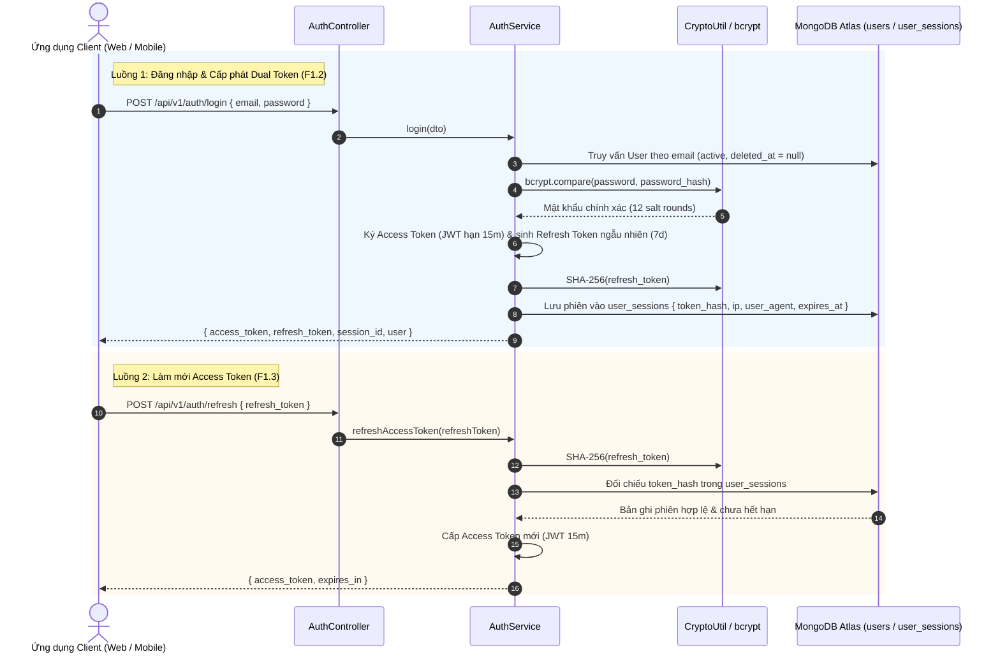

# KẾ HOẠCH TRIỂN KHAI CHI TIẾT MODULE AUTHENTICATION
**Dự án:** Nền tảng Full-stack Quản lý & Giám sát Chất lượng Dữ liệu có AI Hỗ trợ  
*(Full-Stack Data Management & Quality Assurance Platform with AI Assistance)*  
**Tập tin:** `docs/modules/auth_plan.md`  
**Phiên bản:** v1.0  
**Giai đoạn:** Sprint B1 — Module 1: Phân quyền & Xác thực (`auth`)  

---

## 1. Bối cảnh & 3 Câu hỏi Cốt lõi (Rule 1)
- **Đang làm gì?** Hiện thực hóa Module `auth` (`src/backend/src/modules/auth/`) bao gồm 8 RESTful endpoints: Đăng ký tài khoản (F1.1), Đăng nhập (F1.2), Làm mới token (F1.3), Đăng xuất (F1.4), Quên mật khẩu (F1.5), Đặt lại mật khẩu (F1.6), Danh sách phiên đăng nhập (F1.7), và Thu hồi phiên từ xa (F1.8).
- **Cho ai?** Cho toàn bộ người dùng hệ thống (Khách vãng lai, Chuyên viên phân tích dữ liệu, Quản trị viên).
- **Để làm gì?** 
  - Cung cấp cổng xác thực danh tính an toàn (Identity Provider & Security Perimeter) cho toàn bộ hệ thống API.
  - Cấp phát và quản lý vòng đời cặp mã xác thực Dual Token: Access Token ngắn hạn (JWT 15 phút) và Refresh Token dài hạn (7 ngày).
  - Duy trì và giám sát phiên đăng nhập đa thiết bị (Multi-device Session Tracking) với cơ chế băm bảo mật SHA-256 cho Refresh Token và tự động hủy phiên qua MongoDB TTL Index.
  - Ngăn chặn triệt để tấn công vét cạn (Brute-force), giả mạo phiên và rò rỉ dữ liệu xác thực.

---

## 2. Kiến trúc & Chu trình Xác thực Trực quan (Architecture & Auth Flow)



---

## 3. Đặc tả Hợp đồng API (API Contracts)

| Method | Endpoint | Quyền hạn CASL | Mô tả chức năng |
| :---: | :--- | :---: | :--- |
| `POST` | `/api/v1/auth/register` | `@Public()` | F1.1: Đăng ký tài khoản người dùng mới (mã hóa bcrypt 12 rounds) |
| `POST` | `/api/v1/auth/login` | `@Public()` | F1.2: Đăng nhập cấp cặp Dual Token và khởi tạo session |
| `POST` | `/api/v1/auth/refresh` | `@Public()` | F1.3: Cấp mới Access Token bằng Refresh Token hợp lệ |
| `POST` | `/api/v1/auth/logout` | `JwtAuthGuard` | F1.4: Đăng xuất và thu hồi session hiện tại |
| `POST` | `/api/v1/auth/forgot-password` | `@Public()` | F1.5: Yêu cầu mã/token đặt lại mật khẩu |
| `POST` | `/api/v1/auth/reset-password` | `@Public()` | F1.6: Đặt lại mật khẩu mới thông qua token xác thực |
| `GET` | `/api/v1/auth/sessions` | `JwtAuthGuard` | F1.7: Xem danh sách các phiên đăng nhập đang hoạt động |
| `DELETE` | `/api/v1/auth/sessions/:id` | `JwtAuthGuard` | F1.8: Thu hồi từ xa một phiên đăng nhập theo Session ID |

---

## 4. Cấu trúc Tệp & Phân tầng Mã nguồn

```
src/backend/src/modules/auth/
├── dto/
│   ├── login.dto.ts                    # Zod validation schema cho đăng nhập
│   ├── register.dto.ts                 # Zod validation schema cho đăng ký
│   └── reset-password.dto.ts           # Schema đổi/quên mật khẩu
├── schemas/
│   └── user-session.schema.ts          # Mongoose schema cho user_sessions (TTL index 7 ngày)
├── strategies/
│   └── jwt.strategy.ts                 # Passport JWT extraction & payload validation
├── auth.repository.ts                  # Tương tác collection user_sessions
├── auth.service.ts                     # Xử lý logic mã băm, sinh token, quản lý phiên
├── auth.controller.ts                  # RESTful Controller công khai & bảo vệ
└── auth.module.ts                      # Đăng ký JwtModule, Passport, Mongoose
```

---

## 5. Quy tắc Nghiệp vụ Bất biến (Invariants)
- **Token Storage Invariant:** Tuyệt đối không lưu chuỗi Refresh Token dạng thô (plain-text) trong CSDL. Bắt buộc lưu mã băm **`SHA-256`** trong bảng `user_sessions`.
- **TTL Session Expiration:** Cấu hình MongoDB TTL Index `expires_at` (7 ngày) để cơ sở dữ liệu tự động dọn dẹp các phiên quá hạn, chống phình to dung lượng.
- **Bảo mật Thông báo Lỗi (Generic Error):** Khi đăng nhập thất bại do sai email hoặc mật khẩu, hệ thống chỉ trả về thông báo chung: *"Email hoặc mật khẩu không chính xác"*, ngăn ngừa kỹ thuật dò quét tài khoản (Username Enumeration).
- **Tuân thủ Zero Any:** Không sử dụng kiểu `any` trong toàn bộ module; sử dụng `CurrentUserPayload` tường minh.

---

## 6. Ma trận Rủi ro & Giải pháp Phòng ngừa

| Rủi ro Kỹ thuật | Mức độ | Giải pháp phòng ngừa |
| :--- | :---: | :--- |
| **Rò rỉ CSDL làm lộ phiên người dùng** | Nghiêm trọng | Băm một chiều toàn bộ Refresh Token bằng SHA-256 trước khi lưu vào MongoDB. |
| **Chiếm đoạt phiên làm việc (Session Hijacking)** | Cao | Access Token có thời hạn ngắn (15 phút); người dùng có thể thu hồi phiên từ xa qua endpoint F1.8. |
| **Tấn công vét cạn mật khẩu (Brute-force)** | Cao | Tích hợp ThrottlerModule giới hạn tần suất gọi API (Rate Limiting 5 lần/phút cho login). |
