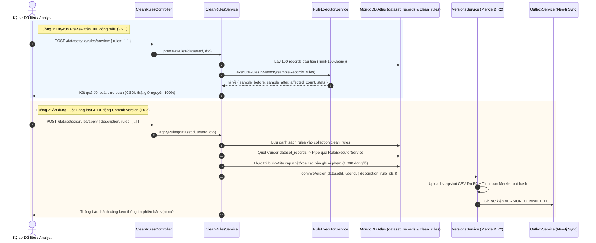

# KẾ HOẠCH TRIỂN KHAI CHI TIẾT MODULE CLEAN RULES
**Dự án:** Nền tảng Full-stack Quản lý & Giám sát Chất lượng Dữ liệu có AI Hỗ trợ  
*(Full-Stack Data Management & Quality Assurance Platform with AI Assistance)*  
**Tập tin:** `docs/modules/clean_rules_plan.md`  
**Phiên bản:** v1.0  
**Giai đoạn:** Sprint B3 — Module 3: Động cơ Làm sạch Xác định Tầng 1 (`clean-rules`)  

---

## 1. Bối cảnh & 3 Câu hỏi Cốt lõi (Rule 1)
- **Đang làm gì?** Thiết kế và hiện thực hóa Module `clean-rules` (`src/backend/src/modules/clean-rules/`) bao gồm 3 RESTful endpoints: Dry-run Preview (F6.1), Batch Apply Rules (F6.2), và List/History Rules (F6.3).
- **Cho ai?** Cho Kỹ sư Dữ liệu (Data Engineers) và Chuyên viên Phân tích (Data Analysts) cần làm sạch dữ liệu bảng trước khi huấn luyện mô hình hoặc trực quan hóa.
- **Để làm gì?** 
  - Cung cấp động cơ làm sạch xác định Tầng 1 (Deterministic Rule Engine) gồm 4 nhóm luật chuẩn hóa: Null Handling, Standardization, Deduplication và Regex Validation.
  - Cho phép người dùng chạy thử (Dry-run preview) trên tập mẫu 100 dòng đầu tiên để xem sự khác biệt trước và sau khi biến đổi mà **tuyệt đối không ghi đè vào CSDL MongoDB Atlas**.
  - Thực thi áp dụng luật hàng loạt trên toàn bộ bảng dữ liệu qua `bulkWrite` (lô 1.000 dòng), tự động kích hoạt tạo `DatasetVersion` mới lưu snapshot CSV lên Cloudflare R2, tính toán chuỗi băm Merkle chống giả mạo và phát sự kiện Outbox để đồng bộ đồ thị phả hệ sang Neo4j AuraDB.

---

## 2. Kiến trúc & Luồng Dữ liệu Trực quan (Architecture & Data Flow)



---

## 3. Đặc tả 4 Nhóm Luật Làm sạch Xác định (Rule Engine Specifications)

Động cơ `RuleExecutorService` là dịch vụ xử lý thuần túy trong bộ nhớ (pure in-memory processing), đảm bảo tính tất định (Deterministic) và không tạo side-effects ngoài ý muốn.

### 3.1. Nhóm 1: Xử lý Thiếu dữ liệu (Null Handling)
- **`DROP_ROW`:**
  - *Mục đích:* Loại bỏ hoàn toàn bản ghi khỏi tập dữ liệu nếu giá trị tại `target_column` là `null`, `undefined`, hoặc chuỗi chỉ chứa khoảng trắng `""`.
  - *Tham số:* Không yêu cầu tham số phụ.
- **`FILL_DEFAULT`:**
  - *Mục đích:* Thay thế giá trị thiếu bằng giá trị mặc định được người dùng chỉ định.
  - *Tham số:* `{ "default_value": string | number | boolean }`.
- **`FILL_MEAN`:**
  - *Mục đích:* Thay thế giá trị thiếu của cột số bằng giá trị trung bình cộng (Arithmetic Mean).
  - *Tham số:* Không yêu cầu tham số (tính toán tự động từ các giá trị hợp lệ trong cột).
- **`FILL_MEDIAN`:**
  - *Mục đích:* Thay thế giá trị thiếu của cột số bằng giá trị trung vị (Median), chống nhiễu bởi các giá trị ngoại lai (outliers).
  - *Tham số:* Không yêu cầu tham số.

### 3.2. Nhóm 2: Chuẩn hóa Định dạng (Standardization)
- **`TRIM`:**
  - *Mục đích:* Cắt bỏ khoảng trắng ở đầu và cuối chuỗi, đồng thời gộp nhiều dấu cách liên tiếp bên trong chuỗi thành 1 dấu cách đơn (`str.trim().replace(/\s+/g, ' ')`).
  - *Tham số:* Không yêu cầu tham số.
- **`UPPERCASE`:**
  - *Mục đích:* Chuyển đổi toàn bộ văn bản trong cột thành chữ in hoa.
  - *Tham số:* Không yêu cầu tham số.
- **`LOWERCASE`:**
  - *Mục đích:* Chuyển đổi toàn bộ văn bản trong cột thành chữ in thường.
  - *Tham số:* Không yêu cầu tham số.
- **`DATE_FORMAT`:**
  - *Mục đích:* Nhận diện các định dạng ngày tháng phổ biến (ví dụ `DD/MM/YYYY`, `MM-DD-YYYY`, `YYYY.MM.DD`) và chuẩn hóa về chuẩn ISO 8601 (`YYYY-MM-DD`).
  - *Tham số:* `{ "target_format"?: string }` (mặc định `YYYY-MM-DD`).
- **`NUMERIC_CAST`:**
  - *Mục đích:* Chuẩn hóa chuỗi số chứa ký hiệu tiền tệ hoặc dấu phân cách hàng nghìn (ví dụ `"$1,250.50"`, `"1.000.000 đ"`) thành số thực `1250.5`.
  - *Tham số:* Không yêu cầu tham số.

### 3.3. Nhóm 3: Khử Trùng lặp (Deduplication)
- **`DROP_DUPLICATES`:**
  - *Mục đích:* Phát hiện và loại bỏ các bản ghi trùng lặp dựa trên tập các cột khóa chỉ định (`target_columns`) hoặc toàn bộ các cột trong bảng.
  - *Tham số:* 
    - `target_columns?: string[]` (Nếu không truyền, mặc định đối soát trên toàn bộ các cột).
    - `keep?: 'first' | 'last'` (Mặc định giữ bản ghi đầu tiên `first`, xóa các bản ghi xuất hiện sau).

### 3.4. Nhóm 4: Ràng buộc Biểu thức Chính quy (Regex Validation & Replacement)
- **`REPLACE_PATTERN`:**
  - *Mục đích:* Tìm kiếm các đoạn chuỗi khớp với mẫu biểu thức chính quy và thay thế bằng chuỗi mới (hỗ trợ che giấu dữ liệu PII như số CCCD, thẻ ngân hàng, hoặc loại bỏ ký tự lạ).
  - *Tham số:* `{ "pattern": string, "replacement": string, "flags"?: string }`.
- **`FILTER_PATTERN`:**
  - *Mục đích:* Chỉ giữ lại những dòng có giá trị cột khớp với mẫu regex (ví dụ: định dạng Email hợp lệ, số điện thoại Việt Nam 10 chữ số). Các dòng không khớp sẽ bị loại bỏ hoặc đánh dấu vi phạm.
  - *Tham số:* `{ "pattern": string, "flags"?: string }`.

---

## 4. Đặc tả Hợp đồng API (API Contracts & Endpoints)

| Method | Endpoint | Quyền hạn CASL | Mô tả chức năng |
| :---: | :--- | :---: | :--- |
| `POST` | `/api/v1/datasets/:id/rules/preview` | `Action.Execute` trên `CleanRule` | F6.1: Dry-run chạy thử danh sách luật trên 100 dòng mẫu |
| `POST` | `/api/v1/datasets/:id/rules/apply` | `Action.Execute` trên `CleanRule` | F6.2: Áp dụng luật hàng loạt, cập nhật DB & commit snapshot |
| `GET` | `/api/v1/datasets/:id/rules` | `Action.Read` trên `CleanRule` | F6.3: Lấy danh sách lịch sử các luật đã lưu/áp dụng |

---

## 5. Cấu trúc Tệp & Nhiệm vụ Hiện thực hóa (File Structure & Tasks)

### 5.1. Cấu trúc Thư mục Module
```
src/backend/src/modules/clean-rules/
├── dto/
│   └── clean-rule.dto.ts               # Zod validation schemas & TypeScript types
├── schemas/
│   └── clean-rule.schema.ts            # Mongoose schema cho collection clean_rules
├── services/
│   └── rule-executor.service.ts        # Động cơ in-memory thuần túy thực thi 4 nhóm luật
├── clean-rules.repository.ts           # Tương tác MongoDB kế thừa BaseMongoRepository
├── clean-rules.service.ts              # Điều phối Preview, Batch Apply, Commit Version
├── clean-rules.controller.ts           # RESTful Controller tích hợp Jwt & PoliciesGuard
├── clean-rules.module.ts               # Module definition và Dependency Injection
└── README.md                           # Tài liệu đặc tả kiến trúc chuẩn 6 phần
```

### 5.2. Danh sách Công việc Cụ thể (Step-by-step Tasks)
1. **Khởi tạo Lược đồ & DTOs:**
   - Tạo `clean-rule.schema.ts` với chỉ mục `{ dataset_id: 1, deleted_at: 1 }`.
   - Tạo `clean-rule.dto.ts` với `RuleDefinitionSchema`, `PreviewRulesSchema`, `ApplyRulesSchema`.
2. **Xây dựng Động cơ Quy tắc (`RuleExecutorService`):**
   - Hiện thực hóa logic biến đổi độc lập: `applyNullHandling`, `applyStandardization`, `applyDeduplication`, `applyRegex`.
   - Tính toán thống kê ô bị sửa, số dòng bị xóa, và trả về diff trước/sau.
3. **Hiện thực hóa Tầng Truy vấn & Dịch vụ (`CleanRulesRepository` & `CleanRulesService`):**
   - `previewRules`: Đọc tối đa 100 dòng đầu với `.lean()`, chạy thử nghiệm qua `RuleExecutorService`.
   - `applyRules`: Quét toàn bộ records, chạy qua `RuleExecutorService`, gọi `bulkWrite` cập nhật MongoDB theo lô 1.000 dòng, sau đó gọi `VersionsService.commitVersion` để tạo snapshot trên Cloudflare R2 và kích hoạt Outbox event.
   - `getRulesByDatasetId`: Tra cứu danh sách các luật đã lưu.
4. **Hiện thực hóa Controller & Đăng ký Module:**
   - Cung cấp 3 endpoints tại `clean-rules.controller.ts`.
   - Đăng ký `CleanRulesModule` vào `app.module.ts`.
5. **Kiểm thử Toàn diện & Bảo vệ Kiến trúc:**
   - Viết bộ kiểm thử `test/clean-rules.spec.ts` (kiểm tra đầy đủ 4 nhóm luật, dry-run không làm bẩn CSDL, batch apply và version commit).
   - Cập nhật `test/guard-coverage.spec.ts` bổ sung `CleanRulesController`.
   - Kiểm tra `pnpm run type-check` và `pnpm test test/zero-any.spec.ts` đạt chuẩn Zero Any 100%.
6. **Tài liệu hóa:**
   - Tạo `src/backend/src/modules/clean-rules/README.md` theo chuẩn 6 phần.

---

## 6. Ma trận Rủi ro & Giải pháp Phòng ngừa (Risk & Mitigation Matrix)

| Rủi ro Kỹ thuật | Mức độ | Giải pháp phòng ngừa |
| :--- | :---: | :--- |
| **Dry-run làm biến dạng CSDL thật** | Nghiêm trọng | `previewRules` chỉ đọc dữ liệu bằng `.lean()`, toàn bộ quá trình biến đổi thực hiện trên bản sao in-memory và không gọi bất kỳ lệnh ghi nào vào MongoDB. |
| **Tràn RAM Node.js khi Batch Apply bảng lớn** | Cao | Không gom toàn bộ dữ liệu vào mảng RAM; duyệt tuần tự qua Mongoose Cursor và thực thi `bulkWrite` theo từng lô nhỏ 1.000 dòng. |
| **Biểu thức chính quy không an toàn (ReDoS)** | Trung bình | Validate pattern regex bằng Zod, giới hạn độ dài pattern tối đa 200 ký tự và bắt lỗi runtime `catch (err: unknown)` an toàn. |
| **Vi phạm Zero Any Policy (Rule 13)** | Nghiêm trọng | Sử dụng generic `Record<string, unknown>`, type narrowing với Type Guards (`typeof`, `instanceof`), chạy `zero-any.spec.ts` tự động kiểm duyệt. |
