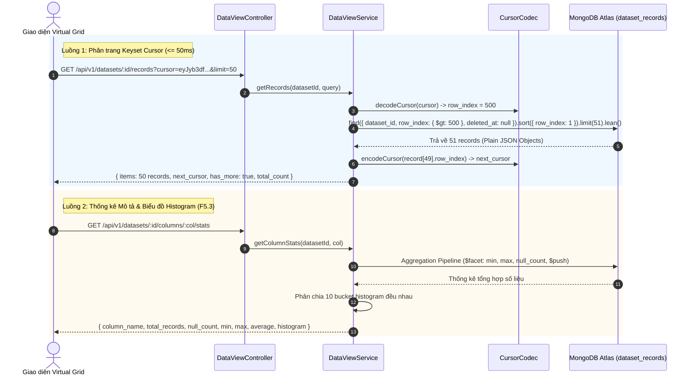

# KẾ HOẠCH TRIỂN KHAI CHI TIẾT MODULE DATA VIEW
**Dự án:** Nền tảng Full-stack Quản lý & Giám sát Chất lượng Dữ liệu có AI Hỗ trợ  
*(Full-Stack Data Management & Quality Assurance Platform with AI Assistance)*  
**Tập tin:** `docs/modules/data_view_plan.md`  
**Phiên bản:** v1.0  
**Giai đoạn:** Sprint B2 — Module 4: Truy xuất Lưới Dữ liệu Ảo & Thống kê Phân phối (`data-view`)  

---

## 1. Bối cảnh & 3 Câu hỏi Cốt lõi (Rule 1)
- **Đang làm gì?** Hiện thực hóa Module `data-view` (`src/backend/src/modules/data-view/`) bao gồm 3 RESTful endpoints: Phân trang Keyset/Cursor cho Lưới Ảo (F5.1), Chỉnh sửa ô trực tiếp In-place Cell Edit (F5.2), và Thống kê phân phối cột Histogram 10 khoảng (F5.3).
- **Cho ai?** Cho Chuyên viên Phân tích và Kỹ sư Dữ liệu thao tác khám phá, duyệt xem hàng triệu bản ghi và chỉnh sửa dữ liệu trên giao diện Virtual Grid.
- **Để làm gì?** 
  - Cung cấp cơ chế phân trang con trỏ (Keyset / Cursor Pagination) đạt độ trễ cực thấp ($\le 50\text{ ms}$), loại bỏ hoàn toàn hiện tượng suy giảm hiệu năng $O(N)$ của phân trang `skip/limit` truyền thống.
  - Cho phép người dùng chỉnh sửa giá trị của một ô dữ liệu cụ thể (`In-place Cell Edit`) với độ an toàn cao.
  - Cung cấp công cụ phân tích mô tả cột: Tính toán số lượng Null, tỷ lệ thiếu, Min, Max, Average và phân phối 10 khoảng đều (Equi-width Buckets Histogram) bằng MongoDB Aggregation Pipeline.

---

## 2. Kiến trúc & Luồng Dữ liệu Trực quan (Architecture & Keyset Flow)



---

## 3. Đặc tả Hợp đồng API (API Contracts)

| Method | Endpoint | Quyền hạn CASL | Mô tả chức năng |
| :---: | :--- | :---: | :--- |
| `GET` | `/api/v1/datasets/:id/records` | `Action.Read` trên `DataRecord` | F5.1: Phân trang Keyset Cursor cho Virtual Grid ($\le 50\text{ ms}$) |
| `PATCH` | `/api/v1/datasets/:id/records/:rowIndex` | `Action.Update` trên `DataRecord` | F5.2: In-place Cell Edit cập nhật giá trị 1 ô tại chỉ số dòng |
| `GET` | `/api/v1/datasets/:id/columns/:columnName/stats` | `Action.Read` trên `DataRecord` | F5.3: Thống kê cột (Null, Min, Max, Avg) và 10 khoảng Histogram |

---

## 4. Cấu trúc Tệp & Phân tầng Mã nguồn

```
src/backend/src/modules/data-view/
├── dto/
│   ├── query-records.dto.ts            # Zod schema cho query phân trang cursor
│   └── update-cell.dto.ts              # Schema cập nhật ô { field, value }
├── data-view.service.ts                # Logic phân trang keyset, cell edit, histogram
├── data-view.controller.ts             # RESTful Controller bảo vệ bằng PoliciesGuard
├── data-view.module.ts                 # Module definition và Dependency Injection
└── README.md                           # Tài liệu đặc tả kiến trúc chuẩn 6 phần
```

---

## 5. Quy tắc Nghiệp vụ Bất biến (Invariants)
- **Tối ưu hóa POJO (`.lean()`):** 100% truy vấn đọc dữ liệu bản ghi sử dụng `.lean()` nhằm loại bỏ overhead của Mongoose Document, giải phóng RAM và đảm bảo tốc độ phản hồi $\le 50\text{ ms}$.
- **Keyset vs Offset:** Nghiêm cấm dùng `skip(N)` cho phân trang lớn; bắt buộc dùng điều kiện con trỏ `{ row_index: { $gt: last_seen } }` kết hợp chỉ mục B-tree.
- **Toàn vẹn Schema khi Edit:** Không cho phép chèn thêm trường nằm ngoài lược đồ `dataset.columns`.
- **Tuân thủ Zero Any:** Không sử dụng `any` trong toàn bộ module; sử dụng `Record<string, unknown>`.

---

## 6. Ma trận Rủi ro & Giải pháp Phòng ngừa

| Rủi ro Kỹ thuật | Mức độ | Giải pháp phòng ngừa |
| :--- | :---: | :--- |
| **Truy vấn phân trang bị chậm khi dữ liệu lớn** | Cao | Bắt buộc sử dụng Keyset Cursor kết hợp compound index `{ dataset_id: 1, row_index: 1, deleted_at: 1 }`. |
| **Tràn RAM do aggregation cột không phải số** | Trung bình | Kiểm tra kiểu dữ liệu cột trong metadata `dataset.columns` trước khi thực thi pipeline tính toán. |
| **Sửa sai dòng khi đồng thời có nhiều người thao tác** | Trung bình | Lọc theo cặp `{ dataset_id, row_index, deleted_at: null }` đảm bảo tính chính xác tuyệt đối của dòng. |
