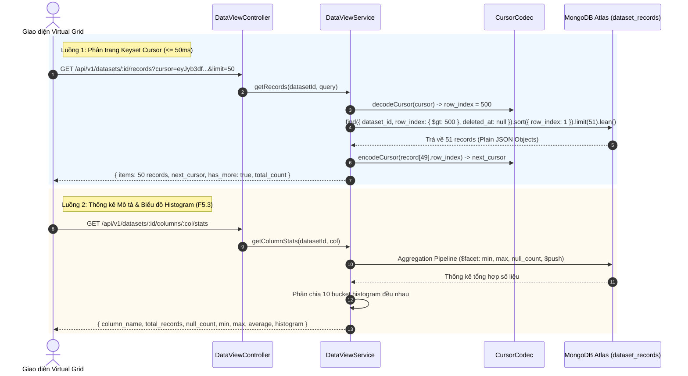

# KẾ HOẠCH TRIỂN KHAI CHI TIẾT MODULE DATA VIEW
**Dự án:** Nền tảng Full-stack Quản lý & Giám sát Chất lượng Dữ liệu có AI Hỗ trợ  
*(Full-Stack Data Management & Quality Assurance Platform with AI Assistance)*  
**Tập tin:** `docs/modules/data_view_plan.md`  
**Phiên bản:** v1.3 (2026-11-25 — mục 8: đóng OPEN-DV-01, OPEN-DV-02 + sửa so sánh thứ tự khớp ô trống)  
**Giai đoạn:** Sprint B2 — Module 4: Truy xuất Lưới Dữ liệu Ảo & Thống kê Phân phối (`data-view`)  

> **Lưu ý v1.1 (2026-11-24):** mục 1–6 là thiết kế gốc v1.0 (Sprint B2), giữ để đối chiếu. Hiện trạng đã khác:
> dữ liệu bất biến nên **không còn** cell edit (`PATCH /records/:rowIndex`, F5.2); module có 4 route
> (`GET records`, `POST records/query`, `GET columns/:columnKey/stats`, `GET charts`); cấu trúc file theo Template Simple
> (`data-view.{controller,service,types,utils}.ts`); bản ghi truy vấn qua `RECORD_QUERY_PORT` của module `datasets`.
> Hợp đồng hiện hành: Phần 7 v13 §3.7 + mục 3.23, bổ sung v16 mục 3.26. Đợt sửa mới nhất: mục 8.

---

## 1. Bối cảnh & 3 Câu hỏi Cốt lõi (Rule 1)
- **Đang làm gì?** Hiện thực hóa Module `data-view` (`src/backend/src/modules/data-view/`) bao gồm 3 RESTful endpoints: Phân trang Keyset/Cursor cho Lưới Ảo (F5.1), Chỉnh sửa ô trực tiếp In-place Cell Edit (F5.2), và Thống kê phân phối cột Histogram 10 khoảng (F5.3).
- **Cho ai?** Cho Chuyên viên Phân tích và Kỹ sư Dữ liệu thao tác khám phá, duyệt xem hàng triệu bản ghi và chỉnh sửa dữ liệu trên giao diện Virtual Grid.
- **Để làm gì?** 
  - Cung cấp cơ chế phân trang con trỏ (Keyset / Cursor Pagination) đạt độ trễ cực thấp ($\le 50\text{ ms}$), loại bỏ hoàn toàn hiện tượng suy giảm hiệu năng $O(N)$ của phân trang `skip/limit` truyền thống.
  - Cho phép người dùng chỉnh sửa giá trị của một ô dữ liệu cụ thể (`In-place Cell Edit`) với độ an toàn cao.
  - Cung cấp công cụ phân tích mô tả cột: Tính toán số lượng Null, tỷ lệ thiếu, Min, Max, Average và phân phối 10 khoảng đều (Equi-width Buckets Histogram) bằng MongoDB Aggregation Pipeline.

---

## 2. Kiến trúc & Luồng Dữ liệu Trực quan (Architecture & Keyset Flow)



---

## 3. Đặc tả Hợp đồng API (API Contracts)

| Method | Endpoint | Quyền hạn CASL | Mô tả chức năng |
| :---: | :--- | :---: | :--- |
| `GET` | `/api/v1/datasets/:id/records` | `Action.Read` trên `DataRecord` | F5.1: Phân trang Keyset Cursor cho Virtual Grid ($\le 50\text{ ms}$) |
| `PATCH` | `/api/v1/datasets/:id/records/:rowIndex` | `Action.Update` trên `DataRecord` | F5.2: In-place Cell Edit cập nhật giá trị 1 ô tại chỉ số dòng |
| `GET` | `/api/v1/datasets/:id/columns/:columnName/stats` | `Action.Read` trên `DataRecord` | F5.3: Thống kê cột (Null, Min, Max, Avg) và 10 khoảng Histogram |

---

## 4. Cấu trúc Tệp & Phân tầng Mã nguồn

```
src/backend/src/modules/data-view/
├── dto/
│   ├── query-records.dto.ts            # Zod schema cho query phân trang cursor
│   └── update-cell.dto.ts              # Schema cập nhật ô { field, value }
├── data-view.service.ts                # Logic phân trang keyset, cell edit, histogram
├── data-view.controller.ts             # RESTful Controller bảo vệ bằng PoliciesGuard
├── data-view.module.ts                 # Module definition và Dependency Injection
└── README.md                           # Tài liệu đặc tả kiến trúc chuẩn 6 phần
```

---

## 5. Quy tắc Nghiệp vụ Bất biến (Invariants)
- **Tối ưu hóa POJO (`.lean()`):** 100% truy vấn đọc dữ liệu bản ghi sử dụng `.lean()` nhằm loại bỏ overhead của Mongoose Document, giải phóng RAM và đảm bảo tốc độ phản hồi $\le 50\text{ ms}$.
- **Keyset vs Offset:** Nghiêm cấm dùng `skip(N)` cho phân trang lớn; bắt buộc dùng điều kiện con trỏ `{ row_index: { $gt: last_seen } }` kết hợp chỉ mục B-tree.
- **Toàn vẹn Schema khi Edit:** Không cho phép chèn thêm trường nằm ngoài lược đồ `dataset.columns`.
- **Tuân thủ Zero Any:** Không sử dụng `any` trong toàn bộ module; sử dụng `Record<string, unknown>`.

---

## 6. Ma trận Rủi ro & Giải pháp Phòng ngừa

| Rủi ro Kỹ thuật | Mức độ | Giải pháp phòng ngừa |
| :--- | :---: | :--- |
| **Truy vấn phân trang bị chậm khi dữ liệu lớn** | Cao | Bắt buộc sử dụng Keyset Cursor kết hợp compound index `{ dataset_id: 1, row_index: 1, deleted_at: 1 }`. |
| **Tràn RAM do aggregation cột không phải số** | Trung bình | Kiểm tra kiểu dữ liệu cột trong metadata `dataset.columns` trước khi thực thi pipeline tính toán. |
| **Sửa sai dòng khi đồng thời có nhiều người thao tác** | Trung bình | Lọc theo cặp `{ dataset_id, row_index, deleted_at: null }` đảm bảo tính chính xác tuyệt đối của dòng. |

---

## 7. Đợt sửa 2026-11-24 — rà soát module data-view

- **Trạng thái:** Đã thực hiện 2026-11-24.
- **Hợp đồng:** Phần 7 v13 mục 3.23 (DV-1…DV-17). **Test:** Phần 13 v15 mục 3.28 (DVT-01…DVT-12).
- **Quyết định của người dùng:** `limit` tối đa 500; cursor gắn chữ ký sort, **không** gắn bộ lọc, chưa có hạn 24 giờ (OPEN-DV-01 — đã làm ở mục 8); null xếp cuối mọi kiểu cột khi sort; `charts?columns=` giữ hành vi bỏ qua cột không khớp.

### 7.1. Lỗi đã xác nhận từ mã nguồn

| # | Mức | Lỗi | Vị trí (trước khi sửa) |
|---|---|---|---|
| L1 | Nghiêm trọng | Phân trang khi sort chỉ dùng `row_index > last` → trang 2 bỏ sót dòng | `record-query.repository.ts` `queryRecords`; `data-view.service.ts` nextCursor |
| L2 | Cao | `POST /records/query` nuốt cursor hỏng, quay về trang 1 | `decodeRowIndex` trong repository |
| L3 | Cao | `value` bộ lọc nhận object → MongoDB thực thi toán tử (vd `$regex` ReDoS). Phạm vi vẫn khoá trong `dataset_id` | `RecordFilterSchema.value = z.unknown()` + `buildOneCondition` |
| L4 | Cao | `date between` là code chết; `date in` / `boolean in` không ép kiểu; ngày sai so sánh chuỗi thô | `buildOneCondition` nhánh date |
| L5 | Cao | `getColumnStats` `$push` toàn bộ giá trị + `Math.min(...arr)` (RangeError ở ~120k+ dòng); cột hằng số sinh bucket đảo | `getColumnStats` |
| L6 | Trung bình | Lọc cùng cột qua `c0` + tên hiển thị bị AND; lọc số sai bị bỏ qua; regex không khớp số/boolean đã ép kiểu; trống chưa tính whitespace | `buildFilterConditions`, `buildOneCondition` |
| L7 | Thấp | `limit` DTO 200 vs 500; `missing_count` lệch; boolean legacy tách nhóm; mẫu biểu đồ không ổn định; `countDocuments` lặp theo cột; code thừa | controller, service `getChartData`, `getColumnValues` |

### 7.2. Hướng sửa

- **Cursor keyset** (`src/shared/domain/pagination/record-keyset-cursor.ts`, hàm thuần — tách khỏi `keyset-cursor.ts` có sẵn vốn chỉ hỗ trợ một trường chuỗi + `_id`): payload `{ v: 1, s: [[key, order]…], k: [[tag, value]…], r: rowIndex }`; không sort giữ `{ row_index }`. Service validate sớm; repository dựng điều kiện `$expr` theo thứ tự từ điển trên alias đã ép kiểu và trả `nextCursor` (port chỉ **thêm** field, không đổi field cũ; `analysis` chỉ dùng `listAllRecords`).
- **Sort:** có `sort` → luôn chạy aggregation, mọi cột sort có alias + cờ null → null cuối mọi kiểu.
- **Bộ lọc:** service quy đổi cột → `cN` trước khi gọi port; repository nhóm OR theo key, chặn object (lớp 2), ném `ValidationError` khi so sánh thứ tự với số/ngày sai (`equals`/`in` khớp chuỗi thô để tìm ô sai kiểu), sửa `between`/`in` cho date/boolean, regex trên `$toString` cho number/boolean, trống gồm whitespace.
- **Stats:** `$min/$max/$avg` trong `$group`, histogram bằng `$bucket`; `min = max` → 1 bucket; chỉ chạy khi cột `number`.
- **Charts:** `isBlankValue` cho `missing_count`, chuẩn hoá boolean bằng `coerceBoolean`, chỉ cột đầu `countDocuments` (các cột sau nhận `knownTotal`), đọc song song 4 cột, mẫu theo `row_index`.

### 7.3. Không làm trong đợt này

- Ràng buộc cursor theo bộ lọc + hạn 24 giờ (OPEN-DV-01) — đã làm ở mục 8.
- Phân quyền CASL theo vai trò (đang do dev khác xử lý).
- OPEN-DV-02: chuỗi ngày legacy được `$convert` đọc theo UTC, lệch 7 giờ so với quy tắc nạp UTC+7 (có từ trước, Phần 7 v13 mục 3.23) — đã làm ở mục 8.

### 7.4. Kết quả

- `tsc` 0 lỗi, `lint` 0 cảnh báo, `test:arch` 23/23, `arch:api-coverage` 84/84.
- Unit `data-view` + `chart-data` + `record-keyset-cursor`: 84/84. Integration `record-query.spec.ts`: 56/56 (28 cũ giữ nguyên assert + 28 mới).
- `test:unit` toàn bộ: chỉ 2 lỗi môi trường đã biết (`/proc/meminfo`). Integration toàn bộ: 167/170 (3 lỗi MinIO đã biết).

### 7.5. Vá sau rà soát commit (v1.2)

- `in` với mảng rỗng gọi thẳng qua `RECORD_QUERY_PORT` trên cột number / boolean / date trả `null` → bộ lọc bị bỏ qua (trả cả bảng), trong khi cột chuỗi khớp 0 dòng. Sửa: trả `{ [path]: { $in: [] } }` → 0 dòng. HTTP vẫn bị DTO chặn từ trước.
- Hợp đồng: Phần 7 v15 mục 3.25 VA-3. Test: Phần 13 v17 VAT-05 (`record-query.spec.ts`, 4 kiểu cột). **Trạng thái:** Đã thực hiện 2026-11-24.

---

## 8. Đợt 2026-11-25 — đóng việc còn mở (OPEN-DV-01, OPEN-DV-02)

- **Trạng thái:** Đã thực hiện 2026-11-25.
- **Hợp đồng:** Phần 7 v16 mục 3.26 (DL-1…DL-6); §3.7 quy tắc 2, 3 nay đã thực thi. **Test:** Phần 13 v18 mục 3.31 (DLT-01…DLT-08).
- **Nguồn:** mục 9 "Việc còn mở" của báo cáo thay đổi nhánh `Vqd_BE` (2026-11-25). Người dùng nhận module và duyệt plan; đảo quyết định hoãn OPEN-DV-01 của mục 7.

### 8.1. Lỗi / thiếu sót

| # | Mức | Nội dung | Vị trí (trước khi sửa) |
|---|---|---|---|
| L8 | Trung bình | Cursor không gắn `filters`/`search`: đổi bộ lọc mà giữ cursor cũ → trang sau tiếp từ vị trí của truy vấn khác, không báo lỗi (lệch §3.7 quy tắc 2) | `DataViewService.getRecords` / `queryRecords` |
| L9 | Thấp | Cursor không có hạn (lệch §3.7 quy tắc 3) | như trên |
| L10 | Trung bình | Chuỗi ngày legacy không múi giờ được `$convert` đọc theo UTC, trong khi `coerceDate` hiểu là UTC+7 → `equals`/`in`/so sánh/sort lệch 7 giờ (OPEN-DV-02) | `dateExpr` trong `record-query.repository.ts` |
| L11 | Trung bình | `lessThan`/`lessThanOrEqual` trên cột số/ngày trả cả ô trống và ô không đọc được (trong aggregation `null` nhỏ hơn mọi số/ngày). Phát hiện khi viết test cho L10 | nhánh `cmp` của cột số và cột ngày trong `buildOneCondition` |

### 8.2. Hướng sửa

- **Bọc cursor ở tầng service** (`record-keyset-cursor.ts`, hàm thuần): `bindRecordCursor` / `unbindRecordCursor` bọc cursor của port thành `{ b: 1, c, q, t }`; `computeRecordQueryHash` băm `filters` (sau khi quy về `cN`, sắp xếp để không phụ thuộc thứ tự) + `search` (rỗng/toàn khoảng trắng = không tìm). Kiểm theo thứ tự: sai định dạng → hết hạn 24 giờ (`cursor_expired`, cả cursor dạng cũ) → lệch truy vấn (`cursor_query_mismatch`) → lệch sort (như v13). **Port `RECORD_QUERY_PORT` và repository không đổi** — khác plan ban đầu (luồn `cursorBinding` qua port), gọn hơn và không chạm module khác.
- **`dateExpr`**: `$switch` theo `$type` — `date` giữ nguyên; `string` → `$dateFromString` (không múi giờ: `timezone: DEFAULT_TIMEZONE`, dấu cách → `T`; có múi giờ: không truyền `timezone`); kiểu khác → `$convert` như cũ. Regex múi giờ `EXPLICIT_ZONE_SUFFIX` xuất từ `value-coercion.vo.ts`, dùng chung với `coerceDate`.
- **`compareExpr`**: so sánh thứ tự kèm `$ne: [expr, null]`.

### 8.3. Không làm trong đợt này

- OPEN-DV-03: `search`/`contains` trên cột ngày so khớp dạng chuỗi ISO **UTC** của `Date` (Phần 7 v16 mục 3.26).
- `decodeRowCursor` trong `data-view.utils.ts` không còn được service dùng, giữ lại vì nằm trong public contract `index.ts`.

### 8.4. Kết quả

- Unit: `record-keyset-cursor.spec.ts` 29/29, `data-view.spec.ts` 21/21 (3 ca cũ đổi **có chủ đích** theo DL-3: cursor trả ra là cursor đã bọc; DVT-03 dùng cursor không sort đã bọc để giữ ý định "lệch sort").
- Integration `record-query.spec.ts`: 71/71 (thêm DLT-06…08). Xác nhận ngược: bỏ phần sửa ở repository thì 7 ca DLT-07/08 không đạt.

---

## 9. Lịch sử thay đổi

- **v1.3 / 2026-11-25:** Mục 8 — đóng OPEN-DV-01 (cursor gắn bộ lọc + hạn 24 giờ), OPEN-DV-02 (chuỗi ngày legacy theo UTC+7), sửa so sánh thứ tự khớp ô trống / Người dùng nhận module data-view và duyệt plan đóng việc còn mở.
- **v1.2 / 2026-11-24:** Mục 7.5 — vá `in: []` qua port.
- **v1.1 / 2026-11-24:** Thêm lưu ý hiện trạng + mục 7 (đợt sửa sau rà soát) / Người dùng yêu cầu rà soát module `data-view` và plan sửa.
- **v1.0:** Thiết kế gốc Sprint B2.
