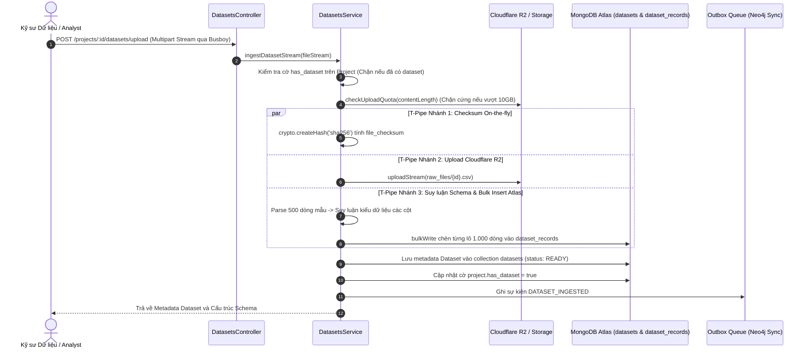

# KẾ HOẠCH TRIỂN KHAI CHI TIẾT MODULE DATASETS INGESTION
**Dự án:** Nền tảng Full-stack Quản lý & Giám sát Chất lượng Dữ liệu có AI Hỗ trợ  
*(Full-Stack Data Management & Quality Assurance Platform with AI Assistance)*  
**Tập tin:** `docs/modules/datasets_plan.md`  
**Phiên bản:** v1.0  
**Giai đoạn:** Sprint B2 — Module 3: Nạp Dữ liệu Dạng luồng & Suy luận Lược đồ (`datasets`)  

---

## 1. Bối cảnh & 3 Câu hỏi Cốt lõi (Rule 1)
- **Đang làm gì?** Hiện thực hóa Module `datasets` (`src/backend/src/modules/datasets/`) bao gồm 6 RESTful endpoints: Streaming Upload Dataset (F4.1), Dataset của Project (F4.2), Chi tiết Dataset (F4.3), Cập nhật Dataset (F4.4), Xóa mềm Dataset (F4.5), và Xem Schema cột (F4.6).
- **Cho ai?** Cho Kỹ sư Dữ liệu và Analyst cần tải lên các tệp dữ liệu bảng thô (CSV/Excel) kích thước lớn mà không làm nghẽn RAM máy chủ.
- **Để làm gì?** 
  - Cung cấp cổng tiếp nhận dữ liệu dạng luồng (Streaming Ingestion Gateway) với kiến trúc T-pipe song song: Vừa tính SHA-256 on-the-fly, vừa stream upload lên Cloudflare R2, vừa phân tích parsing CSV và chèn dữ liệu vào MongoDB Atlas theo lô 1.000 dòng (`bulkWrite`).
  - Tự động suy luận lược đồ Tầng 0 (`SchemaInferenceService`) cho kiểu dữ liệu các cột (`string`, `number`, `boolean`, `date`) và chuẩn hóa tên cột sang `snake_case` dựa trên 500 dòng mẫu đầu tiên.
  - Áp dụng cơ chế R2 Storage Quota Guard (cảnh báo 90% qua ntfy.sh, chặn cứng 100% giới hạn 10GB với HTTP 413).
  - Phát sự kiện `DATASET_INGESTED` vào Outbox Pattern để kích hoạt đồng bộ đồ thị sang Neo4j AuraDB.

---

## 2. Kiến trúc & Luồng Dữ liệu Trực quan (Architecture & T-Pipe Flow)



---

## 3. Đặc tả Hợp đồng API (API Contracts)

| Method | Endpoint | Quyền hạn CASL | Mô tả chức năng |
| :---: | :--- | :---: | :--- |
| `POST` | `/api/v1/projects/:projectId/datasets/upload` | `Action.Create` trên `Dataset` | F4.1: Streaming upload file CSV/Excel qua Busboy |
| `GET` | `/api/v1/projects/:projectId/datasets` | `Action.Read` trên `Dataset` | F4.2: Lấy thông tin tập dữ liệu liên kết với Project |
| `GET` | `/api/v1/datasets/:id` | `Action.Read` trên `Dataset` | F4.3: Xem chi tiết thông tin metadata của Dataset |
| `PATCH` | `/api/v1/datasets/:id` | `Action.Update` trên `Dataset` | F4.4: Cập nhật tên hoặc mô tả của Dataset |
| `DELETE` | `/api/v1/datasets/:id` | `Action.Delete` trên `Dataset` | F4.5: Xóa mềm Dataset, cascade records và giải phóng Project |
| `GET` | `/api/v1/datasets/:id/schema` | `Action.Read` trên `Dataset` | F4.6: Xem cấu trúc schema và kiểu dữ liệu các cột |

---

## 4. Cấu trúc Tệp & Phân tầng Mã nguồn

```
src/backend/src/modules/datasets/
├── dto/
│   └── update-dataset.dto.ts           # Zod schema cho cập nhật Dataset
├── schemas/
│   ├── dataset.schema.ts               # Metadata, checksum, storage_key, columns
│   └── dataset-record.schema.ts        # Lưu từng dòng { row_index, data, version_number }
├── services/
│   └── schema-inference.service.ts     # Suy luận kiểu dữ liệu Tầng 0 trên 500 dòng mẫu
├── datasets.repository.ts              # Kế thừa BaseMongoRepository<IDataset>, bulkInsertRecords
├── datasets.service.ts                 # Điều phối T-pipe stream, quota guard, outbox event
├── datasets.controller.ts              # RESTful Controller xử lý Multipart Stream qua Busboy
└── datasets.module.ts                  # Module definition và Dependency Injection
```

---

## 5. Quy tắc Nghiệp vụ Bất biến (Invariants)
- **Zero In-Memory Storage:** Không lưu toàn bộ tệp vào RAM máy chủ; luồng byte được pipe trực tiếp song song (RAM $\le 20\text{ MB}$).
- **Toàn vẹn Checksum:** `file_checksum` bắt buộc là mã băm SHA-256 tính toán trực tiếp từ luồng byte thô khi tải lên.
- **R2 Quota Guard:** Ngăn chặn vượt hạn mức 10GB của Cloudflare R2; chặn ngay lập tức với mã lỗi HTTP 413.
- **Fault-tolerance Clean-up:** Nếu xảy ra lỗi giữa chừng, trạng thái Dataset được chuyển sang `FAILED` và dọn dẹp các dòng ghi dở dang.
- **Tuân thủ Zero Any:** Không sử dụng `any` trong toàn bộ module.

---

## 6. Ma trận Rủi ro & Giải pháp Phòng ngừa

| Rủi ro Kỹ thuật | Mức độ | Giải pháp phòng ngừa |
| :--- | :---: | :--- |
| **Tràn RAM máy chủ do tệp dữ liệu quá lớn** | Nghiêm trọng | Sử dụng Busboy Multipart Streaming, không dùng multer memoryStorage; batch insert 1.000 records. |
| **Hỏng cấu trúc tệp CSV giữa chừng** | Cao | Lắng nghe sự kiện `error` của stream, hủy các PassThrough stream và đánh dấu Dataset `FAILED`. |
| **Dung lượng R2 bị cạn kiệt** | Trung bình | Kiểm tra `StorageService.checkUploadQuota()` trước khi tiếp nhận luồng dữ liệu. |
