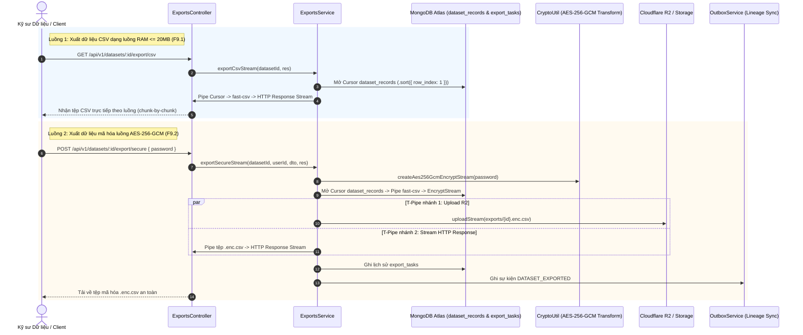

# KẾ HOẠCH TRIỂN KHAI CHI TIẾT MODULE SECURE EXPORTS
**Dự án:** Nền tảng Full-stack Quản lý & Giám sát Chất lượng Dữ liệu có AI Hỗ trợ  
*(Full-Stack Data Management & Quality Assurance Platform with AI Assistance)*  
**Tập tin:** `docs/modules/exports_plan.md`  
**Phiên bản:** v1.0  
**Giai đoạn:** Sprint B3 — Module 4: Xuất Dữ liệu Bảo mật & Mã hóa Luồng (`exports`)  

---

## 1. Bối cảnh & 3 Câu hỏi Cốt lõi (Rule 1)
- **Đang làm gì?** Hiện thực hóa Module `exports` (`src/backend/src/modules/exports/`) bao gồm các RESTful endpoints: Xuất dữ liệu CSV dạng luồng (F9.1), Xuất dữ liệu mã hóa luồng AES-256-GCM bảo vệ bằng mật khẩu (F9.2), và Lịch sử tác vụ xuất dữ liệu.
- **Cho ai?** Cho Chuyên viên Dữ liệu (Data Analysts) và Kỹ sư Dữ liệu cần kết xuất dữ liệu sạch để nạp vào Data Warehouse, huấn luyện AI, hoặc gửi ra bên ngoài với bảo mật cấp quân sự.
- **Để làm gì?** 
  - Cung cấp cơ chế xuất dữ liệu dạng luồng (Streaming CSV) với mức tiêu thụ RAM cực thấp ($\le 20\text{ MB}$) bất kể tập dữ liệu có hàng triệu dòng.
  - Cung cấp cơ chế mã hóa luồng chuẩn AES-256-GCM (PBKDF2 100.000 vòng, Salt 16B, IV 12B, Auth Tag 16B), bảo vệ dữ liệu bằng mật khẩu cá nhân của người dùng.
  - Lưu trữ bản sao tệp mã hóa an toàn trên Cloudflare R2 (`exports/{export_id}.enc.csv`) và phát sự kiện Outbox để kiểm toán nguồn gốc xuất dữ liệu (Data Export Lineage Audit).

---

## 2. Kiến trúc & Luồng Dữ liệu Trực quan (Architecture & Streaming Flow)



---

## 3. Đặc tả Hợp đồng API (API Contracts)

| Method | Endpoint | Quyền hạn CASL | Mô tả chức năng |
| :---: | :--- | :---: | :--- |
| `GET` | `/api/v1/datasets/:id/export/csv` | `Action.Export` trên `Dataset` | F9.1: Stream xuất dữ liệu CSV trực tiếp sang HTTP Response (RAM $\le 20\text{ MB}$) |
| `POST` | `/api/v1/datasets/:id/export/secure` | `Action.Export` trên `Dataset` | F9.2: Xuất dữ liệu mã hóa AES-256-GCM, lưu R2 và stream tải về |
| `GET` | `/api/v1/datasets/:id/exports` | `Action.Read` trên `ExportTask` | Xem lịch sử các lần xuất dữ liệu của tập dữ liệu |

---

## 4. Cấu trúc Tệp & Phân tầng Mã nguồn

```
src/backend/src/modules/exports/
├── dto/
│   └── export.dto.ts                   # Zod schema cho SecureExportDto và ExportQueryDto
├── schemas/
│   └── export-task.schema.ts           # Mongoose schema cho collection export_tasks
├── exports.repository.ts               # Kế thừa BaseMongoRepository<IExportTask>
├── exports.service.ts                  # Điều phối luồng stream, mã hóa AES-256-GCM, upload R2
├── exports.controller.ts               # RESTful Controller xử lý stream tải về
├── exports.module.ts                   # Module definition và Dependency Injection
└── README.md                           # Tài liệu đặc tả kiến trúc chuẩn 6 phần
```

---

## 5. Quy tắc Nghiệp vụ Bất biến (Invariants)
- **Zero In-Memory Buffering:** Tuyệt đối không đọc toàn bộ bảng vào RAM để chuyển đổi CSV hay mã hóa; 100% dữ liệu đi qua chuỗi Transform Streams với sự kiện `drain` / backpressure.
- **Tiêu chuẩn Gói tin Mã hóa AES-256-GCM:** Cấu trúc nhị phân bắt buộc tuân thủ:
  `[Magic Header 8B: 'DATAQUAL'][Salt 16B][IV 12B][Encrypted Payload][AuthTag 16B]`.
  Khóa mã hóa được dẫn xuất từ mật khẩu bằng PBKDF2 (100.000 vòng lặp, HMAC-SHA-512, 256-bit key).
- **Tính Toàn vẹn (Integrity Invariant):** Nếu mật khẩu sai dù chỉ 1 ký tự hoặc tệp bị sửa đổi 1 bit, GCM Authentication Tag sẽ ném lỗi khi giải mã.
- **Tuân thủ Zero Any:** Không sử dụng `any` trong toàn bộ module.

---

## 6. Ma trận Rủi ro & Giải pháp Phòng ngừa

| Rủi ro Kỹ thuật | Mức độ | Giải pháp phòng ngừa |
| :--- | :---: | :--- |
| **Tràn RAM máy chủ khi xuất bảng lớn** | Nghiêm trọng | Sử dụng Mongoose Cursor kết hợp Fast-CSV Stream và Transform Stream; không dùng mảng buffer; RAM luôn $\le 20\text{ MB}$. |
| **Mật khẩu yếu dễ bị vét cạn (Brute-force)** | Cao | Zod Schema bắt buộc mật khẩu tối thiểu 8 ký tự, PBKDF2 dùng 100.000 vòng lặp làm chậm tốc độ thử mật khẩu của kẻ tấn công. |
| **Lỗi mạng làm đứt luồng tải giữa chừng** | Trung bình | Xử lý sự kiện `error` và `close` của Express Response để hủy stream và giải phóng cursor. |
