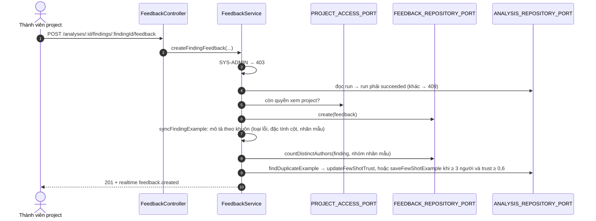

# KẾ HOẠCH TRIỂN KHAI CHI TIẾT MODULE FEEDBACK
**Dự án:** Nền tảng Full-stack Quản lý & Giám sát Chất lượng Dữ liệu có AI Hỗ trợ  
*(Full-Stack Data Management & Quality Assurance Platform with AI Assistance)*  
**Tập tin:** `docs/modules/feedback_plan.md`  
**Phiên bản:** v1.2 (2026-11-25 — mục 8: đóng OPEN-FB-01, migration `scrub-few-shot`)  
**Giai đoạn:** Đợt 5 — Phân tích & AI: Nhận xét kết quả và học lại RAG T1 (`feedback`)  

> Mục 1–6 mô tả module theo mã nguồn hiện hành (sau đợt sửa mục 7, 8). Hợp đồng hiện hành: Phần 7 v14 mục 3.24 + v15 mục 3.25 (VA-4), Phần 12 v17 mục 3.24, Phần 11 v5 mục 3.18.

---

## 1. Bối cảnh & 3 Câu hỏi Cốt lõi (Rule 1)
- **Đang làm gì?** Module `feedback` (`src/backend/src/modules/feedback/`): 7 route nhận xét phát hiện / cả lần phân tích, sửa, xoá, chỉ số chất lượng AI; đồng bộ kho mẫu few-shot (RAG T1) của module `analysis`.
- **Cho ai?** Thành viên project đọc kết quả phân tích; owner / SYS-ADMIN kiểm duyệt nhận xét vi phạm; module `analysis` dùng mẫu đã kiểm chứng khi dựng prompt AI.
- **Để làm gì?**
  - Ghi nhận phát hiện nào đúng, sai, bị bỏ sót để đo chất lượng AI theo project.
  - Chỉ những nhận định được **≥ 3 người** cùng xác nhận mới thành mẫu few-shot, mô tả mẫu sinh theo khuôn nên văn bản tự do của người dùng không vào prompt AI.

---

## 2. Kiến trúc & Luồng Dữ liệu (Architecture & RAG T1 Flow)



Sửa (`PATCH`) và xoá (`DELETE`) đi cùng luồng: kiểm lại quyền project, ghi audit, rồi `syncFindingExample` cho nhãn cũ (nếu khác nhãn mẫu) và nhãn mới. Lỗi RAG không chặn luồng nhận xét.

---

## 3. Đặc tả Hợp đồng API (API Contracts)

| Method | Endpoint | Quyền hạn | Mô tả chức năng |
| :---: | :--- | :---: | :--- |
| `POST` | `/api/v1/analyses/:analysisId/findings/:findingId/feedback` | Thành viên project (SYS-ADMIN bị chặn) | FB-01: nhận xét một phát hiện; run phải `succeeded` |
| `POST` | `/api/v1/analyses/:analysisId/feedback` | Thành viên project (SYS-ADMIN bị chặn) | FB-02: nhận xét cả lần phân tích; run `succeeded` hoặc `failed` |
| `GET` | `/api/v1/analyses/:analysisId/findings/:findingId/feedback` | Người xem project (SYS-ADMIN bị chặn) | FB-03: danh sách keyset + `summary` toàn phạm vi + `meta.limit` |
| `GET` | `/api/v1/analyses/:analysisId/feedback` | Người xem project (SYS-ADMIN bị chặn) | FB-04: danh sách nhận xét cả lần phân tích |
| `PATCH` | `/api/v1/feedback/:id` | Chủ nhận xét, còn quyền xem project (SYS-ADMIN bị chặn) | FB-05: sửa; audit `FEEDBACK_UPDATED` |
| `DELETE` | `/api/v1/feedback/:id` | Chủ nhận xét / owner / SYS-ADMIN | FB-05: xoá; xoá kiểm duyệt ghi audit `FEEDBACK_MODERATION_DELETED` |
| `GET` | `/api/v1/projects/:projectId/ai-quality-metrics` | Thành viên project (SYS-ADMIN bị chặn) | FB-06: chỉ số chất lượng AI |

SYS-ADMIN chỉ được xoá kiểm duyệt. Quyền được kiểm tra trong service qua `PROJECT_ACCESS_PORT` / `WORKSPACE_ACCESS_PORT` (controller không dùng `@CheckPolicies`). Chi tiết mã lỗi: Phần 7 v14 mục 3.24 (FB-R1…FB-R12).

---

## 4. Cấu trúc Tệp & Phân tầng Mã nguồn

```
src/backend/src/modules/feedback/        # Template Simple
├── feedback.controller.ts               # 7 route + DTO Zod (Create/Update/List)
├── feedback.service.ts                  # nghiệp vụ, kiểm quyền, syncFindingExample, audit
├── feedback.repository.ts               # FEEDBACK_REPOSITORY_PORT (Mongoose), countDistinctAuthors
├── feedback.types.ts                    # entity Feedback, FEEDBACK_LABELS, LABELS_REQUIRING_REASON, port, FeedbackScope
├── feedback.mapper.ts                   # document ↔ entity
├── finding-feedback.schema.ts           # collection finding_feedbacks, TTL 365 ngày
├── feedback.utils.ts                    # toPlain
├── feedback.module.ts
└── index.ts
```

Phụ thuộc: `analysis` (`ANALYSIS_REPOSITORY_PORT`, `RAG_FEW_SHOT_PORT`, `rag-few-shot.util.ts`), `projects` / `workspaces` (quyền), `users` (`findByIds` — tên tác giả), `realtime` (`feedback.created`), `audit` (`AUDIT_LOGGER_PORT`, `@Optional`).

---

## 5. Quy tắc Nghiệp vụ Bất biến (Invariants)
- **Không đưa văn bản tự do vào prompt AI:** mô tả mẫu few-shot chỉ sinh theo khuôn (loại lỗi, đặc tính cột đã làm sạch ≤ 80 ký tự, nhãn mẫu); `reason` chỉ lưu ở nhận xét.
- **Ngưỡng vào kho:** ≥ 3 người khác nhau **và** trust ≥ 0,6; số người đếm trên cả nhóm nhãn cùng ánh xạ một nhãn mẫu (`correct` + `partially_correct`).
- **Nhãn bắt buộc lý do:** `false_positive`, `missed_issue`, `other`.
- **Nhận xét theo trạng thái run:** phát hiện → `succeeded`; cả run → `succeeded` / `failed`; khác → `CONFLICT`.
- **Sửa/xoá của chủ nhận xét** cần còn quyền xem project (bảo mật cùng mức `analysis_result`, Phần 6 v9 §3.5b).
- **Append-only có kiểm soát:** sửa/xoá đều ghi audit; dữ liệu tự hết hạn sau 365 ngày (TTL).

---

## 6. Ma trận Rủi ro & Giải pháp Phòng ngừa

| Rủi ro Kỹ thuật | Mức độ | Giải pháp phòng ngừa |
| :--- | :---: | :--- |
| **Prompt injection qua `reason`** | Cao | Mẫu sinh theo khuôn, không dùng `reason`; mẫu cũ còn chứa `reason` được quét một lần bằng migration `scrub-few-shot` (mục 8, đóng OPEN-FB-01). |
| **Mẫu kém chất lượng vào kho** (ít người, nhãn lệch nhau) | Trung bình | Ngưỡng ≥ 3 người + trust ≥ 0,6; đếm lại khi sửa/xoá, mẫu tụt ngưỡng bị loại khi truy xuất. |
| **Cựu thành viên vẫn thao tác nhận xét** | Trung bình | Kiểm lại quyền project ở mọi thao tác sửa/xoá. |
| **Lỗi RAG làm hỏng luồng nhận xét** | Thấp | `syncFindingExample` bắt lỗi, không chặn phản hồi cho người dùng. |

---

## 7. Đợt sửa 2026-11-24 — rà soát module feedback

- **Trạng thái:** Đã thực hiện 2026-11-24.
- **Test:** Phần 13 v16 mục 3.29 (FBT-01…FBT-13).
- **Quyết định của người dùng:**
  - mẫu RAG theo khuôn, không dùng `reason`;
  - ngưỡng vào kho ≥ 3 người;
  - nhận xét phát hiện cần run `succeeded`, nhận xét cả run cho `succeeded` hoặc `failed`;
  - sửa/xoá nhận xét của mình cần còn quyền xem project (theo Phần 6).

### 7.1. Lỗi đã xác nhận từ mã nguồn

| # | Mức | Lỗi | Vị trí (trước khi sửa) |
|---|---|---|---|
| L1 | Cao | `reason` (chỉ che email/SĐT) thành mô tả mẫu RAG, rồi bị chèn nguyên văn vào prompt AI của cả workspace. Trái Phần 6/12 và có rủi ro prompt injection | `promoteFindingToStore`; `rag-few-shot.service.ts` → `renderFewShotBlock` |
| L2 | Cao | Chủ nhận xét đã bị gỡ khỏi project, hoặc project đã xoá, vẫn sửa/xoá được | `updateMine`, `remove` (nhánh chủ) |
| L3 | Trung bình | 2 người đã đủ vào kho RAG (`computeTrustScore(2) = 0.65`), trong khi hợp đồng yêu cầu ≥ 3 | `rag-few-shot.util.ts` |
| L4 | Trung bình | 3 người cùng nhãn nhưng khác `reason` tạo ra 3 mẫu; sửa/xoá nhận xét không cập nhật kho mẫu | `promoteFindingToStore` |
| L5 | Trung bình | Xoá vi phạm không ghi audit log; sửa nhận xét không giữ lịch sử | `remove`, `updateMine` |
| L6 | Trung bình | Gửi được nhận xét vào run `pending`/`running` | `resolveRunProject` |
| L7 | Thấp | Thiếu `meta.limit`; `summary` bị lọc theo `?label`; GET không kiểm tra `findingId` > 200; N+1 khi lấy tên tác giả; `promptVersion` gán cứng; ID sai trả 404; `assertReasonForLabel` ném `Error` trần | service, controller, types |

### 7.2. Hướng sửa

- `syncFindingExample`:
  - mô tả theo khuôn `(loại lỗi, đặc tính cột, nhãn)`;
  - đặc tính cột được làm sạch, tối đa 80 ký tự;
  - gom trùng theo mô tả;
  - đếm lại số người và cập nhật trust khi tạo, sửa (nhãn cũ và nhãn mới) và xoá.
- `computeTrustScore(2) = 0.55`; `isEligibleForStore` = `≥ 3 người` **và** `trust ≥ 0.6`.
- `updateMine` / `remove`:
  - ID sai → 400;
  - chủ nhận xét phải còn quyền project, kiểm tra bằng `resolveProjectAccess`.
- `resolveRunProject` nhận danh sách trạng thái cho phép; sai trạng thái → `ConflictError`.
- Audit qua `AUDIT_LOGGER_PORT` (`@Optional`): `FEEDBACK_MODERATION_DELETED` (kèm nội dung), `FEEDBACK_UPDATED` (kèm giá trị trước/sau).
- Danh sách:
  - `meta.limit`;
  - `summary` đếm toàn phạm vi;
  - `findingId` ≤ 200 ở GET;
  - lấy tên tác giả bằng `users.findByIds`.

### 7.3. Không làm trong đợt này

- **OPEN-FB-01:** quét một lần các mẫu cũ trong `few_shot_examples` có `reason` nguyên văn — đã làm ở mục 8.
- Xoá cứng feedback khi xoá project. Hiện feedback đã bị chặn truy cập vì project trả NotFound, và TTL 365 ngày sẽ dọn.
- Trường `is_anonymized` (Phần 8). Không thêm `finding_key`/`version` vào schema vì Phần 8 không có.
- Đối chiếu `findingId` với kết quả phân tích (RISK `FB-006`), vì kết quả không sinh sẵn mã phát hiện.
- Dispatch domain event của entity `Feedback` (hiện không có nơi tiêu thụ).

### 7.4. Kết quả

- `tsc` 0 lỗi, `lint` 0 cảnh báo, `test:arch` 23/23, `arch:api-coverage` 84/84.
- Unit `test/feedback-v14.spec.ts`: 28/28 ca mới. Các test cũ của feedback/RAG vẫn đạt; riêng `corr-vif-ai.spec.ts` đổi assert ngưỡng có chủ đích.
- Integration `repositories-domain` + `repositories-analysis`: 56/56 (thêm 3 ca FBT-13).
- `test:unit` toàn bộ: chỉ 2 lỗi môi trường đã biết (`/proc/meminfo`). Integration toàn bộ: 170/173 (3 lỗi MinIO đã biết).

### 7.5. Vá sau rà soát commit (v1.1)

- **Hồi quy do đợt sửa v1.0 (commit `9dff652`):** `correct` và `partially_correct` cùng ánh xạ mẫu "đúng" (cùng mô tả theo khuôn) nhưng `countDistinctAuthors` đếm theo nhãn thô; v1.0 lại đưa bước tra trùng + cập nhật trust lên trước bước kiểm ngưỡng → 1 người `partially_correct` hạ trust mẫu của 3 người `correct` từ 0,8 xuống 0,5.
- **Sửa:** `FeedbackScope.labels` (chỉ thêm); `syncFindingExample` đếm theo nhóm nhãn cùng nhãn mẫu; đổi nhãn trong cùng nhóm chỉ đồng bộ 1 lần; `countDistinctAuthors` trả 0 khi `findingId` null/rỗng (trước: `String(null)` = `'null'`).
- **Test bổ sung:** mock `findByIds` ở `feedback-wave7.spec.ts` (tên tác giả thật). Phần 13 v17 mục 3.30 (VAT-01…VAT-04). Hợp đồng: Phần 12 v16 §3.24, Phần 7 v15 VA-4.
- **Trạng thái:** Đã thực hiện 2026-11-24 — unit feedback + `corr-vif-ai` 96/96, integration `repositories-domain` có VAT-03.
- **Sau khi kéo `origin/backend` (2026-11-25):** test chuyển sang `test/unit/feedback/` (`feedback-v14.spec.ts`, `feedback-wave7.spec.ts`); README module lấy khung mới của `backend`, cập nhật luồng RAG theo khuôn và các quy tắc ở mục 7.2 (xem `analysis_plan.md` mục 7k).

---

## 8. Đợt 2026-11-25 — quét mẫu RAG cũ (đóng OPEN-FB-01)

- **Trạng thái:** Đã thực hiện 2026-11-25.
- **Hợp đồng:** Phần 12 v17 §3.24 (T1-7…T1-10), Phần 11 v5 mục 3.18. **Test:** Phần 13 v18 mục 3.31 (FST-01…FST-04).
- **Quyết định của người dùng:** xoá mềm mẫu cũ **và** dựng lại mẫu theo khuôn từ nhận xét còn hiệu lực (để kho RAG không trống).

### 8.1. Hiện trạng cần biết

- Tên collection thật là **`fewshotexamples`** (model `FewShotExample` không đặt `collection:`); nhận xét ở `findingfeedbacks`. README analysis từng ghi `few_shot_examples`.
- Schema mẫu không có `finding_id` / nguồn / phiên bản khuôn → không lần ngược từ mẫu về nhận xét; phải dựng lại từ `findingfeedbacks`.
- Mẫu cũ (trước v15): mô tả = `reason` hoặc `"<nhãn thô> cho <findingId>"`, đặc tính cột chưa làm sạch, trust theo bảng cũ (2 người = 0,65 → lọt ngưỡng truy xuất 0,6).

### 8.2. Hướng sửa

- **Tách khuôn ra hàm thuần** `feedback/feedback-example-template.ts` (`sanitizeColumnTraits`, `columnTraitsFromFindingId`, `templateExampleDescription`, `labelsForExampleLabel`, `buildFindingExampleDraft`, `isTemplatedDescription`), export qua `feedback/index.ts`; `feedback.service.ts` re-export tên cũ. `syncFindingExample` và migration cùng dùng `buildFindingExampleDraft` → không lệch.
- **Migration** `scripts/migrate-scrub-few-shot-examples.ts` + logic `scripts/lib/few-shot-scrub.ts` (`runFewShotScrub`), lệnh `pnpm db:migrate:scrub-few-shot` — dry-run mặc định, `--apply` cần `MIGRATION_CONFIRM=yes`/`NODE_ENV=production`, `--verify` exit 1 nếu còn mẫu sai khuôn; báo cáo JSON không in mô tả.
- **Khác plan ban đầu:** chỉ xoá mềm mẫu **không theo khuôn**, không xoá mẫu theo khuôn đang dưới ngưỡng (mẫu đó cần giữ để hồi lại khi có thêm người đồng ý — T1-5). Mẫu cũ không bao giờ theo khuôn nên vẫn bị loại hết; trust của mẫu theo khuôn được tính lại ở bước dựng lại.

### 8.3. Không làm trong đợt này

- Thêm `finding_id` / phiên bản khuôn vào schema mẫu (Phần 8 không có).
- Tự chạy migration khi deploy — người vận hành chạy tay theo Phần 11 v5 mục 3.18.

### 8.4. Kết quả

- Unit `feedback-example-template.spec.ts` 5/5; feedback cũ 64/64 sau khi tách khuôn (không đổi assert).
- Integration `few-shot-scrub.spec.ts` 4/4 (dry-run không ghi; apply xoá mềm 3 mẫu cũ ở 2 workspace, giữ mẫu đúng khuôn dưới ngưỡng, tạo 2 mẫu; chạy lại 0 thay đổi; verify).
- Chạy script thật bằng `ts-node` trên database thử riêng: dry-run / verify (exit 1) / apply thiếu xác nhận (bị chặn) / apply / apply lần 2 (0 thay đổi) / verify (0).

---

## 9. Lịch sử thay đổi

- **v1.2 / 2026-11-25:** Mục 8 — đóng OPEN-FB-01 bằng migration `scrub-few-shot` (xoá mềm + dựng lại), tách khuôn mẫu RAG ra hàm thuần dùng chung / Người dùng nhận module feedback và duyệt plan.
- **v1.1 / 2026-11-24:** Mục 7.5 (trước là 2.5) — vá hồi quy đồng thuận `correct`/`partially_correct` sau rà soát commit. Bổ sung 2026-11-25: đường dẫn test và README module sau khi kéo `origin/backend`; sắp lại tài liệu theo khuôn `datasets_plan.md` (mục 1–6 mới, đợt sửa thành mục 7).
- **v1.0 / 2026-11-24:** Tạo kế hoạch module. Đợt sửa sau rà soát được người dùng yêu cầu (kèm plan Antigravity).
