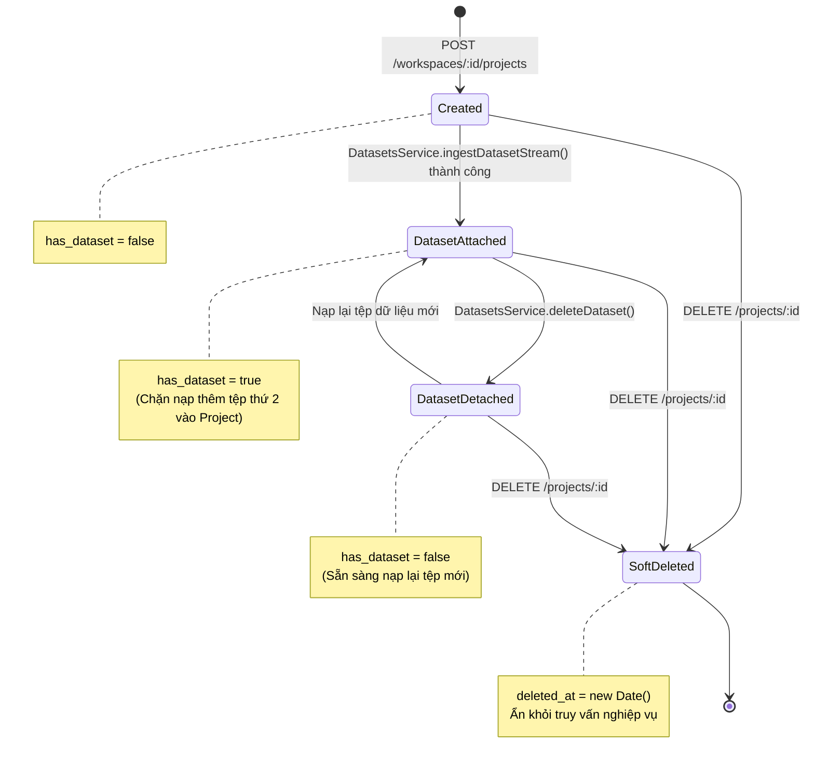

# KẾ HOẠCH TRIỂN KHAI CHI TIẾT MODULE PROJECTS
**Dự án:** Nền tảng Full-stack Quản lý & Giám sát Chất lượng Dữ liệu có AI Hỗ trợ  
*(Full-Stack Data Management & Quality Assurance Platform with AI Assistance)*  
**Tập tin:** `docs/modules/projects_plan.md`  
**Phiên bản:** v1.0  
**Giai đoạn:** Sprint B2 — Module 2: Quản lý Dự án & Ràng buộc Dữ liệu (`projects`)  

---

## 1. Bối cảnh & 3 Câu hỏi Cốt lõi (Rule 1)
- **Đang làm gì?** Hiện thực hóa Module `projects` (`src/backend/src/modules/projects/`) bao gồm 5 RESTful endpoints: Tạo dự án mới (F3.1), Danh sách dự án trong Workspace (F3.2), Chi tiết dự án (F3.3), Cập nhật thông tin dự án (F3.4), và Xóa mềm dự án (F3.5).
- **Cho ai?** Cho Chuyên viên Dữ liệu (Data Analysts) và Kỹ sư Dữ liệu quản lý các mục tiêu làm sạch dữ liệu độc lập.
- **Để làm gì?** 
  - Cung cấp tầng tổ chức trung gian giữa Không gian làm việc (`workspaces`) và Tập dữ liệu (`datasets`).
  - Thực thi quy tắc ràng buộc cứng: **1 Project = 1 Dataset hoạt động** thông qua cờ `has_dataset`.
  - Giúp cô lập bài toán chất lượng dữ liệu và đơn giản hóa việc xây dựng đồ thị phả hệ dữ liệu DAG trên Neo4j.

---

## 2. Kiến trúc & Vòng đời Dự án Trực quan (Architecture & Project Lifecycle)



---

## 3. Đặc tả Hợp đồng API (API Contracts)

| Method | Endpoint | Quyền hạn CASL | Mô tả chức năng |
| :---: | :--- | :---: | :--- |
| `POST` | `/api/v1/workspaces/:workspaceId/projects` | `Action.Create` trên `Project` | F3.1: Tạo Dự án mới trong Không gian làm việc |
| `GET` | `/api/v1/workspaces/:workspaceId/projects` | `Action.Read` trên `Project` | F3.2: Danh sách các Dự án trong Workspace |
| `GET` | `/api/v1/projects/:id` | `Action.Read` trên `Project` | F3.3: Xem chi tiết thông tin và trạng thái Dự án |
| `PATCH` | `/api/v1/projects/:id` | `Action.Update` trên `Project` | F3.4: Đổi tên hoặc mô tả Dự án |
| `DELETE` | `/api/v1/projects/:id` | `Action.Delete` trên `Project` | F3.5: Xóa mềm Dự án (`deleted_at: new Date()`) |

---

## 4. Cấu trúc Tệp & Phân tầng Mã nguồn

```
src/backend/src/modules/projects/
├── dto/
│   ├── create-project.dto.ts           # Zod schema cho tạo Project
│   └── update-project.dto.ts           # Schema cập nhật tên/mô tả
├── schemas/
│   └── project.schema.ts               # Mongoose schema với has_dataset và partial unique index
├── projects.repository.ts              # Kế thừa BaseMongoRepository<IProject>
├── projects.service.ts                 # CRUD Project, setHasDataset, kiểm tra workspace
├── projects.controller.ts              # RESTful Controller bảo vệ bằng PoliciesGuard
└── projects.module.ts                  # Module export ProjectsService cho DatasetsModule
```

---

## 5. Quy tắc Nghiệp vụ Bất biến (Invariants)
- **Ràng buộc 1 Project = 1 Dataset:** Khi `has_dataset === true`, hệ thống ném lỗi `ConflictException` nếu người dùng cố gắng tải lên thêm tệp dữ liệu vào Project này.
- **Partial Unique Index:** Tên dự án là duy nhất trong phạm vi Workspace còn hoạt động: `{ name: 1, workspace_id: 1 }, { unique: true, partialFilterExpression: { deleted_at: null } }`.
- **Ranh giới Phân cấp:** Không thể tạo Project thuộc một Workspace đã bị xóa mềm hoặc không tồn tại.
- **Tuân thủ Zero Any:** Không sử dụng `any` trong toàn bộ module.

---

## 6. Ma trận Rủi ro & Giải pháp Phòng ngừa

| Rủi ro Kỹ thuật | Mức độ | Giải pháp phòng ngừa |
| :--- | :---: | :--- |
| **Nạp nhiều Dataset vào cùng 1 Project gây vỡ đồ thị DAG** | Nghiêm trọng | Bắt chặt điều kiện cờ `has_dataset` ở đầu hàm `ingestDatasetStream` trong `DatasetsService`. |
| **Tạo trùng tên dự án gây nhầm lẫn** | Trung bình | Áp dụng Partial Unique Index trên MongoDB Atlas và chuẩn hóa tên bằng Zod validation. |
| **Dự án bị xóa nhưng dataset con vẫn tồn tại** | Cao | Cascade soft-delete: Tự động kích hoạt xóa mềm Dataset liên kết khi xóa mềm Project. |
