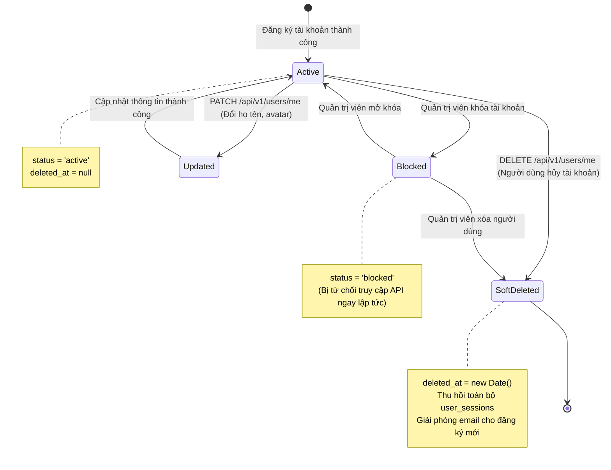

# KẾ HOẠCH TRIỂN KHAI CHI TIẾT MODULE USERS
**Dự án:** Nền tảng Full-stack Quản lý & Giám sát Chất lượng Dữ liệu có AI Hỗ trợ  
*(Full-Stack Data Management & Quality Assurance Platform with AI Assistance)*  
**Tập tin:** `docs/modules/users_plan.md`  
**Phiên bản:** v1.0  
**Giai đoạn:** Sprint B1 — Module 2: Hồ sơ & Vòng đời Người dùng (`users`)  

---

## 1. Bối cảnh & 3 Câu hỏi Cốt lõi (Rule 1)
- **Đang làm gì?** Hiện thực hóa Module `users` (`src/backend/src/modules/users/`) bao gồm 3 RESTful endpoints: Xem thông tin tài khoản cá nhân (F1.9), Cập nhật hồ sơ cá nhân (F1.10), và Xóa mềm tài khoản cá nhân.
- **Cho ai?** Cho toàn bộ người dùng đã xác thực trong nền tảng (Analyst, Admin, Guest đã đăng ký).
- **Để làm gì?** 
  - Cung cấp thực thể định danh cốt lõi (User Entity) đại diện cho tác nhân thực hiện mọi hành vi trong hệ thống (tạo workspace, ingest dataset, commit version, apply clean rules).
  - Quản lý vòng đời tài khoản (`active`, `blocked`, `soft_deleted`) và bảo vệ các trường dữ liệu nhạy cảm (mật khẩu bị ẩn mức Schema với `select: false`).
  - Hỗ trợ cơ chế tái đăng ký email thông qua chỉ mục một phần `PartialFilterExpression: { deleted_at: null }`.
  - Tự động thu hồi phiên đăng nhập trong `user_sessions` khi tài khoản bị khóa hoặc xóa mềm.

---

## 2. Kiến trúc & Vòng đời Tài khoản Trực quan (Architecture & Lifecycle Flow)



---

## 3. Đặc tả Hợp đồng API (API Contracts)

| Method | Endpoint | Quyền hạn CASL | Mô tả chức năng |
| :---: | :--- | :---: | :--- |
| `GET` | `/api/v1/users/me` | `JwtAuthGuard` | F1.9: Lấy thông tin hồ sơ tài khoản đang đăng nhập |
| `PATCH` | `/api/v1/users/me` | `JwtAuthGuard` | F1.10: Cập nhật thông tin hồ sơ (họ tên, avatar) |
| `DELETE` | `/api/v1/users/me` | `JwtAuthGuard` | Xóa mềm tài khoản và tự động thu hồi toàn bộ phiên đăng nhập |

---

## 4. Cấu trúc Tệp & Phân tầng Mã nguồn

```
src/backend/src/modules/users/
├── dto/
│   ├── update-user.dto.ts              # Zod validation schema cho cập nhật hồ sơ
│   └── user-response.dto.ts            # DTO chuẩn hóa dữ liệu trả về cho client
├── schemas/
│   └── user.schema.ts                  # Mongoose schema với partial unique index cho email
├── users.repository.ts                 # Kế thừa BaseMongoRepository<IUser>
├── users.service.ts                    # Xử lý cập nhật hồ sơ, đổi trạng thái, xóa mềm
├── users.controller.ts                 # RESTful Controller bảo vệ bằng JwtAuthGuard
└── users.module.ts                     # Module export UsersService cho Auth và Workspaces
```

---

## 5. Quy tắc Nghiệp vụ Bất biến (Invariants)
- **Field-level Security:** Cấu hình `select: false` cho trường `password_hash` trên Schema Mongoose. Mọi thao tác truy vấn thông thường tuyệt đối không kéo trường mật khẩu về bộ nhớ ứng dụng.
- **Partial Unique Index:** Áp dụng `{ email: 1 }, { unique: true, partialFilterExpression: { deleted_at: null } }` trên MongoDB Atlas, đảm bảo email chỉ duy nhất trong số các tài khoản đang hoạt động.
- **Đồng bộ Xóa mềm (Cascade Invalidation):** Khi tài khoản bị xóa mềm, hệ thống gọi service liên kết để đánh dấu toàn bộ phiên trong `user_sessions` thành vô hiệu, ngăn chặn tái sử dụng JWT cũ.
- **Tuân thủ Zero Any:** Ép kiểu an toàn bằng Type Guards và Zod Schema; cấm dùng `any` trong toàn bộ module.

---

## 6. Ma trận Rủi ro & Giải pháp Phòng ngừa

| Rủi ro Kỹ thuật | Mức độ | Giải pháp phòng ngừa |
| :--- | :---: | :--- |
| **Lộ mật khẩu qua API trả về** | Nghiêm trọng | Khóa trường `password_hash` ở tầng Mongoose Schema (`select: false`) và lọc dữ liệu qua UserResponseDto. |
| **Xung đột email khi người dùng cũ đăng ký lại** | Trung bình | Sử dụng Partial Unique Index với điều kiện `{ deleted_at: null }`. |
| **Tài khoản bị xóa nhưng token vẫn còn hiệu lực** | Cao | Kiểm tra trạng thái `status: 'active'` và `deleted_at: null` trong `JwtStrategy` mỗi khi xác thực token. |
