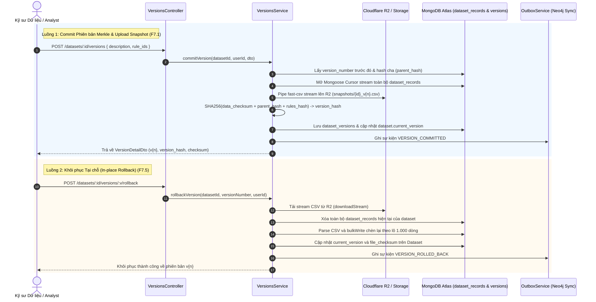

# KẾ HOẠCH TRIỂN KHAI CHI TIẾT MODULE VERSIONS
**Dự án:** Nền tảng Full-stack Quản lý & Giám sát Chất lượng Dữ liệu có AI Hỗ trợ  
*(Full-Stack Data Management & Quality Assurance Platform with AI Assistance)*  
**Tập tin:** `docs/modules/versions_plan.md`  
**Phiên bản:** v1.0  
**Giai đoạn:** Sprint B3 — Module 2: Quản lý Phiên bản Dữ liệu Merkle (`versions`)  

---

## 1. Bối cảnh & 3 Câu hỏi Cốt lõi (Rule 1)
- **Đang làm gì?** Hiện thực hóa Module `versions` (`src/backend/src/modules/versions/`) bao gồm 5 RESTful endpoints: Commit Version (F7.1), List Versions (F7.2), Version Detail (F7.3), Version Diff (F7.4), và In-place Rollback (F7.5).
- **Cho ai?** Cho Kỹ sư Dữ liệu và Analyst cần lưu vết lịch sử biến đổi dữ liệu bất biến, so sánh khác biệt và khôi phục khi cần.
- **Để làm gì?** 
  - Đảm bảo tính toán toàn vẹn chống giả mạo bằng chuỗi băm Merkle:
    $$\text{version\_hash} = \text{SHA-256}(\text{data\_checksum} + \text{parent\_hash} + \text{rules\_hash})$$
  - Upload snapshot tệp CSV lên Cloudflare R2 (`snapshots/{dataset_id}_v{version_number}.csv`), giải phóng tải lưu trữ cho MongoDB Atlas.
  - Cung cấp khả năng khôi phục tại chỗ (In-place Rollback) bằng cách xóa bản ghi cũ và nạp lại từ snapshot theo lô 1.000 dòng bằng `bulkWrite`.
  - Phát sự kiện `VERSION_COMMITTED` và `VERSION_ROLLED_BACK` vào Outbox Pattern để đồng bộ đồ thị phả hệ sang Neo4j AuraDB.

---

## 2. Kiến trúc & Luồng Dữ liệu Trực quan (Architecture & Data Flow)



---

## 3. Đặc tả Hợp đồng API (API Contracts)

| Method | Endpoint | Quyền hạn CASL | Mô tả chức năng |
| :---: | :--- | :---: | :--- |
| `POST` | `/api/v1/datasets/:id/versions` | `Action.Create` trên `DatasetVersion` | F7.1: Tạo snapshot CSV & commit phiên bản Merkle mới |
| `GET` | `/api/v1/datasets/:id/versions` | `Action.Read` trên `DatasetVersion` | F7.2: Danh sách lịch sử các phiên bản có phân trang |
| `GET` | `/api/v1/datasets/:id/versions/diff` | `Action.Read` trên `DatasetVersion` | F7.4: So sánh sai khác cấu trúc, dòng và rules giữa 2 version |
| `GET` | `/api/v1/datasets/:id/versions/:versionNumber` | `Action.Read` trên `DatasetVersion` | F7.3: Xem chi tiết một phiên bản của tập dữ liệu |
| `POST` | `/api/v1/datasets/:id/versions/:versionNumber/rollback` | `Action.Update` trên `DatasetVersion` | F7.5: Khôi phục tại chỗ về phiên bản chỉ định |

---

## 4. Cấu trúc Tệp & Nhiệm vụ Hiện thực hóa

### 4.1. Cấu trúc Thư mục Module
```
src/backend/src/modules/versions/
├── dto/
│   └── version.dto.ts                  # Zod validation schemas & TypeScript types
├── schemas/
│   └── dataset-version.schema.ts       # Mongoose schema cho collection dataset_versions
├── versions.repository.ts              # Tương tác MongoDB kế thừa BaseMongoRepository
├── versions.service.ts                 # Điều phối Merkle chaining, streaming snapshot, rollback
├── versions.controller.ts              # RESTful Controller tích hợp Jwt & PoliciesGuard
├── versions.module.ts                  # Module definition và Dependency Injection
└── README.md                           # Tài liệu đặc tả kiến trúc chuẩn 6 phần
```

---

## 5. Ma trận Rủi ro & Giải pháp Phòng ngừa

| Rủi ro Kỹ thuật | Mức độ | Giải pháp phòng ngừa |
| :--- | :---: | :--- |
| **Nghẽn RAM khi stream CSV dataset lớn** | Cao | Kết hợp stream pipe với xử lý sự kiện `drain` / backpressure; giải phóng buffer liên tục khi ghi lên R2. |
| **Gãy chuỗi Merkle do sai lệch thứ tự rules** | Trung bình | Tự động sắp xếp mảng `rule_ids` theo thứ tự alphabet trước khi băm SHA-256 (`rules_hash`). |
| **Lỗi mạng trong quá trình Rollback** | Cao | Kiểm tra tải stream thành công từ R2 trước khi dọn sạch dữ liệu cũ; rollback theo chunk 1.000 dòng. |
| **Vi phạm Zero Any Policy (Rule 13)** | Nghiêm trọng | Ép kiểu an toàn bằng Type Guards và Zod schema; bộ kiểm thử `test/zero-any.spec.ts` tự động phát hiện vi phạm. |
