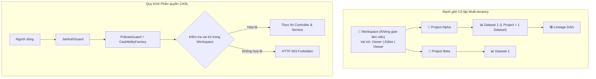

# KẾ HOẠCH TRIỂN KHAI CHI TIẾT MODULE WORKSPACES
**Dự án:** Nền tảng Full-stack Quản lý & Giám sát Chất lượng Dữ liệu có AI Hỗ trợ  
*(Full-Stack Data Management & Quality Assurance Platform with AI Assistance)*  
**Tập tin:** `docs/modules/workspaces_plan.md`  
**Phiên bản:** v1.0  
**Giai đoạn:** Sprint B2 — Module 1: Không gian Làm việc Đa người dùng (`workspaces`)  

---

## 1. Bối cảnh & 3 Câu hỏi Cốt lõi (Rule 1)
- **Đang làm gì?** Hiện thực hóa Module `workspaces` (`src/backend/src/modules/workspaces/`) bao gồm 7 RESTful endpoints: Tạo Workspace (F2.1), Danh sách Workspace (F2.2), Chi tiết Workspace (F2.3), Cập nhật Workspace (F2.4), Xóa mềm Workspace (F2.5), Thêm thành viên (F2.6), và Xóa thành viên (F2.7).
- **Cho ai?** Cho các đội nhóm dữ liệu (Data Engineering Teams), các tổ chức và chuyên viên phân tích dữ liệu cần môi trường làm việc độc lập.
- **Để làm gì?** 
  - Đóng vai trò là ranh giới cô lập dữ liệu cấp cao nhất (Multi-tenancy Boundary) của hệ sinh thái Data Quality.
  - Quản lý danh sách thành viên và phân quyền chi tiết với 3 vai trò: `owner` (Chủ sở hữu), `editor` (Biên tập viên/Kỹ sư), và `viewer` (Người xem).
  - Tích hợp sâu với CASL Ability Framework (`PoliciesGuard`) để thực thi kiểm soát truy cập dựa trên thuộc tính (ABAC).
  - Ngăn ngừa rò rỉ dữ liệu chéo giữa các không gian làm việc khác nhau.

---

## 2. Kiến trúc & Cấu trúc Phân cấp (Architecture & Multi-tenancy)



---

## 3. Đặc tả Hợp đồng API (API Contracts)

| Method | Endpoint | Quyền hạn CASL | Mô tả chức năng |
| :---: | :--- | :---: | :--- |
| `POST` | `/api/v1/workspaces` | `JwtAuthGuard` | F2.1: Tạo Workspace mới (người tạo tự động là Owner) |
| `GET` | `/api/v1/workspaces` | `JwtAuthGuard` | F2.2: Lấy danh sách Workspace mà người dùng là thành viên |
| `GET` | `/api/v1/workspaces/:id` | `Action.Read` trên `Workspace` | F2.3: Xem chi tiết thông tin và danh sách thành viên |
| `PATCH` | `/api/v1/workspaces/:id` | `Action.Update` trên `Workspace` | F2.4: Đổi tên hoặc mô tả Workspace (chỉ Owner) |
| `DELETE` | `/api/v1/workspaces/:id` | `Action.Delete` trên `Workspace` | F2.5: Xóa mềm Workspace (`deleted_at: new Date()`) |
| `POST` | `/api/v1/workspaces/:id/members` | `Action.Manage` trên `Workspace` | F2.6: Mời/thêm thành viên vào Workspace kèm vai trò |
| `DELETE` | `/api/v1/workspaces/:id/members/:uid` | `Action.Manage` trên `Workspace` | F2.7: Xóa thành viên khỏi Workspace (cấm xóa Owner) |

---

## 4. Cấu trúc Tệp & Phân tầng Mã nguồn

```
src/backend/src/modules/workspaces/
├── dto/
│   ├── create-workspace.dto.ts         # Zod schema cho tạo Workspace
│   ├── update-workspace.dto.ts         # Schema cập nhật thông tin
│   └── add-member.dto.ts               # Schema thêm thành viên kèm role
├── schemas/
│   └── workspace.schema.ts             # Mongoose schema kèm mảng members và partial index
├── workspaces.repository.ts            # Kế thừa BaseMongoRepository<IWorkspace>
├── workspaces.service.ts               # Logic CRUD, kiểm tra owner, thêm/xóa thành viên
├── workspaces.controller.ts            # RESTful Controller bảo vệ bằng PoliciesGuard
└── workspaces.module.ts                # Module definition và Dependency Injection
```

---

## 5. Quy tắc Nghiệp vụ Bất biến (Invariants)
- **Tính Bất khả Xâm phạm của Owner:** Người tạo Workspace luôn là `owner` vĩnh viễn và không thể bị xóa khỏi danh sách thành viên của chính Workspace đó.
- **Chỉ mục Một phần Tên Workspace:** `{ name: 1, owner_id: 1 }, { unique: true, partialFilterExpression: { deleted_at: null } }` ngăn chặn tạo 2 Workspace trùng tên cho cùng một chủ sở hữu khi đang hoạt động.
- **Ranh giới Dữ liệu (Isolation):** Mọi truy vấn tài nguyên con (Project, Dataset, Rule, Version) đều phải chứa điều kiện lọc `workspace_id` tương ứng với ngữ cảnh phiên làm việc hiện tại.
- **Tuân thủ Zero Any:** Không sử dụng `any` trong toàn bộ module.

---

## 6. Ma trận Rủi ro & Giải pháp Phòng ngừa

| Rủi ro Kỹ thuật | Mức độ | Giải pháp phòng ngừa |
| :--- | :---: | :--- |
| **Xâm phạm dữ liệu giữa các Workspace (Cross-tenant leak)** | Nghiêm trọng | Bắt buộc kiểm tra `workspace_id` trong CASL Ability Factory và inject điều kiện lọc vào mọi query database. |
| **Xóa nhầm Owner làm mồ côi Workspace** | Nghiêm trọng | Bắt chặt điều kiện trong `workspaces.service.ts`: Ném lỗi `BadRequestException` nếu ID xóa trùng với `owner_id`. |
| **Xóa mềm không triệt để** | Trung bình | Gán `deleted_at: new Date()`, kết hợp các compound index hỗ trợ `deleted_at`. |
