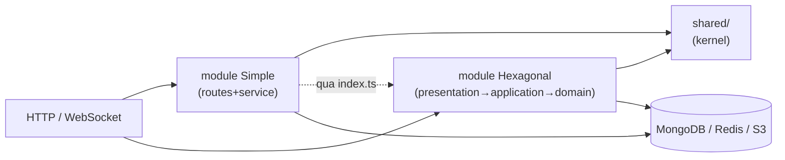

# 1. Kiến trúc đích — Modular Monolith lai (vỏ MM + ruột heterogeneous)

> **Nguyên tắc:** Chỉ thay đổi *cách tổ chức bên trong*. Hành vi bên ngoài giữ nguyên tuyệt đối (R1). Chi tiết ADR: `docs/adr/0002-hybrid-modular-monolith.md` (thay hướng slice-toàn-bộ của ADR-0001).

---

## 1.1. Vỏ Modular Monolith (giữ strict cho cả 13 module)

```
src/
├── AppModule (1 process/deploy)      ← Host
├── shared/ (88 file, shared kernel)  ← BuildingBlocks, không đổi
└── modules/ (13 module, mỗi module 1 thư mục + index.ts)
```

| # | Điều kiện MM | Trạng thái | Bằng chứng |
|---|---|---|---|
| M1 | Ranh giới module rõ ràng | ✅ | 13 thư mục độc lập |
| M2 | Không import chéo ngoài public contract | ✅ đã đạt ở P1 | ESLint MM2 + arch test, 116 import qua `index.ts` |
| M3 | Mỗi module tự giải thích được | ✅ theo 2 template dưới | README ghi `Template: Simple/Hexagonal` |
| M4 | Shared kernel + 1 process | ✅ | `src/shared/`, 1 `AppModule` |

Quy tắc dependency giữ nguyên MM1–MM4 (xem §1.4). **Bỏ MM5** kiểu cũ (ép mọi module phẳng) — thay bằng MM5' dưới đây.

## 1.2. Ruột heterogeneous: 2 template

### Template S — Simple Monolith (6 module)

Áp dụng: `audit, overview, data-view, realtime, notifications, feedback`

```
src/modules/audit/                  ← ví dụ Simple sau refactor
├── audit.routes.ts                 ← controller + DTO + Zod validation + guard dùng
├── audit.service.ts                ← toàn bộ nghiệp vụ (handler gộp thành method)
├── audit.repository.ts             ← chỉ nếu có DB riêng (audit/notifications/feedback có; overview/data-view/realtime không)
├── audit.schema.ts                 ← chỉ nếu có DB riêng
├── audit.adapter.ts                ← từ infrastructure/adapters/* (giữ riêng nếu có)
├── audit.types.ts                  ← type/enum/constant + entity nhẹ (nếu có) + port nội bộ
├── index.ts                        ← public contract (giữ)
└── audit.module.ts                 ← DI wiring (giữ)
```

- Entity nhẹ (nếu có) nằm gọn trong `<mod>.types.ts`, không tách `domain/`.
- Mỗi handler cũ → 1 method service, **giữ nguyên chữ ký `execute()` + thứ tự tham số** (TC-02).
- File đặc biệt giữ riêng: `notifications` giữ 2 mapper riêng (DB vs email); `feedback` giữ 2 entity trong `types.ts` + 1 repository.

### Template H — Hexagonal giữ 4 tầng (7 module)

Áp dụng: `analysis, auth, datasets, projects, workspaces, users, issues`

```
src/modules/datasets/              ← ví dụ Hexagonal (giữ nguyên tầng)
├── application/ (commands/queries/policy-loaders/services)
├── domain/ (entities/events/ports/services/value-objects)
├── infrastructure/ (persistence/adapters)
├── presentation/ (controllers/dtos/responses)
├── index.ts                        ← public contract (chuẩn hóa)
└── datasets.module.ts              ← DI wiring (giữ)
```

- **Không gộp entity/port/handler.** Chỉ chuẩn hóa: import qua `index.ts`, sửa test import path, viết README.
- Lý do giữ: xem §1.3.

## 1.3. Ngưỡng Simple vs Hexagonal (ngưỡng cứng)

Giữ **Hexagonal** nếu module có ≥ 1 trong:

1. **Invariant phải bảo vệ bằng entity** — vd `issues` (optimistic locking + title/reason), `users` (password policy + revocation), `workspaces` (quota 20), `feedback` chạm ngưỡng 1 nhưng được miễn có điều kiện sang Simple vì entity nhẹ gộp được vào `types.ts` (giữ đủ `create/updateByAuthor + requiresReason + ensureNotAdmin`).
2. **Transaction + outbox + cascade** — `tx.runInTransaction`, `resolveMongoSession`, strict vs best-effort (`datasets, projects, workspaces, users`).
3. **Policy RBAC 3 tầng / fail-safe adapter** — `projects` (3 policy loader), `datasets` (policy + 2 schema/2 repo), `auth` (session rotation + OAuth).
4. **Tích hợp ngoài fallible** — AI worker/RAM guard/cardinality (`analysis`), SMTP/ntfy/S3 stream; lỗi không được hỏng luồng chính.

Ngược lại → **Simple**. Bảng phân loại chốt:

| Template | Module | Lý do ngắn |
|---|---|---|
| Simple | `audit` | 1 cmd, facade `AUDIT_LOGGER_PORT`, không invariant |
| Simple | `overview` | 2 query đọc/view, không DB riêng |
| Simple | `data-view` | 4 query, không repo riêng (qua `RECORD_QUERY_PORT`) |
| Simple | `realtime` | 0 handler + 1 subscriber WS, side-effect cục bộ |
| Simple | `notifications` | 6 handler CRUD + 2 mapper riêng (giữ riêng, không gộp) |
| Simple (đk) | `feedback` | 7 handler + `ensureNotAdmin` + camel/snake — được Simple vì entity nhẹ gộp được vào `types.ts` |
| Hexagonal | `issues` | optimistic locking + 1 controller (2 nhóm route user + `admin/*`) + cascade — **ở lại H** (quyết định D14, khác hướng cũ) |
| Hexagonal | `datasets` | 2 schema/2 repo + tx strict + policy + subscriber |
| Hexagonal | `projects` | 17 handler + 3 policy loader + cascade + best-effort outbox |
| Hexagonal | `workspaces` | quota + tx strict + RBAC 3 tầng |
| Hexagonal | `users` | password policy + revocation service + 17 handler |
| Hexagonal | `analysis` | AI worker + RAM/cardinality guard + 7 schema + 14 util |
| Hexagonal | `auth` | OAuth/session rotation + 7 token + 4 adapter |

## 1.4. Quy tắc dependency MM1–MM4 + MM5'



| Luật | Nội dung | Enforce |
|---|---|---|
| MM1 | `shared/` không import từ `modules/` | ESLint + arch test (giữ) |
| MM2 | Module A không import file module B; chỉ qua `index.ts` | ESLint `no-restricted-imports` + arch test (giữ từ P1) |
| MM3 | Không chu trình giữa các module | Arch test (giữ) |
| MM4 | Không import SDK AI/LLM bên thứ ba vào module | Arch test (giữ) |
| MM5' | Simple: route+service+schema/types tự chứa; Hexagonal: tầng trong module không lọt ra ngoài qua deep import | Arch test (nới lỏng so với MM5 cũ — chỉ check ranh giới module, không ép phẳng) |

> CA1/CA2/CA20 (cấm domain import framework...) **giữ hiệu lực bên trong 7 module Hexagonal**, **không áp dụng** cho 6 module Simple.

## 1.5. Quy tắc đặt tên file

Simple dùng tiền tố module; Hexagonal giữ tên cũ:

| Template | Ví dụ |
|---|---|
| Simple | `<mod>.routes.ts`, `<mod>.service.ts`, `<mod>.repository.ts`, `<mod>.schema.ts`, `<mod>.types.ts`, `index.ts`, `<mod>.module.ts` |
| Hexagonal | giữ `application/commands/*.handler.ts`, `domain/entities/*.entity.ts`, ... chỉ chuẩn hóa export ở `index.ts` |

> Không dùng tên generic (`service.ts`, `controller.ts`) ở Simple — phải có tiền tố module.

## 1.6. `shared/` — giữ nguyên

Giữ nguyên 88 file kernel (guard/filter/pipe/outbox/transaction/storage/realtime). Nguyên tắc: thứ dùng bởi ≥ 3 module nằm ở `shared/`; 1–2 module → nằm trong module đó. Nợ kỹ thuật rút gọn `shared/` để dành đợt sau.

## 1.7. Những gì KHÔNG đổi (cả 2 template)

| Không đổi | Lý do |
|---|---|
| 82 HTTP + 1 WS, response shape, status code | Frontend + `arch:api-coverage` |
| 18 model + collection/index | DB thật (`12_business_invariants.md` §12.7) |
| 107 handler + 3 subscriber (Simple: 20 handler → method map 1-1; Hexagonal: 87 handler + 3 sub giữ nguyên file) | Đổi chỗ, không đổi logic |
| Outbox + transaction + `resolveMongoSession` | OPEN-09 |
| RBAC 3 tầng, cursor pagination, Zod, thứ tự guard + route | Hợp đồng API + IDOR |
| 1 277 test — chỉ đổi import path | Tài sản lớn nhất |
| AI worker + RAM/cardinality guard, TTL/index, `ensureNotAdmin/isObjectIdHex/deleted_at/camel-snake` | `13_refactor_constraints.md` TC/AC/BC/PC |
