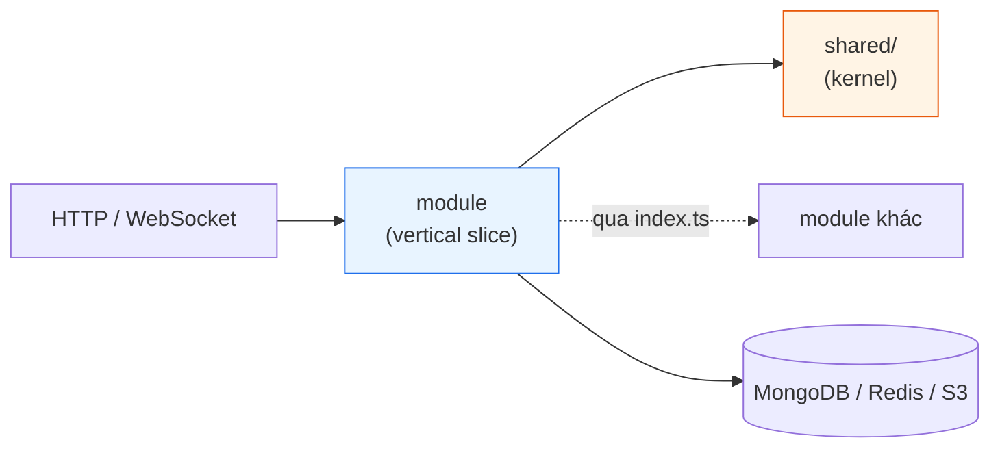

# 1. Kiến trúc đích — Modular Monolith (Vertical Slice)

> **Nguyên tắc:** Chỉ thay đổi *cách tổ chức bên trong*. Hành vi bên ngoài giữ nguyên tuyệt đối (R1).

---

## 1.1. So sánh cấu trúc: trước → sau

### TRƯỚC — Clean Architecture 4 tầng (hiện tại)

```
src/modules/datasets/
├── application/
│   ├── commands/          4 file
│   ├── queries/           4 file
│   ├── policy-loaders/    1 file
│   └── services/          3 file
├── domain/
│   ├── entities/          2 file
│   ├── events/            1 file
│   ├── ports/             2 file
│   ├── services/          1 file
│   └── value-objects/     3 file
├── infrastructure/
│   ├── adapters/          0 file
│   └── persistence/       5 file
├── presentation/
│   ├── controllers/       2 file
│   ├── dtos/              3 file
│   └── responses/         2 file
├── index.ts               ← public contract
└── datasets.module.ts
```

**Người mới phải làm:** 4 lần grep ở 4 thư mục khác nhau để hiểu 1 request.

### SAU — Vertical Slice (đích)

```
src/modules/datasets/
├── datasets.routes.ts        ← HTTP + validation (Zod) + guard
├── datasets.service.ts       ← toàn bộ nghiệp vụ
├── datasets.schema.ts        ← Mongoose model
├── datasets.types.ts         ← type + constant
├── datasets.errors.ts        ← lỗi nghiệp vụ (nếu có)
├── index.ts                 ← public contract (giữ)
└── datasets.module.ts       ← DI wiring (giữ)
```

**Người mới:** 1 lần grep trong 1 thư mục.

---

## 1.2. Bốn điều kiện để gọi là "Modular Monolith" — và cách chứng minh

| # | Điều kiện | Hiện tại | Sau | Bằng chứng |
|---|---|---|---|---|
| **M1** | Ranh giới module rõ ràng | ✅ 13 module | ✅ | Thư mục độc lập, không dùng chung |
| **M2** | Không import chéo module (ngoài public contract) | ✅ 116 import đều qua `index.ts` | ✅ | ESLint rule + arch test |
| **M3** | Module = 1 vertical slice (HTTP → DB trong 1 thư mục) | ❌ 4 tầng | ✅ | Thư mục phẳng, 5–8 file |
| **M4** | Shared kernel + 1 process deploy | ✅ | ✅ | `src/shared/`, 1 `AppModule` |

> **M2 đã đạt.** Chỉ cần làm **M3** — và đó là phần cốt lõi của kịch bản này.

---

## 1.3. Quy tắc dependency (thay cho CA1–CA14)



| Luật | Nội dung | Cơ chế enforce |
|---|---|---|
| **MM1** | `shared/` không import từ `modules/` | ESLint + arch test (giữ CA5) |
| **MM2** | Module A không import trực tiếp file của module B; chỉ qua `index.ts` | ESLint `no-restricted-imports` + arch test (giữ CA4/CA8) |
| **MM3** | Không chu trình phụ thuộc giữa các module | Arch test (giữ CA9) |
| **MM4** | Không import SDK AI/LLM bên thứ ba | Arch test (giữ CA10) |
| **MM5** | Mỗi module tự chứa đủ: route + service + schema | Arch test **mới** (thay CA1/CA2/CA20) |

### Điều MM5 thay thế điều gì?

| Luật cũ | Nội dung | Trạng thái sau refactor |
|---|---|---|
| CA1 | `domain/` không import framework | **BỎ** — không còn `domain/` tách riêng |
| CA2 | `application/` không import infrastructure | **BỎ** — không còn tầng |
| CA20 | `application/` không import `HttpException` | **THAY** bằng MM5: service không được dùng HTTP exception |
| CA3/CA4/CA5/CA8/CA9/CA10/CA11 | Ranh giới module, shared, chu trình, SDK AI | **GIỮ** — nguyên giá trị, chuyển sang ngữ nghĩa modular monolith |

> **Từ 14 luật → 5 luật.** Ít luật hơn = ít tài liệu đồng bộ hơn = ít nợ kỹ thuật hơn.

---

## 1.4. Quy tắc đặt tên file

Mỗi module dùng tiền tố tên module:

| File | Vai trò | Ví dụ (`datasets`) |
|---|---|---|
| `<mod>.routes.ts` | Controller + DTO + validation | `datasets.routes.ts` |
| `<mod>.service.ts` | Nghiệp vụ (thay handler + service + port impl) | `datasets.service.ts` |
| `<mod>.schema.ts` | Mongoose model | `datasets.schema.ts` |
| `<mod>.types.ts` | Type, enum, constant | `datasets.types.ts` |
| `<mod>.errors.ts` | Lỗi nghiệp vụ | `datasets.errors.ts` |
| `<mod>.events.ts` | Event type định nghĩa | `datasets.events.ts` |
| `<mod>.policy.ts` | Policy loader | `datasets.policy.ts` |
| `<mod>.adapter.ts` | Adapter đặc biệt (chỉ khi cần) | `datasets.adapter.ts` |
| `<mod>.module.ts` | NestJS module (DI wiring) | `datasets.module.ts` |
| `index.ts` | Public contract | `index.ts` |

> **Quy tắc:** `<tên-file>.<vai-trò>.ts`. Không dùng tên generic như `service.ts`, `controller.ts` — vì khi có nhiều module trong cùng thư mục, người mới cần biết file thuộc module nào.

---

## 1.5. `shared/` — giữ nguyên hay rút gọn?

**Quyết định: GIỮ NGUYÊN trong kịch bản 30h.**

| Lý do giữ | Chi tiết |
|---|---|
| `shared/` đã là "shared kernel" đúng nghĩa | 88 file, 5 567 LOC, 25 thư mục con — đã là kiểu modular monolith |
| Rủi ro cao khi đụng | 88 file, guard/filter/interceptor/pipes — sai 1 chỗ là hỏng toàn hệ thống |
| Không đóng góp cho M1–M4 | M1–M4 không yêu cầu thay đổi `shared/` |
| Ảnh hưởng "người mới khó hiểu" | `shared/` là **cross-cutting** — người mới hiểu nó 1 lần là dùng cho mọi module |

> **Ghi nhận nợ kỹ thuật:** `shared/` có thể rút gọn thành `shared/{db,http,auth,realtime,utils}` (5 thư mục) — để dành cho đợt sau. Ghi vào `docs/refactor/notes.md`.

---

## 1.6. Ranh giới giữa `shared/` và module

| Nằm ở `shared/` | Nằm ở module |
|---|---|
| `JwtAuthGuard`, `PoliciesGuard`, `@CurrentUser` | Nghiệp vụ cụ thể của domain |
| `HttpExceptionFilter`, `TransformInterceptor` | Schema Mongoose của entity |
| `ZodValidationPipe` | Repository truy vấn entity đó |
| `OutboxService`, `TransactionPort` | Policy loader của resource đó |
| `StorageService`, `EmailSender`, `PushSender` | — |
| `RealtimeTransport` (socket.io) | — |
| `cursor-paginated.response`, `Action`, `SubjectName` | — |

> **Nguyên tắc:** `shared/` = thứ dùng bởi **≥ 3 module**. Dùng bởi 1–2 module → đặt trong module đó.

---

## 1.7. Những gì KHÔNG đổi trong toàn bộ kịch bản

| Không đổi | Lý do |
|---|---|
| **82 HTTP route + 1 WS gateway** + response shape | Frontend đang dựa vào; contract §3.13 đã chốt |
| **18 Mongoose model** + collection/index (xem `12_business_invariants.md` §12.7) | DB đang có dữ liệu thật |
| **107 handler (+3 subscriber) → 107 service method** (map 1-1, chi tiết ở `12_business_invariants.md` §12.2) | Đổi tên lớp, không đổi logic |
| **Outbox + transaction** | Đang hoạt động tốt (OPEN-09) |
| **RBAC 3 tầng** (workspace → project → dataset) | Đã giải quyết IDOR, có test |
| **Cursor pagination** | Đã chốt trong hợp đồng API |
| **Zod validation** | Đang dùng đúng |
| **1 277 test** — chỉ đổi import path | Test là tài sản lớn nhất |
| **AI worker + RAM guard + cardinality guard** | Domain cốt lõi của sản phẩm |
