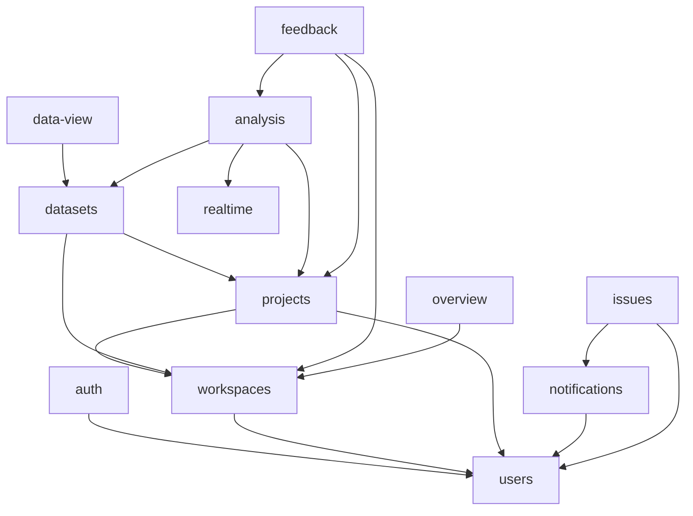

# 8. Phase P6 + P7 — Tài liệu & Verify (9 giờ)

> **Thời gian:** P6 = 6 giờ (tài liệu) · P7 = 3 giờ (verify + buffer)
> **Ưu tiên cao nhất:** P6 là **deliverable trực tiếp cho đồ án**. Không cắt.

---

## 8.1. P6.1 — `docs/ARCHITECTURE.md` (2 giờ)

> **Đây là tài liệu quan trọng nhất cho đồ án.** Nó chứng minh cấu trúc modular monolith có tồn tại và được enforce.

### Khung nội dung

````markdown
# Kiến trúc Backend — Modular Monolith

> Cập nhật: 2026-11-21 · Đọc file này **trước** khi đọc code.

## 1. Tổng quan

Hệ thống là **modular monolith**: một tiến trình Node.js duy nhất, chia thành
**14 module nghiệp vụ** độc lập + **1 shared kernel**.

```
┌──────────────────────────────────────────────────────────┐
│  HTTP / WebSocket  (NestJS, 1 process)                  │
└────────────────────────┬─────────────────────────────────┘
                         ▼
┌──────────────────────────────────────────────────────────┐
│  src/modules/  ← 14 vertical slice                      │
│  auth · users · workspaces · projects · datasets        │
│  data-view · analysis · notifications · issues          │
│  feedback · realtime · audit · overview                 │
└────────────────────────┬─────────────────────────────────┘
                         ▼
┌──────────────────────────────────────────────────────────┐
│  src/shared/  ← kernel dùng chung (88 file)             │
│  db · http · auth · realtime · storage · outbox · utils │
└──────────────────────────────────────────────────────────┘
```

## 2. Module là gì?

Mỗi module là **1 vertical slice**: đi từ HTTP → nghiệp vụ → DB, tự chứa trong
**1 thư mục phẳng**.

```
src/modules/<tên>/
├── <tên>.routes.ts      HTTP + validation (Zod)
├── <tên>.service.ts     nghiệp vụ (ghi)
├── <tên>.query.service.ts  nghiệp vụ (đọc)
├── <tên>.repository.ts  truy vấn DB
├── <tên>.schema.ts      Mongoose model
├── <tên>.types.ts       type + port token
├── <tên>.module.ts      DI wiring
└── index.ts             public contract
```

## 3. Quy tắc phụ thuộc

| Luật | Nội dung | Enforce ở đâu |
|---|---|---|
| MM1 | `shared/` không import từ `modules/` | ESLint + `clean-architecture.spec.ts` |
| MM2 | Module A chỉ biết module B qua `index.ts` | ESLint `no-restricted-imports` |
| MM3 | Không chu trình phụ thuộc | `clean-architecture.spec.ts` |
| MM4 | Không import SDK AI bên thứ ba | `clean-architecture.spec.ts` |
| MM5 | Mỗi module phẳng — không thư mục con | `modular-monolith.spec.ts` |
| MM6 | `*.service.ts` không dùng `HttpException` | `modular-monolith.spec.ts` |

## 4. Sơ đồ phụ thuộc giữa các module



## 5. Bảng đồ module → route

| Module | Số route | File chính |
|---|---|---|
| `auth` | 9 | `auth.routes.ts` |
| ... | ... | ... |

## 6. Dữ liệu: 20 Mongoose model

| Model | Module | Schema file |

## 7. Đồ thị phụ thuộc runtime

## 8. Kiểm chứng

```bash
pnpm arch:api-coverage     # 84 route khớp 1-1 với hợp đồng §3.13
pnpm test:arch             # CA + MM rules
```
````

---

## 8.2. P6.2 — `docs/ONBOARDING.md` (2 giờ)

> **Tài liệu này giải quyết trực tiếp nỗi đau gốc: "người mới khó hiểu codebase".**
> Nó là **bản đồ đường đi theo tính năng**, không phải theo module.

### Khung nội dung

````markdown
# Hướng dẫn Onboarding — Backend

> Mục tiêu: người mới làm được việc đầu tiên trong **30 phút**, không cần đọc 427 file.

## 0. Bắt đầu từ đâu?

| Bạn muốn làm gì? | Đọc file này trước |
|---|---|
| Hiểu hệ thống nói chung | `docs/ARCHITECTURE.md` |
| Thêm 1 endpoint mới | §2 + module tương ứng |
| Sửa 1 tính năng có sẵn | §3 (bản đồ tính năng) |
| Tìm hiểu về auth | §4.1 |
| Debug 1 lỗi | §5 |

## 1. 5 phút — chạy được hệ thống

```bash
cd src/backend
pnpm install
pnpm test              # 67 suite, 1 069 test — phải xanh
pnpm start:dev
```

## 2. Thêm 1 endpoint mới (30 phút)

**Ví dụ: thêm `GET /projects/:id/stats`**

| Bước | File | Làm gì |
|---|---|---|
| 1 | `src/modules/projects/projects.routes.ts` | Thêm method + `@Get('projects/:id/stats')` |
| 2 | `src/modules/projects/projects.query.service.ts` | Thêm method `getStats()` vào service |
| 3 | `src/modules/projects/projects.repository.ts` | Thêm query |
| 4 | `src/modules/projects/projects.types.ts` | Thêm type response |
| 5 | `test/projects.spec.ts` | Thêm test |

**Không cần**: tạo file mới ở tầng nào, export index.ts, viết mapper.
→ **Đây là khác biệt so với kiến trúc cũ.**

## 3. Bản đồ tính năng — "Tôi muốn hiểu X, đọc gì?"

| Tính năng | Bắt đầu đọc từ | Đi sâu vào |
|---|---|---|
| **Đăng nhập / đăng ký** | `auth.routes.ts` | `auth.service.ts` → `users.repository.ts` |
| **Quản lý workspace** | `workspaces.routes.ts` | `workspaces.service.ts` → `workspace-context.adapter.ts` |
| **Phân quyền 3 tầng** | `workspaces.policy.ts` | `projects.policy.ts` → `datasets.policy.ts` |
| **Upload CSV** | `datasets.routes.ts` | `ingest-dataset-stream.handler` → `schema-inference.service.ts` |
| **Hiển thị lưới dữ liệu** | `data-view.routes.ts` | `data-view.service.ts` → `record-query.repository.ts` |
| **Chạy phân tích DQ** | `analysis.routes.ts` | `analysis.service.ts` → `correlation.util.ts` |
| **AI suy luận** | — | `ai-worker.service.ts` → `local-inference.adapter.ts` |
| **Xuất báo cáo PDF** | `analysis.report.routes.ts` | `report-worker.service.ts` → `pdf-builder.util.ts` |
| **Thông báo** | `notifications.routes.ts` | `notifications.service.ts` |
| **Báo lỗi** | `issues.routes.ts` | `issues.service.ts` |
| **Phản hồi chất lượng** | `feedback.routes.ts` | `feedback.service.ts` → `rag-few-shot.service.ts` |
| **Realtime** | `realtime.gateway.ts` | `realtime.service.ts` → `socket-io-realtime.transport.ts` |
| **Đối tác dữ liệu** | — | `record-query.repository.ts` |
| **Xóa dọn dữ liệu** | — | `delete-workspace.handler` → outbox cascade |

## 4. Giải thích các khái niệm

### 4.1. Phân quyền 3 tầng
### 4.2. Outbox pattern — vì sao event ghi DB mà không phát ngay?
### 4.3. Transaction — vì sao xóa workspace phải bọc transaction?
### 4.4. Cursor pagination — vì sao không có `page`?

## 5. Debug

| Triệu chứng | Xem đâu |
|---|---|
| Lỗi 401 | `jwt.strategy.ts`, `users-auth-lookup.adapter.ts` |
| Lỗi 403 | `policies.guard.ts`, `*.policy.ts` |
| Lỗi 422 | Zod schema trong `*.routes.ts` |
| Cascade không xóa | outbox subscriber + `event-dispatcher.service.ts` |
| Cần xem log request | `logging.interceptor.ts` |

## 6. Quy ước đặt tên file
````

---

## 8.3. P6.3 — Cập nhật 30 README hiện có (1 giờ 30 phút)

### Bảng tra cứu nhanh

| Nhóm README | Số file | Cần làm gì |
|---|---|---|
| `README.md` (gốc) | 1 | Cập nhật số liệu, thêm mục "Kiến trúc" trỏ tới `docs/ARCHITECTURE.md` |
| `src/backend/README.md` | 1 | Cập nhật cây thư mục, số liệu |
| `src/backend/src/modules/*/README.md` | 14 | **Cập nhật cây thư mục** + số handler + đường dẫn file mới |
| `src/backend/src/shared/README.md` | 1 | Không đổi (giữ nguyên `shared/`) — chỉ thêm cross-link |
| `src/backend/src/modules/README.md` | 1 | Cập nhật mô tả kiến trúc module |
| `src/backend/test/README.md` | 1 | Cập nhật cây thư mục test |
| `src/backend/test/unit_test/README.md` | 1 | Cập nhật số handler |
| `src/backend/test/unit_test/19_handler_inventory.md` | 1 | **Regenerate** — đường dẫn file mới |
| `src/backend/scripts/README.md` | 1 | Thêm `measure-refactor.sh` |
| `src/backend/deploy/README.md` | 1 | Không đổi |
| `docs/**/README.md` | 8 | Cập nhật số liệu + cross-link |

### Quy tắc bắt buộc

> **Mọi đường dẫn file trong README phải tồn tại.** Dùng link checker sau mỗi nhóm.

### Regenerate `19_handler_inventory.md`

```bash
cd src/backend
python3 - <<'PY'
import glob, os, re
mods = {}
for f in sorted(glob.glob('src/modules/*/application/**/*.handler.ts', recursive=True)):
    mod = f.split('/')[2]
    mods.setdefault(mod, []).append(f[len('src/modules/'):])
for mod, files in mods.items():
    print(f'## {mod}')
    for f in files:
        print(f'- [ ] `modules/{f}` — áp dụng checklist module và các nhánh chung ở trên.')
PY
```

> **Sau P4/P5, các file `*.handler.ts` đã được gộp vào service** → inventory phải liệt kê **service + method** thay vì file handler.
> Cập nhật header: *"107 handler — 61 command + 46 query — nay là 107 method trong các service."*

---

## 8.4. P6.4 — Báo cáo trước/sau (30 phút)

Tạo `docs/refactor/02_inventory_and_metrics.md` — cập nhật bảng "Đường cong đo lại" bằng số thật.

| Chỉ số | Trước | Sau | Δ |
|---|---|---|---|
| File `.ts` trong `src/modules/` | 339 | ___ | −__% |
| LOC | 31 076 | ___ | −__% |
| Thư mục con | ~60 | ___ | −__% |
| Tầng | 4 | 1 | −75% |
| Rule kiến trúc | 14 | 5 | −64% |
| Route | 84 | 84 | 0 (bất biến) |
| Handler | 107 | 107 | 0 (bất biến) |
| Test | 1 277 | 1 277 | 0 (bất biến) |

---

## 8.5. P6.5 — Link checker (15 phút)

```bash
cd "<repo-root>"
python3 - <<'PY'
import os, re, urllib.parse
bad = []; count = 0
for dp, dn, fn in os.walk('.'):
    dn[:] = [d for d in dn if d not in ('.git','node_modules','coverage','.next','dist')]
    for f in fn:
        if not f.endswith('.md'): continue
        p = os.path.join(dp, f)
        s = open(p, encoding='utf-8', errors='replace').read()
        for m in re.finditer(r'\[[^\]]*\]\(([^)\s]+)', s):
            t = m.group(1).strip()
            if t.startswith(('http://','https://','mailto:','#','tel:','file://')): continue
            t = urllib.parse.unquote(t.split('#')[0])
            if not t: continue
            count += 1
            if not os.path.exists(os.path.normpath(os.path.join(dp, t))):
                bad.append((p, t))
print(f'checked {count} | broken {len(bad)}')
for b in bad: print('BROKEN:', b[0], '->', b[1])
PY
```

**Điều kiện:** 0 broken.

---

## 8.6. P7 — Verify toàn bộ (3 giờ)

### P7.1 Verify đầy đủ (1 giờ 30 phút)

```bash
cd src/backend

# 1. TypeScript
pnpm type-check                        # 0 lỗi

# 2. Lint
pnpm lint                              # 0 cảnh báo

# 3. Unit + architecture
pnpm exec jest --maxWorkers=2          # 67 suites / 1 069 tests

# 4. Contract API
pnpm arch:api-coverage                 # 84 | 84 | 0 | 0

# 5. Coverage
pnpm test:cov                          # ≥ 71% stmts
```

### P7.2 Integration + E2E (1 giờ)

> Cần hạ tầng: MongoDB replica set + Redis + MinIO.

```bash
cd src/backend
bash scripts/test-infra-up.sh           # khởi động hạ tầng test
pnpm test:integration                   # 7 suites / 138 tests
pnpm test:e2e                           # 5 suites / 70 tests
bash scripts/test-infra-down.sh         # tắt hạ tầng — giải phóng RAM
```

**Kết quả kỳ vọng:** tổng **1 277 test / 79 suite** — khớp baseline.

### P7.3 Buffer & polish (30 phút)

| Việc | Thời gian |
|---|---|
| Sửa link hỏng còn sót | 10 phút |
| Cập nhật số liệu cuối cùng vào README | 10 phút |
| Chạy lại link checker | 5 phút |
| Commit + tag `v1.2.0-final` | 5 phút |

---

## 8.7. Checklist bàn giao

### Deliverable cho đồ án

- [ ] `docs/adr/0001-modular-monolith.md` — ADR đầy đủ
- [ ] `docs/ARCHITECTURE.md` — sơ đồ + quy tắc + bảng đồ module→route
- [ ] `docs/ONBOARDING.md` — bản đồ tính năng cho người mới
- [ ] `docs/refactor/architecture-diagram.md` — trước/sau
- [ ] `docs/refactor/02_inventory_and_metrics.md` — bảng số liệu trước/sau
- [ ] `docs/refactor/notes.md` — nhật ký quyết định
- [ ] 30 README cập nhật — 0 broken link
- [ ] `test/modular-monolith.spec.ts` — enforce MM1–MM6

### Bằng chứng kỹ thuật

- [ ] `pnpm type-check` → 0 lỗi
- [ ] `pnpm lint` → 0 cảnh báo
- [ ] `pnpm exec jest --maxWorkers=2` → 1 069 pass
- [ ] `pnpm test:integration` → 138 pass
- [ ] `pnpm test:e2e` → 70 pass
- [ ] `pnpm arch:api-coverage` → 84 / 84 / 0 / 0
- [ ] Coverage ≥ 71%
- [ ] Link checker → 0 broken

### Bất biến đã giữ

- [ ] 84 route — không thêm, không bớt
- [ ] 107 handler — đổi tên lớp, không đổi logic
- [ ] 20 Mongoose model
- [ ] 1 277 test xanh
- [ ] Dataset vẫn insert-only (không route cập nhật cột)
- [ ] Audit vẫn best-effort, không có HTTP route
- [ ] RBAC 3 tầng còn nguyên

### Git

- [ ] Tag `v1.1.0-baseline` (trước refactor)
- [ ] Tag `v1.2.0-p1` … `v1.2.0-p7` (từng phase)
- [ ] Tag `v1.2.0-final` (bàn giao)
- [ ] Commit message theo Conventional Commits
