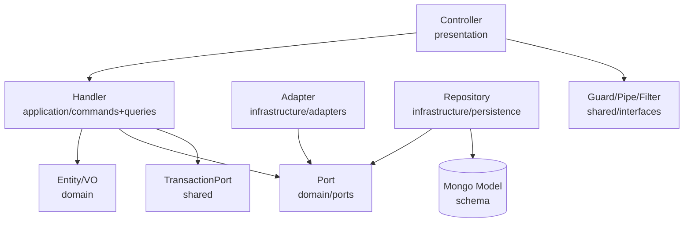
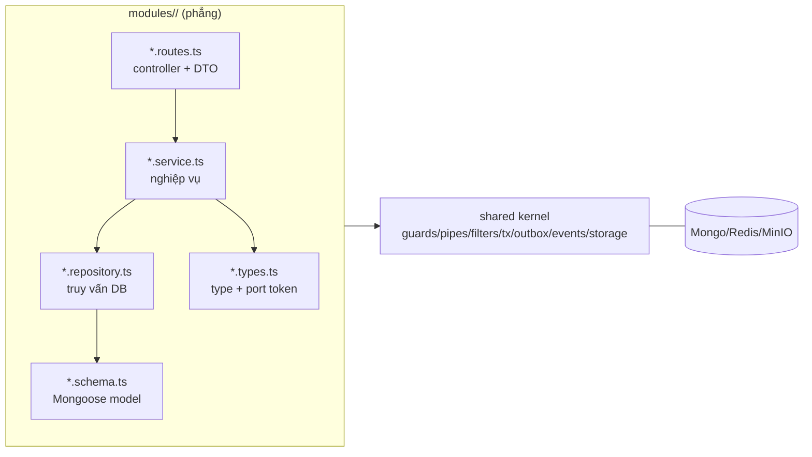

# Sơ đồ kiến trúc trước / sau (P0.4)

## Trước: Clean Architecture 4 tầng (mỗi module lặp lại)

> 1 request đi qua 4 thư mục: `presentation/` → `application/` → `domain/` → `infrastructure/`.

## Sau: Modular Monolith vertical slice (mỗi module 1 thư mục phẳng)

> 1 request chỉ đọc 1 thư mục module + shared kernel. Ranh giới module giữ nguyên, enforce bằng ESLint MM2 + arch test MM5/MM6.
