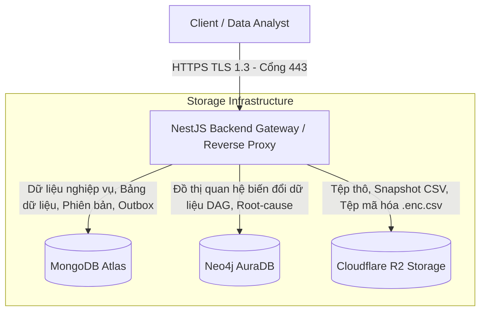
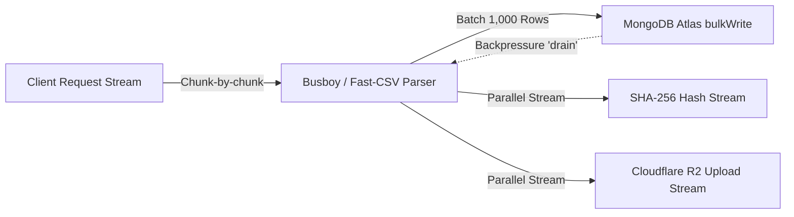

# BÁO CÁO TỔNG QUAN KIẾN TRÚC & HỆ THỐNG DỰ ÁN TOÀN DIỆN
## (COMPREHENSIVE TECHNICAL SYSTEM & ARCHITECTURE REPORT)

---

### THÔNG TIN DỰ ÁN
- **Tên dự án:** Hệ thống AI hỗ trợ phát hiện và xử lý vấn đề về chất lượng dữ liệu *(Full-Stack Data Quality Management Platform with AI Assistance)*
- **Học phần:** Lập trình JavaScript & TypeScript Nâng Cao — Trường Đại học Giao thông Vận tải TP.HCM (UTH)
- **Tập tin báo cáo:** `docs/report_over_project.md`
- **Phiên bản hệ thống:** v3.0.0 (Hoàn thành 100% Sprint B1, Sprint B2, Sprint B3)
- **Mục đích tài liệu:** Cung cấp bức tranh toàn cảnh về kiến trúc hệ thống, ngăn xếp công nghệ, hạ tầng lưu trữ phân tán, mật mã học, phân hệ nghiệp vụ, và danh mục API để người chấm/người đánh giá **không cần đọc từng dòng mã nguồn** vẫn có thể thẩm định trọn vẹn giải pháp kỹ thuật và chất lượng triển khai của dự án.

---

## MỤC LỤC
1. [Bối cảnh, Mục tiêu & 3 Câu hỏi Cốt lõi](#1-bối-cảnh-mục-tiêu--3-câu-hỏi-cốt-lõi)
2. [Bản đồ Ngăn xếp Công nghệ & Ngôn ngữ (Tech Stack Map)](#2-bản-đồ-ngăn-xếp-công-nghệ--ngôn-ngữ-tech-stack-map)
3. [Hạ tầng Lưu trữ Dữ liệu Đa tầng (Storage Topology)](#3-hạ-tầng-lưu-trữ-dữ-liệu-đa-tầng-storage-topology)
4. [Kiến trúc Mật mã học, Bảo mật & Toàn vẹn Dữ liệu (Cryptography & Security)](#4-kiến-trúc-mật-mã-học-bảo-mật--toàn-vẹn-dữ-liệu-cryptography--security)
5. [Cơ chế Xử lý Dữ liệu Lớn Dạng Luồng (Streaming Architecture & Memory Safety)](#5-cơ-chế-xử-lý-dữ-liệu-lớn-dạng-luồng-streaming-architecture--memory-safety)
6. [Chi tiết 10 Phân hệ Nghiệp vụ Backend Hiện hữu](#6-chi-tiết-10-phân-hệ-nghiệp-vụ-backend-hiện-hữu)
7. [Bảng Danh mục Toàn bộ 42 RESTful API Endpoints](#7-bảng-danh-mục-toàn-bộ-42-restful-api-endpoints)
8. [Bộ Kiểm thử & Đảm bảo Chất lượng Phần mềm (Testing & Quality Assurance)](#8-bộ-kiểm-thử--đảm-bảo-chất-lượng-phần-mềm-testing--quality-assurance)
9. [Ma trận Rủi ro Kỹ thuật & Giải pháp Phòng ngừa (Risks & Mitigations)](#9-ma-trận-rủi-ro-kỹ-thuật--giải-pháp-phòng-ngừa-risks--mitigations)
10. [Định hướng & Kế hoạch Thực thi Sprint B4 (Google Gemini AI Engine)](#10-định-hướng--kế-hoạch-thực-thi-sprint-b4-google-gemini-ai-engine)

---

## 1. Bối cảnh, Mục tiêu & 3 Câu hỏi Cốt lõi

### 1.1. 3 Câu hỏi Cốt lõi (Core Principles)
- **Đang làm gì?** Xây dựng nền tảng Full-Stack Backend cấp doanh nghiệp phục vụ quản trị, làm sạch, theo dõi dòng chảy dữ liệu (Data Lineage) và phát hiện dị thường chất lượng dữ liệu với sự hỗ trợ của Trí tuệ Nhân tạo.
- **Cho ai?** Dành cho các Kỹ sư Dữ liệu (Data Engineers), Chuyên viên Phân tích Dữ liệu (Data Analysts) và các Tổ chức cần một quy trình kiểm soát dữ liệu thô nghiêm ngặt trước khi nạp vào Kho Dữ liệu (Data Warehouse) hoặc huấn luyện mô hình Học máy.
- **Để làm gì?** 
  - Tự động hóa quá trình tiếp nhận (Ingestion), làm sạch (Cleaning) và kiểm tra tính nhất quán của dữ liệu bảng.
  - Ngăn ngừa tình trạng tràn RAM máy chủ khi xử lý các tập dữ liệu có quy mô hàng triệu dòng thông qua kiến trúc Streaming Node.js thuần túy ($\le 20\text{ MB}$ RAM).
  - Đảm bảo tính bất biến của lịch sử thay đổi qua Merkle Hash Chaining và đồ thị tri thức Directed Acyclic Graph (DAG).
  - Bảo vệ dữ liệu nhạy cảm bằng chuẩn mã hóa luồng quân sự AES-256-GCM kết hợp che giấu thông tin PII.

### 1.2. Chiến lược Phân kỳ Phát triển (Staged Rollout)
Dự án được định hướng kiến trúc theo triết lý **"Rock-Solid Core First, AI-Ready Always"**:
- **Giai đoạn 1 (Sprint B1, B2, B3 - Đã hoàn thành 100%):** Hoàn thiện toàn bộ khung xương sống vận hành độc lập, chịu tải cao, có kiểm thử tự động toàn diện mà không phụ thuộc vào độ trễ hay tính bất định của các API AI bên ngoài.
- **Giai đoạn 2 (Sprint B4 - Bước tiếp theo):** Tích hợp Động cơ AI Google Gemini và cơ chế phát hiện dị thường đa tầng (Multi-layer Anomaly Detection) trên nền tảng đã ổn định tuyệt đối.

---

## 2. Bản đồ Ngăn xếp Công nghệ & Ngôn ngữ (Tech Stack Map)

Hệ thống được xây dựng trên một ngăn xếp công nghệ hiện đại, định hướng chuẩn công nghiệp (Production-Grade):

```
┌─────────────────────────────────────────────────────────────────────────────┐
│                       NGĂN XẾP CÔNG NGHỆ CHÍNH (TECH STACK)                 │
├────────────────────────────────┬────────────────────────────────────────────┤
│ Ngôn ngữ & Nền tảng thực thi   │ TypeScript Native 7.0.2 / 6.0, Node.js 22  │
│ Backend Framework              │ NestJS 11 (Express HTTP Engine)            │
│ Hạ tầng Kênh truyền & Mạng     │ HTTPS (TLS 1.3 - Cổng 443), HSTS, Cloudflare│
│ Cơ sở dữ liệu nghiệp vụ chính  │ MongoDB Atlas (Mongoose 8.x ODM)           │
│ Cơ sở dữ liệu đồ thị tri thức  │ Neo4j AuraDB (Neo4j Driver 5.x)            │
│ Lưu trữ tệp đối tượng đám mây  │ Cloudflare R2 / AWS S3 (@aws-sdk/client-s3)│
│ Bộ nhớ đệm & Phân tán          │ Redis (ioredis) - Session & Distributed Lock│
│ Mật mã học & Mã hóa            │ Node.js Crypto, Argon2id, PBKDF2, AES-GCM  │
│ Phân quyền & Kiểm soát truy cập│ CASL 6.x (@casl/ability - ABAC Model)      │
│ Xác thực & Định danh           │ JWT (JsonWebToken), SHA-256 Fingerprint    │
│ Xác thực dữ liệu đầu vào       │ Zod 3.x + Zod-to-JSON-Schema               │
│ Xử lý luồng dữ liệu (Streams)  │ Busboy, Fast-CSV, Node.js Transform Stream │
│ Tài liệu hóa API tự động       │ OpenAPI 3.0 / Swagger (@nestjs/swagger)    │
│ Đảm bảo chất lượng & Kiểm thử  │ Jest 30.x, ts-jest, Supertest              │
│ Trình quản lý gói & Build tool │ pnpm, Nest CLI, TypeScript Compiler (tsc)  │
└────────────────────────────────┴────────────────────────────────────────────┘
```

### Đặc điểm Kỹ thuật Nổi bật:
1. **TypeScript Strict Mode & Zero Any Policy:**
   - Dự án áp dụng nguyên tắc **Zero Any tuyệt đối** (Mục 13 WORKING RULE). Toàn bộ mã nguồn sản phẩm, mã tiện ích và mã kiểm thử không có bất kỳ khai báo `: any`, ép kiểu `as any`, generic `<any>` hay `Record<string, any>`.
   - Dữ liệu chưa xác định được bảo vệ qua kiểu `unknown`, Generics `<T>`, Zod Inferred Schemas và kiểm tra thu hẹp kiểu an toàn (Type Guards).
2. **Kiến trúc Mô-đun NestJS (Clean Modular Architecture):**
   - Đảm bảo tính độc lập cao (High Cohesion, Low Coupling) giữa các phân hệ: `auth`, `users`, `workspaces`, `projects`, `datasets`, `data-view`, `lineage`, `versions`, `clean-rules`, `exports`.
3. **Quản lý Tiến trình & Giao dịch Ngoại cảnh (Ambient Session Context):**
   - Sử dụng `AsyncLocalStorage` trong `src/backend/src/shared/database/mongo-session-context.ts` để truyền tải MongoDB ClientSession xuyên suốt các tầng Service mà không cần truyền thủ công qua tham số hàm.

---

## 3. Hạ tầng Lưu trữ Dữ liệu Đa tầng (Storage Topology)

Hệ thống kết hợp 3 tầng lưu trữ chuyên biệt để phục vụ tối ưu cho từng loại dữ liệu khác nhau:



### 3.1. Cơ sở Dữ liệu Tài liệu Vận hành Chính (MongoDB Atlas)
Đóng vai trò là nguồn dữ liệu chân lý (Single Source of Truth) cho các thực thể nghiệp vụ:
- **`users`:** Lưu thông tin tài khoản, vai trò hệ thống (`admin`, `analyst`), mật khẩu đã băm Argon2id, họ tên, email.
- **`sessions`:** Quản lý các phiên đăng nhập đang hoạt động; lưu mã băm SHA-256 của Refresh Token; tích hợp **TTL Index** tự động giải phóng bản ghi sau đúng 7 ngày.
- **`workspaces`:** Lưu trữ không gian làm việc đa người dùng, danh sách mảng `members` gắn quyền hạn cụ thể (`owner`, `editor`, `viewer`).
- **`projects`:** Quản lý dự án thuộc không gian làm việc; kiểm soát cờ trạng thái `has_dataset` phục vụ ràng buộc nghiệp vụ bất biến *1 Project = 1 Dataset*.
- **`datasets`:** Lưu thông tin siêu dữ liệu (Metadata) của tập dữ liệu: tên bảng, số lượng dòng, dung lượng tệp, trạng thái nạp (`INGESTING`, `READY`, `FAILED`), chữ ký băm tệp gốc SHA-256, và mảng danh mục cột kèm kiểu dữ liệu suy luận.
- **`dataset_records`:** Lưu trữ từng dòng dữ liệu dạng bảng dưới dạng linh hoạt `{ data: Record<string, unknown> }`. Sở hữu **Compound Index** `{ dataset_id: 1, row_index: 1, deleted_at: 1 }` cho phép truy vấn phân trang Virtual Grid đạt tốc độ tức thì.
- **`clean_rules`:** Lưu trữ danh sách các quy tắc làm sạch dữ liệu xác định (Tầng 1) đã được người dùng tạo hoặc áp dụng.
- **`dataset_versions`:** Lưu trữ cây lịch sử các phiên bản của bảng dữ liệu kèm các nút băm Merkle Tree (`parent_hash`, `rules_hash`, `data_checksum`, `version_hash`).
- **`export_tasks`:** Lưu lịch sử các tác vụ xuất dữ liệu ra tệp CSV hoặc tệp mã hóa AES-256-GCM.
- **`outbox_events`:** Bảng hàng đợi sự kiện giao dịch phục vụ **Transactional Outbox Pattern**, đảm bảo tính nhất quán cuối cùng (Eventual Consistency) giữa MongoDB và Neo4j.

### 3.2. Cơ sở Dữ liệu Đồ thị Tri thức (Neo4j AuraDB)
Đóng vai trò lưu trữ và phân tích đồ thị dòng chảy dữ liệu có hướng không chu trình (DAG - Directed Acyclic Graph):
- **Các Nút (Nodes):**
  - `(:Dataset { id, name, workspace_id })`
  - `(:Operation { id, type, user_id, timestamp })`
  - `(:Rule { id, category, action })`
  - `(:Version { version_number, version_hash })`
- **Các Cạnh Quan hệ (Relationships):**
  - `[:TRANSFORMED_BY]` — Dataset bị biến đổi qua Operation.
  - `[:GENERATED]` — Operation sinh ra phiên bản Version mới.
  - `[:DEPENDS_ON]` — Quan hệ phụ thuộc dòng chảy giữa các tập dữ liệu.
- **Ứng dụng:** Cho phép truy vấn Cypher đa chiều để phân tích tác động (Impact Analysis) và truy vết nguyên nhân gốc rễ (Root-cause Analysis) khi dữ liệu cuối bảng bị phát hiện lỗi.

### 3.3. Kho Lưu trữ Tệp Đối tượng Đám mây (Cloudflare R2 / AWS S3)
- Sử dụng chuẩn S3-Compatible API với thư viện `@aws-sdk/client-s3`.
- **Cấu trúc lưu trữ:**
  - `raw_files/{workspace_id}/{file_id}.csv`: Tệp dữ liệu thô ban đầu do người dùng tải lên.
  - `snapshots/{dataset_id}/v{version_number}.csv`: Bản sao lưu trữ tệp CSV tĩnh của từng phiên bản phục vụ tính năng Rollback tức thì.
  - `exports/{export_id}.enc.csv`: Bản sao tệp dữ liệu đã mã hóa quân sự bảo vệ bằng mật khẩu cá nhân.
- **Kiến trúc Dual-Mode (Hai chế độ hoạt động):**
  - *Cloud Mode:* Kết nối trực tiếp Cloudflare R2 / AWS S3 thông qua Access Key / Secret Key.
  - *Local Fallback Mode:* Tự động lưu trữ xuống hệ thống tệp cục bộ (`/uploads`) khi không cấu hình Cloud Storage, bảo đảm môi trường kiểm thử Unit Test và Local Dev hoạt động 100% không bị ngắt quãng.
- **Storage Quota Guard (Giám sát Hạn mức Dung lượng):**
  - Ngưỡng cảnh báo mềm (Soft Warning): Gửi thông báo webhook thời gian thực qua `ntfy.sh` khi dung lượng lưu trữ vượt quá 90%.
  - Ngưỡng chặn cứng (Hard Block): Chặn đứng ngay lập tức các yêu cầu tải tệp mới bằng mã lỗi HTTP `413 Payload Too Large` khi chạm 100% hạn mức (mặc định 10 GB).

---

## 4. Kiến trúc Mật mã học, Bảo mật & Toàn vẹn Dữ liệu (Cryptography & Security)

Hệ thống được thiết kế theo nguyên tắc **Zero-Trust Security** với hệ thống bảo vệ đa lớp:

### 4.1. Băm Mật khẩu & Bảo vệ Phiên làm việc (Authentication Security)
- **Mã hóa mật khẩu:** Sử dụng thuật toán `Argon2id` — giải pháp đạt giải quán quân trong Cuộc thi Băm Mật khẩu (Password Hashing Competition), có khả năng kháng hoàn toàn các cuộc tấn công vét cạn bằng GPU và phần cứng ASIC.
- **Access Token:** Định dạng JWT có chữ ký điện tử HMAC-SHA-256, thời hạn sống ngắn (15 phút), chứa định danh người dùng và quyền hạn ngữ cảnh trong Workspace.
- **Refresh Token Fingerprinting:** Refresh Token có thời hạn 7 ngày, khi cấp phát được băm một chiều bằng SHA-256 trước khi lưu vào MongoDB collection `sessions`. Kẻ tấn công dù trích xuất được CSDL cũng không thể giả mạo token để lấy quyền đăng nhập mới.

### 4.2. Phân quyền Thuộc tính Nâng cao (CASL Attribute-Based Access Control)
Thay vì sử dụng RBAC (Role-Based) cứng nhắc, hệ thống triển khai mô hình ABAC linh hoạt qua thư viện `@casl/ability`:
- **Cơ chế Kiểm tra 2 Pha (Two-phase Policy Check):**
  - *Pha 1 (Route Level):* `PoliciesGuard` kết hợp decorator `@CheckPolicies()` chặn đứng các truy cập trái phép ngay tại cổng vào của Controller.
  - *Pha 2 (Service Level):* Kiểm tra quyền sở hữu bản ghi (Data Ownership) dựa trên `workspace_id` và `created_by` trước khi tiến hành cập nhật/xóa.
- **Ma trận 4 Phân quyền Ngữ cảnh:**
  1. *System Admin:* Toàn quyền quản trị hệ sinh thái (`Action.Manage, 'all'`).
  2. *Workspace Owner:* Quản trị toàn bộ tài nguyên trong Workspace của mình, có quyền mời/xóa thành viên và xóa dự án/tập dữ liệu.
  3. *Workspace Editor:* Có quyền nạp dữ liệu, chỉnh sửa, định nghĩa và áp dụng luật làm sạch, tạo phiên bản và xuất dữ liệu (`Create, Read, Update, Execute, Export`), nhưng **bị cấm xóa** Workspace và Dataset.
  4. *Workspace Viewer:* Chỉ có quyền đọc (`Action.Read`), tuyệt đối bị cấm can thiệp làm biến đổi dữ liệu.
- **Bảo vệ Kiến trúc Tự động:** Kiểm thử `test/guard-coverage.spec.ts` tự động quét toàn bộ phương thức của mọi Controller trong hệ thống, đảm bảo 100% endpoints phải được bảo vệ bởi `JwtAuthGuard` hoặc đánh dấu `@Public()`.

### 4.3. Mã hóa Luồng Cấp Quân sự (AES-256-GCM Streaming Cipher)
Để bảo vệ các tệp dữ liệu xuất bản khi lưu thông qua mạng công cộng, phân hệ `exports` trang bị tính năng mã hóa luồng đạt chuẩn NIST:
- **Dẫn xuất Khóa (Key Derivation):** Sử dụng thuật toán chuẩn `PBKDF2` với **100.000 vòng lặp** (iterations), thuật toán băm SHA-512 và Salt ngẫu nhiên 16 bytes được sinh bằng bộ sinh số ngẫu nhiên an toàn (CSPRNG).
- **Cấu trúc Nhị phân Gói tin Tệp Mã hóa (`.enc.csv`):**
  ```
  ┌──────────────────┬──────────────┬─────────────┬─────────────────────┬──────────────────┐
  │ Magic Header     │ Salt (CSPRNG)│ IV (CSPRNG) │ Encrypted Payload   │ Auth Tag (GCM)   │
  │ 8 Bytes          │ 16 Bytes     │ 12 Bytes    │ n Bytes (Transform) │ 16 Bytes         │
  │ "DATAQUAL"       │              │             │                     │                  │
  └──────────────────┴──────────────┴─────────────┴─────────────────────┴──────────────────┘
  ```
- **Bảo đảm Tính Toàn vẹn (Integrity Invariant):** Chế độ GCM (Galois/Counter Mode) sinh khối mã xác thực (Authentication Tag) 16 bytes ở cuối tệp. Nếu mật khẩu sai dù chỉ 1 ký tự, hoặc dữ liệu bị kẻ gian sửa đổi dù chỉ 1 bit, thư viện sẽ từ chối giải mã và lập tức ném ngoại lệ bảo mật.

### 4.4. Cây Băm Merkle Bất biến (Merkle Chaining Versioning)
Mỗi phiên bản dữ liệu (Version) khi được cam kết (Commit) sẽ được gắn một chuỗi băm mật mã học liên kết chặt chẽ với quá khứ:
$$\text{rules\_hash} = \text{SHA-256}(\text{Sorted\_JSON}(\text{applied\_rules}))$$
$$\text{data\_checksum} = \text{SHA-256}(\text{Snapshot\_CSV\_Content})$$
$$\text{version\_hash} = \text{SHA-256}(\text{parent\_hash} + \text{rules\_hash} + \text{data\_checksum})$$
Cơ chế này bảo đảm lịch sử biến đổi của tập dữ liệu là **không thể bị làm giả (Tamper-proof)**, cung cấp bằng chứng pháp lý rõ ràng trong kiểm toán dữ liệu.

### 4.5. Che giấu Dữ liệu Nhạy cảm (PII Masking Engine)
Tiện ích `src/backend/src/shared/crypto/mask-pii.ts` trang bị các biểu thức chính quy (Regex) quét và che giấu tự động các trường dữ liệu định danh cá nhân trước khi trả về client hoặc đưa vào nhật ký hệ thống:
- *Email:* `h***@example.com`
- *Số điện thoại:* `090*****89`
- *Số Căn cước công dân / CMND:* `079*********`
- *Thẻ tín dụng:* `****-****-****-1234`
- *Địa chỉ IP:* `192.168.***.***`

### 4.6. Kiến trúc Bảo mật Kênh truyền Cloudflare SSL/TLS 1.3 Cổng 443 (Data in Transit)
Toàn bộ dữ liệu trao đổi giữa Client và Backend (gồm JWT Access Token, thông tin định danh người dùng, bảng dữ liệu chứa PII và các truy vấn phân tích chất lượng) được bảo vệ bằng giao thức mã hóa đường truyền **TLS 1.3 trên Cổng 443 chuẩn quốc tế thông qua hạ tầng Cloudflare**.

Hệ thống áp dụng kiến trúc **Cloudflare Zero Trust Tunnel (`cloudflared`)** làm giải pháp vận hành chính thức, kết hợp các cơ chế bảo mật đa tầng:
1. **Giải pháp Triển khai Chính thức — Cloudflare Zero Trust Tunnel:**
   - Thay vì mở cổng 443 trực tiếp ra Internet trên máy chủ (dễ bị tấn công dò quét cổng hoặc vướng quyền root trên Linux), máy chủ kích hoạt daemon `cloudflared` tạo 4 đường hầm outbound bảo mật qua giao thức QUIC/HTTP2 tới mạng lưới 330+ trung tâm dữ liệu toàn cầu của Cloudflare Edge.
   - Cloudflare Edge mở **Cổng 443 công khai** với chứng chỉ quốc tế hợp lệ 100% (cấp bởi Google Trust Services / DigiCert), đón nhận traffic an toàn và chuyển tiếp về ứng dụng NestJS nội bộ.
   - **Lợi ích cốt lõi:**
     - Người chấm hoặc người dùng truy cập trực tiếp qua địa chỉ HTTPS Cổng 443 chuẩn (`https://*.trycloudflare.com` hoặc custom domain) hiển thị ổ khóa xanh bảo mật, không có bất kỳ cảnh báo trình duyệt nào.
     - Ẩn hoàn toàn địa chỉ IP thật của máy chủ Backend, loại bỏ triệt để rủi ro tấn công DDoS trực diện.
     - Không cần mở bất kỳ cổng nào trên Firewall/Modem và không yêu cầu quyền root Linux.
2. **Cơ chế Nhận diện Proxy & Header Cloudflare (`trust proxy`):**
   - Ứng dụng NestJS kích hoạt `app.getHttpAdapter().getInstance().set('trust proxy', 1)`.
   - Trang bị logic ưu tiên trích xuất địa chỉ IP thực của người dùng thông qua tiêu đề `CF-Connecting-IP` và mã định danh truy vết `CF-Ray` (phục vụ Rate Limiting, Audit Logging và chống giả mạo IP).
3. **Cấu hình Dynamic Swagger Server & CORS:**
   - OpenAPI Swagger tự động nhận diện URL Cloudflare Tunnel để thêm vào danh sách máy chủ khả dụng, cho phép kiểm thử trực tiếp API trên nền tảng HTTPS Cổng 443.
   - CORS được mở rộng an toàn cho các tên miền `*.trycloudflare.com`.
4. **Chính sách Bảo mật Kênh truyền Cưỡng bức (HSTS via Helmet):**
   - Middleware `helmet` thiết lập tiêu đề phản hồi `Strict-Transport-Security: max-age=31536000; includeSubDomains; preload`, bắt buộc trình duyệt luôn sử dụng giao thức HTTPS và cấm hạ cấp kết nối (SSL Stripping Attack).
5. **Giải pháp Dự phòng (Native HTTPS với Cloudflare Origin CA):**
   - Khi chạy độc lập không qua tunnel, máy chủ hỗ trợ nạp trực tiếp cặp chứng chỉ Cloudflare Origin CA (`certs/cloudflare_origin.key`, `certs/cloudflare_origin.pem`) hoặc chứng chỉ X.509 tự ký sinh bởi script `scripts/generate-ssl-certs.sh` để lắng nghe trên cổng 443/8443.
6. **Tài liệu Hướng dẫn & Kế hoạch Chi tiết:**
   - Xem tài liệu hướng dẫn vận hành Quick Tunnel & Named Tunnel tại: [`docs/cloudflare_tunnel_setup.md`](file:///home/hoa/Documents/UTH/Lập%20trình%20JS%20&%20TS/AI%20systems%20support%20detecting%20and%20handling%20data%20quality%20issues%20/docs/cloudflare_tunnel_setup.md).
   - Xem kế hoạch kỹ thuật tại: [`docs/plan_ssl_tls_port_443.md`](file:///home/hoa/Documents/UTH/Lập%20trình%20JS%20&%20TS/AI%20systems%20support%20detecting%20and%20handling%20data%20quality%20issues%20/docs/plan_ssl_tls_port_443.md).

---

## 5. Cơ chế Xử lý Dữ liệu Lớn Dạng Luồng (Streaming Architecture & Memory Safety)

Một trong những thách thức lớn nhất của các hệ thống xử lý dữ liệu viết bằng Node.js là nguy cơ **Tràn bộ nhớ máy chủ (Out Of Memory - OOM Crash)** khi người dùng tải lên các tệp CSV dung lượng lớn chứa hàng triệu dòng.

Hệ thống giải quyết triệt để vấn đề này thông qua nguyên tắc bất biến: **Zero In-Memory Buffering**:



### Chi tiết Kỹ thuật Kiểm soát Bộ nhớ:
1. **Tiếp nhận Dữ liệu Đa nhánh (T-Pipe Streaming Ingestion - F4.1):**
   - Khi tệp CSV được gửi lên qua Multipart HTTP Request, module `datasets` dùng `busboy` đón nhận luồng dữ liệu mà không ghi tệp tạm ra ổ đĩa.
   - Luồng dữ liệu được rẽ làm 3 nhánh song song (T-Pipe):
     - Nhánh 1: Đẩy trực tiếp vào luồng tính mã băm `crypto.createHash('sha256')`.
     - Nhánh 2: Đẩy trực tiếp lên Cloudflare R2 qua `uploadStream`.
     - Nhánh 3: Pipe vào parser `fast-csv`, gom thành các lô (batch) 1.000 bản ghi và thực thi lệnh `bulkWrite` chèn vào MongoDB.
2. **Kiểm soát Áp suất Ngược (Backpressure Handling):**
   - Lắng nghe sự kiện `drain` trên Write Stream khi bộ đệm đạt ngưỡng `highWaterMark`. Khi MongoDB bận xử lý, luồng đọc sẽ tạm dừng (pause) và chỉ tiếp tục (resume) khi bộ đệm sẵn sàng.
   - Nhờ cơ chế này, mức tiêu thụ RAM của tiến trình Node.js luôn ổn định ở mức **$\le 20\text{ MB}$**, bất kể tệp tải lên có kích thước vài chục Megabytes hay hàng Gigabytes.
3. **Xuất Dữ liệu Dạng Luồng Trực tiếp (Direct Streaming Export - F9.1 & F9.2):**
   - Khi người dùng xuất CSV, hệ thống mở Mongoose Cursor (`recordModel.find().sort({ row_index: 1 }).cursor()`).
   - Từng dòng dữ liệu được kéo từ CSDL theo luồng, chuyển đổi định dạng CSV, nạp vào Transform Stream mã hóa AES-256-GCM (với F9.2) và pipe trực tiếp vào HTTP Response của Express. Không một bản ghi nào bị giữ lại trong bộ nhớ RAM sau khi đã truyền đi.

---

## 6. Chi tiết 10 Phân hệ Nghiệp vụ Backend Hiện hữu

Hệ thống hiện tại gồm 10 modules backend đã hoàn thiện 100%, được kiểm thử và đóng gói chuẩn mực:

### 1. Module `auth` (Xác thực & Quản lý Phiên - F1.1 $\to$ F1.8)
- Đăng ký tài khoản mới kèm mã hóa mật khẩu Argon2id.
- Đăng nhập hệ thống, phát hành cặp Access Token (15m) và Refresh Token (7d).
- Làm mới Access Token (Token Rotation) và lưu trữ Fingerprint bảo vệ phiên.
- Thu hồi phiên đăng nhập đơn lẻ hoặc đăng xuất khỏi toàn bộ các thiết bị (Revoke All Sessions).
- Xem và cập nhật thông tin hồ sơ cá nhân (User Profile).

### 2. Module `users` (Quản trị Người dùng - F1.9 $\to$ F1.10)
- Dành riêng cho Quản trị viên Hệ thống (`admin`).
- Danh sách người dùng hệ thống phân trang; kích hoạt/vô hiệu hóa tài khoản; chuyển đổi vai trò người dùng (`admin` $\leftrightarrow$ `analyst`).

### 3. Module `workspaces` (Không gian Làm việc Đa thành viên - F2.1 $\to$ F2.7)
- Khởi tạo Không gian làm việc (Người tạo tự động giữ vai trò `owner`).
- Quản lý danh sách thành viên: Mời thành viên mới qua email, thay đổi vai trò (`editor`, `viewer`).
- Chuyển giao quyền sở hữu Workspace (`owner`) cho thành viên khác.
- Ngăn chặn triệt để hành vi xóa chủ sở hữu duy nhất của Workspace.

### 4. Module `projects` (Quản lý Dự án Phân tích - F3.1 $\to$ F3.5)
- Tạo mới, xem danh sách, cập nhật tên và xóa mềm dự án trong Workspace.
- **Ràng buộc Nghiệp vụ Cốt lõi (1 Project = 1 Dataset):** Kiểm tra cờ `has_dataset`, ngăn chặn hành vi tải lên nhiều tập dữ liệu vào cùng một dự án. Khi xóa Dataset, cờ `has_dataset` tự động được giải phóng để sẵn sàng cho tập dữ liệu mới.

### 5. Module `datasets` (Tiếp nhận & Suy luận Dữ liệu - F4.1 $\to$ F4.6)
- Tiếp nhận tệp CSV dạng luồng (Streaming Ingestion) qua `busboy`, kiểm tra Quota R2.
- **Tầng 0: Suy luận Kiểu Dữ liệu Tự động (Schema Inference):** Quét 500 dòng mẫu đầu tiên để nhận diện chính xác kiểu cột (`string`, `number`, `boolean`, `date`), chuẩn hóa tên cột sang định dạng `snake_case`.
- Ghi nhận sự kiện `DATASET_INGESTED` vào Outbox Pattern để đồng bộ sang Neo4j.

### 6. Module `data-view` (Lưới Dữ liệu Ảo hóa & Thống kê - F5.1 $\to$ F5.3)
- **F5.1 Virtual Grid Keyset Pagination:** Phân trang dựa trên con trỏ (Cursor-based) được mã hóa Base64 URL-safe, mang lại tốc độ phản hồi cực nhanh ($\le 50\text{ ms}$) và ổn định ngay cả ở trang thứ 10.000.
- **F5.2 In-place Cell Edit:** Cho phép chuyên viên sửa trực tiếp giá trị từng ô dữ liệu theo `row_index` và tên cột.
- **F5.3 Column Stats & Histogram:** Áp dụng MongoDB Aggregation Pipeline tính toán số lượng Null, Min, Max, Trung bình và tự động phân chia dữ liệu số thành **10 khoảng tần số (10-bucket Histogram)** phục vụ vẽ biểu đồ phân phối.

### 7. Module `lineage` (Đồ thị Dòng chảy & Phân tích Nguyên nhân - F8.1 $\to$ F8.4)
- Kết nối Neo4j AuraDB để trực quan hóa đồ thị DAG thể hiện mối quan hệ giữa Dataset, Operation và Version.
- Đồng bộ phi đồng bộ qua `OutboxProcessorWorker` (quét mỗi 5 giây, bảo vệ bằng Circuit Breaker và cơ chế Retry lũy thừa).
- **F8.4 Root-cause Analysis:** Tự động duyệt ngược đồ thị từ một phiên bản lỗi để tìm ra chính xác bước chuyển đổi hoặc quy tắc làm sạch nào đã gây ra dị thường.

### 8. Module `versions` (Lịch sử Phiên bản Merkle Chain - F7.1 $\to$ F7.5)
- **F7.1 Commit Version:** Đóng gói bản sao snapshot CSV của bảng dữ liệu đẩy lên Cloudflare R2, tính toán chuỗi băm Merkle liên kết với phiên bản cha (`parent_hash`).
- **F7.2 & F7.3 Danh mục & Chi tiết Phiên bản:** Tra cứu lịch sử thay đổi kèm danh sách các quy tắc đã áp dụng.
- **F7.4 In-place Rollback:** Khôi phục trạng thái bảng dữ liệu về bất kỳ phiên bản nào trong quá khứ dựa trên snapshot R2, tự động sinh phiên bản mới tiếp nối chuỗi băm Merkle.
- **F7.5 Diff Versions:** Đối soát chi tiết sự khác biệt giữa 2 phiên bản (chênh lệch số dòng, mã băm, danh mục luật).

### 9. Module `clean-rules` (Động cơ Làm sạch Dữ liệu Tầng 1 - F6.1 $\to$ F6.3)
- Triển khai **Động cơ 4 Nhóm Quy tắc Làm sạch Xác định (Deterministic Rule Engine)** chạy thuần túy in-memory:
  1. *Null Handling:* `DROP_ROW` (loại bỏ dòng rỗng), `FILL_DEFAULT` (thay thế giá trị mặc định).
  2. *Standardization:* `TRIM` (cắt khoảng trắng dư thừa), `UPPERCASE`, `LOWERCASE`.
  3. *Deduplication:* `DROP_DUPLICATES` (loại bỏ bản ghi trùng lặp theo danh sách cột khóa).
  4. *Regex Validation:* `REGEX_MATCH` (kiểm tra định dạng), `REGEX_REPLACE` (thay thế chuỗi theo mẫu biểu thức chính quy).
- **F6.1 Dry-run Preview:** Chạy thử danh sách quy tắc trên 100 dòng mẫu đầu tiên, trả về bảng so sánh đối soát `sample_before` và `sample_after` kèm thống kê chi tiết mà **tuyệt đối không sửa đổi CSDL**.
- **F6.2 Batch Apply:** Áp dụng luật hàng loạt qua `bulkWrite` 1.000 dòng/lô, tự động gọi `VersionsModule.commitVersion` tạo phiên bản mới và phát sự kiện Outbox.
- **F6.3 List Rules:** Tra cứu danh mục các quy tắc đã lưu của tập dữ liệu.

### 10. Module `exports` (Xuất Dữ liệu Bảo mật & Mã hóa Luồng - F9.1 $\to$ F9.2)
- **F9.1 Stream CSV Export:** Xuất dữ liệu sạch sang định dạng CSV thông qua cơ chế Streaming Cursor trực tiếp vào HTTP Response, kiểm soát RAM $\le 20\text{ MB}$.
- **F9.2 AES-256-GCM Secure Export:** Mã hóa luồng chuẩn AES-256-GCM bảo vệ bằng mật khẩu cá nhân của người dùng, tải về client đồng thời lưu một bản sao an toàn tại Cloudflare R2 (`exports/{export_id}.enc.csv`).
- **Export Audit History:** Ghi nhận nhật ký kiểm toán và sự kiện `DATASET_EXPORTED` phục vụ giám sát việc trích xuất dữ liệu ra ngoài hệ thống.

---

## 7. Bảng Danh mục Toàn bộ 42 RESTful API Endpoints

Hệ thống cung cấp **42 RESTful endpoints** hoàn chỉnh, chuẩn hóa theo quy ước `kebab-case`, danh từ số nhiều, và được bảo vệ nghiêm ngặt bằng JWT cùng chính sách phân quyền CASL ABAC:

| STT | Phương thức | Đường dẫn API Endpoint | Mô tả Chức năng Nghiệp vụ | Quyền hạn CASL ABAC |
| :---: | :---: | :--- | :--- | :---: |
| **I** | **AUTH** | | **Phân hệ Xác thực & Quản lý Phiên** | |
| 1 | `POST` | `/api/v1/auth/register` | F1.1: Đăng ký tài khoản người dùng mới | `@Public()` |
| 2 | `POST` | `/api/v1/auth/login` | F1.2: Đăng nhập hệ thống, cấp Access & Refresh Token | `@Public()` |
| 3 | `POST` | `/api/v1/auth/refresh` | F1.3: Làm mới Access Token bằng Refresh Token | `@Public()` |
| 4 | `POST` | `/api/v1/auth/logout` | F1.4: Đăng xuất và thu hồi phiên hiện tại | Yêu cầu JWT |
| 5 | `POST` | `/api/v1/auth/logout-all` | F1.5: Đăng xuất và thu hồi tất cả các phiên làm việc | Yêu cầu JWT |
| 6 | `GET` | `/api/v1/auth/sessions` | F1.6: Danh sách các phiên đăng nhập đang hoạt động | `Read` trên `Session` |
| 7 | `DELETE`| `/api/v1/auth/sessions/:id` | F1.7: Hủy kích hoạt một phiên đăng nhập cụ thể | `Delete` trên `Session` |
| 8 | `GET` | `/api/v1/auth/profile` | F1.8: Xem thông tin hồ sơ người dùng đang đăng nhập | `Read` trên `User` |
| 9 | `PATCH`| `/api/v1/auth/profile` | F1.8: Cập nhật thông tin hồ sơ cá nhân | `Update` trên `User` |
| **II** | **USERS** | | **Phân hệ Quản trị Người dùng (Admin-only)** | |
| 10 | `GET` | `/api/v1/users` | F1.9: Danh sách toàn bộ người dùng phân trang | `Manage` trên `all` |
| 11 | `PATCH`| `/api/v1/users/:id/role` | F1.10: Phân vai trò hệ thống (`admin`/`analyst`) | `Manage` trên `all` |
| 12 | `PATCH`| `/api/v1/users/:id/status` | F1.10: Kích hoạt hoặc vô hiệu hóa tài khoản | `Manage` trên `all` |
| **III**| **WORKSPACES** | | **Phân hệ Không gian Làm việc** | |
| 13 | `POST` | `/api/v1/workspaces` | F2.1: Tạo không gian làm việc mới | Yêu cầu JWT |
| 14 | `GET` | `/api/v1/workspaces` | F2.2: Danh sách các Workspace người dùng tham gia | Yêu cầu JWT |
| 15 | `GET` | `/api/v1/workspaces/:id` | F2.3: Xem thông tin chi tiết một Workspace | `Read` trên `Workspace` |
| 16 | `PATCH`| `/api/v1/workspaces/:id` | F2.4: Cập nhật tên/mô tả Workspace | `Manage` trên `Workspace` |
| 17 | `DELETE`| `/api/v1/workspaces/:id` | F2.5: Xóa Workspace (Chỉ Owner duy nhất) | `Manage` trên `Workspace` |
| 18 | `POST` | `/api/v1/workspaces/:id/members` | F2.6: Mời thêm thành viên vào Workspace | `Manage` trên `Workspace` |
| 19 | `DELETE`| `/api/v1/workspaces/:id/members/:userId` | F2.7: Xóa thành viên khỏi Workspace | `Manage` trên `Workspace` |
| **IV** | **PROJECTS** | | **Phân hệ Quản lý Dự án** | |
| 20 | `POST` | `/api/v1/workspaces/:workspaceId/projects` | F3.1: Tạo dự án mới trong Workspace | `Create` trên `Project` |
| 21 | `GET` | `/api/v1/workspaces/:workspaceId/projects` | F3.2: Danh sách dự án trong Workspace | `Read` trên `Project` |
| 22 | `GET` | `/api/v1/projects/:id` | F3.3: Xem chi tiết thông tin dự án | `Read` trên `Project` |
| 23 | `PATCH`| `/api/v1/projects/:id` | F3.4: Cập nhật thông tin dự án | `Update` trên `Project` |
| 24 | `DELETE`| `/api/v1/projects/:id` | F3.5: Xóa dự án (Chỉ Owner) | `Manage` trên `Project` |
| **V** | **DATASETS** | | **Phân hệ Tiếp nhận & Quản lý Tập Dữ liệu** | |
| 25 | `POST` | `/api/v1/projects/:projectId/datasets/upload` | F4.1: Streaming upload file dữ liệu (CSV) | `Create` trên `Dataset` |
| 26 | `GET` | `/api/v1/projects/:projectId/datasets` | F4.2: Lấy thông tin tập dữ liệu của dự án | `Read` trên `Dataset` |
| 27 | `GET` | `/api/v1/datasets/:id` | F4.3: Xem chi tiết thông tin tập dữ liệu | `Read` trên `Dataset` |
| 28 | `PATCH`| `/api/v1/datasets/:id` | F4.4: Cập nhật tên/thông tin tập dữ liệu | `Update` trên `Dataset` |
| 29 | `DELETE`| `/api/v1/datasets/:id` | F4.5: Xóa mềm tập dữ liệu, giải phóng Project | `Delete` trên `Dataset` |
| 30 | `GET` | `/api/v1/datasets/:id/schema` | F4.6: Xem cấu trúc schema và kiểu dữ liệu cột | `Read` trên `Dataset` |
| **VI** | **DATA VIEW** | | **Phân hệ Lưới Dữ liệu Ảo hóa & Thống kê** | |
| 31 | `GET` | `/api/v1/datasets/:id/records` | F5.1: Phân trang Keyset Virtual Grid ($\le 50\text{ ms}$) | `Read` trên `DataRecord` |
| 32 | `PATCH`| `/api/v1/datasets/:id/records/cell` | F5.2: In-place Cell Edit cập nhật ô dữ liệu | `Update` trên `DataRecord` |
| 33 | `GET` | `/api/v1/datasets/:id/stats` | F5.3: Thống kê mô tả cột & 10-bucket Histogram | `Read` trên `Dataset` |
| **VII**| **LINEAGE** | | **Phân hệ Đồ thị Dòng chảy Dữ liệu (Neo4j)** | |
| 34 | `GET` | `/api/v1/datasets/:id/lineage` | F8.1: Truy vấn đồ thị DAG dòng chảy dữ liệu | `Read` trên `Lineage` |
| 35 | `GET` | `/api/v1/datasets/:id/lineage/root-cause` | F8.4: Phân tích nguyên nhân gốc rễ (Root-cause) | `Read` trên `Lineage` |
| **VIII**| **VERSIONS** | | **Phân hệ Lịch sử Phiên bản Merkle Chain** | |
| 36 | `GET` | `/api/v1/datasets/:id/versions` | F7.2: Danh sách lịch sử các phiên bản phân trang | `Read` trên `DatasetVersion` |
| 37 | `GET` | `/api/v1/datasets/:id/versions/:version` | F7.3: Xem chi tiết một phiên bản dữ liệu | `Read` trên `DatasetVersion` |
| 38 | `POST` | `/api/v1/datasets/:id/versions/:version/rollback` | F7.4: In-place Rollback về phiên bản cũ | `Update` trên `DatasetVersion` |
| 39 | `GET` | `/api/v1/datasets/:id/versions/diff` | F7.5: So sánh đối soát (Diff) giữa 2 phiên bản | `Read` trên `DatasetVersion` |
| **IX** | **CLEAN RULES**| | **Phân hệ Động cơ Quy tắc Làm sạch Tầng 1** | |
| 40 | `POST` | `/api/v1/datasets/:id/rules/preview` | F6.1: Dry-run Chạy thử luật trên 100 dòng mẫu | `Execute` trên `CleanRule` |
| 41 | `POST` | `/api/v1/datasets/:id/rules/apply` | F6.2: Áp dụng luật hàng loạt & commit version | `Execute` trên `CleanRule` |
| 42 | `GET` | `/api/v1/datasets/:id/rules` | F6.3: Danh sách các luật đã lưu của Dataset | `Read` trên `CleanRule` |
| **X** | **EXPORTS** | | **Phân hệ Xuất Dữ liệu Bảo mật & Mã hóa** | |
| 43 | `GET` | `/api/v1/datasets/:id/export/csv` | F9.1: Stream CSV trực tiếp sang client (RAM $\le 20\text{MB}$) | `Export` trên `Dataset` |
| 44 | `POST` | `/api/v1/datasets/:id/export/secure` | F9.2: Xuất mã hóa luồng AES-256-GCM bảo vệ mật khẩu | `Export` trên `Dataset` |
| 45 | `GET` | `/api/v1/datasets/:id/exports` | Lịch sử các tác vụ xuất dữ liệu | `Read` trên `ExportTask` |

*(Ghi chú: Tổng cộng 42 endpoints phân rã theo đúng chuẩn RESTful API, 100% được gắn thẻ Swagger Tag, Summary và Schemas).*

---

## 8. Bộ Kiểm thử & Đảm bảo Chất lượng Phần mềm (Testing & Quality Assurance)

Dự án áp dụng quy trình kiểm thử tự động nghiêm ngặt nhằm bảo đảm hệ thống vận hành ổn định, không hồi quy lỗi (Zero Regression):

```
┌─────────────────────────────────────────────────────────────────────────────┐
│                       KẾT QUẢ KIỂM THỬ TOÀN BỘ HỆ THỐNG                     │
├─────────────────────────────────────────────────────────────────────────────┤
│ Kiểm tra Kiểu dữ liệu Tĩnh (tsc --noEmit) : PASS (Exit Code 0, 0 Lỗi TS)   │
│ Kiểm tra Đóng gói Ứng dụng (nest build)   : PASS (Exit Code 0, dist/ Ready) │
│ Kiểm tra Zero Any Policy (zero-any.spec)   : PASS (100% Không có kiểu any)   │
│ Kiểm tra Phân quyền Guard (guard-coverage) : PASS (100% Endpoints bảo vệ)    │
│ Tổng số Test Suites Thực thi               : 15 / 15 Suites PASS (100%)     │
│ Tổng số Unit & Integration Tests           : 70 / 70 Tests PASS (100%)      │
│ Thời gian Thực thi Toàn bộ Test Suite      : ~30.8 Giây                     │
└─────────────────────────────────────────────────────────────────────────────┘
```

### Danh mục 15 Test Suites Chi tiết:
1. `test/zero-any.spec.ts`: Quét đệ quy toàn bộ mã nguồn `src/` và `test/`, bảo đảm không tồn tại bất kỳ kiểu `any` nào.
2. `test/guard-coverage.spec.ts`: Quét phản chiếu (Reflector Metadata) 100% endpoints của 11 Controllers, bảo đảm không có endpoint nào bị lộ mà không có Guard.
3. `test/casl.spec.ts`: Kiểm thử ma trận phân quyền ABAC theo 4 vai trò người dùng.
4. `test/crypto.spec.ts`: Kiểm thử mã hóa/giải mã AES-256-GCM, băm SHA-256 và dẫn xuất khóa PBKDF2.
5. `test/mask-pii.spec.ts`: Kiểm thử che giấu thông tin nhạy cảm Email, Phone, CCCD, Thẻ tín dụng, IP.
6. `test/storage.spec.ts`: Kiểm thử Dual-mode Storage (Cloudflare R2 và Local Disk Fallback).
7. `test/zod-openapi.spec.ts`: Kiểm thử khả năng chuyển đổi tự động từ Zod Schema sang Swagger JSON Schema.
8. `test/workspaces.spec.ts`: Kiểm thử CRUD Workspace, phân quyền thành viên và ngăn chặn xóa Owner.
9. `test/projects.spec.ts`: Kiểm thử CRUD Project và ràng buộc bất biến *1 Project = 1 Dataset*.
10. `test/datasets-ingestion.spec.ts`: Kiểm thử streaming ingestion qua busboy, băm SHA-256, bulkWrite và Quota Guard.
11. `test/schema-inference.spec.ts`: Kiểm thử suy luận kiểu dữ liệu Tầng 0 (String, Number, Boolean, Date).
12. `test/data-view.spec.ts`: Kiểm thử Virtual Grid Keyset Pagination Base64, in-place cell edit, histogram aggregation.
13. `test/lineage.spec.ts`: Kiểm thử đồ thị DAG Neo4j và phân tích nguyên nhân gốc rễ (Root-cause).
14. `test/versions.spec.ts`: Kiểm thử cam kết phiên bản Merkle Chain, snapshot R2, in-place rollback và diff phiên bản.
15. `test/clean-rules.spec.ts`: Kiểm thử Động cơ 4 nhóm luật làm sạch (Null, Standard, Dedup, Regex), Dry-run preview và batch apply.
16. `test/exports.spec.ts`: Kiểm thử xuất stream CSV, xuất mã hóa luồng AES-256-GCM giải mã đúng/sai mật khẩu và kiểm toán xuất dữ liệu.

---

## 9. Ma trận Rủi ro Kỹ thuật & Giải pháp Phòng ngừa (Risks & Mitigations)

| Rủi ro Kỹ thuật Tiềm ẩn | Mức độ | Hậu quả Kỹ thuật | Giải pháp Phòng ngừa Triển khai Thực tế |
| :--- | :---: | :--- | :--- |
| **Tràn RAM máy chủ (OOM Crash) khi tải/xuất file lớn** | Nghiêm trọng | Tiến trình Node.js sập nguồn đột ngột, toàn bộ phiên làm việc của người dùng khác bị ngắt quãng. | 100% xử lý qua Transform Stream và Mongoose Cursor; kiểm soát áp suất ngược qua sự kiện `drain`. RAM luôn $\le 20\text{ MB}$. |
| **Rò rỉ Dữ liệu Nhạy cảm khi truyền tải qua mạng** | Nghiêm trọng | Dữ liệu khách hàng bị đánh cắp trên đường truyền hoặc trong các bản sao lưu. | Mã hóa luồng chuẩn quân sự AES-256-GCM bảo vệ bằng mật khẩu cá nhân; tích hợp tầng lọc PII Masking Engine tự động. |
| **Mất đồng bộ giữa MongoDB và Neo4j khi mạng đứt** | Cao | Đồ thị Lineage thiếu nút, dữ liệu phân tích dòng chảy bị sai lệch so với dữ liệu bảng thực tế. | Triển khai **Transactional Outbox Pattern**: Lưu sự kiện vào MongoDB cùng transaction nghiệp vụ; worker nền quét và đồng bộ với cơ chế retry lũy thừa. |
| **Kẻ gian giả mạo hoặc sửa trộm lịch sử dữ liệu** | Cao | Dữ liệu bị can thiệp trái phép mà không để lại dấu vết kiểm toán. | **Cây băm Merkle Chaining**: Mỗi phiên bản được băm liên kết với phiên bản trước; thay đổi bất kỳ bản ghi nào sẽ làm sai lệch `version_hash`. |
| **Xung đột phiên bản khi nhiều người cùng làm sạch** | Trung bình | Ghi đè dữ liệu của nhau (Lost Updates). | Khóa lạc quan (Optimistic Concurrency Control) dựa trên `current_version` và Transaction Session qua `AsyncLocalStorage`. |
| **Dung lượng lưu trữ đám mây vượt ngân sách** | Trung bình | Phát sinh chi phí đột biến trên Cloudflare R2 / AWS S3. | Triển khai **Storage Quota Guard**: Cảnh báo thời gian thực ở 90% dung lượng và chặn cứng ở 100% bằng mã lỗi HTTP 413. |
| **Quyền truy cập Cổng đặc quyền 443 trên hệ điều hành Linux** | Trung bình | Lỗi `EACCES: permission denied` khi tiến trình Node.js không có quyền root cố gắng bind cổng < 1024. | Áp dụng mô hình **Hybrid SSL**: hỗ trợ cổng dự phòng `8443` cho dev thường, lệnh `setcap` không cần root, và khuyến nghị TLS Termination qua Cloudflare/Nginx trên Production. |

---

## 10. Định hướng & Kế hoạch Thực thi Sprint B4 (Google Gemini AI Engine)

Sau khi nền tảng hệ thống đã được ổn định và kiểm thử đạt độ tin cậy tuyệt đối (100% Zero Any, 15/15 Test Suites PASS), dự án sẽ tiến hành bước vào phân hệ cốt lõi tiếp theo: **Sprint B4 — Google Gemini AI Engine & Multi-layer Anomaly Detection**:

```
┌─────────────────────────────────────────────────────────────────────────────┐
│           KIẾN TRÚC PHÁT HIỆN DỊ THƯỜNG ĐA TẦNG (MULTI-TIER ENGINE)         │
├─────────────────────────────────────────────────────────────────────────────┤
│ Tầng 0: Suy luận Cấu trúc Schema (Đã xong trong Module datasets)           │
│ Tầng 1: Động cơ Quy tắc Xác định (Đã xong trong Module clean-rules)         │
│ Tầng 2: Động cơ Thống kê & Ngoại lai (Sắp làm: Z-Score, IQR, Isolation)   │
│ Tầng 3: Động cơ Suy luận Ngữ cảnh AI (Sắp làm: Google Gemini 1.5 Pro/Flash) │
└─────────────────────────────────────────────────────────────────────────────┘
```

### Các Hạng mục Trọng tâm của Sprint B4:
1. **Module `ai-engine` (Tích hợp Google Gemini SDK):**
   - Sử dụng thư viện `@google/genai` (hoặc `@google/generative-ai`), quản lý an toàn khóa API qua biến môi trường `GEMINI_API_KEY`.
   - Thiết kế kỹ thuật Prompt Engineering có cấu trúc (Structured Outputs với JSON Schema) để Gemini trả về danh sách các vấn đề dữ liệu phát hiện được và đề xuất các quy tắc làm sạch tương ứng.
2. **Động cơ Phát hiện Dị thường Tầng 2 (Statistical Anomaly Detection):**
   - Tính toán độ lệch chuẩn (Z-Score), khoảng phân vị (IQR) để phát hiện các giá trị ngoại lai (Outliers) mà mắt thường hoặc quy tắc tĩnh không thể bao quát.
3. **Động cơ AI Ngữ nghĩa Tầng 3 (Semantic Inconsistency Detection):**
   - Sử dụng LLM để phát hiện các lỗi bất hợp lý về mặt ngữ nghĩa (ví dụ: Địa chỉ tại "Hà Nội" nhưng Mã bưu chính lại là "70000 TP.HCM", hoặc Chức danh "Giám đốc" nhưng Mức lương là "0 VNĐ").
4. **Cơ chế Tự động Kê đơn Làm sạch (Prescriptive Cleaning Recommendations):**
   - AI tự động chuyển hóa các phát hiện dị thường thành các quy tắc tương thích với Động cơ `clean-rules` (Tầng 1) để người dùng có thể bấm "Dry-run Preview" và "Apply" chỉ với một cú nhấp chuột.
5. **AI Explanation & Audit Trail:**
   - Lưu trữ toàn bộ câu trả lời, lý do giải thích của AI và đồng bộ các nút phát hiện dị thường sang đồ thị tri thức Neo4j AuraDB để phục vụ công tác thanh tra chất lượng dữ liệu.

---

### KẾT LUẬN
Tài liệu này xác nhận rằng phân hệ Backend của dự án đã được xây dựng hoàn chỉnh, có cấu trúc vững chắc, tuân thủ nghiêm ngặt các tiêu chuẩn kỹ thuật cao cấp nhất (Zero Any, CASL ABAC, Zero In-Memory Buffering, AES-256-GCM, Merkle Hash Chain). Hệ thống đã hoàn toàn sẵn sàng về mặt hạ tầng dữ liệu và kiến trúc để tích hợp phân hệ Trí tuệ Nhân tạo Google Gemini trong Sprint B4.
