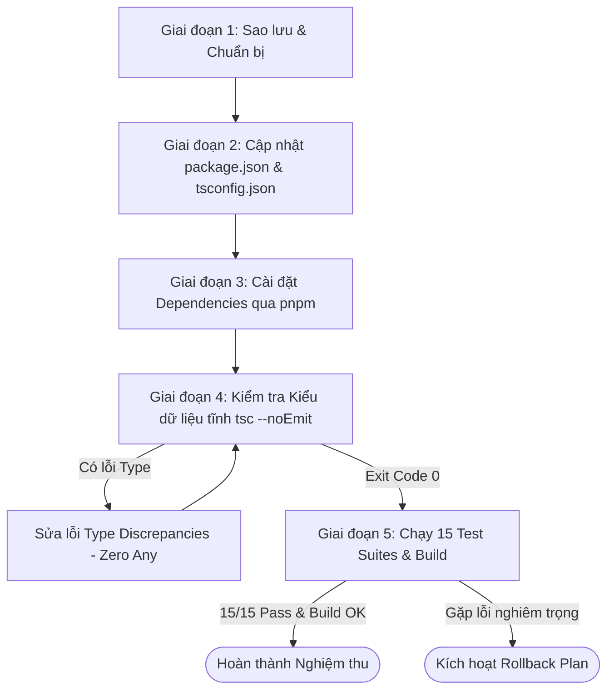

# KẾ HOẠCH TRIỂN KHAI NÂNG CẤP & ĐỒNG BỘ PHIÊN BẢN TYPESCRIPT
## (TYPESCRIPT VERSION UPGRADE & SYNCHRONIZATION IMPLEMENTATION PLAN)

---

### THÔNG TIN TÀI LIỆU
- **Dự án:** Hệ thống AI hỗ trợ phát hiện và xử lý vấn đề về chất lượng dữ liệu *(Full-Stack Data Quality Management Platform with AI Assistance)*
- **Tập tin:** `docs/update_ts_version.md`
- **Phiên bản kế hoạch:** v1.0
- **Dự án mẫu tham chiếu đối chuẩn duy nhất:** `/home/hoa/Documents/BACK-END/Property Rental Management System -project/sgod-rental-management`
- **Ngày lập:** 25/10/2026

---

## 1. Bối cảnh & 3 Câu hỏi Cốt lõi (Rule 1)

- **Đang làm gì?** Thực hiện nâng cấp và đồng bộ hóa phiên bản TypeScript của dự án hiện tại (`src/backend`) từ `typescript: "^5.6.3"` sang cấu hình npm alias tương thích chuẩn dự án mẫu: `"typescript": "npm:@typescript/typescript6@^6.0.2"` và `"@typescript/native": "npm:typescript@^7.0.2"` (nhị phân thực thi `tsc -v` đạt **Version 7.0.2**).
- **Cho ai?** Cho Đội ngũ phát triển, Giảng viên và Người đánh giá dự án để bảo đảm 100% tính đồng nhất về ngăn xếp công nghệ và công cụ biên dịch giữa dự án thực tế và dự án mẫu chuẩn.
- **Để làm gì?**
  - Tận dụng hiệu năng biên dịch vượt trội của trình biên dịch TypeScript Native 7.x.
  - Tối ưu hóa tính tương thích kiến trúc với dự án mẫu `sgod-rental-management`.
  - Kiểm soát và giải quyết triệt để mọi rủi ro về Breaking Changes của TypeScript 7 đối với NestJS Decorator Metadata, `ts-jest` và nguyên tắc bất biến **Zero Any Policy** (Mục 13 WORKING RULE).

---

## 2. Mục tiêu Kỹ thuật & Cấu hình Đích (Target Configuration)

### 2.1. Đối chiếu Thay đổi trong `package.json`

| Gói Phụ thuộc (`devDependencies`) | Phiên bản Hiện tại (`src/backend`) | Cấu hình Đích theo Dự án Mẫu |
| :--- | :--- | :--- |
| `typescript` | `"^5.6.3"` | `"npm:@typescript/typescript6@^6.0.2"` |
| `@typescript/native` | *Chưa khai báo* | `"npm:typescript@^7.0.2"` |
| `ts-jest` | `"^29.4.9"` | `"^29.4.9"` *(Giữ nguyên hoặc cập nhật tương thích)* |
| `@types/node` | `"^20.16.11"` | `"^25.8.0"` *(Đồng bộ nâng cao theo dự án mẫu)* |

### 2.2. Tinh chỉnh Cấu hình Biên dịch trong `tsconfig.json`
Đồng bộ các cờ compiler quan trọng từ dự án mẫu nhằm bảo đảm NestJS Dependency Injection hoạt động trơn tru:
- `experimentalDecorators: true` (Bắt buộc cho NestJS)
- `emitDecoratorMetadata: true` (Bắt buộc cho NestJS runtime injection)
- `target: "ES2022"` (Nâng từ `ES2021` lên `ES2022` như dự án mẫu)
- `moduleResolution: "bundler"` (hoặc `"node"` đảm bảo tương thích đường dẫn)
- `skipLibCheck: true` (Bỏ qua kiểm tra type của thư viện bên thứ ba trong `node_modules`)
- `strict: true`, `noImplicitAny: true`, `strictNullChecks: true` (Giữ nguyên cam kết Zero Any)

---

## 3. Ma trận Rủi ro Tiềm ẩn & Kịch bản Ứng phó (Risks & Mitigations)

| Rủi ro Kỹ thuật | Khả năng | Mức độ | Hậu quả tiềm ẩn | Kịch bản Ứng phó & Giải pháp Kỹ thuật |
| :--- | :---: | :---: | :--- | :--- |
| **Gãy cơ chế Decorator Metadata của NestJS** | Trung bình | Nghiêm trọng | NestJS ném lỗi runtime `Nest can't resolve dependencies...` khi khởi động do không đọc được type qua reflection. | Đảm bảo cờ `emitDecoratorMetadata: true` và `experimentalDecorators: true` trong `tsconfig.json`; kiểm tra kỹ `app.module.ts` và toàn bộ 11 Controller qua test suite `test/guard-coverage.spec.ts`. |
| **Lỗi biên dịch `ts-jest` khi chạy test** | Trung bình | Cao | Lệnh `pnpm test` thất bại do `ts-jest` không hiểu một số cú pháp AST mới của TypeScript 7. | Cấu hình `transform: { '^.+\\.(t\|j)s$': ['ts-jest', { isolatedModules: true, tsconfig: 'tsconfig.json' }] }` trong cấu hình Jest. |
| **Lỗi Type Discrepancies do TS 7 siết chặt type inference** | Cao | Trung bình | Lệnh `tsc --noEmit` ném lỗi `TS2322`, `TS2345` trên các Mongoose Documents hoặc Zod types. | Áp dụng Type Narrowing an toàn (`instanceof`, `typeof`, type predicates `val is T`). **Tuyệt đối không dùng `as any` hay `: any`** để fix lỗi (vi phạm Rule 13). |
| **Xung đột gói khóa `pnpm-lock.yaml`** | Thấp | Trung bình | Lỗi phân giải peer dependency khi thực thi `pnpm install`. | Sử dụng cờ `pnpm install --no-frozen-lockfile` để pnpm tái cấu trúc cây phụ thuộc phù hợp. |

---

## 4. Kịch bản Khôi phục Thất bại (Rollback Plan)
Nếu quá trình nâng cấp gặp sự cố không thể khắc phục hoặc gây ảnh hưởng tiêu cực tới tiến độ:
1. Sao lưu dự phòng các tệp gốc trước khi thực hiện:
   - `src/backend/package.json.bak`
   - `src/backend/tsconfig.json.bak`
   - `src/backend/pnpm-lock.yaml.bak`
2. Lệnh phục hồi tức thì nếu cần hủy bỏ thay đổi:
   ```bash
   cp package.json.bak package.json
   cp tsconfig.json.bak tsconfig.json
   cp pnpm-lock.yaml.bak pnpm-lock.yaml
   pnpm install
   ```

---

## 5. Quy trình Thực thi Chi tiết 5 Giai đoạn (Staged Execution Workflow)



### Giai đoạn 1: Sao lưu Dự phòng (Preparation & Backup)
- Tạo bản sao lưu dự phòng cho `package.json`, `tsconfig.json`, `pnpm-lock.yaml`.
- Kiểm tra nhánh Git hiện tại (`Hoa24102026`) để bảo đảm trạng thái làm việc sạch sẽ.

### Giai đoạn 2: Cập nhật Tệp Cấu hình (Configuration Updates)
- Chỉnh sửa `src/backend/package.json`:
  - Thêm `@typescript/native: "npm:typescript@^7.0.2"`.
  - Cập nhật `typescript: "npm:@typescript/typescript6@^6.0.2"`.
  - Cập nhật `@types/node` lên tương đương dự án mẫu nếu cần thiết.
- Tinh chỉnh `src/backend/tsconfig.json`:
  - Nâng `target: "ES2022"`.
  - Bổ sung `moduleResolution: "bundler"` (hoặc giữ `"node"` nếu bundler gây conflict với ts-node).
  - Giữ vững các cờ kiểm tra nghiêm ngặt `strict: true`, `noImplicitAny: true`.

### Giai đoạn 3: Phân giải & Cài đặt Gói (Package Installation)
- Chạy lệnh `pnpm install --no-frozen-lockfile`.
- Kiểm tra phiên bản thực thi qua:
  ```bash
  ./node_modules/.bin/tsc -v
  ```
  Kỳ vọng: Hiển thị đúng phiên bản mục tiêu (Version 7.0.2).

### Giai đoạn 4: Thẩm định Kiểu Dữ liệu Tĩnh & Tinh chỉnh Code (Type Check)
- Chạy lệnh:
  ```bash
  pnpm run type-check
  ```
- Rà soát từng lỗi biên dịch (nếu có):
  - Thu hẹp kiểu an toàn với Generics và Zod schemas.
  - Tuân thủ 100% **Zero Any Policy** (Mục 13 WORKING RULE). Tuyệt đối không dùng shortcut ép kiểu `any`.

### Giai đoạn 5: Kiểm định Toàn diện & Nghiệm thu (Verification & Build)
- Thực thi kiểm tra Zero Any độc lập:
  ```bash
  pnpm test test/zero-any.spec.ts
  ```
- Thực thi toàn bộ 15 Test Suites hiện hữu:
  ```bash
  pnpm test
  ```
  Kỳ vọng: **15/15 Test Suites PASS**, **70/70 Unit & Integration Tests PASS**.
- Kiểm tra đóng gói ứng dụng:
  ```bash
  pnpm run build
  ```
  Kỳ vọng: Nest CLI biên dịch thành công không cảnh báo (Exit code 0).
- Cập nhật tài liệu tổng quan dự án [`docs/report_over_project.md`](file:///home/hoa/Documents/UTH/Lập%20trình%20JS%20&%20TS/AI%20systems%20support%20detecting%20and%20handling%20data%20quality%20issues%20/docs/report_over_project.md) phản ánh thông số kỹ thuật mới.

---

## 6. Tiêu chí Nghiệm thu Thành công (Acceptance Criteria)

1. Lệnh `./node_modules/.bin/tsc -v` phản ánh phiên bản nhị phân **Version 7.0.2**.
2. Lệnh `pnpm run type-check` (`tsc --noEmit`) đạt **Exit code 0** (0 lỗi biên dịch).
3. Lệnh `pnpm test test/zero-any.spec.ts` đạt **PASS 100%** (Không có bất kỳ vi phạm kiểu `any` nào).
4. Lệnh `pnpm test` đạt **15/15 Test Suites PASS**, **70/70 Tests PASS**.
5. Lệnh `pnpm run build` (`nest build`) đạt **Exit code 0**, mã chạy được sinh đầy đủ vào thư mục `dist/`.
