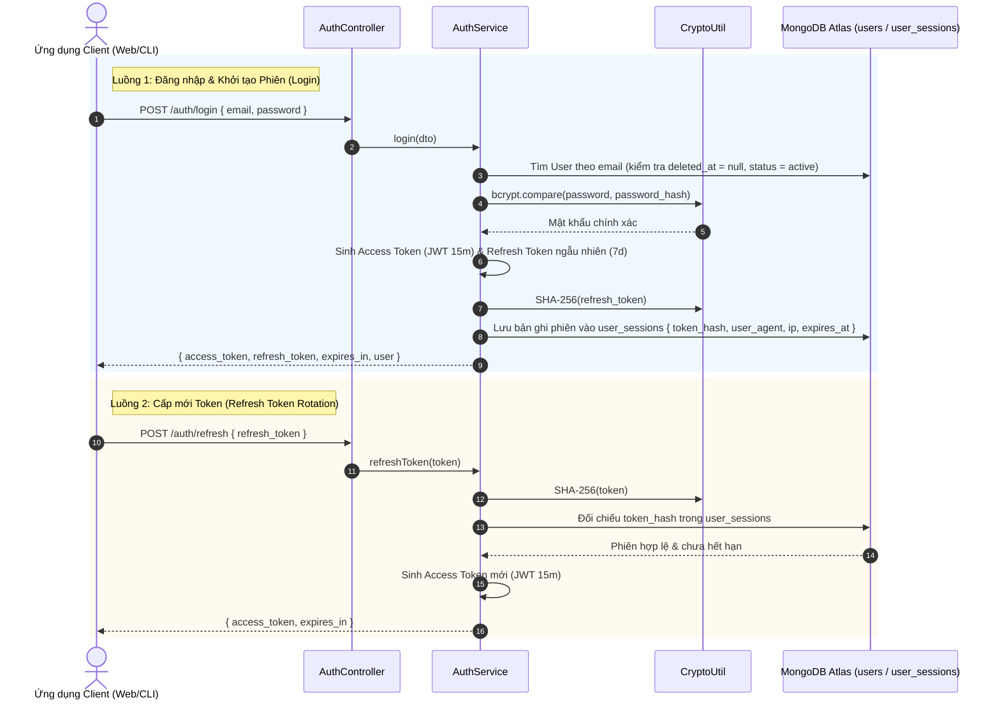

# AUTHENTICATION MODULE SPECIFICATION & OVERVIEW

## 1. Tổng quan & Vị trí trong Hệ sinh thái (Overview & System Context)
Module `auth` là vành đai bảo mật đầu tiên (Security Perimeter) và là nhà cung cấp danh tính (Identity Provider) của toàn bộ nền tảng Data Quality. Module này chịu trách nhiệm xác thực danh tính người dùng, cấp phát và quản lý vòng đời của mã xác thực (Tokens), duy trì các phiên đăng nhập bảo mật và ngăn chặn các hành vi xâm nhập trái phép.

- **Vị trí trong hệ thống:**
  - **Cổng vào Hệ thống:** Mọi yêu cầu HTTP gửi đến API (ngoại trừ các endpoint công khai có đánh dấu `@Public()`) đều phải đi qua `JwtAuthGuard` do module này cung cấp để giải mã và kiểm thực Access Token.
  - **Liên kết Dữ liệu:** Quản lý thông tin phiên làm việc trong collection `user_sessions` và đối chiếu thông tin người dùng trong collection `users` trên **MongoDB Atlas**.
  - **Bảo mật Đa tầng:** Kết hợp mật mã hóa mật khẩu `bcrypt` (12 rounds) và băm một chiều `SHA-256` cho Refresh Token.

---

## 2. Kiến trúc & Chu trình Xác thực Trực quan (Architecture & Auth Flow)
Quy trình Đăng nhập, Duy trì Phiên làm việc và Cấp mới Token:

---

## 3. Khái niệm Cốt lõi & Mô hình Nghiệp vụ (Domain Model & Invariants)

### 3.1. Mô hình Mã xác thực Kép (Dual Token Model)
Nhằm cân bằng giữa tính bảo mật cao và trải nghiệm người dùng không bị gián đoạn:
- **Access Token (Ngắn hạn - 15 phút):** Là JWT chứa thông tin định danh `{ sub: userId, email, role, sessionId }`, được ký bằng khóa bí mật `JWT_SECRET`. Client gửi token này trong header `Authorization: Bearer <token>` để truy cập API mà backend không cần query database mỗi lần kiểm tra.
- **Refresh Token (Dài hạn - 7 ngày):** Là chuỗi ngẫu nhiên có độ entropy cao, được lưu trữ an toàn phía client và dùng để xin cấp lại Access Token mới khi token cũ hết hạn.

### 3.2. Quy tắc Nghiệp vụ Bất biến (Invariants)
- **Băm Một Chiều Refresh Token (Token Storage Invariant):** Backend tuyệt đối không lưu Refresh Token dưới dạng chuỗi thô (plain-text). Chỉ lưu mã băm **`SHA-256`** trong bảng `user_sessions`. Nếu database bị rò rỉ, kẻ tấn công cũng không thể sử dụng mã băm này để mạo danh phiên làm việc.
- **Thu hồi Phiên từ xa (Remote Session Revocation):** Người dùng có thể xem danh sách các thiết bị đang đăng nhập và chủ động xóa phiên làm việc (`DELETE /auth/sessions/:id`). Khi bản ghi phiên trong DB bị xóa, Refresh Token tương ứng sẽ vô hiệu lực ngay lập tức.
- **Tiêu chuẩn Băm Mật khẩu:** 100% mật khẩu được băm bằng thuật toán `bcrypt` với tham số an toàn cao `SALT_ROUNDS = 12`.
- **Chặn Tài khoản Tức thì:** Ngay cả khi Access Token còn hạn, nếu tài khoản bị khóa (`status === 'blocked'`) hoặc đã bị xóa mềm (`deleted_at !== null`), yêu cầu sẽ bị `JwtStrategy` từ chối ngay lập tức.

---

## 4. Ma trận Phân quyền & Endpoint Protection

| Endpoint | Quyền hạn | Cơ chế bảo vệ | Mục đích Nghiệp vụ |
| :--- | :---: | :--- | :--- |
| `POST /api/v1/auth/register` | Công khai | `@Public()` + `ZodValidationPipe` | Đăng ký tài khoản người dùng mới |
| `POST /api/v1/auth/login` | Công khai | `@Public()` + `ZodValidationPipe` | Đăng nhập hệ thống, cấp cặp token |
| `POST /api/v1/auth/refresh` | Công khai | `@Public()` + `ZodValidationPipe` | Cấp mới Access Token bằng Refresh Token |
| `POST /api/v1/auth/logout` | Người dùng đã đăng nhập | `JwtAuthGuard` | Đăng xuất, hủy phiên làm việc hiện tại |
| `GET /api/v1/auth/sessions` | Người dùng đã đăng nhập | `JwtAuthGuard` | Lấy danh sách các phiên thiết bị đang hoạt động |
| `DELETE /api/v1/auth/sessions/:id` | Người dùng đã đăng nhập | `JwtAuthGuard` | Thu hồi từ xa một phiên làm việc chỉ định |

---

## 5. Đánh đổi Kỹ thuật & Lịch sử Phiên bản (Trade-offs & Changelog)

### 5.1. Đánh đổi Kỹ thuật (Technical Trade-offs)
- **Access Token 15 phút không lưu trạng thái (Stateless):** Để tối ưu hóa tốc độ và giảm tải truy vấn MongoDB Atlas, hệ thống không kiểm tra DB đối với từng request gửi Access Token hợp lệ. Đánh đổi: Nếu người dùng đổi mật khẩu hoặc bị thu hồi quyền, Access Token hiện tại vẫn có thể hoạt động tối đa 15 phút cho đến khi hết hạn.
- **Lưu Session trong MongoDB thay vì Redis:** Lựa chọn MongoDB Atlas cho bảng `user_sessions` giúp tinh gọn hạ tầng trong giai đoạn MVP/Gói miễn phí, không phát sinh chi phí duy trì cụm Redis độc lập.

### 5.2. Lịch sử Thay đổi (Change Log)
- `v1.2.0` (2026-10-24):
  - *Thay đổi gì:* Nâng cấp tài liệu sang chuẩn kiến trúc trực quan, bổ sung sơ đồ Mermaid mô tả chu trình Dual Token và cơ chế băm SHA-256 cho session.
  - *Lý do:* Giúp người xem nắm bắt cơ chế bảo mật mà không cần đọc code.
- `v1.1.0` (2026-10-20):
  - *Thay đổi gì:* Chuyển đổi toàn bộ DTO sang Zod Validation Pipe, tách biệt `shared/` module.
- `v1.0.0` (2026-10-20):
  - *Thay đổi gì:* Hoàn thành triển khai xác thực Bcrypt, Passport JWT và Session Management.
