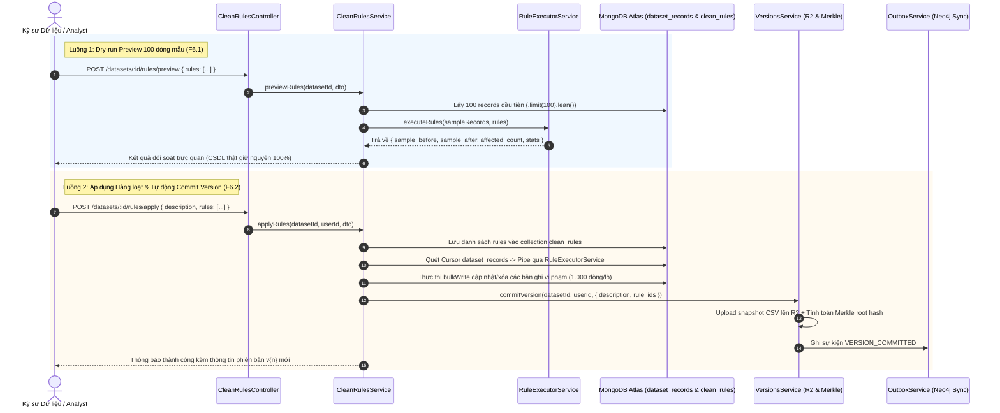

# CLEAN RULES MODULE SPECIFICATION & OVERVIEW

## 1. Tổng quan & Vị trí trong Hệ sinh thái (Overview & System Context)
Module `clean-rules` là Động cơ Làm sạch Dữ liệu Xác định Tầng 1 (Deterministic Cleaning Engine Layer 1) của nền tảng Data Quality. Module này cho phép kỹ sư dữ liệu và chuyên viên phân tích định nghĩa, chạy thử nghiệm (Dry-run preview) và áp dụng hàng loạt các quy tắc làm sạch dữ liệu bảng chuẩn mực mà không cần viết mã lệnh phức tạp.

- **Vị trí trong hệ thống:**
  - **Đầu vào (Input):** Danh sách định nghĩa quy tắc (`rules`), tham số cấu hình, và yêu cầu chạy thử hoặc áp dụng từ phía người dùng.
  - **Tương tác CSDL & Dịch vụ Liên kết:**
    - MongoDB Atlas: Lưu trữ quy tắc trong collection `clean_rules` và cập nhật dữ liệu bảng tại `dataset_records`.
    - `VersionsModule`: Tự động gọi `commitVersion` tạo snapshot CSV trên Cloudflare R2 và tính toán chuỗi băm Merkle `rules_hash`.
    - `OutboxService`: Phát sự kiện `RULES_APPLIED` đồng bộ đồ thị biến đổi sang Neo4j AuraDB.
  - **Đầu ra (Output):** Kết quả đối soát trực quan (sample_before vs sample_after), thống kê số ô/dòng bị ảnh hưởng, và metadata phiên bản mới được commit.

---

## 2. Kiến trúc & Luồng Dữ liệu Trực quan (Architecture & Data Flow)

---

## 3. Khái niệm Cốt lõi & Mô hình Nghiệp vụ (Domain Model & Invariants)

### 3.1. 4 Nhóm Quy tắc Làm sạch Xác định
1. **Null Handling (`null_handling`):**
   - `DROP_ROW`: Loại bỏ toàn bộ dòng nếu cột chỉ định có giá trị `null`, `undefined` hoặc chuỗi rỗng `""`.
   - `FILL_DEFAULT`: Thay thế giá trị thiếu bằng giá trị mặc định được chỉ định (`default_value`).
   - `FILL_MEAN`: Thay thế giá trị thiếu của cột số bằng trung bình cộng (Mean).
   - `FILL_MEDIAN`: Thay thế giá trị thiếu của cột số bằng trung vị (Median), chống nhiễu ngoại lai.
2. **Standardization (`standardization`):**
   - `TRIM`: Cắt khoảng trắng 2 đầu và gộp khoảng trắng liên tiếp bên trong (`replace(/\s+/g, ' ')`).
   - `UPPERCASE`: Chuyển chuỗi sang chữ hoa.
   - `LOWERCASE`: Chuyển chuỗi sang chữ thường.
   - `DATE_FORMAT`: Chuẩn hóa định dạng ngày tháng sang ISO 8601 (`YYYY-MM-DD`).
   - `NUMERIC_CAST`: Loại bỏ ký hiệu tiền tệ/dấu phẩy và ép kiểu về dạng `number`.
3. **Deduplication (`deduplication`):**
   - `DROP_DUPLICATES`: Khử trùng lặp dòng theo tập cột chỉ định (`target_columns`) hoặc toàn bộ dòng, giữ bản ghi đầu tiên (`first`) hoặc cuối cùng (`last`).
4. **Regex Validation & Replacement (`regex`):**
   - `REPLACE_PATTERN`: Thay thế chuỗi khớp biểu thức chính quy (hỗ trợ ẩn PII, format số điện thoại).
   - `FILTER_PATTERN`: Chỉ giữ lại các dòng khớp với mẫu regex (loại bỏ dữ liệu rác).

### 3.2. Quy tắc Nghiệp vụ Bất biến (Invariants)
- **Tính Bất Biến của Dữ liệu Thật khi Preview:** Yêu cầu xem trước F6.1 chỉ đọc dữ liệu bằng `.lean()`, sao chép dữ liệu sâu trong RAM và tuyệt đối không thực hiện bất kỳ lệnh ghi nào vào MongoDB Atlas.
- **Tính Nhất Quán qua Chunk Batch Write:** Quá trình áp dụng F6.2 thực hiện qua `bulkWrite` theo từng lô 1.000 dòng, đảm bảo chỉ số `row_index` tuần tự từ 0 đến $N-1$.
- **Tuân thủ Tuyệt đối Zero Any:** Không sử dụng `any` trong toàn bộ module; sử dụng `Record<string, unknown>`.

---

## 4. Ma trận Phân quyền & Bảo mật (Access Control & Security)

| Hành động | Quyền tối thiểu | Cơ chế kiểm tra bảo mật |
| :--- | :---: | :--- |
| **Xem trước kết quả luật (F6.1)** | `Editor` | `JwtAuthGuard` + `PoliciesGuard` (Action.Execute trên `CleanRule`) |
| **Áp dụng luật hàng loạt (F6.2)** | `Editor` | `JwtAuthGuard` + `PoliciesGuard` (Action.Execute trên `CleanRule`) |
| **Xem lịch sử luật đã lưu (F6.3)** | `Viewer` | `JwtAuthGuard` + `PoliciesGuard` (Action.Read trên `CleanRule`) |

---

## 5. Đặc tả Giao tiếp API (API Specifications)

| Method | Endpoint | Query / Body DTO | Kết quả Phản hồi | Mục đích Nghiệp vụ |
| :---: | :--- | :--- | :--- | :--- |
| `POST` | `/api/v1/datasets/:id/rules/preview` | `PreviewRulesDto` (`rules: [...]`) | `PreviewRulesResultDto` | F6.1: Dry-run chạy thử danh sách luật trên 100 dòng mẫu |
| `POST` | `/api/v1/datasets/:id/rules/apply` | `ApplyRulesDto` (`description`, `rules: [...]`) | `ApplyRulesResultDto` | F6.2: Áp dụng luật hàng loạt & tự động commit version |
| `GET` | `/api/v1/datasets/:id/rules` | Param `:id` | `{ rules: CleanRuleDetailDto[] }` | F6.3: Danh sách lịch sử các luật đã lưu/áp dụng |

---

## 6. Đánh đổi Kỹ thuật & Lịch sử Phiên bản (Trade-offs & Changelog)

### 6.1. Đánh đổi Kỹ thuật (Technical Trade-offs)
- **In-memory Execution vs Database Update Queries:** Động cơ quy tắc chạy in-memory trong RAM Node.js sau đó ghi lại hàng loạt thay vì sinh các câu lệnh MongoDB Aggregation Pipeline `$set` phức tạp.
  - *Ưu điểm:* Đảm bảo logic làm sạch xác định, linh hoạt tuyệt đối cho regex, chuẩn hóa ngày tháng và hỗ trợ Dry-run preview tức thì.
  - *Nhược điểm:* Đòi hỏi quản lý bộ nhớ batch 1.000 dòng để không làm tăng mức tiêu thụ RAM máy chủ.

### 6.2. Lịch sử Thay đổi (Change Log)
- `v1.0.0` (2026-10-25):
  - *Thay đổi gì:* Triển khai toàn diện Module Clean Rules bao gồm 4 nhóm luật xác định, endpoint preview F6.1, apply F6.2, history F6.3, tích hợp commit snapshot Merkle và unit test suite 100% Zero Any.
  - *Lý do:* Hoàn thành mốc Sprint B3 - Module 3 theo kiến trúc chuẩn.
