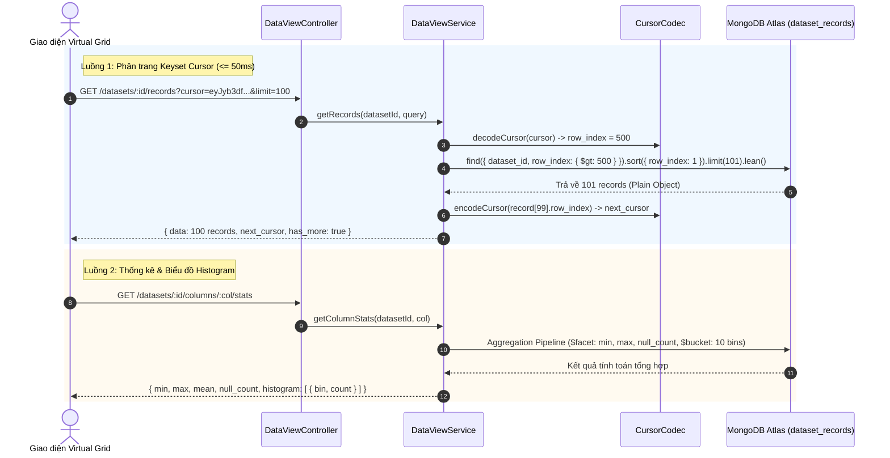

# DATA VIEW MODULE SPECIFICATION & OVERVIEW

## 1. Tổng quan & Vị trí trong Hệ sinh thái (Overview & System Context)
Module `data-view` là động cơ truy xuất và khám phá dữ liệu hiệu năng cao của nền tảng Data Quality. Module này được thiết kế để cấp dữ liệu thời gian thực cho giao diện Lưới Dữ liệu Ảo (Virtual Grid / Infinite Scroll), cho phép người dùng duyệt hàng triệu dòng dữ liệu với độ trễ phản hồi cực thấp ($\le 50\text{ ms}$), chỉnh sửa trực tiếp giá trị từng ô và xem biểu đồ phân phối giá trị cột (Histogram 10 khoảng).

- **Vị trí trong hệ thống:**
  - **Đầu vào (Input):** Yêu cầu phân trang con trỏ (Cursor Pagination), yêu cầu chỉnh sửa ô (Cell Edit) hoặc yêu cầu thống kê cột từ giao diện người dùng.
  - **Tương tác CSDL:** Thao tác trực tiếp trên MongoDB Atlas collection `dataset_records` thông qua chỉ mục kép `{ dataset_id: 1, row_index: 1 }` và các đường ống tổng hợp (Aggregation Pipelines).
  - **Đầu ra (Output):** Danh sách dòng dữ liệu tối ưu hóa bộ nhớ (`.lean()`), con trỏ Base64 tiếp theo (`next_cursor`), và biểu đồ phân phối tần suất giá trị số.

---

## 2. Kiến trúc & Luồng Dữ liệu Trực quan (Architecture & Data Flow)
Hệ thống sử dụng cơ chế **Phân trang Con trỏ Keyset (Keyset / Cursor Pagination)** loại bỏ hoàn toàn hạn chế suy giảm hiệu năng của phương pháp `skip/limit` truyền thống:

---

## 3. Khái niệm Cốt lõi & Mô hình Nghiệp vụ (Domain Model & Invariants)

### 3.1. Phân trang Keyset vs Phân trang Offset
- **Hạn chế của Offset (`skip/limit`):** Khi người dùng cuộn đến dòng thứ 500.000, MongoDB buộc phải duyệt qua toàn bộ 500.000 bản ghi trước đó rồi mới lấy 100 bản ghi tiếp theo, độ phức tạp $O(N)$, gây nghẽn RAM và tăng thời gian phản hồi lên nhiều giây.
- **Giải pháp Keyset Pagination:** Sử dụng điều kiện lọc `{ row_index: { $gt: last_seen_row_index } }` kết hợp sắp xếp `{ row_index: 1 }`. MongoDB nhảy trực tiếp đến vị trí chỉ mục B-Tree với độ phức tạp $O(1)$, giữ độ trễ truy vấn luôn $\le 50\text{ ms}$ bất kể vị trí của dòng dữ liệu trong tệp.

### 3.2. Quy tắc Nghiệp vụ Bất biến (Invariants)
- **Giới hạn kích thước trang (Page Size Guard):** Tham số `limit` được giới hạn tối đa 500 bản ghi/lần gọi để bảo vệ băng thông và dung lượng bộ nhớ Node.js.
- **Toàn vẹn Cấu trúc Cột (Cell Edit Invariant):** Việc sửa ô chỉ được phép thực hiện trên các cột đã được định nghĩa trong siêu dữ liệu `dataset.columns`. Nghiêm cấm chèn thêm trường tùy tiện làm biến dạng cấu trúc bảng.
- **Tối ưu hóa POJO (`.lean()`):** 100% truy vấn đọc dữ liệu sử dụng `.lean()` nhằm giải phóng overhead quản lý Mongoose Document, chuyển đổi kiểu an toàn tuyệt đối theo nguyên tắc Zero Any.

---

## 4. Ma trận Phân quyền & Bảo mật (Access Control & Security)

| Hành động | Quyền tối thiểu | Cơ chế kiểm tra bảo mật |
| :--- | :---: | :--- |
| **Duyệt xem dữ liệu bảng** | `Viewer` | `JwtAuthGuard` + `PoliciesGuard` (Quyền đọc dữ liệu của Workspace) |
| **Xem thống kê & Histogram** | `Viewer` | `JwtAuthGuard` + `PoliciesGuard` (Quyền đọc dữ liệu của Workspace) |
| **Chỉnh sửa ô dữ liệu (In-place Edit)** | `Editor` | `JwtAuthGuard` + `PoliciesGuard` (Quyền chỉnh sửa nội dung tập dữ liệu) |

---

## 5. Đặc tả Giao tiếp API (API Specifications)

| Method | Endpoint | Query / Body DTO | Kết quả Phản hồi | Mục đích Nghiệp vụ |
| :---: | :--- | :--- | :--- | :--- |
| `GET` | `/api/v1/datasets/:id/records` | `limit`, `cursor`, `sort_by`, `sort_dir` | `{ data, next_cursor, has_more }` | Phân trang con trỏ hiển thị Virtual Grid |
| `PATCH` | `/api/v1/datasets/:id/records/:row_index` | `{ column_name, new_value }` | `IDatasetRecord` | Cập nhật trực tiếp giá trị 1 ô tại chỉ số dòng |
| `GET` | `/api/v1/datasets/:id/columns/:col/stats` | Route Params `:id`, `:col` | `ColumnStatsDto` | Thống kê mô tả (Null, Min, Max, Mean) & 10 khoảng Histogram |

---

## 6. Đánh đổi Kỹ thuật & Lịch sử Phiên bản (Trade-offs & Changelog)

### 6.1. Đánh đổi Kỹ thuật (Technical Trade-offs)
- **Mã hóa Con trỏ Base64:** Con trỏ phân trang được mã hóa Base64 chứa `{ row_index, dataset_id }`. Đánh đổi: Client không thể tự ý nhảy cóc đến một trang bất kỳ (như trang 50) mà phải cuộn tuần tự theo luồng dữ liệu liên tục (Infinite Scrolling).
- **MongoDB Aggregation `$bucket` cho Histogram:** Phép tính toán phân cụm 10 khoảng đều nhau (Equi-width Buckets) được thực hiện trực tiếp trên database server thay vì kéo dữ liệu về Node.js để tính toán, giúp tiết kiệm tối đa băng thông mạng.

### 6.2. Lịch sử Thay đổi (Change Log)
- `v1.1.0` (2026-10-24):
  - *Thay đổi gì:* Nâng cấp tài liệu theo chuẩn tổng quan kiến trúc, bổ sung sơ đồ Mermaid minh họa luồng Keyset Cursor và cơ chế thống kê Histogram.
  - *Lý do:* Giúp người xem nắm bắt cơ chế phân trang tốc độ cao mà không cần đọc code.
- `v1.0.0` (2026-10-23):
  - *Thay đổi gì:* Hoàn thành triển khai Keyset Pagination, In-place Cell Edit và Aggregation Stats.
  - *Lý do:* Hiện thực hóa Sprint B2 theo yêu cầu kỹ thuật.
