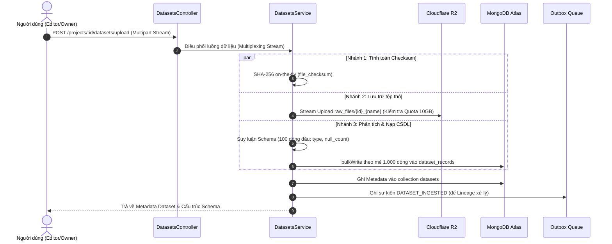

# DATASETS INGESTION MODULE SPECIFICATION & OVERVIEW

## 1. Tổng quan & Vị trí trong Hệ sinh thái (Overview & System Context)
Module `datasets` là cổng tiếp nhận dữ liệu đầu vào (Ingestion Gateway) của toàn bộ nền tảng Data Quality. Module này chịu trách nhiệm tiếp nhận các tệp dữ liệu bảng thô (CSV/Excel) với kích thước từ vài chục đến hàng trăm megabytes, xác thực tính hợp lệ, tính toán tính toàn vẹn và phân phối dữ liệu an toàn vào hạ tầng lưu trữ mà không làm suy giảm hiệu năng hay tràn bộ nhớ máy chủ.

- **Vị trí trong hệ thống:**
  - **Đầu vào (Input):** Người dùng (`Editor` hoặc `Owner`) tải lên tệp CSV/Excel qua REST API Multipart Form.
  - **Hạ tầng lưu trữ:** Tệp thô nguyên bản được lưu trữ trên **Cloudflare R2**; Từng dòng dữ liệu sau phân tách được lưu vào **MongoDB Atlas** (`dataset_records`).
  - **Đầu ra (Output):** Phát sự kiện `DATASET_INGESTED` vào bảng `outbox_events` để kích hoạt dựng đồ thị nguồn gốc dữ liệu bên **LineageModule** và phục vụ hiển thị trên **DataViewModule**.

---

## 2. Kiến trúc & Luồng Dữ liệu Trực quan (Architecture & Data Flow)
Hệ thống sử dụng cơ chế **Truyền phát đa nhánh song song (Multiplexing Stream)**: tệp tải lên được đọc theo từng phân đoạn (chunk-by-chunk) qua `busboy`, nhân bản thành 3 nhánh xử lý độc lập đồng thời trong RAM (duy trì mức tiêu thụ RAM $\le 20\text{ MB}$):

---

## 3. Khái niệm Cốt lõi & Mô hình Nghiệp vụ (Domain Model & Invariants)

### 3.1. Phân tách Thực thể Dữ liệu (Separation of Concerns)
Nhằm tối ưu hóa hiệu năng đọc/ghi, cấu trúc dữ liệu được phân rã thành hai collection độc lập:
- **`datasets` (Metadata):** Lưu thông tin mô tả, kích thước byte, số dòng, trạng thái kiểm tra tính toàn vẹn (`file_checksum`), cấu trúc lược đồ các cột (`columns`: tên cột, kiểu dữ liệu, số lượng null) và liên kết với Project.
- **`dataset_records` (Data Rows):** Lưu từng dòng dữ liệu thô dạng JSON (`raw_data`) kèm chỉ số thứ tự `row_index` để phục vụ phân trang con trỏ (Keyset Pagination) tốc độ cao ở các module sau.

### 3.2. Quy tắc Nghiệp vụ Bất biến (Invariants)
- **Zero In-Memory Storage:** Không bao giờ nạp toàn bộ tệp vào RAM hoặc ghi tệp tạm vào ổ đĩa cục bộ của máy chủ (ngăn ngừa nguy cơ cạn kiệt tài nguyên hệ thống).
- **Hạn mức Lưu trữ (Storage Quota):** Bắt buộc gọi `StorageService.checkUploadQuota()` trước và trong khi stream. Từ chối yêu cầu ngay lập tức với HTTP 413 nếu chạm ngưỡng 10GB của Cloudflare R2.
- **Toàn vẹn Dữ liệu (Checksum Integrity):** `file_checksum` phải khớp chính xác với chuỗi băm SHA-256 tính trực tiếp từ luồng byte thô.
- **Tính Bền vững & Dọn dẹp (Fault Tolerance Rollback):** Nếu việc upload lên R2 gặp sự cố hoặc tệp CSV hỏng cấu trúc giữa chừng, hệ thống tự động xóa sạch toàn bộ các bản ghi đã nạp dở dang trong `dataset_records` để tránh dữ liệu rác.

---

## 4. Ma trận Phân quyền & Bảo mật (Access Control & Security)

| Hành động | Quyền tối thiểu | Cơ chế kiểm tra bảo mật |
| :--- | :---: | :--- |
| **Upload Dataset** | `Editor` | `JwtAuthGuard` + `PoliciesGuard` (Quyền sửa trên Workspace sở hữu Project) |
| **Xem Chi tiết & Metadata** | `Viewer` | `JwtAuthGuard` + `PoliciesGuard` (Quyền đọc dữ liệu trong Workspace) |
| **Đổi tên / Cập nhật mô tả** | `Editor` | `JwtAuthGuard` + `PoliciesGuard` (Chỉ cập nhật thông tin mô tả, không sửa file gốc) |
| **Xóa Dataset (Soft Delete)** | `Editor` | `JwtAuthGuard` + `PoliciesGuard` (Cập nhật `deleted_at`, giải phóng cờ `has_dataset`) |

---

## 5. Đặc tả Giao tiếp & Sự kiện (API & Event Contracts)

### 5.1. REST API Endpoints
| Method | Endpoint | Input | Output Chính | Mô tả Nghiệp vụ |
| :---: | :--- | :--- | :--- | :--- |
| `POST` | `/api/v1/projects/:projectId/datasets/upload` | `multipart/form-data` | `IDataset` (JSON) | Tiếp nhận file stream, phân nhánh lưu trữ và nạp dữ liệu |
| `GET` | `/api/v1/datasets/:id` | Route Param `id` | `IDataset` (JSON) | Trả về thông tin tệp, tổng số dòng và schema các cột |
| `PATCH` | `/api/v1/datasets/:id` | `UpdateDatasetDto` | `IDataset` (JSON) | Chỉnh sửa tên hiển thị và mô tả nghiệp vụ |
| `DELETE` | `/api/v1/datasets/:id` | Route Param `id` | `{ message: string }` | Đánh dấu xóa mềm, ẩn khỏi danh sách truy vấn |

### 5.2. Sự kiện Bất đồng bộ (Asynchronous Events)
- **`DATASET_INGESTED`**: Phát sinh ngay sau khi nạp thành công.
  - *Payload tóm tắt:* `{ dataset_id, project_id, file_checksum, row_count, storage_key }`.
  - *Mục đích:* Báo hiệu cho `OutboxProcessorWorker` đồng bộ tạo Node `Dataset` trên đồ thị phả hệ Neo4j AuraDB.

---

## 6. Đánh đổi Kỹ thuật & Lịch sử Phiên bản (Trade-offs & Changelog)

### 6.1. Đánh đổi Kỹ thuật (Technical Trade-offs)
- **Suy luận Schema trên 100 dòng đầu:** Thay vì quét toàn bộ hàng triệu dòng (gây nghẽn CPU và tăng độ trễ lên hàng chục giây), hệ thống chỉ lấy mẫu 100 dòng đầu tiên để suy luận kiểu dữ liệu (`number`, `string`, `date`, `boolean`). Đánh đổi: Có xác suất nhỏ suy luận sai nếu 100 dòng đầu toàn giá trị rỗng.
- **BulkWrite 1.000 bản ghi/mẻ:** Cân bằng tối ưu giữa kích thước gói tin gửi qua mạng tới MongoDB Atlas và mức tiêu thụ bộ nhớ đệm Node.js.

### 6.2. Lịch sử Thay đổi (Change Log)
- `v1.1.0` (2026-10-24):
  - *Thay đổi gì:* Tái cấu trúc tài liệu theo chuẩn kiến trúc trực quan, bổ sung sơ đồ Mermaid và ma trận bảo mật.
  - *Lý do:* Nâng cao chất lượng tài liệu giúp người xem hiểu toàn diện luồng hoạt động mà không cần đọc code.
  - *Ảnh hưởng:* Cập nhật tài liệu kỹ thuật, không ảnh hưởng đến mã nguồn thực thi.
- `v1.0.0` (2026-10-23):
  - *Thay đổi gì:* Hoàn thành triển khai Ingestion Multiplexing Stream, Schema Inference và kiểm thử.
  - *Lý do:* Hiện thực hóa Sprint B2 theo yêu cầu kỹ thuật.
