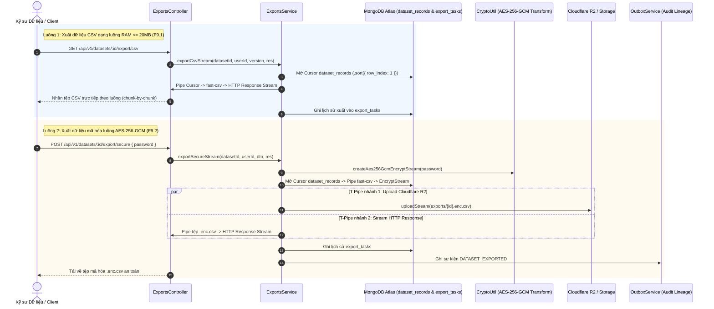

# SECURE EXPORTS MODULE SPECIFICATION & OVERVIEW

## 1. Tổng quan & Vị trí trong Hệ sinh thái (Overview & System Context)
Module `exports` là Phân hệ Xuất Dữ liệu Bảo mật & Mã hóa Luồng (Secure Streaming Export Subsystem) của nền tảng Data Quality. Phân hệ này cung cấp khả năng kết xuất dữ liệu đã được làm sạch sang định dạng CSV thông dụng hoặc đóng gói trong tệp nhị phân mã hóa chuẩn quân sự AES-256-GCM bảo vệ bằng mật khẩu cá nhân.

- **Vị trí trong hệ thống:**
  - **Đầu vào (Input):** Yêu cầu xuất dữ liệu từ người dùng, số phiên bản tập dữ liệu (tùy chọn), và mật khẩu mã hóa (cho F9.2).
  - **Tương tác CSDL & Dịch vụ Liên kết:**
    - MongoDB Atlas: Quét dữ liệu bảng qua Mongoose Cursor từ collection `dataset_records` và lưu trữ lịch sử tác vụ vào `export_tasks`.
    - Cloudflare R2 (`StorageService`): Lưu trữ an toàn tệp bản sao mã hóa tại `exports/{export_id}.enc.csv`.
    - `OutboxService`: Phát sự kiện kiểm toán `DATASET_EXPORTED` phục vụ việc truy xuất nguồn gốc (Lineage Audit).
  - **Đầu ra (Output):** Luồng dữ liệu nhị phân/văn bản trực tiếp tới client (HTTP chunked response) và bản ghi lịch sử xuất dữ liệu.

---

## 2. Kiến trúc & Luồng Dữ liệu Trực quan (Architecture & Data Flow)

---

## 3. Khái niệm Cốt lõi & Mô hình Nghiệp vụ (Domain Model & Invariants)

### 3.1. Cơ chế Tiết kiệm Bộ nhớ (RAM <= 20MB Invariant)
- Sử dụng Mongoose Streaming Cursor kết hợp thư viện `fast-csv` và `stream.PassThrough`.
- Backpressure Handling: Lắng nghe sự kiện `drain` trên Write Stream khi bộ đệm đạt ngưỡng `highWaterMark`, đảm bảo máy chủ không bao giờ bị OOM (Out Of Memory) ngay cả khi xử lý tập dữ liệu hàng triệu dòng.

### 3.2. Tiêu chuẩn Mã hóa Luồng AES-256-GCM
Cấu trúc nhị phân của tệp mã hóa `.enc.csv`:
- `[Magic Header 8B]`: Chuỗi `'DATAQUAL'` định danh chữ ký tệp.
- `[Salt 16B]`: Salt ngẫu nhiên được sinh bằng CSPRNG cho thuật toán PBKDF2.
- `[IV 12B]`: Initialization Vector 96-bit ngẫu nhiên đảm bảo tính duy nhất của cipher stream.
- `[Encrypted Payload]`: Dữ liệu bảng CSV được mã hóa on-the-fly theo từng khối.
- `[Auth Tag 16B]`: Khối kiểm tra tính toàn vẹn GCM Authentication Tag gắn ở cuối luồng tệp.

---

## 4. Đặc tả Hợp đồng Giao tiếp & Danh mục API (API Contracts)

| Method | Endpoint | Quyền hạn CASL | Mô tả chi tiết |
| :---: | :--- | :---: | :--- |
| `GET` | `/api/v1/datasets/:id/export/csv` | `Action.Export` trên `Dataset` | F9.1: Stream xuất dữ liệu CSV trực tiếp sang HTTP Response (RAM $\le 20\text{ MB}$) |
| `POST` | `/api/v1/datasets/:id/export/secure` | `Action.Export` trên `Dataset` | F9.2: Xuất dữ liệu mã hóa AES-256-GCM, lưu R2 và stream tải về |
| `GET` | `/api/v1/datasets/:id/exports` | `Action.Read` trên `ExportTask` | Xem lịch sử các lần xuất dữ liệu của tập dữ liệu |

---

## 5. Quy chuẩn Đặt tên, Cấu trúc Thư mục & Type Safety

- **Thư mục:** Tuân thủ `kebab-case` (`modules/exports/`).
- **Tập tin:**
  - `dto/export.dto.ts`: Zod validation schemas và TypeScript DTO types.
  - `schemas/export-task.schema.ts`: Mongoose schema cho collection `export_tasks`.
  - `exports.repository.ts`: Repository thao tác CSDL kế thừa `BaseMongoRepository<IExportTask>`.
  - `exports.service.ts`: Nghiệp vụ streaming, mã hóa AES-256-GCM, và ghi nhận audit.
  - `exports.controller.ts`: RESTful endpoints có phân quyền CASL và JwtAuthGuard.
  - `exports.module.ts`: Khai báo module và các liên kết phụ thuộc.
- **Tuân thủ Zero Any:** 100% mã nguồn không sử dụng `: any`, `as any`, `<any>`. Thu hẹp kiểu bắt lỗi bằng `catch (err: unknown)`.

---

## 6. Ma trận Rủi ro & Giải pháp Phòng ngừa (Risk & Mitigation)

| Rủi ro Kỹ thuật | Mức độ | Hậu quả tiềm ẩn | Giải pháp phòng ngừa & Kiểm soát |
| :--- | :---: | :--- | :--- |
| **Tràn RAM máy chủ khi xuất bảng dữ liệu lớn** | Nghiêm trọng | Node.js process bị sập (Fatal error: OOM) ảnh hưởng đến toàn bộ người dùng khác. | Tuyệt đối không đọc toàn bộ bảng vào mảng; dùng Mongoose Cursor pipe trực tiếp qua Fast-CSV Stream với xử lý backpressure `drain`. |
| **Mật khẩu mã hóa người dùng quá ngắn hoặc yếu** | Cao | Dễ bị kẻ tấn công vét cạn mật khẩu để đọc trộm dữ liệu. | Ràng buộc Zod Schema bắt buộc mật khẩu tối thiểu 8 ký tự, PBKDF2 cấu hình 100.000 vòng lặp HMAC-SHA-512. |
| **Mất kết nối mạng giữa chừng khi đang stream** | Trung bình | Gây rò rỉ tài nguyên luồng hoặc bản ghi dở dang trên bộ nhớ. | Bắt sự kiện `res.on('error')` và `res.on('close')` để hủy cursor và dọn dẹp Transform stream ngay lập tức. |
