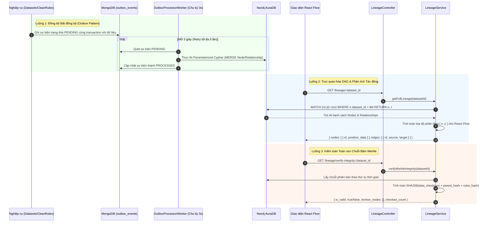

# LINEAGE MODULE SPECIFICATION & OVERVIEW

## 1. Tổng quan & Vị trí trong Hệ sinh thái (Overview & System Context)
Module `lineage` là trung tâm truy vết nguồn gốc và kiểm toán tính toàn vẹn của dữ liệu trên nền tảng Data Quality. Bằng cách mô hình hóa toàn bộ lịch sử biến đổi của dữ liệu dưới dạng **Đồ thị Hướng không chu trình (Directed Acyclic Graph - DAG)** trên CSDL Đồ thị **Neo4j AuraDB**, module này giải quyết ba bài toán cốt lõi:
1. **Truy vết Nguồn gốc (Root Cause Analysis - Upstream):** Khi phát hiện dữ liệu lỗi ở hiện tại, hệ thống truy ngược về quá khứ xem lỗi bắt nguồn từ tệp nạp ban đầu hay do quy tắc làm sạch nào gây ra.
2. **Phân tích Tác động Lan truyền (Downstream Impact Analysis):** Đánh giá xem một sự cố dữ liệu ở bước này sẽ ảnh hưởng đến những báo cáo, phiên bản phái sinh hay mô hình AI nào phía sau.
3. **Kiểm toán Chống Giả mạo (Cryptographic Merkle Integrity Verification):** Sử dụng chuỗi băm Merkle để phát hiện bất kỳ hành vi can thiệp, chỉnh sửa trái phép nào vào dữ liệu trong cơ sở dữ liệu.

- **Vị trí trong hệ thống:**
  - **Đầu vào (Input):** Lắng nghe các sự kiện bất đồng bộ (`DATASET_INGESTED`, `VERSION_COMMITTED`, `RULES_APPLIED`) thông qua Transactional Outbox Pattern từ MongoDB Atlas.
  - **Hạ tầng đồ thị:** Neo4j AuraDB lưu trữ các nút và quan hệ phả hệ.
  - **Đầu ra (Output):** Cấu trúc Node và Edge kèm tọa độ phân tầng hiển thị trực quan trên giao diện **React Flow**.

---

## 2. Kiến trúc & Luồng Dữ liệu Trực quan (Architecture & Data Flow)
Kiến trúc tích hợp giữa MongoDB Atlas và Neo4j AuraDB được phân tách bằng **Outbox Pattern Worker** nhằm đảm bảo độ tin cậy và không phụ thuộc vào giao dịch phân tán 2PC:

---

## 3. Khái niệm Cốt lõi & Mô hình Nghiệp vụ (Domain Model & Invariants)

### 3.1. Mô hình Đồ thị Thực thể trên Neo4j
- **Các loại Node (Đỉnh):**
  - `(:Dataset)`: Đại diện cho tập dữ liệu gốc ban đầu.
  - `(:Version)`: Đại diện cho một phiên bản dữ liệu cố định (Snapshot), lưu `version_hash`, `parent_hash`, `data_checksum`.
  - `(:Transformation)`: Đại diện cho một bước xử lý, làm sạch hoặc chuẩn hóa, lưu danh sách `rule_ids` và `rules_hash`.
- **Các loại Relationship (Cạnh):**
  - `[:DERIVED_FROM]`: Nút phiên bản mới bắt nguồn từ nút phiên bản trước đó.
  - `[:APPLIED_TO]`: Bước chuyển đổi được áp dụng lên phiên bản dữ liệu.

### 3.2. Thuật toán Toàn vẹn Merkle (Merkle Integrity Chain)
- **Phiên bản gốc ($v1$):** `parent_hash = '0000000000000000000000000000000000000000000000000000000000000000'`.
- **Phiên bản tiếp theo ($v_N$):** Bắt buộc thỏa mãn công thức toán học:
  $$\text{version\_hash}_{N} = \text{SHA256}(\text{data\_checksum}_{N} + \text{parent\_hash}_{N} + \text{rules\_hash}_{N})$$
- Nếu bất kỳ bản ghi nào trong cơ sở dữ liệu bị chỉnh sửa lén, `data_checksum` sẽ thay đổi, dẫn đến chuỗi băm Merkle bị đứt gãy ngay lập tức tại phiên bản đó.

---

## 4. Ma trận Phân quyền & Bảo mật (Access Control & Security)

| Hành động | Quyền tối thiểu | Cơ chế kiểm tra bảo mật |
| :--- | :---: | :--- |
| **Xem Đồ thị DAG Phả hệ** | `Viewer` | `JwtAuthGuard` + `PoliciesGuard` (Quyền đọc dữ liệu trong Workspace) |
| **Truy vết Root Cause (Upstream)** | `Viewer` | `JwtAuthGuard` + `PoliciesGuard` (Quyền đọc dữ liệu trong Workspace) |
| **Phân tích Tác động (Downstream)** | `Viewer` | `JwtAuthGuard` + `PoliciesGuard` (Quyền đọc dữ liệu trong Workspace) |
| **Thực hiện Kiểm toán Merkle** | `Viewer` / Auditor | `JwtAuthGuard` + `PoliciesGuard` (Quyền kiểm toán tính toàn vẹn) |

### Bảo mật Chống Tấn công Cypher Injection
100% câu lệnh truy vấn Cypher đều sử dụng **Truy vấn Tham số hóa (Parameterized Cypher Queries)** với cú pháp `$dataset_id`, `$node_id`. Nghiêm cấm hoàn toàn việc nối chuỗi (String Concatenation) trong mã nguồn.

---

## 5. Đặc tả Giao tiếp API (API Specifications)

| Method | Endpoint | Query / Body DTO | Kết quả Phản hồi | Mục đích Nghiệp vụ |
| :---: | :--- | :--- | :--- | :--- |
| `GET` | `/api/v1/lineage/:dataset_id` | Param `dataset_id` | `LineageGraphResponseDto` | Cung cấp DAG Nodes & Edges đã tính tọa độ cho React Flow |
| `GET` | `/api/v1/lineage/node/:id/upstream` | Param Node `id` | `UpstreamResponseDto` | Truy vết ngược tìm nguyên nhân gốc rễ (Root Cause) |
| `GET` | `/api/v1/lineage/node/:id/downstream` | Param Node `id` | `DownstreamResponseDto` | Truy vết xuôi phân tích phạm vi ảnh hưởng lan truyền |
| `GET` | `/api/v1/lineage/verify-integrity/:dataset_id` | Param `dataset_id` | `VerifyIntegrityResponseDto` | Đối soát chuỗi băm Merkle, phát hiện giả mạo dữ liệu |

---

## 6. Đánh đổi Kỹ thuật & Lịch sử Phiên bản (Trade-offs & Changelog)

### 6.1. Đánh đổi Kỹ thuật (Technical Trade-offs)
- **Mức độ trừu tượng của Node Đồ thị:** Hệ thống gom nhóm và quản lý Node ở cấp độ **Dataset / Version / Transformation** thay vì lưu từng ô dữ liệu (Cell-level Lineage). Đánh đổi: Không thể xem từng ô dữ liệu nhảy sang ô nào, nhưng giữ cho đồ thị Neo4j gọn nhẹ, không bị vượt ngưỡng hạn ngạch 200.000 nodes của gói Neo4j AuraDB Free Tier.
- **Tách biệt Outbox Polling Worker:** Chấp nhận độ trễ đồng bộ tối đa 3 giây để đổi lấy việc không bị lỗi dây chuyền (fault isolation) nếu kết nối internet tới Neo4j AuraDB tạm thời bị gián đoạn.

### 6.2. Lịch sử Thay đổi (Change Log)
- `v1.1.0` (2026-10-24):
  - *Thay đổi gì:* Nâng cấp tài liệu sang chuẩn kiến trúc trực quan, bổ sung sơ đồ Mermaid 3 luồng và công thức toán học Merkle.
  - *Lý do:* Giúp người xem nắm bắt cơ chế đồ thị và kiểm toán toàn vẹn mà không cần đọc code.
- `v1.0.0` (2026-10-24):
  - *Thay đổi gì:* Hoàn thành triển khai Cypher Queries, Outbox Processor Worker, Lineage Service và Unit Tests.
  - *Lý do:* Hiện thực hóa Sprint B3 Module 1 theo kế hoạch kỹ thuật.
