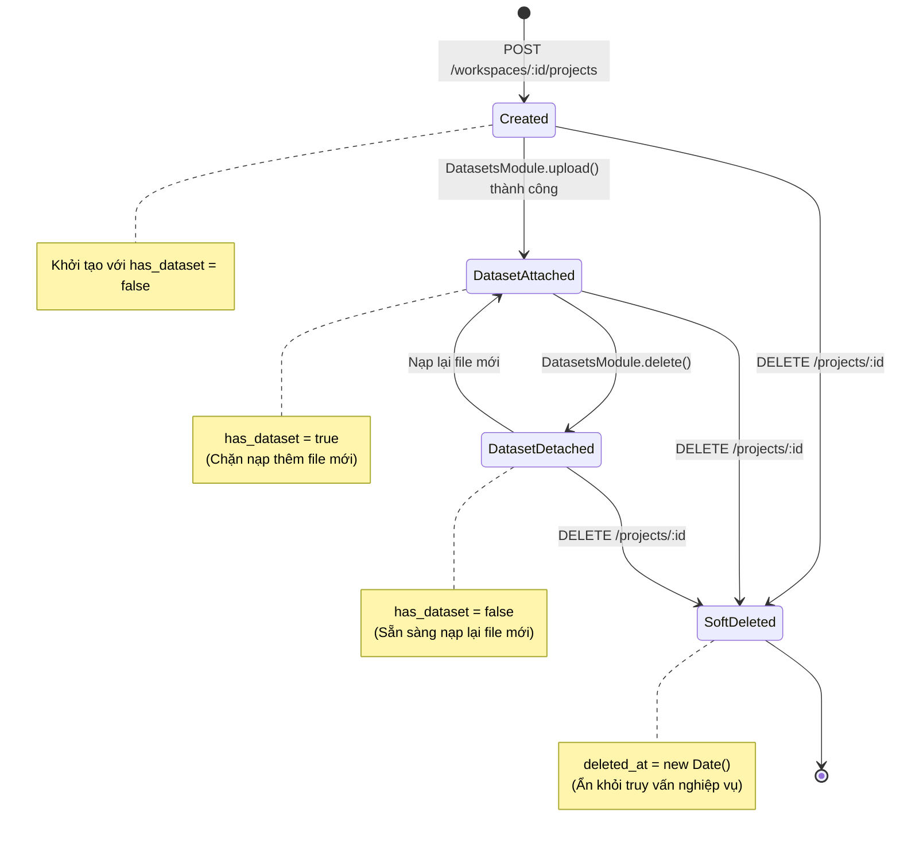

# PROJECTS MODULE SPECIFICATION & OVERVIEW

## 1. Tổng quan & Vị trí trong Hệ sinh thái (Overview & System Context)
Module `projects` đóng vai trò là tầng tổ chức nghiệp vụ trung gian trực thuộc Không gian làm việc (`workspaces`). Một Dự án (Project) đại diện cho một sáng kiến hoặc một bài toán chất lượng dữ liệu cụ thể (ví dụ: "Làm sạch dữ liệu khách hàng CRM", "Chuẩn hóa danh mục sản phẩm E-commerce"). Module này quản lý vòng đời của dự án và ràng buộc gắn kết với tập dữ liệu nguồn.

- **Vị trí trong hệ thống:**
  - **Mối quan hệ Phân cấp:** Trực thuộc `workspaces` (Quan hệ $1 - N$: một Workspace chứa nhiều Project).
  - **Liên kết Dữ liệu:** Mỗi Project liên kết chặt chẽ với một tập dữ liệu nguồn duy nhất thông qua cờ trạng thái `has_dataset`.
  - **Hạ tầng lưu trữ:** Collection `projects` trên **MongoDB Atlas** với chỉ mục một phần (Partial Unique Index) chống trùng lặp tên dự án trong cùng Workspace.

---

## 2. Kiến trúc & Vòng đời Dự án Trực quan (Architecture & Project Lifecycle)
Sơ đồ chuyển đổi trạng thái của Project và sự gắn kết với Dataset:

---

## 3. Khái niệm Cốt lõi & Mô hình Nghiệp vụ (Domain Model & Invariants)

### 3.1. Ràng buộc Một Tập dữ liệu cho Mỗi Dự án (Single Dataset Invariant)
Nhằm đơn giản hóa quy trình kiểm toán phả hệ (Lineage DAG) và phân tích chất lượng dữ liệu, mỗi Project được thiết kế để xử lý duy nhất **một nguồn dữ liệu bảng tại một thời điểm**:
- Khi mới tạo: `has_dataset = false`.
- Khi người dùng tải lên tệp CSV/Excel: Cờ chuyển thành `has_dataset = true`. Mọi yêu cầu nạp thêm tệp thứ hai vào Project này sẽ bị từ chối với mã lỗi HTTP 400.
- Khi tệp dữ liệu bị xóa mềm: Cờ được giải phóng về `false`, cho phép người dùng nạp tệp mới.

### 3.2. Quy tắc Nghiệp vụ Bất biến (Invariants)
- **Ranh giới Workspace (Tenancy Isolation):** Project luôn phải thuộc về một Workspace hợp lệ và còn hoạt động (`deleted_at === null`). Người dùng không thuộc Workspace tuyệt đối không thể nhìn thấy hoặc thao tác trên Project.
- **Tính Duy nhất của Tên Dự án (Partial Unique Index):** Trong cùng một Workspace, không thể có hai Project trùng tên cùng hoạt động. Chỉ mục MongoDB Atlas:
  `{ name: 1, workspace_id: 1 }, { unique: true, partialFilterExpression: { deleted_at: null } }`.
- **Chuẩn hóa Xóa mềm (Soft Delete Invariant):** Việc xóa Project chỉ đánh dấu mốc thời gian `deleted_at`. Không xóa vật lý để đảm bảo an toàn truy vết lịch sử.

---

## 4. Ma trận Phân quyền (Access Control Matrix)

| Hành động | Quyền tối thiểu | Cơ chế kiểm tra bảo mật |
| :--- | :---: | :--- |
| **Xem danh sách & Chi tiết Project** | `Viewer` | `JwtAuthGuard` + `PoliciesGuard` (Quyền đọc của Workspace) |
| **Tạo Dự án mới** | `Editor` | `JwtAuthGuard` + `PoliciesGuard` (Quyền sửa của Workspace) |
| **Chỉnh sửa thông tin Dự án** | `Editor` | `JwtAuthGuard` + `PoliciesGuard` (Quyền sửa của Workspace) |
| **Xóa mềm Dự án (Soft Delete)** | `Editor` / `Owner` | `JwtAuthGuard` + `PoliciesGuard` (Quyền quản trị của Workspace) |

---

## 5. Đặc tả Giao tiếp API (API Specifications)

| Method | Endpoint | Quyền hạn | Input DTO | Phản hồi Chính | Mô tả Nghiệp vụ |
| :---: | :--- | :---: | :--- | :--- | :--- |
| `POST` | `/api/v1/workspaces/:workspaceId/projects` | Editor/Owner | `CreateProjectDto` | `IProject` | Tạo mới dự án trong Workspace |
| `GET` | `/api/v1/workspaces/:workspaceId/projects` | Member | Param `:workspaceId` | `IProject[]` | Lấy danh sách dự án trong Workspace |
| `GET` | `/api/v1/projects/:id` | Member | Param `:id` | `IProject` | Lấy thông tin chi tiết của dự án |
| `PATCH` | `/api/v1/projects/:id` | Editor/Owner | `UpdateProjectDto` | `IProject` | Cập nhật tên hoặc mô tả dự án |
| `DELETE` | `/api/v1/projects/:id` | Editor/Owner | Param `:id` | `{ message }` | Xóa mềm dự án (`deleted_at = new Date()`) |

---

## 6. Đánh đổi Kỹ thuật & Lịch sử Phiên bản (Trade-offs & Changelog)

### 6.1. Đánh đổi Kỹ thuật (Technical Trade-offs)
- **Ràng buộc Single Dataset trên Project:** Lựa chọn giới hạn 1 Dataset/Project thay vì cho phép 1 Project chứa nhiều Datasets giúp giữ cho cấu trúc phả hệ Lineage DAG và cơ chế quản lý phiên bản Merkle rõ ràng, không bị phân nhánh quá phức tạp trong giai đoạn hiện tại.

### 6.2. Lịch sử Thay đổi (Change Log)
- `v1.1.0` (2026-10-24):
  - *Thay đổi gì:* Nâng cấp tài liệu sang chuẩn kiến trúc trực quan, bổ sung sơ đồ chuyển đổi trạng thái (State Diagram) và giải thích ràng buộc `has_dataset`.
  - *Lý do:* Giúp người xem nắm bắt vai trò cầu nối của Project giữa Workspace và Dataset mà không cần đọc code.
- `v1.0.0` (2026-10-23):
  - *Thay đổi gì:* Hoàn thành triển khai CRUD Project, quản lý cờ `has_dataset` và kiểm thử bảo vệ CASL.
  - *Lý do:* Hiện thực hóa Sprint B2 theo yêu cầu kỹ thuật.
