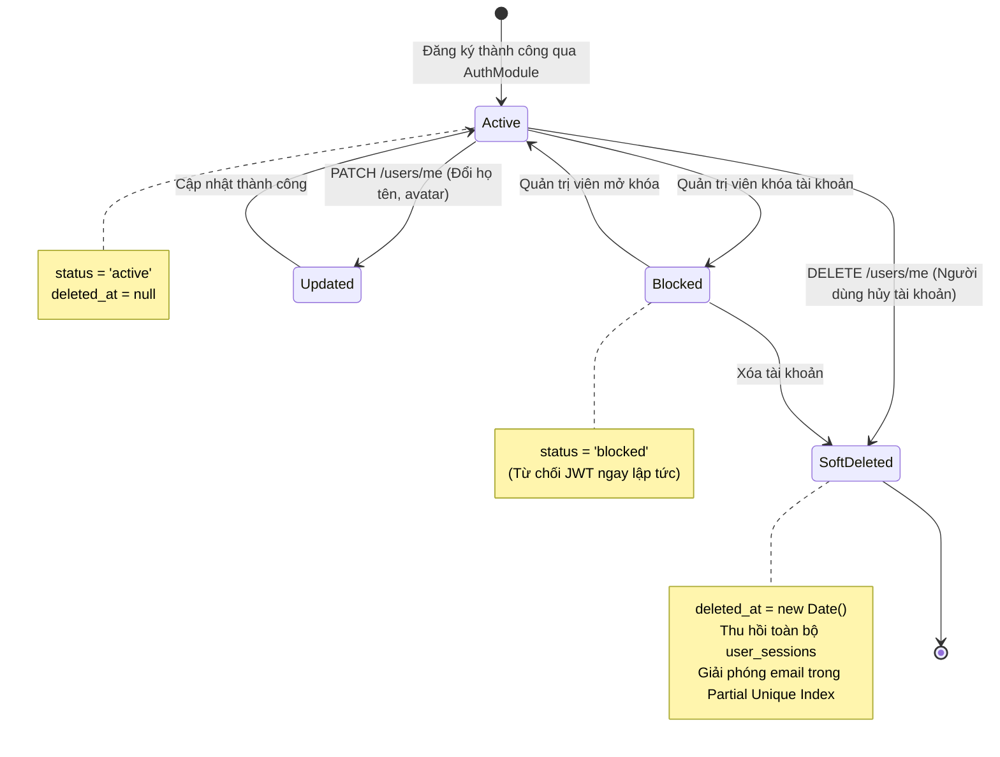

# USERS MODULE SPECIFICATION & OVERVIEW

## 1. Tổng quan & Vị trí trong Hệ sinh thái (Overview & System Context)
Module `users` chịu trách nhiệm quản lý thông tin tài khoản người dùng, hồ sơ cá nhân và vòng đời trạng thái hoạt động trong hệ thống. Module này cung cấp thực thể định danh cốt lõi cho mọi hành vi trong nền tảng: từ việc gán quyền trong Không gian làm việc (`workspaces`), ghi nhận tác giả tạo dự án (`projects`), cho đến truy vết ai đã áp dụng quy tắc làm sạch dữ liệu.

- **Vị trí trong hệ thống:**
  - **Cung cấp Danh tính:** Cung cấp thông tin xác thực cho `AuthModule` và thông tin thành viên cho `WorkspacesModule`.
  - **Hạ tầng lưu trữ:** Collection `users` trên **MongoDB Atlas** với cơ chế bảo vệ trường nhạy cảm và chỉ mục một phần (Partial Unique Index).
  - **Ràng buộc Toàn vẹn:** Tự động đồng bộ trạng thái tài khoản với bảng quản lý phiên `user_sessions`.

---

## 2. Kiến trúc & Vòng đời Tài khoản Trực quan (Architecture & User Lifecycle)
Sơ đồ trạng thái vòng đời của một tài khoản và cơ chế thu hồi phiên khi xóa mềm:

---

## 3. Khái niệm Cốt lõi & Mô hình Nghiệp vụ (Domain Model & Invariants)

### 3.1. Bảo vệ Trường Nhạy cảm (Field-level Security)
- **Ẩn Mật khẩu Mặc định (`select: false`):** Trường `password_hash` được cấu hình ẩn ở mức Schema của Mongoose. Mọi truy vấn lấy thông tin người dùng (`find`, `findById`) đều không bao gồm trường mật khẩu trừ khi hàm xác thực nội bộ gọi tường minh `.select('+password_hash')`.
- **Phân tách Vai trò Hệ thống vs Vai trò Workspace:** Trường `role` trong User đại diện cho vai trò toàn hệ thống (`user`, `superadmin`), hoàn toàn độc lập với vai trò cục bộ trong từng Workspace (`owner`, `editor`, `viewer`).

### 3.2. Quy tắc Nghiệp vụ Bất biến (Invariants)
- **Chuẩn hóa Xóa mềm (`deleted_at`):** Tuyệt đối không sử dụng cờ boolean `is_deleted`. Bắt buộc dùng `deleted_at: Date | null`. Mọi truy vấn nghiệp vụ thông thường mặc định bắt buộc lọc `{ deleted_at: null }`.
- **Tái Đăng ký Email nhờ Chỉ mục Một phần (Partial Unique Index):** Nếu một tài khoản bị xóa mềm, địa chỉ email đó có thể được sử dụng lại để đăng ký tài khoản mới. Chỉ mục MongoDB Atlas:
  `{ email: 1 }, { unique: true, partialFilterExpression: { deleted_at: null } }`.
- **Đồng bộ Thu hồi Phiên (Cascade Session Revocation):** Khi tài khoản bị xóa mềm hoặc khóa, toàn bộ các phiên làm việc đang mở trong bảng `user_sessions` đều bị đánh dấu vô hiệu lực (`is_revoked = true`) để chặn đứng phiên truy cập ngay tức khắc.

---

## 4. Ma trận Phân quyền (Access Control Matrix)

| Hành động | Quyền tối thiểu | Cơ chế bảo vệ |
| :--- | :---: | :--- |
| **Xem hồ sơ của tôi (`/users/me`)** | Người dùng đã đăng nhập | `JwtAuthGuard` (Lấy thông tin từ `req.user.sub`) |
| **Cập nhật hồ sơ (`PATCH /users/me`)** | Người dùng đã đăng nhập | `JwtAuthGuard` + `ZodValidationPipe` |
| **Xóa mềm tài khoản (`DELETE /users/me`)** | Người dùng đã đăng nhập | `JwtAuthGuard` (Đánh dấu xóa mềm và hủy session) |

---

## 5. Đặc tả Giao tiếp API (API Specifications)

| Method | Endpoint | Quyền hạn | Input DTO | Phản hồi Chính | Mô tả Nghiệp vụ |
| :---: | :--- | :---: | :--- | :--- | :--- |
| `GET` | `/api/v1/users/me` | Bearer JWT | N/A | `IUser` (Không gồm password) | Lấy thông tin hồ sơ của tài khoản hiện tại |
| `PATCH` | `/api/v1/users/me` | Bearer JWT | `UpdateUserDto` | `IUser` | Cập nhật họ, tên, thông tin hiển thị |
| `DELETE` | `/api/v1/users/me` | Bearer JWT | N/A | `{ message }` | Xóa mềm tài khoản và thu hồi các phiên active |

---

## 6. Đánh đổi Kỹ thuật & Lịch sử Phiên bản (Trade-offs & Changelog)

### 6.1. Đánh đổi Kỹ thuật (Technical Trade-offs)
- **Xóa mềm kết hợp Partial Index:** Việc giữ lại bản ghi sau khi xóa giúp duy trì tính toàn vẹn khóa ngoại (Foreign Key Integrity) cho các bảng lịch sử audit log, nhưng yêu cầu mọi câu lệnh tìm kiếm đều phải có điều kiện lọc `{ deleted_at: null }`.

### 6.2. Lịch sử Thay đổi (Change Log)
- `v1.2.0` (2026-10-24):
  - *Thay đổi gì:* Nâng cấp tài liệu sang chuẩn kiến trúc trực quan, bổ sung sơ đồ Mermaid mô tả vòng đời tài khoản và giải thích cơ chế Partial Index.
  - *Lý do:* Giúp người xem nắm bắt mô hình quản lý người dùng mà không cần đọc code.
- `v1.1.0` (2026-10-20):
  - *Thay đổi gì:* Chuyển đổi `UpdateUserDto` sang Zod schema, kết nối `ZodValidationPipe`.
- `v1.0.0` (2026-10-20):
  - *Thay đổi gì:* Khởi tạo schema User, UserSession và các endpoints hồ sơ cá nhân.
