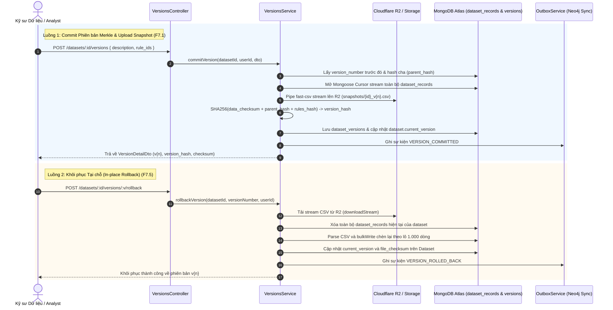

# VERSIONS MODULE SPECIFICATION & OVERVIEW

## 1. Tổng quan & Vị trí trong Hệ sinh thái (Overview & System Context)
Module `versions` đảm nhiệm chức năng Kiểm soát Phiên bản Mật mã học (Cryptographic Version Control) cho các tập dữ liệu trong hệ thống. Module này cho phép ghi lại dấu vết biến đổi dữ liệu theo chuỗi băm Merkle bất biến (Merkle Chaining), lưu trữ bản sao lưu CSV nén (Snapshot) trên Cloudflare R2, so sánh sai khác giữa các phiên bản (Diff) và khôi phục dữ liệu tại chỗ (In-place Rollback) với độ tin cậy tuyệt đối.

- **Vị trí trong hệ thống:**
  - **Đầu vào (Input):** Yêu cầu commit phiên bản kèm danh sách mã quy tắc làm sạch (`rule_ids`), yêu cầu tra cứu lịch sử phiên bản, yêu cầu so sánh sai khác (`diff?v1=X&v2=Y`), và yêu cầu khôi phục (`rollback`).
  - **Tương tác CSDL & Cloud Storage:**
    - MongoDB Atlas: Lưu trữ metadata phiên bản tại collection `dataset_versions` và toàn bộ các dòng dữ liệu tại `dataset_records`.
    - Cloudflare R2: Lưu trữ snapshot tệp CSV (`snapshots/{dataset_id}_v{version_number}.csv`).
    - Outbox Pattern: Phát sinh các sự kiện `VERSION_COMMITTED` và `VERSION_ROLLED_BACK` để đồng bộ đồ thị nguồn gốc (Lineage Graph) sang Neo4j AuraDB.
  - **Đầu ra (Output):** Thông tin phiên bản chuẩn hóa (`VersionDetailDto`), kết quả đối soát cấu trúc và dữ liệu (`VersionDiffResult`), cùng trạng thái khôi phục dữ liệu.

---

## 2. Kiến trúc & Luồng Dữ liệu Trực quan (Architecture & Data Flow)

---

## 3. Khái niệm Cốt lõi & Mô hình Nghiệp vụ (Domain Model & Invariants)

### 3.1. Chuỗi Băm Merkle Bất biến (Merkle Hash Chaining)
Mỗi phiên bản được định danh duy nhất thông qua một chuỗi băm mật mã học độ dài 64 ký tự hex (SHA-256):
$$\text{version\_hash} = \text{SHA-256}(\text{data\_checksum} + \text{parent\_hash} + \text{rules\_hash})$$

- **$\text{data\_checksum}$:** Mã băm SHA-256 tính toán trực tiếp trên toàn bộ nội dung dòng của tệp snapshot CSV khi được trích xuất.
- **$\text{parent\_hash}$:** `version_hash` của phiên bản liền trước. Phiên bản khởi tạo đầu tiên ($v1$) có $\text{parent\_hash} = \text{"0"}^{64}$.
- **$\text{rules\_hash}$:** Mã băm SHA-256 của danh sách mã quy tắc làm sạch (`rule_ids`) đã được sắp xếp tăng dần, đảm bảo tính tất định (Deterministic). Nếu không áp dụng quy tắc nào, $\text{rules\_hash} = \text{"0"}^{64}$.

Bất kỳ sự thay đổi trái phép nào đối với dữ liệu lịch sử hoặc thứ tự phiên bản đều làm gãy chuỗi Merkle, cho phép hệ thống phát hiện hành vi gian lận dữ liệu tức thì.

### 3.2. Quy tắc Nghiệp vụ Bất biến (Invariants)
- **Tính Bất Biến của Snapshot (Snapshot Immutability):** Tệp sao lưu trên Cloudflare R2 sau khi ghi sẽ không bao giờ bị chỉnh sửa hoặc ghi đè. Mọi biến đổi dữ liệu đều phải tạo phiên bản kế tiếp ($v_{n+1}$).
- **Bảo toàn Số lượng Dòng khi Rollback:** Quá trình khôi phục tại chỗ thực hiện xóa tập bản ghi cũ và tái nạp nguyên vẹn số dòng từ snapshot theo từng lô 1.000 bản ghi bằng `bulkWrite`, bảo toàn chỉ số `row_index` từ 0 đến $N-1$.
- **Tuân thủ Tuyệt đối Zero Any:** Không sử dụng kiểu dữ liệu `any` trong toàn bộ service, controller, repository và test suites.

---

## 4. Ma trận Phân quyền & Bảo mật (Access Control & Security)

| Hành động | Quyền tối thiểu | Cơ chế kiểm tra bảo mật |
| :--- | :---: | :--- |
| **Commit phiên bản mới (F7.1)** | `Editor` | `JwtAuthGuard` + `PoliciesGuard` (Action.Create trên `DatasetVersion`) |
| **Xem danh sách phiên bản (F7.2)** | `Viewer` | `JwtAuthGuard` + `PoliciesGuard` (Action.Read trên `DatasetVersion`) |
| **Xem chi tiết phiên bản (F7.3)** | `Viewer` | `JwtAuthGuard` + `PoliciesGuard` (Action.Read trên `DatasetVersion`) |
| **So sánh sai khác giữa 2 phiên bản (F7.4)** | `Viewer` | `JwtAuthGuard` + `PoliciesGuard` (Action.Read trên `DatasetVersion`) |
| **Khôi phục tại chỗ (Rollback) (F7.5)** | `Editor` | `JwtAuthGuard` + `PoliciesGuard` (Action.Update trên `DatasetVersion`) |

---

## 5. Đặc tả Giao tiếp API (API Specifications)

| Method | Endpoint | Query / Body DTO | Kết quả Phản hồi | Mục đích Nghiệp vụ |
| :---: | :--- | :--- | :--- | :--- |
| `POST` | `/api/v1/datasets/:id/versions` | `CommitVersionDto` (`description`, `rule_ids`) | `{ message, version: VersionDetailDto }` | F7.1: Tạo snapshot CSV & commit phiên bản Merkle |
| `GET` | `/api/v1/datasets/:id/versions` | `ListVersionsQueryDto` (`limit`, `skip`) | `{ items: VersionDetailDto[], total }` | F7.2: Danh sách lịch sử các phiên bản |
| `GET` | `/api/v1/datasets/:id/versions/diff` | `DiffVersionsQueryDto` (`v1`, `v2`) | `{ diff: VersionDiffResult }` | F7.4: So sánh sai khác cấu trúc, dòng và rules |
| `GET` | `/api/v1/datasets/:id/versions/:versionNumber` | Param `:versionNumber` | `{ version: VersionDetailDto }` | F7.3: Chi tiết một phiên bản cụ thể |
| `POST` | `/api/v1/datasets/:id/versions/:versionNumber/rollback` | Param `:versionNumber` | `{ message, version: VersionDetailDto }` | F7.5: Khôi phục tại chỗ về phiên bản snapshot |

---

## 6. Đánh đổi Kỹ thuật & Lịch sử Phiên bản (Trade-offs & Changelog)

### 6.1. Đánh đổi Kỹ thuật (Technical Trade-offs)
- **T-Pipe Streaming vs Temporary Local Disk:** Dữ liệu records từ Mongoose cursor được pipe trực tiếp qua `fast-csv`, vừa tính toán mã băm SHA-256 song song vừa truyền thẳng lên Cloudflare R2 mà không lưu tệp trung gian vào ổ đĩa local.
  - *Ưu điểm:* Tiết kiệm IOPS ổ đĩa, không sợ tràn ổ cứng server khi dataset có hàng triệu bản ghi.
  - *Nhược điểm:* Đòi hỏi cơ chế xử lý sự kiện `drain` / backpressure chặt chẽ để không gây nghẽn RAM Node.js.
- **Rollback via Re-inserting vs In-place Diff Patching:** Thay vì lưu chuỗi Delta / Patch phức tạp, hệ thống lưu full CSV snapshot cho mỗi commit và xóa/nạp lại theo chunk 1.000 dòng.
  - *Ưu điểm:* Đảm bảo tính toán toàn vẹn $100\%$ không bị lệch lỗi cộng dồn (drift), truy xuất lịch sử cực nhanh.
  - *Nhược điểm:* Tốn thêm dung lượng lưu trữ trên Cloudflare R2 (được bù đắp nhờ chi phí lưu trữ R2 rất rẻ và không tính phí egress).

### 6.2. Lịch sử Thay đổi (Change Log)
- `v1.0.0` (2026-10-25):
  - *Thay đổi gì:* Triển khai toàn diện Module Versions bao gồm F7.1 $\rightarrow$ F7.5, tích hợp Merkle root hash, R2 streaming snapshot, Outbox event và unit test suite 100% Zero Any.
  - *Lý do:* Hoàn thành mốc Sprint B3 - Module 2 theo kiến trúc chuẩn.
