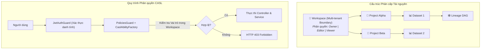

# WORKSPACES MODULE SPECIFICATION & OVERVIEW

## 1. Tổng quan & Vị trí trong Hệ sinh thái (Overview & System Context)
Module `workspaces` là ranh giới cô lập dữ liệu cấp cao nhất (Multi-tenancy Boundary) của toàn bộ nền tảng Data Quality. Mỗi Không gian làm việc (Workspace) đóng vai trò là một môi trường làm việc độc lập dành cho một nhóm hoặc tổ chức, chịu trách nhiệm quản lý tài nguyên, phân quyền thành viên và kiểm soát phạm vi truy cập dữ liệu.

- **Vị trí trong hệ thống:**
  - **Mô hình Phân cấp (Resource Hierarchy):** `Workspace` $\rightarrow$ chứa nhiều `Project` $\rightarrow$ mỗi Project liên kết với `Dataset` và các biến thể làm sạch.
  - **Kiểm soát Quyền hạn (Authorization):** Tích hợp với **CASL Ability** để xác định người dùng có quyền thực hiện các thao tác (đọc, tạo, sửa, xóa) trên các tài nguyên trực thuộc Workspace hay không.
  - **Hạ tầng lưu trữ:** Collection `workspaces` trên **MongoDB Atlas** với chỉ mục một phần (Partial Unique Index) đảm bảo tính duy nhất.

---

## 2. Kiến trúc & Cấu trúc Phân cấp (Architecture & Resource Hierarchy)
Mô hình tổ chức tài nguyên và quy trình kiểm tra quyền truy cập qua CASL:

---

## 3. Khái niệm Cốt lõi & Mô hình Nghiệp vụ (Domain Model & Invariants)

### 3.1. Hệ thống Vai trò Thành viên (Role-Based Access Control)
Trong mỗi Workspace, thành viên được gán một trong ba vai trò bất biến:
- **`owner` (Chủ sở hữu):** Người tạo Workspace. Toàn quyền quản trị: đổi tên, xóa Workspace, mời thành viên, gán vai trò và thu hồi quyền của thành viên khác.
- **`editor` (Người chỉnh sửa):** Thành viên chuyên môn (Data Engineer / Analyst). Có quyền tạo mới, chỉnh sửa Project, tải lên Dataset và áp dụng các quy tắc làm sạch dữ liệu.
- **`viewer` (Người xem):** Thành viên quan sát (Auditor / Viewer). Chỉ có quyền xem danh sách tài nguyên, kiểm tra dữ liệu bảng và theo dõi đồ thị phả hệ Lineage.

### 3.2. Quy tắc Nghiệp vụ Bất biến (Invariants)
- **Tính Bất khả Xâm phạm của Owner:** Người tạo Workspace luôn là `owner` mặc định và không thể bị xóa khỏi danh sách thành viên của chính Workspace đó.
- **Chỉ mục Một phần Tên Workspace (Partial Unique Index):** Mỗi người dùng không được phép tạo 2 Workspace trùng tên khi cả 2 đang hoạt động. Chỉ mục MongoDB:
  `{ name: 1, owner_id: 1 }, { unique: true, partialFilterExpression: { deleted_at: null } }`.
- **Chuẩn hóa Xóa mềm (Soft Delete Invariant):** Khi xóa Workspace, trường `deleted_at` được gán mốc thời gian hiện tại (`new Date()`). Dữ liệu không bị xóa vật lý ngay lập tức để phục vụ kiểm toán và khôi phục khi cần. Mọi truy vấn thông thường bắt buộc lọc `{ deleted_at: null }`.

---

## 4. Ma trận Phân quyền (Access Control Matrix)

| Chức năng Nghiệp vụ | Owner | Editor | Viewer | Người ngoài Workspace |
| :--- | :---: | :---: | :---: | :---: |
| **Xem thông tin & danh sách tài nguyên** | ✅ | ✅ | ✅ | ❌ (403) |
| **Tạo / Chỉnh sửa Project & Dataset** | ✅ | ✅ | ❌ (403) | ❌ (403) |
| **Thêm / Xóa thành viên nhóm** | ✅ | ❌ (403) | ❌ (403) | ❌ (403) |
| **Cập nhật thông tin Workspace** | ✅ | ❌ (403) | ❌ (403) | ❌ (403) |
| **Xóa mềm Workspace (Soft Delete)** | ✅ | ❌ (403) | ❌ (403) | ❌ (403) |

---

## 5. Đặc tả Giao tiếp API (API Specifications)

| Method | Endpoint | Quyền hạn | Input DTO | Phản hồi Chính | Mô tả Nghiệp vụ |
| :---: | :--- | :---: | :--- | :--- | :--- |
| `POST` | `/api/v1/workspaces` | Bearer JWT | `CreateWorkspaceDto` | `IWorkspace` | Khởi tạo Workspace mới (User trở thành Owner) |
| `GET` | `/api/v1/workspaces` | Bearer JWT | N/A | `IWorkspace[]` | Lấy danh sách Workspace mà User là thành viên |
| `GET` | `/api/v1/workspaces/:id` | Member | Param `:id` | `IWorkspace` | Lấy chi tiết Workspace và danh sách thành viên |
| `PATCH` | `/api/v1/workspaces/:id` | Owner | `UpdateWorkspaceDto` | `IWorkspace` | Cập nhật tên hoặc mô tả Workspace |
| `DELETE` | `/api/v1/workspaces/:id` | Owner | Param `:id` | `{ message }` | Xóa mềm Workspace (`deleted_at = new Date()`) |
| `POST` | `/api/v1/workspaces/:id/members` | Owner | `AddMemberDto` | `IWorkspace` | Thêm thành viên vào Workspace kèm vai trò |
| `DELETE` | `/api/v1/workspaces/:id/members/:uid` | Owner | Params `:id`, `:uid` | `IWorkspace` | Xóa thành viên khỏi Workspace |

---

## 6. Đánh đổi Kỹ thuật & Lịch sử Phiên bản (Trade-offs & Changelog)

### 6.1. Đánh đổi Kỹ thuật (Technical Trade-offs)
- **Mô hình Phân quyền Nhúng (Embedded Members Array):** Danh sách thành viên `{ user_id, role, joined_at }` được nhúng trực tiếp trong document của Workspace thay vì tách ra bảng riêng. Ưu điểm: Lấy thông tin Workspace và kiểm tra quyền chỉ tốn đúng 1 câu query duy nhất ($O(1)$) không cần `$lookup`. Đánh đổi: Thích hợp cho các nhóm dưới 1.000 thành viên.

### 6.2. Lịch sử Thay đổi (Change Log)
- `v1.1.0` (2026-10-24):
  - *Thay đổi gì:* Nâng cấp tài liệu sang chuẩn kiến trúc trực quan, bổ sung sơ đồ Mermaid phân cấp tài nguyên và ma trận CASL RBAC.
  - *Lý do:* Giúp người xem nắm bắt ranh giới cô lập dữ liệu mà không cần đọc code.
- `v1.0.0` (2026-10-23):
  - *Thay đổi gì:* Triển khai toàn bộ Module Workspaces, quản lý thành viên và kiểm thử CASL.
  - *Lý do:* Hiện thực hóa Sprint B2 theo yêu cầu kỹ thuật.
