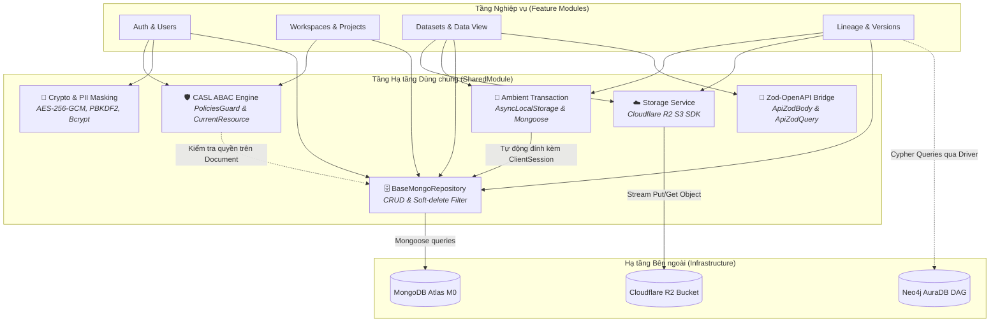

# SHARED ARCHITECTURE & CROSS-CUTTING FOUNDATION

## 1. Tổng quan & Vị trí trong Hệ sinh thái (Overview & System Context)
Module `shared` là khung xương sống hạ tầng (Infrastructural Backbone) của toàn bộ hệ thống. Module này tập trung giải quyết các bài toán kỹ thuật dùng chung (Cross-cutting Concerns) theo chuẩn Enterprise, cung cấp các khối xây dựng cốt lõi (Building Blocks) cho toàn bộ 9 Feature Modules (`auth`, `users`, `workspaces`, `projects`, `datasets`, `data-view`, `versions`, `lineage`, `clean-rules`).

- **Các Trụ cột Hạ tầng Chính:**
  - **Phân quyền Thuộc tính Thực thể CASL (ABAC/PBAC):** Phân quyền động theo ngữ cảnh Workspace và giải quyết triệt để lỗi truy vấn CSDL 2 lần (Double Database Query).
  - **Quản lý Giao dịch CSDL Ngầm (Ambient Mongo Transaction):** Tự động lan truyền phiên `ClientSession` qua `AsyncLocalStorage` mà không cần truyền biến thủ công qua từng tầng hàm.
  - **Lưu trữ Đối tượng Đa chế độ (Object Storage):** Tích hợp Cloudflare R2 / AWS S3 tương thích S3 API kèm cơ chế kiểm soát hạn ngạch lưu trữ (Quota Guard 10GB).
  - **Mật mã học & Bảo mật Thông tin Nhạy cảm (Crypto & PII):** Mã hóa luồng AES-256-GCM (PBKDF2 100.000 vòng lặp), băm SHA-256, che giấu dữ liệu PII trong nhật ký hệ thống.
  - **Tự động hóa Swagger từ Zod (OpenAPI Bridge):** Tự động sinh tài liệu Swagger UI từ Zod Schema mà không cần `class-validator`.

---

## 2. Kiến trúc Hạ tầng & Luồng Tương tác Trực quan (Architecture & Subsystems)
Sơ đồ kết nối giữa các Feature Modules, Khung hạ tầng `shared` và các dịch vụ cơ sở hạ tầng bên ngoài:



---

## 3. Khái niệm Cốt lõi & Mô hình Nghiệp vụ (Domain Concepts & Patterns)

### 3.1. Phân quyền Thuộc tính Thực thể CASL (ABAC vs RBAC tĩnh)
- **Hạn chế của RBAC tĩnh:** Không thể kiểm soát ngữ cảnh: *"Người dùng A có vai trò Editor ở Workspace 1 nhưng không có quyền can thiệp vào Project của Workspace 2"*.
- **Giải pháp CASL Ability:** `CaslAbilityFactory` kết hợp với `PoliciesGuard` đánh giá quyền dựa trên điều kiện của thuộc tính thực thể `{ workspace_id: user.workspaceId }`.
- **Khắc phục lỗi Double Database Query:** Bằng cách sử dụng `@PolicyResource()` và `@CurrentResource()`, thực thể sau khi được Guard nạp từ CSDL để kiểm tra quyền sẽ được đính kèm trực tiếp vào `request.resource`. Handler trong Controller chỉ việc lấy ra sử dụng, tiết kiệm 50% số lượng truy vấn CSDL.

### 3.2. Quản lý Giao dịch Ngầm (Ambient Transaction via AsyncLocalStorage)
- **Vấn đề truyền thống:** Bắt buộc phải truyền biến `session: ClientSession` qua 4-5 tầng hàm gọi nhau (`Service -> Repository -> Helper`), làm ô nhiễm signature của hàm và dễ gây quên session dẫn đến rò rỉ dữ liệu ngoài transaction.
- **Giải pháp AsyncLocalStorage:** `MongooseTransactionService.runInTransaction(async () => { ... })` lưu trữ session trong ngữ cảnh luồng thực thi ngầm (`AsyncLocalStorage`). Mọi phương thức trong `BaseMongoRepository` tự động phát hiện và đính kèm session nếu đang chạy trong transaction.

### 3.3. Bảo mật Thông tin Nhạy cảm (PII Masking & Log Sanitization)
Tuân thủ nghiêm ngặt **WORKING RULE (Mục 6 - Bảo mật)**:
- Không bao giờ in ra console email, số điện thoại hoặc token ở dạng thô.
- `maskEmail('user@gmail.com')` $\rightarrow$ `us***@gmail.com`.
- `maskPhone('0901234567')` $\rightarrow$ `090*****67`.
- Hàm `sanitizeObjectForLog(obj)` đệ quy làm sạch object trước khi chuyển vào Logger.

---

## 4. Ma trận Đường ống Bảo vệ (Zero-Trust Guarding Pipeline)
Mỗi yêu cầu HTTP đi vào hệ thống đều phải đi qua chuỗi lọc bảo mật đa tầng:

```
Request 
  ──► JwtAuthGuard (Xác thực danh tính / Bỏ qua nếu có @Public)
  ──► PoliciesGuard (Kiểm tra quyền CASL trên Resource)
  ──► ZodValidationPipe (Kiểm thực và ép kiểu Schema)
  ──► Controller Handler (Xử lý logic nghiệp vụ)
  ──► LoggingInterceptor (Ghi log an toàn đã mask PII)
  ──► Response
```

---

## 5. Danh mục Providers & Tiện ích Xuất bản (Exported Contracts)

| Provider / Utility | Thư mục | Mục đích Nghiệp vụ |
| :--- | :--- | :--- |
| `CaslAbilityFactory` | `src/shared/casl/` | Tạo đối tượng `AppAbility` tương ứng với vai trò và ngữ cảnh người dùng |
| `PoliciesGuard` | `src/shared/casl/` | Guard kiểm tra quyền hạn đa tầng (Static $\rightarrow$ Instance) |
| `@CurrentResource()` | `src/shared/casl/` | Decorator inject thực thể đã nạp trong Guard vào Controller |
| `MongooseTransactionService` | `src/shared/database/` | Dịch vụ bọc khối lệnh trong MongoDB Multi-document Transaction |
| `BaseMongoRepository<T>` | `src/shared/database/` | Lớp cơ sở trừu tượng cho Repository, tự động lọc `deleted_at: null` |
| `StorageService` | `src/shared/storage/` | Dịch vụ tải tệp, kiểm tra hạn mức Quota 10GB trên Cloudflare R2 |
| `CryptoUtil` | `src/shared/crypto/` | Tiện ích băm Bcrypt, SHA-256, mã hóa dòng AES-256-GCM |
| `sanitizeObjectForLog` | `src/shared/crypto/` | Làm sạch đối tượng trước khi log (ẩn password, token, PII) |
| `@ApiZodBody()`, `@ApiZodQuery()` | `src/shared/swagger/` | Tự động sinh đặc tả OpenAPI 3.0 cho Swagger UI từ Zod Schema |

---

## 6. Đánh đổi Kỹ thuật & Lịch sử Phiên bản (Trade-offs & Changelog)

### 6.1. Đánh đổi Kỹ thuật (Technical Trade-offs)
- **AsyncLocalStorage cho Transaction:** Mang lại kiến trúc code cực kỳ sạch sẽ và an toàn, nhưng phụ thuộc vào tính năng ngữ cảnh bất đồng bộ của Node.js runtime (tương thích hoàn toàn từ Node.js v16+).
- **Zod-to-JSON-Schema thay cho Class-Validator:** Loại bỏ hoàn toàn sự phụ thuộc vào decorator reflection và cho phép suy diễn kiểu dữ liệu 100% tự nhiên (`z.infer<typeof Schema>`), đáp ứng tuyệt đối nguyên tắc **Zero Any**.

### 6.2. Lịch sử Thay đổi (Change Log)
- `v1.3.0` (2026-10-24):
  - *Thay đổi gì:* Nâng cấp tài liệu sang chuẩn kiến trúc trực quan, bổ sung sơ đồ Mermaid liên kết các phân hệ và mô tả chuỗi lọc bảo vệ Zero-Trust.
  - *Lý do:* Giúp người xem nắm bắt nền tảng kỹ thuật của toàn bộ dự án mà không cần đọc code.
- `v1.2.0` (2026-10-21):
  - *Thay đổi gì:* Tích hợp CASL ABAC, Zod-OpenAPI Swagger Bridge, AsyncLocalStorage Mongo Transaction và PII Masking.
- `v1.0.0` (2026-10-20):
  - *Thay đổi gì:* Khởi tạo khung hạ tầng shared, CryptoUtil, StorageService và BaseMongoRepository.
