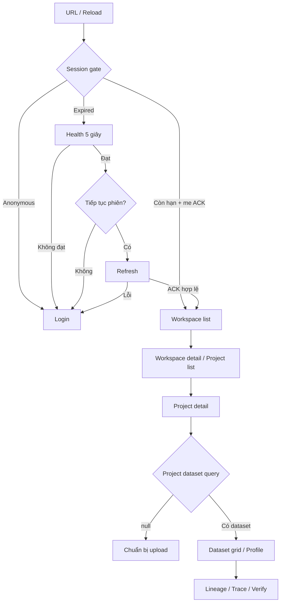

# Screen flow — Màn hình và hành vi điều hướng

Ngày: 26/10/2026. Trạng thái: đặc tả/prompt, chưa dựng route hoặc màn hình nghiệp vụ. Dành cho 2 người FE. Các route từ architecture được giữ làm mục tiêu; việc đã có route trong tài liệu không đồng nghĩa đã có route runtime.

Tham chiếu [Foundation](foundation-spec.md), [Shared UI](shared-ui.md), [Master plan](master-plan.md) và [plan 9 module](modules/00-contract-audit.md). FE A sở hữu router/layout; FE B triển khai view domain mình phụ trách qua boundary đã bàn giao. Không để FE A/B tự chọn hai cách điều hướng khác nhau cho cùng action.

## 1. Mục tiêu và hiện trạng

Hiện chỉ có startup UI trong App, chưa có router/auth. Đích của đặc tả: biết mỗi màn hình lấy dữ liệu gì, chặn lúc nào, sau mỗi action điều hướng ra sao và phần nào chưa đủ contract. Không thêm dashboard/AI/chat/chức năng demo vì cần lấp màn hình.

Trong tài liệu: **Đã chốt** là policy được xác nhận trước; **Đề xuất kỹ thuật** là cách chia responsibility, không tạo business mới; **UX-Pxx chờ xác nhận** là lựa chọn hành vi chưa được duyệt, chưa triển khai nhánh đó. Không đưa UX pending thành expected outcome duy nhất trong test.

## 2. Đặc tả sáu mục

| Mục | Quy định |
|---|---|
| Đầu vào | URL/params, session phase, account/resource identity, query state, user action và server ACK |
| Điều kiện | Public/private guard thật; không render resource riêng tư khi bootstrap/expired; chỉ action có API và quyền đã xác nhận |
| Xử lý | URL → guard → layout → route entry → view/hook → service; action ACK cập nhật cache và điều hướng theo policy đã chốt/UX được duyệt |
| Đầu ra | Màn hình/region đúng resource và loading/empty/error/denied; không redirect im lặng sang dữ liệu khác để che lỗi |
| Xếp loại | Public, private, session-blocked, resource-error, local-limited; không đồng nhất error/empty/forbidden |
| Thứ tự | Auth trước resource; workspace trước project list, project trước dataset context; session/selection generation trước response commit |

## 3. Sitemap và route registry

Các path là URL browser, không phải API path. Router khai báo explicit; không tự dùng import.meta.glob như SGOD.

| Route mục tiêu | Màn hình / owner | Dữ liệu cần | Gate/trạng thái |
|---|---|---|---|
| `/` | Chọn entry / FE A | Session state | Đã chốt: phiên hợp lệ → workspaces, không có phiên → login; bootstrap phải chờ |
| `/auth/login` | Login / FE A | Không private query; login service khi submit | Public-only guard; lỗi credential ở form |
| `/auth/register` | Register / FE A | Register schema | Role policy phải BE xác nhận trước phát hành; không tự gửi role admin |
| `/workspaces` | Workspace list / FE A | GET workspaces | Empty/ready/error riêng; scene workspace ở batch graphics sau |
| `/workspaces/:workspaceId` | Workspace detail + project list / FE A | GET workspace, GET projects theo id | 403/404 không fallback workspace khác; không hứa projectCount chưa có |
| `/projects/:projectId` | Project detail + dataset region / FE A + FE B | GET project, GET project datasets | Dataset null khác lỗi; Project.has_dataset không cung cấp datasetId |
| `/datasets/:datasetId` | Grid/profile/dataset metadata / FE B | GET dataset/schema/records; stats khi chọn cột | Cursor không fake page-jump/sort/filter; bố cục pane UX-P04 |
| `/datasets/:datasetId/lineage` | Graph/trace/verify / owner chỉ định | GET lineage, trace/verify theo action | Graph 404 không coi dataset đã xóa; history/rollback không có action |
| `/account` | Profile / FE A | GET me, PATCH khi submit | Update ACK mới thông tin chính thức; delete account UI chưa duyệt |
| `/account/sessions` | Session list / FE A | GET sessions | Revoke action theo API; không hứa access token cũ mất hiệu lực ngay |
| `/sync` | Draft/operation local / owner chỉ định | Account-scoped repositories | Chỉ thêm route runtime sau storage spec/batch; không route giả dữ liệu |
| Route không tồn tại | Not-found / FE A | Không private resource tự đoán | Đích nút quay lại UX-P08; không loop redirect |

Transformation/Export chưa có path API, chưa bổ sung URL màn hình thực thi. Data 3D mapping chưa đặc tả; không tự tạo route axes editor và sample dataset demo.

## 4. Luồng nhìn toàn ứng dụng



Sơ đồ mô tả liên kết chức năng. Sau refresh đang ở resource route hợp lệ thì không ép luôn về workspaces; return-target policy cụ thể là UX-P01. Không dùng sơ đồ đơn giản làm lý do phá browser history/resource context. Trường hợp API lỗi nhưng token còn hạn là local-limited theo Foundation, chỉ dùng feature local đã được duyệt và thật sự triển khai.

## 5. Bảng action → hiệu ứng → điều hướng

| Action | Hiệu ứng đã rõ | Điều hướng |
|---|---|---|
| Login ACK | Persist StoredSession, lấy/đặt user qua contract, clear state cũ | Entry default workspaces; quay lại URL đang định vào là UX-P01 |
| Refresh ACK | Phiên mới cùng account, read flow có thể resume | Giữ intent resource nếu còn hợp lệ; cách lưu return target UX-P01 |
| Từ chối/refresh lỗi/expired+outage | Clear credential/cache; giữ draft | Đã chốt về login, không private UI |
| Select workspace/project/dataset | Đổi URL và resource identity; bỏ response/selection scope cũ | Sang route tương ứng trong registry |
| Create workspace/project ACK | List/detail cache cập nhật từ server id | Ở list hay mở detail mới: UX-P02 |
| Update profile/resource ACK | Update/refetch cùng resource; form baseline mới | Đề xuất ở màn hiện tại, cần duyệt UX-P02 cho dialog close/focus |
| Upload dataset ACK | Refetch project/dataset; graph chưa chắc có | Ở project hay mở dataset mới: UX-P03 |
| Dataset delete ACK | Clear dataset selection/queries, refetch project | Về project cha đã xác nhận id; fallback nếu cha không có/denied: UX-P08 |
| Workspace/project delete ACK | Bỏ resource selection, refetch list | Parent list/context hợp lệ; fallback UX-P08, không suy cascade |
| Graph node selection | Trace query theo raw id được xác nhận | Đổi panel, không tự navigate sang version page chưa có contract |
| Local upload/delete commit | Saved-local, pending; không đổi resource server thành ACK | Vị trí mở sync panel/route: UX-P06 |
| Cancel pending operation | Chỉ hủy trước gửi theo policy sync | Giữ resource context; thao tác đang gửi không hứa server đã hủy |

Nút Back của browser không phải “navigate(-1)” mặc định cho mọi nút về cha: deep link có thể không có history cùng ứng dụng. Quy tắc breadcrumb/parent-link là UX-P08, chưa tự tạo path từ id không có.

## 6. Màn hình và trạng thái chuẩn

### Public/auth

Login có email/password và submit loading/error, không preset secret. Public page không render user/draft cũ. Khi token expired nhưng health đang kiểm tra hoặc consent đang chờ, private content bị chặn; dialog gia hạn không là background refresh âm thầm.

### Workspace/Project

Public guard không thay resource permission. Detail query fail thì region dựa tài nguyên đó không hiển thị dữ liệu scope trước. Project dataset null hiện empty upload region; dataset query lỗi không hiện “chưa có dataset”. Create/write chỉ sau server ACK, không auto queue ngoài whitelist.

### Dataset/Grid/Profile/Lineage

Giữ dataset identity xuyên region; chọn cột chỉ fetch stats cột đó, đổi dataset reset selection. Data-grid row selection và scene selection qua cùng identity contract, không dùng vị trí mảng. Graph lỗi không phá dữ liệu bảng; 3D renderer lỗi có DOM fallback. Bố cục pane, tabs và panel fullscreen cần UX-P04 trước UI code.

### Local-limited/Sync

Banner phân biệt “API chưa khả dụng” với “không có Internet” hoặc “thiếu quyền”. Không có IndexedDB implementation thì không hiển thị draft đã lưu giả. Các operation cần phân biệt pending/sending/conflict/synced và account scope. Draft pending nằm ở local không đồng nghĩa route dataset server mới tồn tại.

## 7. Các lựa chọn UX chưa được xác nhận

Đây là đề xuất để người dùng chọn, **chưa là yêu cầu implementation**:

| ID | Cần chốt | Phương án đề xuất | Trade-off / lựa chọn khác |
|---|---|---|---|
| UX-P01 | Return target sau login/refresh và refresh deep link | Giữ relative URL nội bộ hợp lệ cho cùng phiên/account; login không có target → workspaces | Cần chặn external/invalid target; đơn giản hơn là luôn workspaces nhưng mất context |
| UX-P02 | Sau create/update và đóng dialog | Create ở list, highlight item thật; update ở trang hiện tại và trả focus về trigger | Auto mở detail tiện tiếp tục nhưng đổi flow/historical navigation |
| UX-P03 | Sau upload ACK | Mở dataset route bằng server id | Ở lại project giúp xem summary; cần quyết định để hai người tích hợp cùng flow |
| UX-P04 | Dataset layout | Bảng trung tâm, profile side panel, lineage có route riêng | Tabs đơn giản hơn; 3D pane chưa chốt mapping/visual |
| UX-P05 | Rời form/draft memory chưa lưu | Hỏi bỏ thay đổi trước điều hướng nội bộ, không auto lưu | Thêm bước; không có prompt đơn giản hơn nhưng có thể mất input; browser close/reload policy cần chốt riêng |
| UX-P06 | Vị trí thao tác chờ sync | Banner/link tới `/sync`, không redirect ngay khi commit local | Inline panel đỡ đổi trang nhưng có thể khó thấy toàn queue |
| UX-P07 | Sidebar/header responsive | Desktop sidebar; màn hẹp dùng nav có thể mở/đóng; DOM luôn dùng được khi scene lỗi | Breakpoint/kích thước/visual chưa chốt, không tự thêm menu ngoài feature đã có |
| UX-P08 | Breadcrumb/back/fallback | Parent link tường minh từ data đã xác nhận; cha không hợp lệ → list root có quyền | Không dùng history.back mù; chi tiết UX khi denied cần người dùng duyệt |

Không bắt đầu code nhánh có ID pending trước xác nhận. Tài liệu có thể hoàn tất việc mô tả phương án/gate nhưng chưa gọi toàn bộ screen flow là decision-complete.

## 8. File/interface bàn giao

- FE A: route registry + param parsing + guard + app shell/breadcrumb boundary trong `app/router`, `app/context`, `app/pages`, `app/layout.tsx`.
- FE B: dataset/grid/profile view nhận resource identity và callbacks; không tạo BrowserRouter thứ hai hoặc tự thay toàn layout để gắn scene.
- Page entry compose view; view không tự mount provider. Shared callbacks: select resource, request parent navigation, report selection, trigger dialog; type cụ thể chốt cùng owner khi code, không truyền navigate function khắp component chỉ để lách router.
- Query/resource state và session state tách biệt. URL là nguồn resource selection, memory state không được hiển thị dataset khác URL.

## 9. Test case dự kiến

| Mã | Nhóm | Sự kiện | Kết quả mong đợi | Lý do |
|---|---|---|---|---|
| S01 | Thường | Login default thành công | Route workspaces sau auth; không giả return target chưa duyệt | Entry |
| S02 | Đặc biệt | Reload private deep link | Chờ bootstrap; không flash account/resource cũ | Guard |
| S03 | Không hợp lệ | Private route khi anonymous | Login; không gọi private write | Auth |
| S04 | Biên | Token hết hạn trong view | Dừng nghiệp vụ; health/consent hoặc login đúng policy | Expiry |
| S05 | Thường | Select W1→P1→D1 | URL/resource identity thống nhất | Cross-module |
| S06 | Đặc biệt | D1 response về sau chọn D2 | Không render D1 dưới D2 | Race |
| S07 | Đặc biệt | Project dataset null | Empty upload region, khác query error | Absence |
| S08 | Không hợp lệ | Query 403/404/500 | Denied/not-found/error rõ, không redirect dữ liệu khác | Error |
| S09 | Đặc biệt | Upload ACK | Follow UX-P03 sau khi duyệt; gate hiện tại, không expected redirect tự đặt | Pending UX |
| S10 | Đặc biệt | Browser back/deep link không history | Parent policy UX-P08; không external navigation ngầm | Navigation |
| S11 | Đặc biệt | Graph 404 sau ingestion ACK | Dataset còn, graph unavailable | Async |
| S12 | Đặc biệt | Scene context lỗi | DOM view vẫn dùng được | Fallback |
| S13 | Không hợp lệ | Transformation/export/rollback chưa có API | Không nút/path thực thi giả | Capability |
| S14 | Đặc biệt | Pending local commit | Saved-local, không dataset server route giả; UX-P06 gate | Sync |
| S15 | Đặc biệt | Form dirty rồi rời trang | Theo UX-P05 sau khi duyệt; hiện chưa tự thêm guard | Pending UX |
| S16 | Không hợp lệ | External return target, unknown URL | Không tự chuyển ra ngoài; not-found/gate theo policy đã duyệt | URL safety |

Empty states áp dụng list/record; NaN/Infinity của params phải được parsing boundary chặn khi field số thật sự có contract. Không tự validate resource id như số. Case S09/S10/S14/S15 còn phụ thuộc UX; chưa chạy các case.

## 10. Pseudocode và dò tay

```text
URL thay đổi:
  session gate trước render private
  parse resource params → query account/resource
  capture identity; response chỉ commit khi URL/account còn khớp
  render loading/ready/empty/denied/not-found/error đúng nguồn
action:
  kiểm tra capability/permission và session
  NẾU UX quyết định chưa duyệt: dừng batch phần đó
  gửi service theo contract
  ACK → invalidate/cache → navigate theo transition đã duyệt
  timeout/error → không success/redirect giả, giữ lỗi/resource context
```

Dò tay thường: W1 project list → chọn P1 → GET project và dataset → dataset null → empty upload, không route D giả. Dò tay biên: đang URL D2, response D1 về → bỏ; không đổi heading/bảng D2. Chưa thực thi FE/browser.

## 11. Prompt triển khai chi tiết

```text
CONTEXT
Nhóm 2 người làm React 19.3.1/TS 6.0.3/Vite 8/Yarn; entry src/app/main.tsx, router folder có sẵn nhưng chưa implementation. Đọc screen-flow.md, foundation-spec.md, shared-ui.md và module plan liên quan.

TASK
Chỉ triển khai screen/transition thuộc batch đã được duyệt. FE A sở hữu router/layout, FE B nhận resource/callback contract cho Dataset/Visualization. Không thêm dashboard demo, route export/rollback hoặc backend mock để hoàn thiện UI giả.

INPUT
Route registry mục 3, session phase Foundation, response theo DTO/service ở audit, transition mục 5 và quyết định UX-P01–P08 đã được người dùng xác nhận. ID nào chưa xác nhận phải báo gate, không tự chọn phương án đề xuất.

CONSTRAINTS
Explicit routing, một router/provider chain. URL identity phải khớp data; không flash private content khi bootstrap/expired. Loading/empty/error/403/404 tách biệt. Page compose view, component không gọi API. Back/parent từ dữ liệu đã xác nhận, không suy id hoặc external target. Không sửa BE, .env, dependency ngoài batch.

PSEUDOCODE
Theo mục 10; ACK trước navigate success, response stale không commit. Health/consent theo Foundation, không refresh âm thầm.

EXAMPLES
Project dataset null → empty upload, không xem là lỗi; GET lỗi mạng → error, không empty. D1 request trả về sau URL D2 → bỏ D1. Upload ACK → chỉ điều hướng theo UX-P03 đã duyệt; nếu chưa thì dừng phần transition đó.

OUTPUT
Patch file/route/view đã duyệt, code trọng tâm và giải thích một luồng xuyên màn hình, mở diff. Báo build/lint/test và browser/API evidence riêng; liệt kê nhánh chưa có contract hoặc UX decision.

CRITERIA
S01–S16 áp dụng batch; không giả pass case pending. Điều hướng browser back/reload/select resource phải cùng account/context. Layout/scene lỗi không phá form/bảng DOM.
```

## 12. Log và trạng thái bàn giao

Yêu cầu mục 1, spec mục 2–8, test mục 9, pseudocode mục 10, prompt mục 11 là bước 1–5. Code AI, runtime/browser tests và quyết định nhận code chưa thực hiện. Tiếp theo review UX-P01–P08 rồi mới lập batch route cụ thể. Không tự triển khai chỉ vì file plan đã được tạo.
